# SDK 5 benchmark

<!-- markdownlint-configure-file {"MD024": {"siblings_only": true}, "MD033": {"allowed_elements": ["details", "summary", "table", "thead", "tbody", "tr", "th", "td", "strong"]}} -->

October–November 2026 · Holoscan `5.0.0a3 (public EA3)` · **48 configurations, 74 camera results**.

SDK 5 measurements collected 2026-10-17 / 2026-11-17 on public EA3. The SDK 4 baseline is retained from October 2, 2026.

HSB capture runs SDK 4.6.0; its coordinator and surgeon run SDK 5. All other refreshed sources run SDK 5.

H.264/H.265 results, and every Logitech BRIO and IMX274 result, were measured on 2026-11-17 with the bitrate-limited encoder defaults. Simulation nvJPEG and BGR8 results are from 2026-10-17; that code path and scene are unchanged. [Encoder defaults before and after](docs/BENCHMARK_ENCODING.md) compares the same configurations with the former constant-QP defaults.

Compare resolutions and codecs for each patient source. **The surgeon always runs on the x86 workstation.** The main tables use Holoviz; [WebRTC](#appendix-webrtc) is in the appendix. [SDK 4 report](docs/BENCHMARK_SDK4.md) · [SDK comparison](docs/BENCHMARK_COMPARISON.md).

[Measurements](benchmarks/results/summary.csv) · [Matched-frame breakdowns](benchmarks/results/stages.csv) · [Raw records](benchmarks/results/matrix/) · [Hardware details](benchmarks/results/matrix/hardware-ea3.json)

## Sources and hosts

Titles identify the patient and surgeon roles. **x86** is the Host Machine described below.

| Patient → Surgeon | Scenario | Camera |
| ----------------------------------- | ------------------------ | ------------------------ |
| x86 (Patient) → x86 (Surgeon) | Same host · Simulation | MIRA procedure and room |
| x86 (Patient) → x86 (Surgeon) | Same host · Physical | Logitech BRIO webcam |
| Thor (Patient) → x86 (Surgeon) | Remote host · Physical | IMX274 via HSB, sensor 0 |
| DGX Spark (Patient) → x86 (Surgeon) | Remote host · Simulation | MIRA procedure and room |

Both MIRA cameras stream simultaneously.

Same-host tests run patient and surgeon on the same physical workstation. Remote patient nodes capture, encode and send directly to the surgeon. The patient dashboard/coordinator runs on the x86 workstation in all tests; it does not relay remote video.

| Host | Hardware | Ethernet link |
| --------- | --------------------------------------------------------------------------------------------------- | ------------: |
| x86 | x86_64 · Intel Core i9-14900K · NVIDIA RTX PRO 6000 Blackwell GPUs (Workstation and Max-Q editions) | 10 Gbit/s |
| Thor | ARM64 · NVIDIA Thor | 5 Gbit/s |
| DGX Spark | ARM64 · NVIDIA GB10 | 10 Gbit/s |

Link rates are the negotiated Ethernet speeds during testing.

| Resolution | Name | Pixels |
| ---------- | -------------- | --------- |
| FHD | Full HD | 1920×1080 |
| QHD | Quad HD | 2560×1440 |
| 4K | Ultra HD (UHD) | 3840×2160 |

MIRA and BRIO request 30 FPS; IMX274 requests 60 FPS in its native FHD and 4K modes. QHD has no IMX274 result. H.265 is tested only at 4K.

## Reading the charts and tables

Latency is in **milliseconds**. **RES** = resolution; **CC** = codec; **FPS** = viewer frame rate; **FS** = mean transport frame size.

**Total** is measured end-to-end latency, including preparation, queues and display handoff. Table stages are independent percentiles; they need not sum to Total. For BGR8, Encode/Decode mean packing/upload.

<details open>
<summary>

## x86 (Patient) → x86 (Surgeon): MIRA Procedure Camera

</summary>

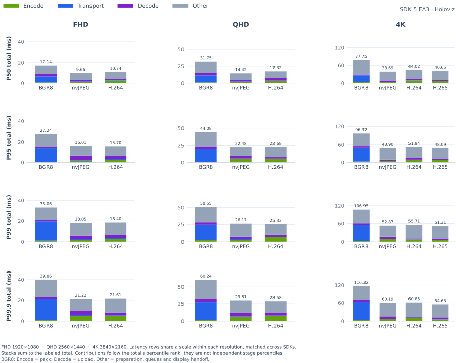

<details>
<summary>

### P50

</summary>

<table>
    <thead>
        <tr><th align="left">RES</th><th align="left">CC</th><th align="right">FPS</th><th align="right">FS</th><th align="right">Encode (ms)</th><th align="right">Transport (ms)</th><th align="right">Decode (ms)</th><th align="right">Total (ms)</th></tr>
    </thead>
    <tbody>
        <tr><td rowspan="3">FHD</td><td>BGR8</td><td align="right">29.55</td><td align="right">5.93 MiB</td><td align="right">0.53</td><td align="right">5.58</td><td align="right">1.37</td><td align="right">17.14</td></tr>
        <tr><td>nvJPEG</td><td align="right">28.58</td><td align="right">106.3 KiB</td><td align="right">1.41</td><td align="right">0.40</td><td align="right">1.32</td><td align="right">9.66</td></tr>
        <tr><td><strong>H.264</strong></td><td align="right"><strong>28.96</strong></td><td align="right"><strong>35.3 KiB</strong></td><td align="right"><strong>2.33</strong></td><td align="right"><strong>0.33</strong></td><td align="right"><strong>1.07</strong></td><td align="right"><strong>10.74</strong></td></tr>
        <tr><td rowspan="3">QHD</td><td>BGR8</td><td align="right">28.60</td><td align="right">10.55 MiB</td><td align="right">1.15</td><td align="right">11.64</td><td align="right">2.57</td><td align="right">31.75</td></tr>
        <tr><td>nvJPEG</td><td align="right">27.63</td><td align="right">163.3 KiB</td><td align="right">2.20</td><td align="right">0.45</td><td align="right">1.93</td><td align="right">14.42</td></tr>
        <tr><td><strong>H.264</strong></td><td align="right"><strong>28.25</strong></td><td align="right"><strong>56.5 KiB</strong></td><td align="right"><strong>3.92</strong></td><td align="right"><strong>0.36</strong></td><td align="right"><strong>1.90</strong></td><td align="right"><strong>17.32</strong></td></tr>
        <tr><td rowspan="4">4K</td><td>BGR8</td><td align="right">14.61</td><td align="right">23.73 MiB</td><td align="right">1.65</td><td align="right">27.43</td><td align="right">4.58</td><td align="right">77.75</td></tr>
        <tr><td>nvJPEG</td><td align="right">15.50</td><td align="right">309.1 KiB</td><td align="right">3.73</td><td align="right">0.72</td><td align="right">4.15</td><td align="right">38.69</td></tr>
        <tr><td><strong>H.264</strong></td><td align="right"><strong>14.73</strong></td><td align="right"><strong>98.7 KiB</strong></td><td align="right"><strong>8.21</strong></td><td align="right"><strong>0.42</strong></td><td align="right"><strong>3.19</strong></td><td align="right"><strong>44.02</strong></td></tr>
        <tr><td><strong>H.265</strong></td><td align="right"><strong>15.31</strong></td><td align="right"><strong>104.5 KiB</strong></td><td align="right"><strong>5.62</strong></td><td align="right"><strong>0.43</strong></td><td align="right"><strong>2.86</strong></td><td align="right"><strong>40.65</strong></td></tr>
    </tbody>
</table>

</details>

<details>
<summary>

### P95

</summary>

<table>
    <thead>
        <tr><th align="left">RES</th><th align="left">CC</th><th align="right">FPS</th><th align="right">FS</th><th align="right">Encode (ms)</th><th align="right">Transport (ms)</th><th align="right">Decode (ms)</th><th align="right">Total (ms)</th></tr>
    </thead>
    <tbody>
        <tr><td rowspan="3">FHD</td><td>BGR8</td><td align="right">29.55</td><td align="right">5.93 MiB</td><td align="right">1.21</td><td align="right">12.87</td><td align="right">2.98</td><td align="right">27.24</td></tr>
        <tr><td>nvJPEG</td><td align="right">28.58</td><td align="right">106.3 KiB</td><td align="right">2.45</td><td align="right">0.82</td><td align="right">3.99</td><td align="right">16.01</td></tr>
        <tr><td><strong>H.264</strong></td><td align="right"><strong>28.96</strong></td><td align="right"><strong>35.3 KiB</strong></td><td align="right"><strong>3.46</strong></td><td align="right"><strong>0.55</strong></td><td align="right"><strong>3.58</strong></td><td align="right"><strong>15.70</strong></td></tr>
        <tr><td rowspan="3">QHD</td><td>BGR8</td><td align="right">28.60</td><td align="right">10.55 MiB</td><td align="right">2.65</td><td align="right">19.70</td><td align="right">4.47</td><td align="right">44.08</td></tr>
        <tr><td>nvJPEG</td><td align="right">27.63</td><td align="right">163.3 KiB</td><td align="right">5.34</td><td align="right">0.76</td><td align="right">4.52</td><td align="right">22.48</td></tr>
        <tr><td><strong>H.264</strong></td><td align="right"><strong>28.25</strong></td><td align="right"><strong>56.5 KiB</strong></td><td align="right"><strong>6.16</strong></td><td align="right"><strong>0.52</strong></td><td align="right"><strong>4.22</strong></td><td align="right"><strong>22.68</strong></td></tr>
        <tr><td rowspan="4">4K</td><td>BGR8</td><td align="right">14.61</td><td align="right">23.73 MiB</td><td align="right">4.22</td><td align="right">46.17</td><td align="right">9.62</td><td align="right">96.32</td></tr>
        <tr><td>nvJPEG</td><td align="right">15.50</td><td align="right">309.1 KiB</td><td align="right">6.23</td><td align="right">1.45</td><td align="right">6.37</td><td align="right">48.90</td></tr>
        <tr><td><strong>H.264</strong></td><td align="right"><strong>14.73</strong></td><td align="right"><strong>98.7 KiB</strong></td><td align="right"><strong>10.83</strong></td><td align="right"><strong>0.61</strong></td><td align="right"><strong>5.08</strong></td><td align="right"><strong>51.94</strong></td></tr>
        <tr><td><strong>H.265</strong></td><td align="right"><strong>15.31</strong></td><td align="right"><strong>104.5 KiB</strong></td><td align="right"><strong>8.48</strong></td><td align="right"><strong>0.59</strong></td><td align="right"><strong>4.82</strong></td><td align="right"><strong>48.09</strong></td></tr>
    </tbody>
</table>

</details>

<details open>
<summary>

### P99

</summary>

<table>
    <thead>
        <tr><th align="left">RES</th><th align="left">CC</th><th align="right">FPS</th><th align="right">FS</th><th align="right">Encode (ms)</th><th align="right">Transport (ms)</th><th align="right">Decode (ms)</th><th align="right">Total (ms)</th></tr>
    </thead>
    <tbody>
        <tr><td rowspan="3">FHD</td><td>BGR8</td><td align="right">29.55</td><td align="right">5.93 MiB</td><td align="right">1.46</td><td align="right">17.17</td><td align="right">3.51</td><td align="right">33.06</td></tr>
        <tr><td>nvJPEG</td><td align="right">28.58</td><td align="right">106.3 KiB</td><td align="right">4.23</td><td align="right">1.29</td><td align="right">4.47</td><td align="right">18.05</td></tr>
        <tr><td><strong>H.264</strong></td><td align="right"><strong>28.96</strong></td><td align="right"><strong>35.3 KiB</strong></td><td align="right"><strong>4.20</strong></td><td align="right"><strong>0.87</strong></td><td align="right"><strong>3.97</strong></td><td align="right"><strong>18.40</strong></td></tr>
        <tr><td rowspan="3">QHD</td><td>BGR8</td><td align="right">28.60</td><td align="right">10.55 MiB</td><td align="right">3.08</td><td align="right">23.69</td><td align="right">5.13</td><td align="right">50.55</td></tr>
        <tr><td>nvJPEG</td><td align="right">27.63</td><td align="right">163.3 KiB</td><td align="right">7.16</td><td align="right">1.13</td><td align="right">4.95</td><td align="right">26.17</td></tr>
        <tr><td><strong>H.264</strong></td><td align="right"><strong>28.25</strong></td><td align="right"><strong>56.5 KiB</strong></td><td align="right"><strong>7.38</strong></td><td align="right"><strong>0.68</strong></td><td align="right"><strong>4.80</strong></td><td align="right"><strong>25.33</strong></td></tr>
        <tr><td rowspan="4">4K</td><td>BGR8</td><td align="right">14.61</td><td align="right">23.73 MiB</td><td align="right">4.98</td><td align="right">55.52</td><td align="right">11.04</td><td align="right">106.95</td></tr>
        <tr><td>nvJPEG</td><td align="right">15.50</td><td align="right">309.1 KiB</td><td align="right">8.62</td><td align="right">1.67</td><td align="right">7.83</td><td align="right">52.87</td></tr>
        <tr><td><strong>H.264</strong></td><td align="right"><strong>14.73</strong></td><td align="right"><strong>98.7 KiB</strong></td><td align="right"><strong>12.49</strong></td><td align="right"><strong>0.77</strong></td><td align="right"><strong>6.06</strong></td><td align="right"><strong>55.71</strong></td></tr>
        <tr><td><strong>H.265</strong></td><td align="right"><strong>15.31</strong></td><td align="right"><strong>104.5 KiB</strong></td><td align="right"><strong>10.42</strong></td><td align="right"><strong>0.79</strong></td><td align="right"><strong>5.08</strong></td><td align="right"><strong>51.31</strong></td></tr>
    </tbody>
</table>

</details>

<details open>
<summary>

### P99.9

</summary>

<table>
    <thead>
        <tr><th align="left">RES</th><th align="left">CC</th><th align="right">FPS</th><th align="right">FS</th><th align="right">Encode (ms)</th><th align="right">Transport (ms)</th><th align="right">Decode (ms)</th><th align="right">Total (ms)</th></tr>
    </thead>
    <tbody>
        <tr><td rowspan="3">FHD</td><td>BGR8</td><td align="right">29.55</td><td align="right">5.93 MiB</td><td align="right">2.48</td><td align="right">20.53</td><td align="right">4.09</td><td align="right">39.86</td></tr>
        <tr><td>nvJPEG</td><td align="right">28.58</td><td align="right">106.3 KiB</td><td align="right">6.29</td><td align="right">2.03</td><td align="right">5.14</td><td align="right">21.22</td></tr>
        <tr><td><strong>H.264</strong></td><td align="right"><strong>28.96</strong></td><td align="right"><strong>35.3 KiB</strong></td><td align="right"><strong>5.60</strong></td><td align="right"><strong>1.45</strong></td><td align="right"><strong>4.66</strong></td><td align="right"><strong>21.61</strong></td></tr>
        <tr><td rowspan="3">QHD</td><td>BGR8</td><td align="right">28.60</td><td align="right">10.55 MiB</td><td align="right">3.43</td><td align="right">27.14</td><td align="right">5.97</td><td align="right">60.24</td></tr>
        <tr><td>nvJPEG</td><td align="right">27.63</td><td align="right">163.3 KiB</td><td align="right">8.01</td><td align="right">1.58</td><td align="right">6.40</td><td align="right">29.81</td></tr>
        <tr><td><strong>H.264</strong></td><td align="right"><strong>28.25</strong></td><td align="right"><strong>56.5 KiB</strong></td><td align="right"><strong>8.61</strong></td><td align="right"><strong>1.08</strong></td><td align="right"><strong>5.70</strong></td><td align="right"><strong>28.58</strong></td></tr>
        <tr><td rowspan="4">4K</td><td>BGR8</td><td align="right">14.61</td><td align="right">23.73 MiB</td><td align="right">5.77</td><td align="right">64.32</td><td align="right">12.31</td><td align="right">116.32</td></tr>
        <tr><td>nvJPEG</td><td align="right">15.50</td><td align="right">309.1 KiB</td><td align="right">9.82</td><td align="right">1.97</td><td align="right">8.33</td><td align="right">60.19</td></tr>
        <tr><td><strong>H.264</strong></td><td align="right"><strong>14.73</strong></td><td align="right"><strong>98.7 KiB</strong></td><td align="right"><strong>13.30</strong></td><td align="right"><strong>0.94</strong></td><td align="right"><strong>7.75</strong></td><td align="right"><strong>60.85</strong></td></tr>
        <tr><td><strong>H.265</strong></td><td align="right"><strong>15.31</strong></td><td align="right"><strong>104.5 KiB</strong></td><td align="right"><strong>11.30</strong></td><td align="right"><strong>1.16</strong></td><td align="right"><strong>5.35</strong></td><td align="right"><strong>54.63</strong></td></tr>
    </tbody>
</table>

</details>

</details>

<details>
<summary>

## x86 (Patient) → x86 (Surgeon): MIRA Room Camera

</summary>

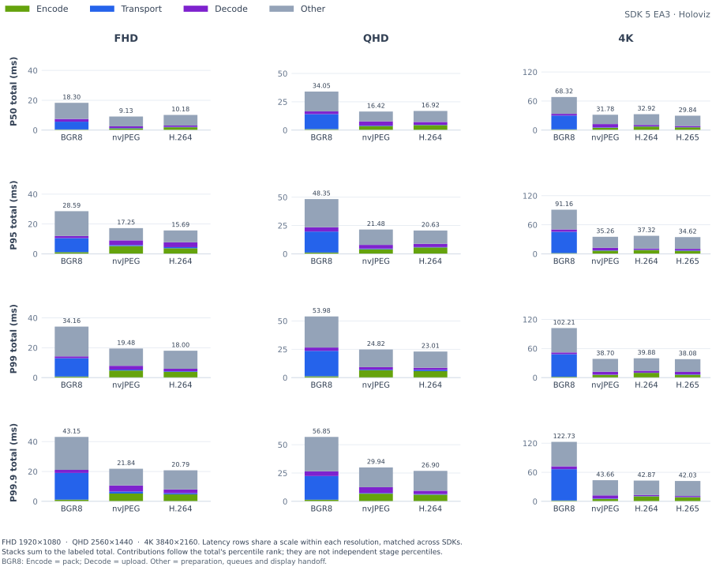

<details>
<summary>

### P50

</summary>

<table>
    <thead>
        <tr><th align="left">RES</th><th align="left">CC</th><th align="right">FPS</th><th align="right">FS</th><th align="right">Encode (ms)</th><th align="right">Transport (ms)</th><th align="right">Decode (ms)</th><th align="right">Total (ms)</th></tr>
    </thead>
    <tbody>
        <tr><td rowspan="3">FHD</td><td>BGR8</td><td align="right">29.56</td><td align="right">5.93 MiB</td><td align="right">0.53</td><td align="right">6.00</td><td align="right">1.46</td><td align="right">18.30</td></tr>
        <tr><td>nvJPEG</td><td align="right">28.56</td><td align="right">82.8 KiB</td><td align="right">1.28</td><td align="right">0.31</td><td align="right">1.20</td><td align="right">9.13</td></tr>
        <tr><td><strong>H.264</strong></td><td align="right"><strong>28.98</strong></td><td align="right"><strong>35.4 KiB</strong></td><td align="right"><strong>2.24</strong></td><td align="right"><strong>0.27</strong></td><td align="right"><strong>0.97</strong></td><td align="right"><strong>10.18</strong></td></tr>
        <tr><td rowspan="3">QHD</td><td>BGR8</td><td align="right">28.58</td><td align="right">10.55 MiB</td><td align="right">1.15</td><td align="right">10.92</td><td align="right">2.58</td><td align="right">34.05</td></tr>
        <tr><td>nvJPEG</td><td align="right">27.63</td><td align="right">131.6 KiB</td><td align="right">2.23</td><td align="right">0.38</td><td align="right">3.39</td><td align="right">16.42</td></tr>
        <tr><td><strong>H.264</strong></td><td align="right"><strong>28.46</strong></td><td align="right"><strong>56.6 KiB</strong></td><td align="right"><strong>4.04</strong></td><td align="right"><strong>0.31</strong></td><td align="right"><strong>2.19</strong></td><td align="right"><strong>16.92</strong></td></tr>
        <tr><td rowspan="4">4K</td><td>BGR8</td><td align="right">14.70</td><td align="right">23.73 MiB</td><td align="right">1.68</td><td align="right">28.58</td><td align="right">3.65</td><td align="right">68.32</td></tr>
        <tr><td>nvJPEG</td><td align="right">15.51</td><td align="right">263.1 KiB</td><td align="right">5.62</td><td align="right">0.57</td><td align="right">6.36</td><td align="right">31.78</td></tr>
        <tr><td><strong>H.264</strong></td><td align="right"><strong>14.83</strong></td><td align="right"><strong>102.0 KiB</strong></td><td align="right"><strong>7.77</strong></td><td align="right"><strong>0.36</strong></td><td align="right"><strong>3.25</strong></td><td align="right"><strong>32.92</strong></td></tr>
        <tr><td><strong>H.265</strong></td><td align="right"><strong>15.30</strong></td><td align="right"><strong>112.6 KiB</strong></td><td align="right"><strong>5.59</strong></td><td align="right"><strong>0.38</strong></td><td align="right"><strong>2.59</strong></td><td align="right"><strong>29.84</strong></td></tr>
    </tbody>
</table>

</details>

<details>
<summary>

### P95

</summary>

<table>
    <thead>
        <tr><th align="left">RES</th><th align="left">CC</th><th align="right">FPS</th><th align="right">FS</th><th align="right">Encode (ms)</th><th align="right">Transport (ms)</th><th align="right">Decode (ms)</th><th align="right">Total (ms)</th></tr>
    </thead>
    <tbody>
        <tr><td rowspan="3">FHD</td><td>BGR8</td><td align="right">29.56</td><td align="right">5.93 MiB</td><td align="right">1.24</td><td align="right">11.84</td><td align="right">2.96</td><td align="right">28.59</td></tr>
        <tr><td>nvJPEG</td><td align="right">28.56</td><td align="right">82.8 KiB</td><td align="right">4.87</td><td align="right">0.66</td><td align="right">3.69</td><td align="right">17.25</td></tr>
        <tr><td><strong>H.264</strong></td><td align="right"><strong>28.98</strong></td><td align="right"><strong>35.4 KiB</strong></td><td align="right"><strong>4.03</strong></td><td align="right"><strong>0.46</strong></td><td align="right"><strong>3.38</strong></td><td align="right"><strong>15.69</strong></td></tr>
        <tr><td rowspan="3">QHD</td><td>BGR8</td><td align="right">28.58</td><td align="right">10.55 MiB</td><td align="right">2.49</td><td align="right">20.06</td><td align="right">4.62</td><td align="right">48.35</td></tr>
        <tr><td>nvJPEG</td><td align="right">27.63</td><td align="right">131.6 KiB</td><td align="right">5.52</td><td align="right">0.65</td><td align="right">4.39</td><td align="right">21.48</td></tr>
        <tr><td><strong>H.264</strong></td><td align="right"><strong>28.46</strong></td><td align="right"><strong>56.6 KiB</strong></td><td align="right"><strong>6.10</strong></td><td align="right"><strong>0.45</strong></td><td align="right"><strong>3.72</strong></td><td align="right"><strong>20.63</strong></td></tr>
        <tr><td rowspan="4">4K</td><td>BGR8</td><td align="right">14.70</td><td align="right">23.73 MiB</td><td align="right">3.52</td><td align="right">44.95</td><td align="right">7.07</td><td align="right">91.16</td></tr>
        <tr><td>nvJPEG</td><td align="right">15.51</td><td align="right">263.1 KiB</td><td align="right">7.06</td><td align="right">0.75</td><td align="right">7.26</td><td align="right">35.26</td></tr>
        <tr><td><strong>H.264</strong></td><td align="right"><strong>14.83</strong></td><td align="right"><strong>102.0 KiB</strong></td><td align="right"><strong>10.17</strong></td><td align="right"><strong>0.49</strong></td><td align="right"><strong>4.46</strong></td><td align="right"><strong>37.32</strong></td></tr>
        <tr><td><strong>H.265</strong></td><td align="right"><strong>15.30</strong></td><td align="right"><strong>112.6 KiB</strong></td><td align="right"><strong>7.99</strong></td><td align="right"><strong>0.49</strong></td><td align="right"><strong>4.62</strong></td><td align="right"><strong>34.62</strong></td></tr>
    </tbody>
</table>

</details>

<details open>
<summary>

### P99

</summary>

<table>
    <thead>
        <tr><th align="left">RES</th><th align="left">CC</th><th align="right">FPS</th><th align="right">FS</th><th align="right">Encode (ms)</th><th align="right">Transport (ms)</th><th align="right">Decode (ms)</th><th align="right">Total (ms)</th></tr>
    </thead>
    <tbody>
        <tr><td rowspan="3">FHD</td><td>BGR8</td><td align="right">29.56</td><td align="right">5.93 MiB</td><td align="right">1.41</td><td align="right">15.25</td><td align="right">3.41</td><td align="right">34.16</td></tr>
        <tr><td>nvJPEG</td><td align="right">28.56</td><td align="right">82.8 KiB</td><td align="right">5.47</td><td align="right">0.98</td><td align="right">3.97</td><td align="right">19.48</td></tr>
        <tr><td><strong>H.264</strong></td><td align="right"><strong>28.98</strong></td><td align="right"><strong>35.4 KiB</strong></td><td align="right"><strong>4.85</strong></td><td align="right"><strong>0.82</strong></td><td align="right"><strong>3.67</strong></td><td align="right"><strong>18.00</strong></td></tr>
        <tr><td rowspan="3">QHD</td><td>BGR8</td><td align="right">28.58</td><td align="right">10.55 MiB</td><td align="right">2.85</td><td align="right">23.02</td><td align="right">5.32</td><td align="right">53.98</td></tr>
        <tr><td>nvJPEG</td><td align="right">27.63</td><td align="right">131.6 KiB</td><td align="right">6.31</td><td align="right">1.00</td><td align="right">4.87</td><td align="right">24.82</td></tr>
        <tr><td><strong>H.264</strong></td><td align="right"><strong>28.46</strong></td><td align="right"><strong>56.6 KiB</strong></td><td align="right"><strong>6.76</strong></td><td align="right"><strong>0.69</strong></td><td align="right"><strong>3.95</strong></td><td align="right"><strong>23.01</strong></td></tr>
        <tr><td rowspan="4">4K</td><td>BGR8</td><td align="right">14.70</td><td align="right">23.73 MiB</td><td align="right">3.81</td><td align="right">53.03</td><td align="right">9.22</td><td align="right">102.21</td></tr>
        <tr><td>nvJPEG</td><td align="right">15.51</td><td align="right">263.1 KiB</td><td align="right">8.01</td><td align="right">0.89</td><td align="right">7.52</td><td align="right">38.70</td></tr>
        <tr><td><strong>H.264</strong></td><td align="right"><strong>14.83</strong></td><td align="right"><strong>102.0 KiB</strong></td><td align="right"><strong>11.19</strong></td><td align="right"><strong>0.62</strong></td><td align="right"><strong>4.63</strong></td><td align="right"><strong>39.88</strong></td></tr>
        <tr><td><strong>H.265</strong></td><td align="right"><strong>15.30</strong></td><td align="right"><strong>112.6 KiB</strong></td><td align="right"><strong>9.06</strong></td><td align="right"><strong>0.77</strong></td><td align="right"><strong>4.79</strong></td><td align="right"><strong>38.08</strong></td></tr>
    </tbody>
</table>

</details>

<details open>
<summary>

### P99.9

</summary>

<table>
    <thead>
        <tr><th align="left">RES</th><th align="left">CC</th><th align="right">FPS</th><th align="right">FS</th><th align="right">Encode (ms)</th><th align="right">Transport (ms)</th><th align="right">Decode (ms)</th><th align="right">Total (ms)</th></tr>
    </thead>
    <tbody>
        <tr><td rowspan="3">FHD</td><td>BGR8</td><td align="right">29.56</td><td align="right">5.93 MiB</td><td align="right">2.09</td><td align="right">18.95</td><td align="right">4.06</td><td align="right">43.15</td></tr>
        <tr><td>nvJPEG</td><td align="right">28.56</td><td align="right">82.8 KiB</td><td align="right">5.93</td><td align="right">1.56</td><td align="right">4.38</td><td align="right">21.84</td></tr>
        <tr><td><strong>H.264</strong></td><td align="right"><strong>28.98</strong></td><td align="right"><strong>35.4 KiB</strong></td><td align="right"><strong>5.72</strong></td><td align="right"><strong>1.42</strong></td><td align="right"><strong>3.91</strong></td><td align="right"><strong>20.79</strong></td></tr>
        <tr><td rowspan="3">QHD</td><td>BGR8</td><td align="right">28.58</td><td align="right">10.55 MiB</td><td align="right">3.21</td><td align="right">24.91</td><td align="right">6.12</td><td align="right">56.85</td></tr>
        <tr><td>nvJPEG</td><td align="right">27.63</td><td align="right">131.6 KiB</td><td align="right">7.19</td><td align="right">1.89</td><td align="right">6.74</td><td align="right">29.94</td></tr>
        <tr><td><strong>H.264</strong></td><td align="right"><strong>28.46</strong></td><td align="right"><strong>56.6 KiB</strong></td><td align="right"><strong>7.22</strong></td><td align="right"><strong>1.32</strong></td><td align="right"><strong>4.06</strong></td><td align="right"><strong>26.90</strong></td></tr>
        <tr><td rowspan="4">4K</td><td>BGR8</td><td align="right">14.70</td><td align="right">23.73 MiB</td><td align="right">4.35</td><td align="right">64.54</td><td align="right">10.60</td><td align="right">122.73</td></tr>
        <tr><td>nvJPEG</td><td align="right">15.51</td><td align="right">263.1 KiB</td><td align="right">9.06</td><td align="right">1.08</td><td align="right">7.81</td><td align="right">43.66</td></tr>
        <tr><td><strong>H.264</strong></td><td align="right"><strong>14.83</strong></td><td align="right"><strong>102.0 KiB</strong></td><td align="right"><strong>12.03</strong></td><td align="right"><strong>1.25</strong></td><td align="right"><strong>4.86</strong></td><td align="right"><strong>42.87</strong></td></tr>
        <tr><td><strong>H.265</strong></td><td align="right"><strong>15.30</strong></td><td align="right"><strong>112.6 KiB</strong></td><td align="right"><strong>9.60</strong></td><td align="right"><strong>1.09</strong></td><td align="right"><strong>4.94</strong></td><td align="right"><strong>42.03</strong></td></tr>
    </tbody>
</table>

</details>

</details>

<details>
<summary>

## x86 (Patient) → x86 (Surgeon): Logitech BRIO Camera

</summary>

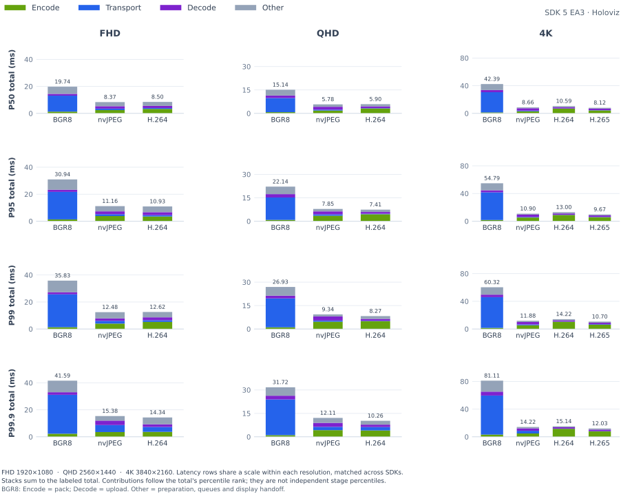

<details>
<summary>

### P50

</summary>

<table>
    <thead>
        <tr><th align="left">RES</th><th align="left">CC</th><th align="right">FPS</th><th align="right">FS</th><th align="right">Encode (ms)</th><th align="right">Transport (ms)</th><th align="right">Decode (ms)</th><th align="right">Total (ms)</th></tr>
    </thead>
    <tbody>
        <tr><td rowspan="3">FHD</td><td>BGR8</td><td align="right">29.84</td><td align="right">5.93 MiB</td><td align="right">1.15</td><td align="right">11.48</td><td align="right">1.31</td><td align="right">19.74</td></tr>
        <tr><td>nvJPEG</td><td align="right">29.91</td><td align="right">199.1 KiB</td><td align="right">2.39</td><td align="right">1.02</td><td align="right">1.76</td><td align="right">8.37</td></tr>
        <tr><td><strong>H.264</strong></td><td align="right"><strong>29.91</strong></td><td align="right"><strong>36.1 KiB</strong></td><td align="right"><strong>3.29</strong></td><td align="right"><strong>0.69</strong></td><td align="right"><strong>1.47</strong></td><td align="right"><strong>8.50</strong></td></tr>
        <tr><td rowspan="3">QHD</td><td>BGR8</td><td align="right">29.95</td><td align="right">10.55 MiB</td><td align="right">0.79</td><td align="right">8.63</td><td align="right">1.57</td><td align="right">15.14</td></tr>
        <tr><td>nvJPEG</td><td align="right">29.80</td><td align="right">363.6 KiB</td><td align="right">1.85</td><td align="right">0.51</td><td align="right">1.76</td><td align="right">5.78</td></tr>
        <tr><td><strong>H.264</strong></td><td align="right"><strong>29.79</strong></td><td align="right"><strong>57.8 KiB</strong></td><td align="right"><strong>3.18</strong></td><td align="right"><strong>0.25</strong></td><td align="right"><strong>1.15</strong></td><td align="right"><strong>5.90</strong></td></tr>
        <tr><td rowspan="4">4K</td><td>BGR8</td><td align="right">29.83</td><td align="right">23.73 MiB</td><td align="right">1.59</td><td align="right">27.04</td><td align="right">3.32</td><td align="right">42.39</td></tr>
        <tr><td>nvJPEG</td><td align="right">29.98</td><td align="right">724.1 KiB</td><td align="right">2.82</td><td align="right">0.76</td><td align="right">3.44</td><td align="right">8.66</td></tr>
        <tr><td><strong>H.264</strong></td><td align="right"><strong>30.01</strong></td><td align="right"><strong>105.4 KiB</strong></td><td align="right"><strong>6.87</strong></td><td align="right"><strong>0.30</strong></td><td align="right"><strong>1.90</strong></td><td align="right"><strong>10.59</strong></td></tr>
        <tr><td><strong>H.265</strong></td><td align="right"><strong>29.74</strong></td><td align="right"><strong>130.4 KiB</strong></td><td align="right"><strong>4.27</strong></td><td align="right"><strong>0.30</strong></td><td align="right"><strong>2.22</strong></td><td align="right"><strong>8.12</strong></td></tr>
    </tbody>
</table>

</details>

<details>
<summary>

### P95

</summary>

<table>
    <thead>
        <tr><th align="left">RES</th><th align="left">CC</th><th align="right">FPS</th><th align="right">FS</th><th align="right">Encode (ms)</th><th align="right">Transport (ms)</th><th align="right">Decode (ms)</th><th align="right">Total (ms)</th></tr>
    </thead>
    <tbody>
        <tr><td rowspan="3">FHD</td><td>BGR8</td><td align="right">29.84</td><td align="right">5.93 MiB</td><td align="right">1.96</td><td align="right">19.10</td><td align="right">2.23</td><td align="right">30.94</td></tr>
        <tr><td>nvJPEG</td><td align="right">29.91</td><td align="right">199.1 KiB</td><td align="right">4.21</td><td align="right">1.98</td><td align="right">2.44</td><td align="right">11.16</td></tr>
        <tr><td><strong>H.264</strong></td><td align="right"><strong>29.91</strong></td><td align="right"><strong>36.1 KiB</strong></td><td align="right"><strong>5.05</strong></td><td align="right"><strong>1.22</strong></td><td align="right"><strong>2.09</strong></td><td align="right"><strong>10.93</strong></td></tr>
        <tr><td rowspan="3">QHD</td><td>BGR8</td><td align="right">29.95</td><td align="right">10.55 MiB</td><td align="right">1.91</td><td align="right">14.21</td><td align="right">2.55</td><td align="right">22.14</td></tr>
        <tr><td>nvJPEG</td><td align="right">29.80</td><td align="right">363.6 KiB</td><td align="right">3.52</td><td align="right">0.92</td><td align="right">1.98</td><td align="right">7.85</td></tr>
        <tr><td><strong>H.264</strong></td><td align="right"><strong>29.79</strong></td><td align="right"><strong>57.8 KiB</strong></td><td align="right"><strong>4.39</strong></td><td align="right"><strong>0.42</strong></td><td align="right"><strong>1.35</strong></td><td align="right"><strong>7.41</strong></td></tr>
        <tr><td rowspan="4">4K</td><td>BGR8</td><td align="right">29.83</td><td align="right">23.73 MiB</td><td align="right">3.52</td><td align="right">39.23</td><td align="right">5.73</td><td align="right">54.79</td></tr>
        <tr><td>nvJPEG</td><td align="right">29.98</td><td align="right">724.1 KiB</td><td align="right">4.97</td><td align="right">1.31</td><td align="right">3.61</td><td align="right">10.90</td></tr>
        <tr><td><strong>H.264</strong></td><td align="right"><strong>30.01</strong></td><td align="right"><strong>105.4 KiB</strong></td><td align="right"><strong>9.17</strong></td><td align="right"><strong>0.44</strong></td><td align="right"><strong>2.08</strong></td><td align="right"><strong>13.00</strong></td></tr>
        <tr><td><strong>H.265</strong></td><td align="right"><strong>29.74</strong></td><td align="right"><strong>130.4 KiB</strong></td><td align="right"><strong>5.62</strong></td><td align="right"><strong>0.45</strong></td><td align="right"><strong>2.40</strong></td><td align="right"><strong>9.67</strong></td></tr>
    </tbody>
</table>

</details>

<details open>
<summary>

### P99

</summary>

<table>
    <thead>
        <tr><th align="left">RES</th><th align="left">CC</th><th align="right">FPS</th><th align="right">FS</th><th align="right">Encode (ms)</th><th align="right">Transport (ms)</th><th align="right">Decode (ms)</th><th align="right">Total (ms)</th></tr>
    </thead>
    <tbody>
        <tr><td rowspan="3">FHD</td><td>BGR8</td><td align="right">29.84</td><td align="right">5.93 MiB</td><td align="right">2.69</td><td align="right">23.34</td><td align="right">3.17</td><td align="right">35.83</td></tr>
        <tr><td>nvJPEG</td><td align="right">29.91</td><td align="right">199.1 KiB</td><td align="right">4.73</td><td align="right">2.32</td><td align="right">2.77</td><td align="right">12.48</td></tr>
        <tr><td><strong>H.264</strong></td><td align="right"><strong>29.91</strong></td><td align="right"><strong>36.1 KiB</strong></td><td align="right"><strong>5.80</strong></td><td align="right"><strong>1.44</strong></td><td align="right"><strong>2.29</strong></td><td align="right"><strong>12.62</strong></td></tr>
        <tr><td rowspan="3">QHD</td><td>BGR8</td><td align="right">29.95</td><td align="right">10.55 MiB</td><td align="right">2.09</td><td align="right">18.15</td><td align="right">3.26</td><td align="right">26.93</td></tr>
        <tr><td>nvJPEG</td><td align="right">29.80</td><td align="right">363.6 KiB</td><td align="right">4.71</td><td align="right">1.26</td><td align="right">2.42</td><td align="right">9.34</td></tr>
        <tr><td><strong>H.264</strong></td><td align="right"><strong>29.79</strong></td><td align="right"><strong>57.8 KiB</strong></td><td align="right"><strong>4.76</strong></td><td align="right"><strong>0.56</strong></td><td align="right"><strong>1.61</strong></td><td align="right"><strong>8.27</strong></td></tr>
        <tr><td rowspan="4">4K</td><td>BGR8</td><td align="right">29.83</td><td align="right">23.73 MiB</td><td align="right">4.01</td><td align="right">44.41</td><td align="right">6.89</td><td align="right">60.32</td></tr>
        <tr><td>nvJPEG</td><td align="right">29.98</td><td align="right">724.1 KiB</td><td align="right">5.77</td><td align="right">1.45</td><td align="right">3.73</td><td align="right">11.88</td></tr>
        <tr><td><strong>H.264</strong></td><td align="right"><strong>30.01</strong></td><td align="right"><strong>105.4 KiB</strong></td><td align="right"><strong>10.47</strong></td><td align="right"><strong>0.57</strong></td><td align="right"><strong>2.37</strong></td><td align="right"><strong>14.22</strong></td></tr>
        <tr><td><strong>H.265</strong></td><td align="right"><strong>29.74</strong></td><td align="right"><strong>130.4 KiB</strong></td><td align="right"><strong>6.42</strong></td><td align="right"><strong>0.54</strong></td><td align="right"><strong>2.51</strong></td><td align="right"><strong>10.70</strong></td></tr>
    </tbody>
</table>

</details>

<details open>
<summary>

### P99.9

</summary>

<table>
    <thead>
        <tr><th align="left">RES</th><th align="left">CC</th><th align="right">FPS</th><th align="right">FS</th><th align="right">Encode (ms)</th><th align="right">Transport (ms)</th><th align="right">Decode (ms)</th><th align="right">Total (ms)</th></tr>
    </thead>
    <tbody>
        <tr><td rowspan="3">FHD</td><td>BGR8</td><td align="right">29.84</td><td align="right">5.93 MiB</td><td align="right">2.93</td><td align="right">30.49</td><td align="right">4.93</td><td align="right">41.59</td></tr>
        <tr><td>nvJPEG</td><td align="right">29.91</td><td align="right">199.1 KiB</td><td align="right">5.20</td><td align="right">4.33</td><td align="right">4.53</td><td align="right">15.38</td></tr>
        <tr><td><strong>H.264</strong></td><td align="right"><strong>29.91</strong></td><td align="right"><strong>36.1 KiB</strong></td><td align="right"><strong>6.82</strong></td><td align="right"><strong>3.28</strong></td><td align="right"><strong>2.92</strong></td><td align="right"><strong>14.34</strong></td></tr>
        <tr><td rowspan="3">QHD</td><td>BGR8</td><td align="right">29.95</td><td align="right">10.55 MiB</td><td align="right">2.40</td><td align="right">22.76</td><td align="right">4.21</td><td align="right">31.72</td></tr>
        <tr><td>nvJPEG</td><td align="right">29.80</td><td align="right">363.6 KiB</td><td align="right">5.12</td><td align="right">2.39</td><td align="right">3.08</td><td align="right">12.11</td></tr>
        <tr><td><strong>H.264</strong></td><td align="right"><strong>29.79</strong></td><td align="right"><strong>57.8 KiB</strong></td><td align="right"><strong>5.37</strong></td><td align="right"><strong>0.99</strong></td><td align="right"><strong>1.79</strong></td><td align="right"><strong>10.26</strong></td></tr>
        <tr><td rowspan="4">4K</td><td>BGR8</td><td align="right">29.83</td><td align="right">23.73 MiB</td><td align="right">4.52</td><td align="right">59.55</td><td align="right">8.30</td><td align="right">81.11</td></tr>
        <tr><td>nvJPEG</td><td align="right">29.98</td><td align="right">724.1 KiB</td><td align="right">7.57</td><td align="right">3.56</td><td align="right">4.88</td><td align="right">14.22</td></tr>
        <tr><td><strong>H.264</strong></td><td align="right"><strong>30.01</strong></td><td align="right"><strong>105.4 KiB</strong></td><td align="right"><strong>11.72</strong></td><td align="right"><strong>0.72</strong></td><td align="right"><strong>3.45</strong></td><td align="right"><strong>15.14</strong></td></tr>
        <tr><td><strong>H.265</strong></td><td align="right"><strong>29.74</strong></td><td align="right"><strong>130.4 KiB</strong></td><td align="right"><strong>7.64</strong></td><td align="right"><strong>0.80</strong></td><td align="right"><strong>2.68</strong></td><td align="right"><strong>12.03</strong></td></tr>
    </tbody>
</table>

</details>

</details>

<details open>
<summary>

## Thor (Patient) → x86 (Surgeon): IMX274 Camera

</summary>

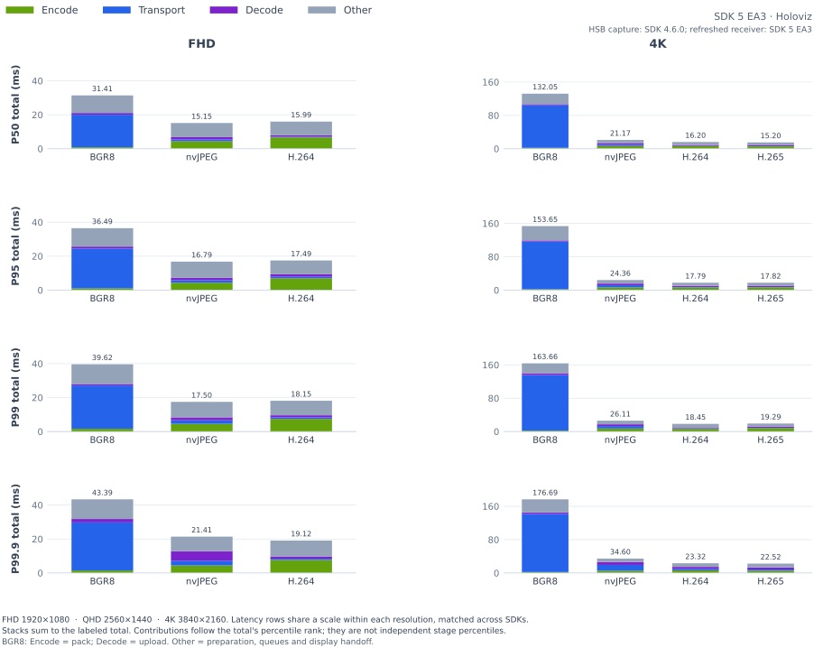

<details>
<summary>

### P50

</summary>

<table>
    <thead>
        <tr><th align="left">RES</th><th align="left">CC</th><th align="right">FPS</th><th align="right">FS</th><th align="right">Encode (ms)</th><th align="right">Transport (ms)</th><th align="right">Decode (ms)</th><th align="right">Total (ms)</th></tr>
    </thead>
    <tbody>
        <tr><td rowspan="3">FHD</td><td>BGR8</td><td align="right">59.70</td><td align="right">5.93 MiB</td><td align="right">0.90</td><td align="right">18.52</td><td align="right">0.95</td><td align="right">31.41</td></tr>
        <tr><td>nvJPEG</td><td align="right">59.71</td><td align="right">146.3 KiB</td><td align="right">4.42</td><td align="right">1.07</td><td align="right">1.33</td><td align="right">15.15</td></tr>
        <tr><td><strong>H.264</strong></td><td align="right"><strong>59.72</strong></td><td align="right"><strong>19.2 KiB</strong></td><td align="right"><strong>6.66</strong></td><td align="right"><strong>0.53</strong></td><td align="right"><strong>1.07</strong></td><td align="right"><strong>15.99</strong></td></tr>
        <tr><td rowspan="4">4K</td><td>BGR8</td><td align="right">14.85</td><td align="right">23.73 MiB</td><td align="right">2.23</td><td align="right">103.16</td><td align="right">2.81</td><td align="right">132.05</td></tr>
        <tr><td>nvJPEG</td><td align="right">59.92</td><td align="right">776.2 KiB</td><td align="right">5.57</td><td align="right">3.98</td><td align="right">3.85</td><td align="right">21.17</td></tr>
        <tr><td><strong>H.264</strong></td><td align="right"><strong>60.02</strong></td><td align="right"><strong>58.3 KiB</strong></td><td align="right"><strong>6.20</strong></td><td align="right"><strong>0.68</strong></td><td align="right"><strong>2.07</strong></td><td align="right"><strong>16.20</strong></td></tr>
        <tr><td><strong>H.265</strong></td><td align="right"><strong>60.04</strong></td><td align="right"><strong>9.7 KiB</strong></td><td align="right"><strong>5.14</strong></td><td align="right"><strong>0.49</strong></td><td align="right"><strong>2.31</strong></td><td align="right"><strong>15.20</strong></td></tr>
    </tbody>
</table>

</details>

<details>
<summary>

### P95

</summary>

<table>
    <thead>
        <tr><th align="left">RES</th><th align="left">CC</th><th align="right">FPS</th><th align="right">FS</th><th align="right">Encode (ms)</th><th align="right">Transport (ms)</th><th align="right">Decode (ms)</th><th align="right">Total (ms)</th></tr>
    </thead>
    <tbody>
        <tr><td rowspan="3">FHD</td><td>BGR8</td><td align="right">59.70</td><td align="right">5.93 MiB</td><td align="right">1.71</td><td align="right">22.81</td><td align="right">1.42</td><td align="right">36.49</td></tr>
        <tr><td>nvJPEG</td><td align="right">59.71</td><td align="right">146.3 KiB</td><td align="right">4.50</td><td align="right">1.94</td><td align="right">1.77</td><td align="right">16.79</td></tr>
        <tr><td><strong>H.264</strong></td><td align="right"><strong>59.72</strong></td><td align="right"><strong>19.2 KiB</strong></td><td align="right"><strong>7.36</strong></td><td align="right"><strong>0.94</strong></td><td align="right"><strong>1.64</strong></td><td align="right"><strong>17.49</strong></td></tr>
        <tr><td rowspan="4">4K</td><td>BGR8</td><td align="right">14.85</td><td align="right">23.73 MiB</td><td align="right">2.54</td><td align="right">115.63</td><td align="right">4.78</td><td align="right">153.65</td></tr>
        <tr><td>nvJPEG</td><td align="right">59.92</td><td align="right">776.2 KiB</td><td align="right">7.20</td><td align="right">5.98</td><td align="right">4.25</td><td align="right">24.36</td></tr>
        <tr><td><strong>H.264</strong></td><td align="right"><strong>60.02</strong></td><td align="right"><strong>58.3 KiB</strong></td><td align="right"><strong>6.76</strong></td><td align="right"><strong>1.28</strong></td><td align="right"><strong>2.55</strong></td><td align="right"><strong>17.79</strong></td></tr>
        <tr><td><strong>H.265</strong></td><td align="right"><strong>60.04</strong></td><td align="right"><strong>9.7 KiB</strong></td><td align="right"><strong>7.29</strong></td><td align="right"><strong>0.92</strong></td><td align="right"><strong>2.98</strong></td><td align="right"><strong>17.82</strong></td></tr>
    </tbody>
</table>

</details>

<details open>
<summary>

### P99

</summary>

<table>
    <thead>
        <tr><th align="left">RES</th><th align="left">CC</th><th align="right">FPS</th><th align="right">FS</th><th align="right">Encode (ms)</th><th align="right">Transport (ms)</th><th align="right">Decode (ms)</th><th align="right">Total (ms)</th></tr>
    </thead>
    <tbody>
        <tr><td rowspan="3">FHD</td><td>BGR8</td><td align="right">59.70</td><td align="right">5.93 MiB</td><td align="right">1.80</td><td align="right">25.55</td><td align="right">1.74</td><td align="right">39.62</td></tr>
        <tr><td>nvJPEG</td><td align="right">59.71</td><td align="right">146.3 KiB</td><td align="right">4.58</td><td align="right">2.29</td><td align="right">2.03</td><td align="right">17.50</td></tr>
        <tr><td><strong>H.264</strong></td><td align="right"><strong>59.72</strong></td><td align="right"><strong>19.2 KiB</strong></td><td align="right"><strong>7.54</strong></td><td align="right"><strong>1.08</strong></td><td align="right"><strong>1.85</strong></td><td align="right"><strong>18.15</strong></td></tr>
        <tr><td rowspan="4">4K</td><td>BGR8</td><td align="right">14.85</td><td align="right">23.73 MiB</td><td align="right">3.66</td><td align="right">126.69</td><td align="right">5.34</td><td align="right">163.66</td></tr>
        <tr><td>nvJPEG</td><td align="right">59.92</td><td align="right">776.2 KiB</td><td align="right">8.26</td><td align="right">6.91</td><td align="right">4.44</td><td align="right">26.11</td></tr>
        <tr><td><strong>H.264</strong></td><td align="right"><strong>60.02</strong></td><td align="right"><strong>58.3 KiB</strong></td><td align="right"><strong>6.97</strong></td><td align="right"><strong>1.51</strong></td><td align="right"><strong>2.96</strong></td><td align="right"><strong>18.45</strong></td></tr>
        <tr><td><strong>H.265</strong></td><td align="right"><strong>60.04</strong></td><td align="right"><strong>9.7 KiB</strong></td><td align="right"><strong>8.41</strong></td><td align="right"><strong>1.10</strong></td><td align="right"><strong>3.33</strong></td><td align="right"><strong>19.29</strong></td></tr>
    </tbody>
</table>

</details>

<details open>
<summary>

### P99.9

</summary>

<table>
    <thead>
        <tr><th align="left">RES</th><th align="left">CC</th><th align="right">FPS</th><th align="right">FS</th><th align="right">Encode (ms)</th><th align="right">Transport (ms)</th><th align="right">Decode (ms)</th><th align="right">Total (ms)</th></tr>
    </thead>
    <tbody>
        <tr><td rowspan="3">FHD</td><td>BGR8</td><td align="right">59.70</td><td align="right">5.93 MiB</td><td align="right">2.26</td><td align="right">29.42</td><td align="right">2.64</td><td align="right">43.39</td></tr>
        <tr><td>nvJPEG</td><td align="right">59.71</td><td align="right">146.3 KiB</td><td align="right">5.10</td><td align="right">3.59</td><td align="right">3.15</td><td align="right">21.41</td></tr>
        <tr><td><strong>H.264</strong></td><td align="right"><strong>59.72</strong></td><td align="right"><strong>19.2 KiB</strong></td><td align="right"><strong>7.82</strong></td><td align="right"><strong>2.16</strong></td><td align="right"><strong>2.20</strong></td><td align="right"><strong>19.12</strong></td></tr>
        <tr><td rowspan="4">4K</td><td>BGR8</td><td align="right">14.85</td><td align="right">23.73 MiB</td><td align="right">3.93</td><td align="right">140.08</td><td align="right">6.71</td><td align="right">176.69</td></tr>
        <tr><td>nvJPEG</td><td align="right">59.92</td><td align="right">776.2 KiB</td><td align="right">10.93</td><td align="right">15.68</td><td align="right">6.24</td><td align="right">34.60</td></tr>
        <tr><td><strong>H.264</strong></td><td align="right"><strong>60.02</strong></td><td align="right"><strong>58.3 KiB</strong></td><td align="right"><strong>7.28</strong></td><td align="right"><strong>3.60</strong></td><td align="right"><strong>3.37</strong></td><td align="right"><strong>23.32</strong></td></tr>
        <tr><td><strong>H.265</strong></td><td align="right"><strong>60.04</strong></td><td align="right"><strong>9.7 KiB</strong></td><td align="right"><strong>10.10</strong></td><td align="right"><strong>4.02</strong></td><td align="right"><strong>3.96</strong></td><td align="right"><strong>22.52</strong></td></tr>
    </tbody>
</table>

</details>

</details>

<details>
<summary>

## DGX Spark (Patient) → x86 (Surgeon): MIRA Procedure Camera

</summary>

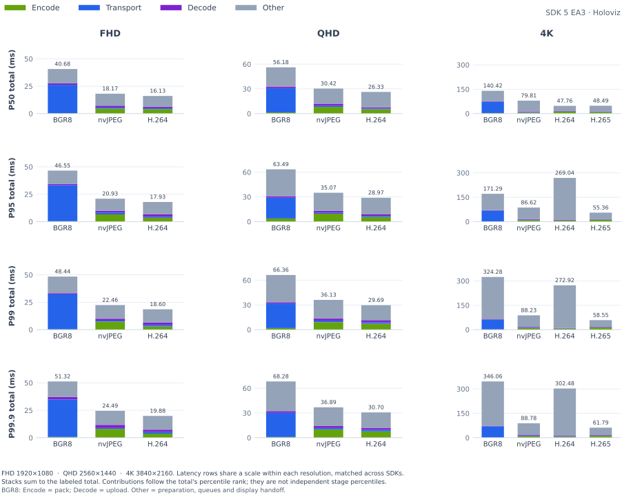

<details>
<summary>

### P50

</summary>

<table>
    <thead>
        <tr><th align="left">RES</th><th align="left">CC</th><th align="right">FPS</th><th align="right">FS</th><th align="right">Encode (ms)</th><th align="right">Transport (ms)</th><th align="right">Decode (ms)</th><th align="right">Total (ms)</th></tr>
    </thead>
    <tbody>
        <tr><td rowspan="3">FHD</td><td>BGR8</td><td align="right">16.11</td><td align="right">5.93 MiB</td><td align="right">0.53</td><td align="right">25.66</td><td align="right">1.15</td><td align="right">40.68</td></tr>
        <tr><td>nvJPEG</td><td align="right">16.00</td><td align="right">106.7 KiB</td><td align="right">5.09</td><td align="right">1.05</td><td align="right">1.65</td><td align="right">18.17</td></tr>
        <tr><td><strong>H.264</strong></td><td align="right"><strong>16.26</strong></td><td align="right"><strong>35.3 KiB</strong></td><td align="right"><strong>3.51</strong></td><td align="right"><strong>0.90</strong></td><td align="right"><strong>1.59</strong></td><td align="right"><strong>16.13</strong></td></tr>
        <tr><td rowspan="3">QHD</td><td>BGR8</td><td align="right">10.85</td><td align="right">10.55 MiB</td><td align="right">1.81</td><td align="right">28.16</td><td align="right">1.77</td><td align="right">56.18</td></tr>
        <tr><td>nvJPEG</td><td align="right">10.81</td><td align="right">164.4 KiB</td><td align="right">8.03</td><td align="right">1.38</td><td align="right">2.35</td><td align="right">30.42</td></tr>
        <tr><td><strong>H.264</strong></td><td align="right"><strong>11.36</strong></td><td align="right"><strong>56.5 KiB</strong></td><td align="right"><strong>7.05</strong></td><td align="right"><strong>1.08</strong></td><td align="right"><strong>1.88</strong></td><td align="right"><strong>26.33</strong></td></tr>
        <tr><td rowspan="4">4K</td><td>BGR8</td><td align="right">6.32</td><td align="right">23.73 MiB</td><td align="right">2.58</td><td align="right">65.45</td><td align="right">2.79</td><td align="right">140.42</td></tr>
        <tr><td>nvJPEG</td><td align="right">6.26</td><td align="right">310.5 KiB</td><td align="right">7.66</td><td align="right">2.17</td><td align="right">4.13</td><td align="right">79.81</td></tr>
        <tr><td><strong>H.264</strong></td><td align="right"><strong>6.37</strong></td><td align="right"><strong>80.9 KiB</strong></td><td align="right"><strong>9.91</strong></td><td align="right"><strong>1.41</strong></td><td align="right"><strong>2.79</strong></td><td align="right"><strong>47.76</strong></td></tr>
        <tr><td><strong>H.265</strong></td><td align="right"><strong>6.42</strong></td><td align="right"><strong>103.3 KiB</strong></td><td align="right"><strong>10.73</strong></td><td align="right"><strong>1.51</strong></td><td align="right"><strong>3.08</strong></td><td align="right"><strong>48.49</strong></td></tr>
    </tbody>
</table>

</details>

<details>
<summary>

### P95

</summary>

<table>
    <thead>
        <tr><th align="left">RES</th><th align="left">CC</th><th align="right">FPS</th><th align="right">FS</th><th align="right">Encode (ms)</th><th align="right">Transport (ms)</th><th align="right">Decode (ms)</th><th align="right">Total (ms)</th></tr>
    </thead>
    <tbody>
        <tr><td rowspan="3">FHD</td><td>BGR8</td><td align="right">16.11</td><td align="right">5.93 MiB</td><td align="right">1.02</td><td align="right">31.14</td><td align="right">1.84</td><td align="right">46.55</td></tr>
        <tr><td>nvJPEG</td><td align="right">16.00</td><td align="right">106.7 KiB</td><td align="right">6.67</td><td align="right">1.72</td><td align="right">1.92</td><td align="right">20.93</td></tr>
        <tr><td><strong>H.264</strong></td><td align="right"><strong>16.26</strong></td><td align="right"><strong>35.3 KiB</strong></td><td align="right"><strong>4.83</strong></td><td align="right"><strong>1.42</strong></td><td align="right"><strong>2.18</strong></td><td align="right"><strong>17.93</strong></td></tr>
        <tr><td rowspan="3">QHD</td><td>BGR8</td><td align="right">10.85</td><td align="right">10.55 MiB</td><td align="right">4.13</td><td align="right">34.12</td><td align="right">2.95</td><td align="right">63.49</td></tr>
        <tr><td>nvJPEG</td><td align="right">10.81</td><td align="right">164.4 KiB</td><td align="right">10.69</td><td align="right">2.10</td><td align="right">2.70</td><td align="right">35.07</td></tr>
        <tr><td><strong>H.264</strong></td><td align="right"><strong>11.36</strong></td><td align="right"><strong>56.5 KiB</strong></td><td align="right"><strong>9.18</strong></td><td align="right"><strong>1.73</strong></td><td align="right"><strong>2.52</strong></td><td align="right"><strong>28.97</strong></td></tr>
        <tr><td rowspan="4">4K</td><td>BGR8</td><td align="right">6.32</td><td align="right">23.73 MiB</td><td align="right">7.90</td><td align="right">78.39</td><td align="right">4.42</td><td align="right">171.29</td></tr>
        <tr><td>nvJPEG</td><td align="right">6.26</td><td align="right">310.5 KiB</td><td align="right">9.86</td><td align="right">3.74</td><td align="right">4.44</td><td align="right">86.62</td></tr>
        <tr><td><strong>H.264</strong></td><td align="right"><strong>6.37</strong></td><td align="right"><strong>80.9 KiB</strong></td><td align="right"><strong>15.32</strong></td><td align="right"><strong>2.20</strong></td><td align="right"><strong>3.75</strong></td><td align="right"><strong>269.04</strong></td></tr>
        <tr><td><strong>H.265</strong></td><td align="right"><strong>6.42</strong></td><td align="right"><strong>103.3 KiB</strong></td><td align="right"><strong>13.64</strong></td><td align="right"><strong>2.20</strong></td><td align="right"><strong>3.84</strong></td><td align="right"><strong>55.36</strong></td></tr>
    </tbody>
</table>

</details>

<details open>
<summary>

### P99

</summary>

<table>
    <thead>
        <tr><th align="left">RES</th><th align="left">CC</th><th align="right">FPS</th><th align="right">FS</th><th align="right">Encode (ms)</th><th align="right">Transport (ms)</th><th align="right">Decode (ms)</th><th align="right">Total (ms)</th></tr>
    </thead>
    <tbody>
        <tr><td rowspan="3">FHD</td><td>BGR8</td><td align="right">16.11</td><td align="right">5.93 MiB</td><td align="right">1.46</td><td align="right">32.86</td><td align="right">2.31</td><td align="right">48.44</td></tr>
        <tr><td>nvJPEG</td><td align="right">16.00</td><td align="right">106.7 KiB</td><td align="right">7.01</td><td align="right">1.92</td><td align="right">2.24</td><td align="right">22.46</td></tr>
        <tr><td><strong>H.264</strong></td><td align="right"><strong>16.26</strong></td><td align="right"><strong>35.3 KiB</strong></td><td align="right"><strong>5.38</strong></td><td align="right"><strong>1.58</strong></td><td align="right"><strong>2.45</strong></td><td align="right"><strong>18.60</strong></td></tr>
        <tr><td rowspan="3">QHD</td><td>BGR8</td><td align="right">10.85</td><td align="right">10.55 MiB</td><td align="right">4.43</td><td align="right">37.37</td><td align="right">3.68</td><td align="right">66.36</td></tr>
        <tr><td>nvJPEG</td><td align="right">10.81</td><td align="right">164.4 KiB</td><td align="right">11.69</td><td align="right">2.46</td><td align="right">2.89</td><td align="right">36.13</td></tr>
        <tr><td><strong>H.264</strong></td><td align="right"><strong>11.36</strong></td><td align="right"><strong>56.5 KiB</strong></td><td align="right"><strong>10.20</strong></td><td align="right"><strong>1.92</strong></td><td align="right"><strong>2.84</strong></td><td align="right"><strong>29.69</strong></td></tr>
        <tr><td rowspan="4">4K</td><td>BGR8</td><td align="right">6.32</td><td align="right">23.73 MiB</td><td align="right">9.75</td><td align="right">81.96</td><td align="right">4.99</td><td align="right">324.28</td></tr>
        <tr><td>nvJPEG</td><td align="right">6.26</td><td align="right">310.5 KiB</td><td align="right">10.26</td><td align="right">4.32</td><td align="right">4.82</td><td align="right">88.23</td></tr>
        <tr><td><strong>H.264</strong></td><td align="right"><strong>6.37</strong></td><td align="right"><strong>80.9 KiB</strong></td><td align="right"><strong>16.75</strong></td><td align="right"><strong>2.80</strong></td><td align="right"><strong>4.09</strong></td><td align="right"><strong>272.92</strong></td></tr>
        <tr><td><strong>H.265</strong></td><td align="right"><strong>6.42</strong></td><td align="right"><strong>103.3 KiB</strong></td><td align="right"><strong>14.93</strong></td><td align="right"><strong>2.45</strong></td><td align="right"><strong>3.97</strong></td><td align="right"><strong>58.55</strong></td></tr>
    </tbody>
</table>

</details>

<details open>
<summary>

### P99.9

</summary>

<table>
    <thead>
        <tr><th align="left">RES</th><th align="left">CC</th><th align="right">FPS</th><th align="right">FS</th><th align="right">Encode (ms)</th><th align="right">Transport (ms)</th><th align="right">Decode (ms)</th><th align="right">Total (ms)</th></tr>
    </thead>
    <tbody>
        <tr><td rowspan="3">FHD</td><td>BGR8</td><td align="right">16.11</td><td align="right">5.93 MiB</td><td align="right">2.17</td><td align="right">34.76</td><td align="right">2.80</td><td align="right">51.32</td></tr>
        <tr><td>nvJPEG</td><td align="right">16.00</td><td align="right">106.7 KiB</td><td align="right">8.64</td><td align="right">3.57</td><td align="right">3.76</td><td align="right">24.49</td></tr>
        <tr><td><strong>H.264</strong></td><td align="right"><strong>16.26</strong></td><td align="right"><strong>35.3 KiB</strong></td><td align="right"><strong>5.76</strong></td><td align="right"><strong>2.07</strong></td><td align="right"><strong>3.06</strong></td><td align="right"><strong>19.88</strong></td></tr>
        <tr><td rowspan="3">QHD</td><td>BGR8</td><td align="right">10.85</td><td align="right">10.55 MiB</td><td align="right">4.54</td><td align="right">39.48</td><td align="right">4.32</td><td align="right">68.28</td></tr>
        <tr><td>nvJPEG</td><td align="right">10.81</td><td align="right">164.4 KiB</td><td align="right">12.62</td><td align="right">3.11</td><td align="right">3.11</td><td align="right">36.89</td></tr>
        <tr><td><strong>H.264</strong></td><td align="right"><strong>11.36</strong></td><td align="right"><strong>56.5 KiB</strong></td><td align="right"><strong>10.73</strong></td><td align="right"><strong>2.31</strong></td><td align="right"><strong>3.21</strong></td><td align="right"><strong>30.70</strong></td></tr>
        <tr><td rowspan="4">4K</td><td>BGR8</td><td align="right">6.32</td><td align="right">23.73 MiB</td><td align="right">10.47</td><td align="right">85.01</td><td align="right">5.74</td><td align="right">346.06</td></tr>
        <tr><td>nvJPEG</td><td align="right">6.26</td><td align="right">310.5 KiB</td><td align="right">10.65</td><td align="right">5.01</td><td align="right">4.94</td><td align="right">88.78</td></tr>
        <tr><td><strong>H.264</strong></td><td align="right"><strong>6.37</strong></td><td align="right"><strong>80.9 KiB</strong></td><td align="right"><strong>20.98</strong></td><td align="right"><strong>3.27</strong></td><td align="right"><strong>4.16</strong></td><td align="right"><strong>302.48</strong></td></tr>
        <tr><td><strong>H.265</strong></td><td align="right"><strong>6.42</strong></td><td align="right"><strong>103.3 KiB</strong></td><td align="right"><strong>15.38</strong></td><td align="right"><strong>2.51</strong></td><td align="right"><strong>4.07</strong></td><td align="right"><strong>61.79</strong></td></tr>
    </tbody>
</table>

</details>

</details>

<details>
<summary>

## DGX Spark (Patient) → x86 (Surgeon): MIRA Room Camera

</summary>

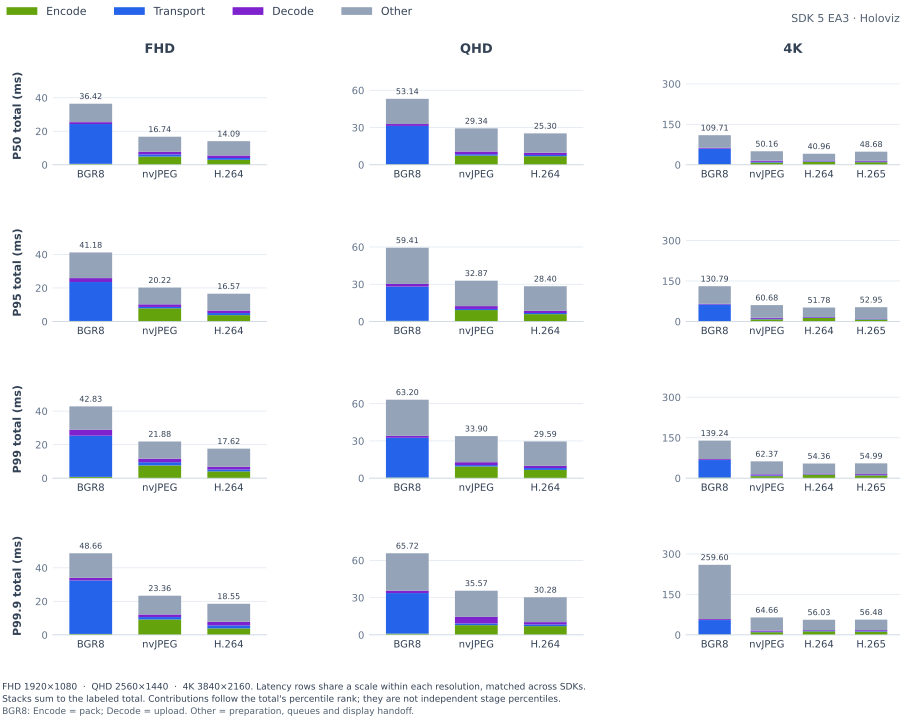

<details>
<summary>

### P50

</summary>

<table>
    <thead>
        <tr><th align="left">RES</th><th align="left">CC</th><th align="right">FPS</th><th align="right">FS</th><th align="right">Encode (ms)</th><th align="right">Transport (ms)</th><th align="right">Decode (ms)</th><th align="right">Total (ms)</th></tr>
    </thead>
    <tbody>
        <tr><td rowspan="3">FHD</td><td>BGR8</td><td align="right">16.21</td><td align="right">5.93 MiB</td><td align="right">0.43</td><td align="right">21.85</td><td align="right">1.13</td><td align="right">36.42</td></tr>
        <tr><td>nvJPEG</td><td align="right">16.03</td><td align="right">82.8 KiB</td><td align="right">5.69</td><td align="right">1.15</td><td align="right">1.61</td><td align="right">16.74</td></tr>
        <tr><td><strong>H.264</strong></td><td align="right"><strong>16.28</strong></td><td align="right"><strong>35.3 KiB</strong></td><td align="right"><strong>3.08</strong></td><td align="right"><strong>0.82</strong></td><td align="right"><strong>1.45</strong></td><td align="right"><strong>14.09</strong></td></tr>
        <tr><td rowspan="3">QHD</td><td>BGR8</td><td align="right">10.83</td><td align="right">10.55 MiB</td><td align="right">0.82</td><td align="right">25.39</td><td align="right">1.63</td><td align="right">53.14</td></tr>
        <tr><td>nvJPEG</td><td align="right">10.81</td><td align="right">131.7 KiB</td><td align="right">8.36</td><td align="right">1.17</td><td align="right">2.22</td><td align="right">29.34</td></tr>
        <tr><td><strong>H.264</strong></td><td align="right"><strong>11.36</strong></td><td align="right"><strong>56.7 KiB</strong></td><td align="right"><strong>5.36</strong></td><td align="right"><strong>0.95</strong></td><td align="right"><strong>1.72</strong></td><td align="right"><strong>25.30</strong></td></tr>
        <tr><td rowspan="4">4K</td><td>BGR8</td><td align="right">6.35</td><td align="right">23.73 MiB</td><td align="right">1.41</td><td align="right">54.27</td><td align="right">2.63</td><td align="right">109.71</td></tr>
        <tr><td>nvJPEG</td><td align="right">6.28</td><td align="right">263.1 KiB</td><td align="right">9.62</td><td align="right">1.82</td><td align="right">3.99</td><td align="right">50.16</td></tr>
        <tr><td><strong>H.264</strong></td><td align="right"><strong>6.37</strong></td><td align="right"><strong>80.1 KiB</strong></td><td align="right"><strong>8.85</strong></td><td align="right"><strong>1.26</strong></td><td align="right"><strong>2.61</strong></td><td align="right"><strong>40.96</strong></td></tr>
        <tr><td><strong>H.265</strong></td><td align="right"><strong>6.42</strong></td><td align="right"><strong>104.5 KiB</strong></td><td align="right"><strong>9.60</strong></td><td align="right"><strong>1.57</strong></td><td align="right"><strong>2.96</strong></td><td align="right"><strong>48.68</strong></td></tr>
    </tbody>
</table>

</details>

<details>
<summary>

### P95

</summary>

<table>
    <thead>
        <tr><th align="left">RES</th><th align="left">CC</th><th align="right">FPS</th><th align="right">FS</th><th align="right">Encode (ms)</th><th align="right">Transport (ms)</th><th align="right">Decode (ms)</th><th align="right">Total (ms)</th></tr>
    </thead>
    <tbody>
        <tr><td rowspan="3">FHD</td><td>BGR8</td><td align="right">16.21</td><td align="right">5.93 MiB</td><td align="right">0.71</td><td align="right">25.31</td><td align="right">2.01</td><td align="right">41.18</td></tr>
        <tr><td>nvJPEG</td><td align="right">16.03</td><td align="right">82.8 KiB</td><td align="right">8.28</td><td align="right">1.55</td><td align="right">2.00</td><td align="right">20.22</td></tr>
        <tr><td><strong>H.264</strong></td><td align="right"><strong>16.28</strong></td><td align="right"><strong>35.3 KiB</strong></td><td align="right"><strong>4.55</strong></td><td align="right"><strong>1.33</strong></td><td align="right"><strong>2.16</strong></td><td align="right"><strong>16.57</strong></td></tr>
        <tr><td rowspan="3">QHD</td><td>BGR8</td><td align="right">10.83</td><td align="right">10.55 MiB</td><td align="right">1.71</td><td align="right">30.77</td><td align="right">2.23</td><td align="right">59.41</td></tr>
        <tr><td>nvJPEG</td><td align="right">10.81</td><td align="right">131.7 KiB</td><td align="right">9.87</td><td align="right">1.85</td><td align="right">2.64</td><td align="right">32.87</td></tr>
        <tr><td><strong>H.264</strong></td><td align="right"><strong>11.36</strong></td><td align="right"><strong>56.7 KiB</strong></td><td align="right"><strong>7.50</strong></td><td align="right"><strong>1.53</strong></td><td align="right"><strong>2.24</strong></td><td align="right"><strong>28.40</strong></td></tr>
        <tr><td rowspan="4">4K</td><td>BGR8</td><td align="right">6.35</td><td align="right">23.73 MiB</td><td align="right">3.61</td><td align="right">65.13</td><td align="right">4.16</td><td align="right">130.79</td></tr>
        <tr><td>nvJPEG</td><td align="right">6.28</td><td align="right">263.1 KiB</td><td align="right">12.14</td><td align="right">3.21</td><td align="right">4.34</td><td align="right">60.68</td></tr>
        <tr><td><strong>H.264</strong></td><td align="right"><strong>6.37</strong></td><td align="right"><strong>80.1 KiB</strong></td><td align="right"><strong>12.70</strong></td><td align="right"><strong>2.00</strong></td><td align="right"><strong>3.51</strong></td><td align="right"><strong>51.78</strong></td></tr>
        <tr><td><strong>H.265</strong></td><td align="right"><strong>6.42</strong></td><td align="right"><strong>104.5 KiB</strong></td><td align="right"><strong>11.63</strong></td><td align="right"><strong>2.36</strong></td><td align="right"><strong>3.82</strong></td><td align="right"><strong>52.95</strong></td></tr>
    </tbody>
</table>

</details>

<details open>
<summary>

### P99

</summary>

<table>
    <thead>
        <tr><th align="left">RES</th><th align="left">CC</th><th align="right">FPS</th><th align="right">FS</th><th align="right">Encode (ms)</th><th align="right">Transport (ms)</th><th align="right">Decode (ms)</th><th align="right">Total (ms)</th></tr>
    </thead>
    <tbody>
        <tr><td rowspan="3">FHD</td><td>BGR8</td><td align="right">16.21</td><td align="right">5.93 MiB</td><td align="right">0.91</td><td align="right">26.74</td><td align="right">2.64</td><td align="right">42.83</td></tr>
        <tr><td>nvJPEG</td><td align="right">16.03</td><td align="right">82.8 KiB</td><td align="right">9.20</td><td align="right">1.76</td><td align="right">2.17</td><td align="right">21.88</td></tr>
        <tr><td><strong>H.264</strong></td><td align="right"><strong>16.28</strong></td><td align="right"><strong>35.3 KiB</strong></td><td align="right"><strong>4.97</strong></td><td align="right"><strong>1.52</strong></td><td align="right"><strong>2.37</strong></td><td align="right"><strong>17.62</strong></td></tr>
        <tr><td rowspan="3">QHD</td><td>BGR8</td><td align="right">10.83</td><td align="right">10.55 MiB</td><td align="right">2.27</td><td align="right">33.73</td><td align="right">3.01</td><td align="right">63.20</td></tr>
        <tr><td>nvJPEG</td><td align="right">10.81</td><td align="right">131.7 KiB</td><td align="right">10.49</td><td align="right">2.05</td><td align="right">2.85</td><td align="right">33.90</td></tr>
        <tr><td><strong>H.264</strong></td><td align="right"><strong>11.36</strong></td><td align="right"><strong>56.7 KiB</strong></td><td align="right"><strong>8.35</strong></td><td align="right"><strong>1.74</strong></td><td align="right"><strong>2.44</strong></td><td align="right"><strong>29.59</strong></td></tr>
        <tr><td rowspan="4">4K</td><td>BGR8</td><td align="right">6.35</td><td align="right">23.73 MiB</td><td align="right">5.42</td><td align="right">71.23</td><td align="right">5.14</td><td align="right">139.24</td></tr>
        <tr><td>nvJPEG</td><td align="right">6.28</td><td align="right">263.1 KiB</td><td align="right">12.68</td><td align="right">3.53</td><td align="right">4.57</td><td align="right">62.37</td></tr>
        <tr><td><strong>H.264</strong></td><td align="right"><strong>6.37</strong></td><td align="right"><strong>80.1 KiB</strong></td><td align="right"><strong>13.74</strong></td><td align="right"><strong>2.31</strong></td><td align="right"><strong>3.70</strong></td><td align="right"><strong>54.36</strong></td></tr>
        <tr><td><strong>H.265</strong></td><td align="right"><strong>6.42</strong></td><td align="right"><strong>104.5 KiB</strong></td><td align="right"><strong>12.70</strong></td><td align="right"><strong>2.54</strong></td><td align="right"><strong>4.03</strong></td><td align="right"><strong>54.99</strong></td></tr>
    </tbody>
</table>

</details>

<details open>
<summary>

### P99.9

</summary>

<table>
    <thead>
        <tr><th align="left">RES</th><th align="left">CC</th><th align="right">FPS</th><th align="right">FS</th><th align="right">Encode (ms)</th><th align="right">Transport (ms)</th><th align="right">Decode (ms)</th><th align="right">Total (ms)</th></tr>
    </thead>
    <tbody>
        <tr><td rowspan="3">FHD</td><td>BGR8</td><td align="right">16.21</td><td align="right">5.93 MiB</td><td align="right">1.16</td><td align="right">32.50</td><td align="right">3.31</td><td align="right">48.66</td></tr>
        <tr><td>nvJPEG</td><td align="right">16.03</td><td align="right">82.8 KiB</td><td align="right">9.68</td><td align="right">2.98</td><td align="right">2.82</td><td align="right">23.36</td></tr>
        <tr><td><strong>H.264</strong></td><td align="right"><strong>16.28</strong></td><td align="right"><strong>35.3 KiB</strong></td><td align="right"><strong>5.53</strong></td><td align="right"><strong>3.20</strong></td><td align="right"><strong>2.73</strong></td><td align="right"><strong>18.55</strong></td></tr>
        <tr><td rowspan="3">QHD</td><td>BGR8</td><td align="right">10.83</td><td align="right">10.55 MiB</td><td align="right">2.89</td><td align="right">36.00</td><td align="right">3.51</td><td align="right">65.72</td></tr>
        <tr><td>nvJPEG</td><td align="right">10.81</td><td align="right">131.7 KiB</td><td align="right">11.47</td><td align="right">3.91</td><td align="right">5.01</td><td align="right">35.57</td></tr>
        <tr><td><strong>H.264</strong></td><td align="right"><strong>11.36</strong></td><td align="right"><strong>56.7 KiB</strong></td><td align="right"><strong>8.69</strong></td><td align="right"><strong>2.11</strong></td><td align="right"><strong>2.57</strong></td><td align="right"><strong>30.28</strong></td></tr>
        <tr><td rowspan="4">4K</td><td>BGR8</td><td align="right">6.35</td><td align="right">23.73 MiB</td><td align="right">6.21</td><td align="right">78.41</td><td align="right">5.95</td><td align="right">259.60</td></tr>
        <tr><td>nvJPEG</td><td align="right">6.28</td><td align="right">263.1 KiB</td><td align="right">12.95</td><td align="right">3.77</td><td align="right">4.69</td><td align="right">64.66</td></tr>
        <tr><td><strong>H.264</strong></td><td align="right"><strong>6.37</strong></td><td align="right"><strong>80.1 KiB</strong></td><td align="right"><strong>15.08</strong></td><td align="right"><strong>2.48</strong></td><td align="right"><strong>4.06</strong></td><td align="right"><strong>56.03</strong></td></tr>
        <tr><td><strong>H.265</strong></td><td align="right"><strong>6.42</strong></td><td align="right"><strong>104.5 KiB</strong></td><td align="right"><strong>13.16</strong></td><td align="right"><strong>2.76</strong></td><td align="right"><strong>4.32</strong></td><td align="right"><strong>56.48</strong></td></tr>
    </tbody>
</table>

</details>

</details>

## Method and limits

- The coordinator and receiver use Holoscan `5.0.0a3 (public EA3)`; HSB capture uses `4.6.0` and all other sources use SDK 5. All 48 configurations collect 60 seconds after a 30-second warmup. Actual durations, sample counts, incomplete timing coverage and frame-loss counters are in the CSV.
- H.264/H.265 use NVENC P1, ultra-low-latency, the automatic bitrate limit for the resolution (10 Mbit/s at FHD, 16 at QHD, 30 at 4K; one-frame VBV), IPPP with a ten-second GOP, no B frames and no lookahead. nvJPEG quality is 85. Equal bitrate limits do not imply equal visual quality.
- BRIO captures YUYV at FHD and MJPEG at QHD/4K. MJPEG decoding inside camera capture precedes the measured buffer boundary. IMX274 uses native sensor modes. Simulation recreates each camera at the requested render resolution.
- Timing starts when a USB BGR buffer, processed HSB Bayer buffer or simulator RGB buffer is available. Sensor exposure, earlier producer work and physical scanout are excluded. The full path includes frame preparation, encoder queue, encode/pack, source relay/queue, send queue, transport, receive queue, decode/upload and viewer handoff.
- Percentiles use linear interpolation over at most 10,000 valid samples. Timing excludes the first two seconds after reset; native summaries refresh every five seconds. Browser totals use frames matched by RTP timestamp. Transport uses the receiver's recorded `steady_metrics.delivery_ms` percentiles.
- Same-host timing uses a monotonic clock. Remote timing uses fresh UTC bounds or four-timestamp relative estimates. Clock uncertainty is recorded in the CSV; unresolved timing remains unavailable.
- Frame size excludes TLS/TCP/IP overhead. FPS, frame spacing, sequence gaps and browser drops are separate from latency. Browser FPS subtracts dropped frames from the [total video frame counter](https://w3c.github.io/media-playback-quality/); sequence gaps use application stream numbers.
- Streams retain their requested resolution through decoding. Native windows are capped at 1280×720; Chromium uses a 1600×1000 dashboard viewport. These are stream-resolution tests with display scaling afterward. Browser hardware decoding was not confirmed.

Each configuration has one measured run. P99.9 can depend on only a few frames in a 60-second sample, especially for slower simulation sources. Unrelated telesurgery streams and simulations were stopped. Power and clocks were observed rather than fixed; physical camera scenes were not controlled. Remote tests also change source hardware, so their differences are not solely network overhead. Isaac Sim rendering and CPU readback/IPC can limit throughput independently of the codec.

## Repeat one configuration

Start patient, node and surgeon services on SDK 5 EA3, approve the node and discover the cameras, then collect a run:

```bash
.venv-sdk5/bin/python scripts/benchmark.py \
  --camera host:procedure --camera host:room \
  --width 3840 --height 2160 --fps 30 \
  --codec h265 --receiver holoviz \
  --seconds 60 --output runs/benchmark.json
```

The collector starts/stops the selected streams and viewers and resets their metrics. It never moves robots. `--patient`, `--surgeon` and `--endpoint` select service addresses. For browser viewing, use `--codec h264 --receiver webrtc`; install Playwright/Chromium as described in [Contributing](CONTRIBUTING.md).

<details>
<summary>

## Appendix: WebRTC

</summary>

H.264 viewing in a visible Chromium browser on the surgeon's x86 workstation. The same source titles and percentiles apply. Total includes browser delivery and scheduling; Transport covers patient-to-surgeon-service delivery only.

<details open>
<summary>

### x86 (Patient) → x86 (Surgeon): MIRA Procedure Camera

</summary>

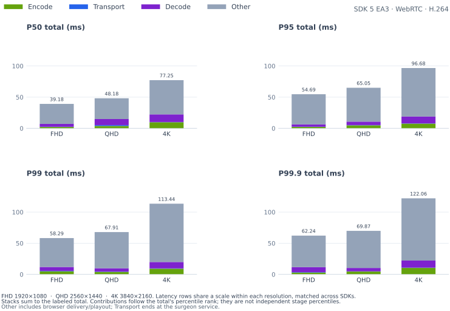

<details>
<summary>

#### P50

</summary>

<table>
    <thead>
        <tr><th align="left">RES</th><th align="left">CC</th><th align="right">FPS</th><th align="right">FS</th><th align="right">Encode (ms)</th><th align="right">Transport (ms)</th><th align="right">Decode (ms)</th><th align="right">Total (ms)</th></tr>
    </thead>
    <tbody>
        <tr><td>FHD</td><td><strong>H.264</strong></td><td align="right"><strong>27.67</strong></td><td align="right"><strong>35.5 KiB</strong></td><td align="right"><strong>2.44</strong></td><td align="right"><strong>0.35</strong></td><td align="right"><strong>3.90</strong></td><td align="right"><strong>39.18</strong></td></tr>
        <tr><td>QHD</td><td><strong>H.264</strong></td><td align="right"><strong>26.90</strong></td><td align="right"><strong>56.6 KiB</strong></td><td align="right"><strong>4.51</strong></td><td align="right"><strong>0.38</strong></td><td align="right"><strong>5.90</strong></td><td align="right"><strong>48.18</strong></td></tr>
        <tr><td>4K</td><td><strong>H.264</strong></td><td align="right"><strong>15.52</strong></td><td align="right"><strong>99.6 KiB</strong></td><td align="right"><strong>8.64</strong></td><td align="right"><strong>0.44</strong></td><td align="right"><strong>11.30</strong></td><td align="right"><strong>77.25</strong></td></tr>
    </tbody>
</table>

</details>

<details>
<summary>

#### P95

</summary>

<table>
    <thead>
        <tr><th align="left">RES</th><th align="left">CC</th><th align="right">FPS</th><th align="right">FS</th><th align="right">Encode (ms)</th><th align="right">Transport (ms)</th><th align="right">Decode (ms)</th><th align="right">Total (ms)</th></tr>
    </thead>
    <tbody>
        <tr><td>FHD</td><td><strong>H.264</strong></td><td align="right"><strong>27.67</strong></td><td align="right"><strong>35.5 KiB</strong></td><td align="right"><strong>3.73</strong></td><td align="right"><strong>0.53</strong></td><td align="right"><strong>6.70</strong></td><td align="right"><strong>54.69</strong></td></tr>
        <tr><td>QHD</td><td><strong>H.264</strong></td><td align="right"><strong>26.90</strong></td><td align="right"><strong>56.6 KiB</strong></td><td align="right"><strong>6.99</strong></td><td align="right"><strong>0.57</strong></td><td align="right"><strong>8.90</strong></td><td align="right"><strong>65.05</strong></td></tr>
        <tr><td>4K</td><td><strong>H.264</strong></td><td align="right"><strong>15.52</strong></td><td align="right"><strong>99.6 KiB</strong></td><td align="right"><strong>11.62</strong></td><td align="right"><strong>0.62</strong></td><td align="right"><strong>17.41</strong></td><td align="right"><strong>96.68</strong></td></tr>
    </tbody>
</table>

</details>

<details open>
<summary>

#### P99

</summary>

<table>
    <thead>
        <tr><th align="left">RES</th><th align="left">CC</th><th align="right">FPS</th><th align="right">FS</th><th align="right">Encode (ms)</th><th align="right">Transport (ms)</th><th align="right">Decode (ms)</th><th align="right">Total (ms)</th></tr>
    </thead>
    <tbody>
        <tr><td>FHD</td><td><strong>H.264</strong></td><td align="right"><strong>27.67</strong></td><td align="right"><strong>35.5 KiB</strong></td><td align="right"><strong>4.44</strong></td><td align="right"><strong>0.72</strong></td><td align="right"><strong>10.81</strong></td><td align="right"><strong>58.29</strong></td></tr>
        <tr><td>QHD</td><td><strong>H.264</strong></td><td align="right"><strong>26.90</strong></td><td align="right"><strong>56.6 KiB</strong></td><td align="right"><strong>7.94</strong></td><td align="right"><strong>0.79</strong></td><td align="right"><strong>9.90</strong></td><td align="right"><strong>67.91</strong></td></tr>
        <tr><td>4K</td><td><strong>H.264</strong></td><td align="right"><strong>15.52</strong></td><td align="right"><strong>99.6 KiB</strong></td><td align="right"><strong>12.73</strong></td><td align="right"><strong>0.85</strong></td><td align="right"><strong>22.02</strong></td><td align="right"><strong>113.44</strong></td></tr>
    </tbody>
</table>

</details>

<details open>
<summary>

#### P99.9

</summary>

<table>
    <thead>
        <tr><th align="left">RES</th><th align="left">CC</th><th align="right">FPS</th><th align="right">FS</th><th align="right">Encode (ms)</th><th align="right">Transport (ms)</th><th align="right">Decode (ms)</th><th align="right">Total (ms)</th></tr>
    </thead>
    <tbody>
        <tr><td>FHD</td><td><strong>H.264</strong></td><td align="right"><strong>27.67</strong></td><td align="right"><strong>35.5 KiB</strong></td><td align="right"><strong>5.81</strong></td><td align="right"><strong>1.17</strong></td><td align="right"><strong>13.96</strong></td><td align="right"><strong>62.24</strong></td></tr>
        <tr><td>QHD</td><td><strong>H.264</strong></td><td align="right"><strong>26.90</strong></td><td align="right"><strong>56.6 KiB</strong></td><td align="right"><strong>8.91</strong></td><td align="right"><strong>1.58</strong></td><td align="right"><strong>13.14</strong></td><td align="right"><strong>69.87</strong></td></tr>
        <tr><td>4K</td><td><strong>H.264</strong></td><td align="right"><strong>15.52</strong></td><td align="right"><strong>99.6 KiB</strong></td><td align="right"><strong>13.99</strong></td><td align="right"><strong>1.69</strong></td><td align="right"><strong>28.12</strong></td><td align="right"><strong>122.06</strong></td></tr>
    </tbody>
</table>

</details>

</details>

<details>
<summary>

### x86 (Patient) → x86 (Surgeon): MIRA Room Camera

</summary>

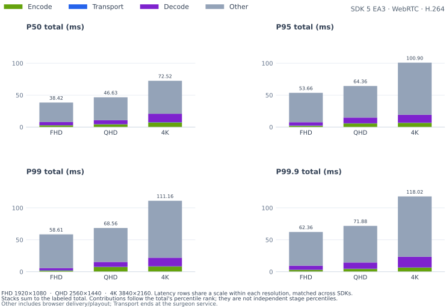

<details>
<summary>

#### P50

</summary>

<table>
    <thead>
        <tr><th align="left">RES</th><th align="left">CC</th><th align="right">FPS</th><th align="right">FS</th><th align="right">Encode (ms)</th><th align="right">Transport (ms)</th><th align="right">Decode (ms)</th><th align="right">Total (ms)</th></tr>
    </thead>
    <tbody>
        <tr><td>FHD</td><td><strong>H.264</strong></td><td align="right"><strong>27.81</strong></td><td align="right"><strong>35.4 KiB</strong></td><td align="right"><strong>2.23</strong></td><td align="right"><strong>0.25</strong></td><td align="right"><strong>4.10</strong></td><td align="right"><strong>38.42</strong></td></tr>
        <tr><td>QHD</td><td><strong>H.264</strong></td><td align="right"><strong>26.65</strong></td><td align="right"><strong>56.7 KiB</strong></td><td align="right"><strong>4.58</strong></td><td align="right"><strong>0.30</strong></td><td align="right"><strong>6.70</strong></td><td align="right"><strong>46.63</strong></td></tr>
        <tr><td>4K</td><td><strong>H.264</strong></td><td align="right"><strong>15.46</strong></td><td align="right"><strong>102.2 KiB</strong></td><td align="right"><strong>7.97</strong></td><td align="right"><strong>0.38</strong></td><td align="right"><strong>12.20</strong></td><td align="right"><strong>72.52</strong></td></tr>
    </tbody>
</table>

</details>

<details>
<summary>

#### P95

</summary>

<table>
    <thead>
        <tr><th align="left">RES</th><th align="left">CC</th><th align="right">FPS</th><th align="right">FS</th><th align="right">Encode (ms)</th><th align="right">Transport (ms)</th><th align="right">Decode (ms)</th><th align="right">Total (ms)</th></tr>
    </thead>
    <tbody>
        <tr><td>FHD</td><td><strong>H.264</strong></td><td align="right"><strong>27.81</strong></td><td align="right"><strong>35.4 KiB</strong></td><td align="right"><strong>4.13</strong></td><td align="right"><strong>1.21</strong></td><td align="right"><strong>6.90</strong></td><td align="right"><strong>53.66</strong></td></tr>
        <tr><td>QHD</td><td><strong>H.264</strong></td><td align="right"><strong>26.65</strong></td><td align="right"><strong>56.7 KiB</strong></td><td align="right"><strong>6.53</strong></td><td align="right"><strong>0.84</strong></td><td align="right"><strong>9.60</strong></td><td align="right"><strong>64.36</strong></td></tr>
        <tr><td>4K</td><td><strong>H.264</strong></td><td align="right"><strong>15.46</strong></td><td align="right"><strong>102.2 KiB</strong></td><td align="right"><strong>10.25</strong></td><td align="right"><strong>0.55</strong></td><td align="right"><strong>17.48</strong></td><td align="right"><strong>100.90</strong></td></tr>
    </tbody>
</table>

</details>

<details open>
<summary>

#### P99

</summary>

<table>
    <thead>
        <tr><th align="left">RES</th><th align="left">CC</th><th align="right">FPS</th><th align="right">FS</th><th align="right">Encode (ms)</th><th align="right">Transport (ms)</th><th align="right">Decode (ms)</th><th align="right">Total (ms)</th></tr>
    </thead>
    <tbody>
        <tr><td>FHD</td><td><strong>H.264</strong></td><td align="right"><strong>27.81</strong></td><td align="right"><strong>35.4 KiB</strong></td><td align="right"><strong>4.83</strong></td><td align="right"><strong>1.68</strong></td><td align="right"><strong>10.20</strong></td><td align="right"><strong>58.61</strong></td></tr>
        <tr><td>QHD</td><td><strong>H.264</strong></td><td align="right"><strong>26.65</strong></td><td align="right"><strong>56.7 KiB</strong></td><td align="right"><strong>7.34</strong></td><td align="right"><strong>1.65</strong></td><td align="right"><strong>11.15</strong></td><td align="right"><strong>68.56</strong></td></tr>
        <tr><td>4K</td><td><strong>H.264</strong></td><td align="right"><strong>15.46</strong></td><td align="right"><strong>102.2 KiB</strong></td><td align="right"><strong>11.83</strong></td><td align="right"><strong>0.76</strong></td><td align="right"><strong>19.90</strong></td><td align="right"><strong>111.16</strong></td></tr>
    </tbody>
</table>

</details>

<details open>
<summary>

#### P99.9

</summary>

<table>
    <thead>
        <tr><th align="left">RES</th><th align="left">CC</th><th align="right">FPS</th><th align="right">FS</th><th align="right">Encode (ms)</th><th align="right">Transport (ms)</th><th align="right">Decode (ms)</th><th align="right">Total (ms)</th></tr>
    </thead>
    <tbody>
        <tr><td>FHD</td><td><strong>H.264</strong></td><td align="right"><strong>27.81</strong></td><td align="right"><strong>35.4 KiB</strong></td><td align="right"><strong>5.99</strong></td><td align="right"><strong>3.16</strong></td><td align="right"><strong>13.66</strong></td><td align="right"><strong>62.36</strong></td></tr>
        <tr><td>QHD</td><td><strong>H.264</strong></td><td align="right"><strong>26.65</strong></td><td align="right"><strong>56.7 KiB</strong></td><td align="right"><strong>8.20</strong></td><td align="right"><strong>2.70</strong></td><td align="right"><strong>12.67</strong></td><td align="right"><strong>71.88</strong></td></tr>
        <tr><td>4K</td><td><strong>H.264</strong></td><td align="right"><strong>15.46</strong></td><td align="right"><strong>102.2 KiB</strong></td><td align="right"><strong>12.46</strong></td><td align="right"><strong>1.41</strong></td><td align="right"><strong>21.69</strong></td><td align="right"><strong>118.02</strong></td></tr>
    </tbody>
</table>

</details>

</details>

<details>
<summary>

### x86 (Patient) → x86 (Surgeon): Logitech BRIO Camera

</summary>

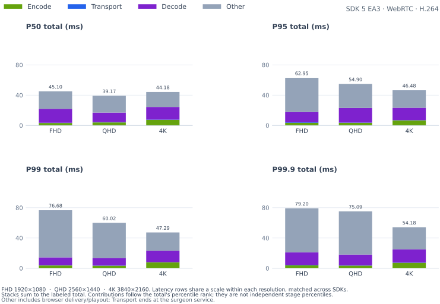

<details>
<summary>

#### P50

</summary>

<table>
    <thead>
        <tr><th align="left">RES</th><th align="left">CC</th><th align="right">FPS</th><th align="right">FS</th><th align="right">Encode (ms)</th><th align="right">Transport (ms)</th><th align="right">Decode (ms)</th><th align="right">Total (ms)</th></tr>
    </thead>
    <tbody>
        <tr><td>FHD</td><td><strong>H.264</strong></td><td align="right"><strong>30.00</strong></td><td align="right"><strong>36.0 KiB</strong></td><td align="right"><strong>3.25</strong></td><td align="right"><strong>0.43</strong></td><td align="right"><strong>11.70</strong></td><td align="right"><strong>45.10</strong></td></tr>
        <tr><td>QHD</td><td><strong>H.264</strong></td><td align="right"><strong>30.03</strong></td><td align="right"><strong>57.8 KiB</strong></td><td align="right"><strong>3.34</strong></td><td align="right"><strong>0.31</strong></td><td align="right"><strong>12.20</strong></td><td align="right"><strong>39.17</strong></td></tr>
        <tr><td>4K</td><td><strong>H.264</strong></td><td align="right"><strong>29.79</strong></td><td align="right"><strong>105.5 KiB</strong></td><td align="right"><strong>6.54</strong></td><td align="right"><strong>0.33</strong></td><td align="right"><strong>15.60</strong></td><td align="right"><strong>44.18</strong></td></tr>
    </tbody>
</table>

</details>

<details>
<summary>

#### P95

</summary>

<table>
    <thead>
        <tr><th align="left">RES</th><th align="left">CC</th><th align="right">FPS</th><th align="right">FS</th><th align="right">Encode (ms)</th><th align="right">Transport (ms)</th><th align="right">Decode (ms)</th><th align="right">Total (ms)</th></tr>
    </thead>
    <tbody>
        <tr><td>FHD</td><td><strong>H.264</strong></td><td align="right"><strong>30.00</strong></td><td align="right"><strong>36.0 KiB</strong></td><td align="right"><strong>4.61</strong></td><td align="right"><strong>0.97</strong></td><td align="right"><strong>18.70</strong></td><td align="right"><strong>62.95</strong></td></tr>
        <tr><td>QHD</td><td><strong>H.264</strong></td><td align="right"><strong>30.03</strong></td><td align="right"><strong>57.8 KiB</strong></td><td align="right"><strong>4.65</strong></td><td align="right"><strong>0.50</strong></td><td align="right"><strong>17.90</strong></td><td align="right"><strong>54.90</strong></td></tr>
        <tr><td>4K</td><td><strong>H.264</strong></td><td align="right"><strong>29.79</strong></td><td align="right"><strong>105.5 KiB</strong></td><td align="right"><strong>8.58</strong></td><td align="right"><strong>0.48</strong></td><td align="right"><strong>18.00</strong></td><td align="right"><strong>46.48</strong></td></tr>
    </tbody>
</table>

</details>

<details open>
<summary>

#### P99

</summary>

<table>
    <thead>
        <tr><th align="left">RES</th><th align="left">CC</th><th align="right">FPS</th><th align="right">FS</th><th align="right">Encode (ms)</th><th align="right">Transport (ms)</th><th align="right">Decode (ms)</th><th align="right">Total (ms)</th></tr>
    </thead>
    <tbody>
        <tr><td>FHD</td><td><strong>H.264</strong></td><td align="right"><strong>30.00</strong></td><td align="right"><strong>36.0 KiB</strong></td><td align="right"><strong>5.42</strong></td><td align="right"><strong>1.37</strong></td><td align="right"><strong>21.39</strong></td><td align="right"><strong>76.68</strong></td></tr>
        <tr><td>QHD</td><td><strong>H.264</strong></td><td align="right"><strong>30.03</strong></td><td align="right"><strong>57.8 KiB</strong></td><td align="right"><strong>5.10</strong></td><td align="right"><strong>0.59</strong></td><td align="right"><strong>20.82</strong></td><td align="right"><strong>60.02</strong></td></tr>
        <tr><td>4K</td><td><strong>H.264</strong></td><td align="right"><strong>29.79</strong></td><td align="right"><strong>105.5 KiB</strong></td><td align="right"><strong>9.08</strong></td><td align="right"><strong>0.61</strong></td><td align="right"><strong>20.47</strong></td><td align="right"><strong>47.29</strong></td></tr>
    </tbody>
</table>

</details>

<details open>
<summary>

#### P99.9

</summary>

<table>
    <thead>
        <tr><th align="left">RES</th><th align="left">CC</th><th align="right">FPS</th><th align="right">FS</th><th align="right">Encode (ms)</th><th align="right">Transport (ms)</th><th align="right">Decode (ms)</th><th align="right">Total (ms)</th></tr>
    </thead>
    <tbody>
        <tr><td>FHD</td><td><strong>H.264</strong></td><td align="right"><strong>30.00</strong></td><td align="right"><strong>36.0 KiB</strong></td><td align="right"><strong>6.23</strong></td><td align="right"><strong>1.55</strong></td><td align="right"><strong>25.63</strong></td><td align="right"><strong>79.20</strong></td></tr>
        <tr><td>QHD</td><td><strong>H.264</strong></td><td align="right"><strong>30.03</strong></td><td align="right"><strong>57.8 KiB</strong></td><td align="right"><strong>6.54</strong></td><td align="right"><strong>1.11</strong></td><td align="right"><strong>24.13</strong></td><td align="right"><strong>75.09</strong></td></tr>
        <tr><td>4K</td><td><strong>H.264</strong></td><td align="right"><strong>29.79</strong></td><td align="right"><strong>105.5 KiB</strong></td><td align="right"><strong>10.60</strong></td><td align="right"><strong>0.81</strong></td><td align="right"><strong>23.78</strong></td><td align="right"><strong>54.18</strong></td></tr>
    </tbody>
</table>

</details>

</details>

<details open>
<summary>

### Thor (Patient) → x86 (Surgeon): IMX274 Camera

</summary>

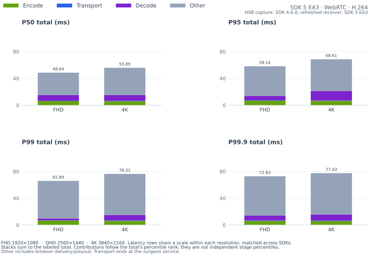

<details>
<summary>

#### P50

</summary>

<table>
    <thead>
        <tr><th align="left">RES</th><th align="left">CC</th><th align="right">FPS</th><th align="right">FS</th><th align="right">Encode (ms)</th><th align="right">Transport (ms)</th><th align="right">Decode (ms)</th><th align="right">Total (ms)</th></tr>
    </thead>
    <tbody>
        <tr><td>FHD</td><td><strong>H.264</strong></td><td align="right"><strong>59.26</strong></td><td align="right"><strong>19.2 KiB</strong></td><td align="right"><strong>6.58</strong></td><td align="right"><strong>0.55</strong></td><td align="right"><strong>6.00</strong></td><td align="right"><strong>48.64</strong></td></tr>
        <tr><td>4K</td><td><strong>H.264</strong></td><td align="right"><strong>55.44</strong></td><td align="right"><strong>58.3 KiB</strong></td><td align="right"><strong>6.16</strong></td><td align="right"><strong>0.60</strong></td><td align="right"><strong>8.60</strong></td><td align="right"><strong>55.89</strong></td></tr>
    </tbody>
</table>

</details>

<details>
<summary>

#### P95

</summary>

<table>
    <thead>
        <tr><th align="left">RES</th><th align="left">CC</th><th align="right">FPS</th><th align="right">FS</th><th align="right">Encode (ms)</th><th align="right">Transport (ms)</th><th align="right">Decode (ms)</th><th align="right">Total (ms)</th></tr>
    </thead>
    <tbody>
        <tr><td>FHD</td><td><strong>H.264</strong></td><td align="right"><strong>59.26</strong></td><td align="right"><strong>19.2 KiB</strong></td><td align="right"><strong>7.28</strong></td><td align="right"><strong>0.95</strong></td><td align="right"><strong>10.10</strong></td><td align="right"><strong>58.14</strong></td></tr>
        <tr><td>4K</td><td><strong>H.264</strong></td><td align="right"><strong>55.44</strong></td><td align="right"><strong>58.3 KiB</strong></td><td align="right"><strong>6.77</strong></td><td align="right"><strong>0.84</strong></td><td align="right"><strong>12.36</strong></td><td align="right"><strong>68.61</strong></td></tr>
    </tbody>
</table>

</details>

<details open>
<summary>

#### P99

</summary>

<table>
    <thead>
        <tr><th align="left">RES</th><th align="left">CC</th><th align="right">FPS</th><th align="right">FS</th><th align="right">Encode (ms)</th><th align="right">Transport (ms)</th><th align="right">Decode (ms)</th><th align="right">Total (ms)</th></tr>
    </thead>
    <tbody>
        <tr><td>FHD</td><td><strong>H.264</strong></td><td align="right"><strong>59.26</strong></td><td align="right"><strong>19.2 KiB</strong></td><td align="right"><strong>7.56</strong></td><td align="right"><strong>1.19</strong></td><td align="right"><strong>11.20</strong></td><td align="right"><strong>65.89</strong></td></tr>
        <tr><td>4K</td><td><strong>H.264</strong></td><td align="right"><strong>55.44</strong></td><td align="right"><strong>58.3 KiB</strong></td><td align="right"><strong>7.05</strong></td><td align="right"><strong>1.01</strong></td><td align="right"><strong>15.27</strong></td><td align="right"><strong>76.31</strong></td></tr>
    </tbody>
</table>

</details>

<details open>
<summary>

#### P99.9

</summary>

<table>
    <thead>
        <tr><th align="left">RES</th><th align="left">CC</th><th align="right">FPS</th><th align="right">FS</th><th align="right">Encode (ms)</th><th align="right">Transport (ms)</th><th align="right">Decode (ms)</th><th align="right">Total (ms)</th></tr>
    </thead>
    <tbody>
        <tr><td>FHD</td><td><strong>H.264</strong></td><td align="right"><strong>59.26</strong></td><td align="right"><strong>19.2 KiB</strong></td><td align="right"><strong>7.91</strong></td><td align="right"><strong>1.85</strong></td><td align="right"><strong>13.62</strong></td><td align="right"><strong>72.83</strong></td></tr>
        <tr><td>4K</td><td><strong>H.264</strong></td><td align="right"><strong>55.44</strong></td><td align="right"><strong>58.3 KiB</strong></td><td align="right"><strong>7.43</strong></td><td align="right"><strong>1.33</strong></td><td align="right"><strong>20.87</strong></td><td align="right"><strong>77.43</strong></td></tr>
    </tbody>
</table>

</details>

</details>

<details>
<summary>

### DGX Spark (Patient) → x86 (Surgeon): MIRA Procedure Camera

</summary>

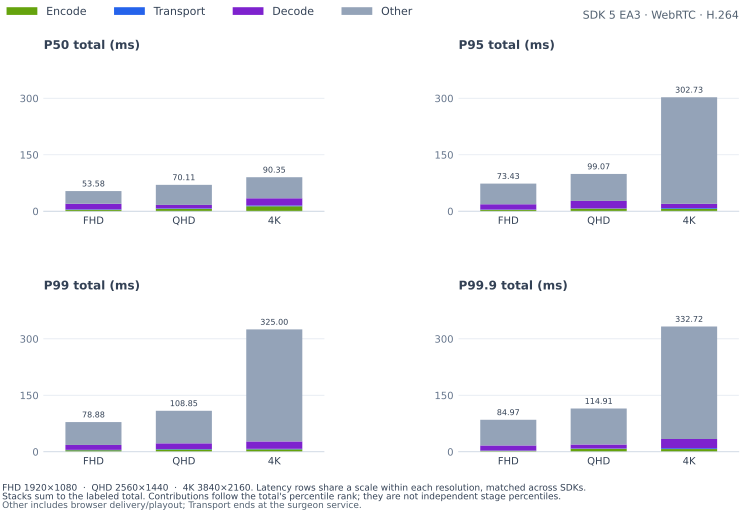

<details>
<summary>

#### P50

</summary>

<table>
    <thead>
        <tr><th align="left">RES</th><th align="left">CC</th><th align="right">FPS</th><th align="right">FS</th><th align="right">Encode (ms)</th><th align="right">Transport (ms)</th><th align="right">Decode (ms)</th><th align="right">Total (ms)</th></tr>
    </thead>
    <tbody>
        <tr><td>FHD</td><td><strong>H.264</strong></td><td align="right"><strong>16.26</strong></td><td align="right"><strong>35.2 KiB</strong></td><td align="right"><strong>3.52</strong></td><td align="right"><strong>0.91</strong></td><td align="right"><strong>10.50</strong></td><td align="right"><strong>53.58</strong></td></tr>
        <tr><td>QHD</td><td><strong>H.264</strong></td><td align="right"><strong>11.36</strong></td><td align="right"><strong>56.6 KiB</strong></td><td align="right"><strong>7.02</strong></td><td align="right"><strong>1.16</strong></td><td align="right"><strong>13.40</strong></td><td align="right"><strong>70.11</strong></td></tr>
        <tr><td>4K</td><td><strong>H.264</strong></td><td align="right"><strong>6.34</strong></td><td align="right"><strong>93.7 KiB</strong></td><td align="right"><strong>12.65</strong></td><td align="right"><strong>1.72</strong></td><td align="right"><strong>18.40</strong></td><td align="right"><strong>90.35</strong></td></tr>
    </tbody>
</table>

</details>

<details>
<summary>

#### P95

</summary>

<table>
    <thead>
        <tr><th align="left">RES</th><th align="left">CC</th><th align="right">FPS</th><th align="right">FS</th><th align="right">Encode (ms)</th><th align="right">Transport (ms)</th><th align="right">Decode (ms)</th><th align="right">Total (ms)</th></tr>
    </thead>
    <tbody>
        <tr><td>FHD</td><td><strong>H.264</strong></td><td align="right"><strong>16.26</strong></td><td align="right"><strong>35.2 KiB</strong></td><td align="right"><strong>4.86</strong></td><td align="right"><strong>1.60</strong></td><td align="right"><strong>15.00</strong></td><td align="right"><strong>73.43</strong></td></tr>
        <tr><td>QHD</td><td><strong>H.264</strong></td><td align="right"><strong>11.36</strong></td><td align="right"><strong>56.6 KiB</strong></td><td align="right"><strong>9.48</strong></td><td align="right"><strong>1.88</strong></td><td align="right"><strong>20.50</strong></td><td align="right"><strong>99.07</strong></td></tr>
        <tr><td>4K</td><td><strong>H.264</strong></td><td align="right"><strong>6.34</strong></td><td align="right"><strong>93.7 KiB</strong></td><td align="right"><strong>16.27</strong></td><td align="right"><strong>2.71</strong></td><td align="right"><strong>27.20</strong></td><td align="right"><strong>302.73</strong></td></tr>
    </tbody>
</table>

</details>

<details open>
<summary>

#### P99

</summary>

<table>
    <thead>
        <tr><th align="left">RES</th><th align="left">CC</th><th align="right">FPS</th><th align="right">FS</th><th align="right">Encode (ms)</th><th align="right">Transport (ms)</th><th align="right">Decode (ms)</th><th align="right">Total (ms)</th></tr>
    </thead>
    <tbody>
        <tr><td>FHD</td><td><strong>H.264</strong></td><td align="right"><strong>16.26</strong></td><td align="right"><strong>35.2 KiB</strong></td><td align="right"><strong>5.48</strong></td><td align="right"><strong>2.04</strong></td><td align="right"><strong>17.00</strong></td><td align="right"><strong>78.88</strong></td></tr>
        <tr><td>QHD</td><td><strong>H.264</strong></td><td align="right"><strong>11.36</strong></td><td align="right"><strong>56.6 KiB</strong></td><td align="right"><strong>10.46</strong></td><td align="right"><strong>2.33</strong></td><td align="right"><strong>21.63</strong></td><td align="right"><strong>108.85</strong></td></tr>
        <tr><td>4K</td><td><strong>H.264</strong></td><td align="right"><strong>6.34</strong></td><td align="right"><strong>93.7 KiB</strong></td><td align="right"><strong>19.20</strong></td><td align="right"><strong>3.04</strong></td><td align="right"><strong>31.76</strong></td><td align="right"><strong>325.00</strong></td></tr>
    </tbody>
</table>

</details>

<details open>
<summary>

#### P99.9

</summary>

<table>
    <thead>
        <tr><th align="left">RES</th><th align="left">CC</th><th align="right">FPS</th><th align="right">FS</th><th align="right">Encode (ms)</th><th align="right">Transport (ms)</th><th align="right">Decode (ms)</th><th align="right">Total (ms)</th></tr>
    </thead>
    <tbody>
        <tr><td>FHD</td><td><strong>H.264</strong></td><td align="right"><strong>16.26</strong></td><td align="right"><strong>35.2 KiB</strong></td><td align="right"><strong>5.92</strong></td><td align="right"><strong>2.95</strong></td><td align="right"><strong>20.22</strong></td><td align="right"><strong>84.97</strong></td></tr>
        <tr><td>QHD</td><td><strong>H.264</strong></td><td align="right"><strong>11.36</strong></td><td align="right"><strong>56.6 KiB</strong></td><td align="right"><strong>11.61</strong></td><td align="right"><strong>3.47</strong></td><td align="right"><strong>24.07</strong></td><td align="right"><strong>114.91</strong></td></tr>
        <tr><td>4K</td><td><strong>H.264</strong></td><td align="right"><strong>6.34</strong></td><td align="right"><strong>93.7 KiB</strong></td><td align="right"><strong>20.60</strong></td><td align="right"><strong>3.32</strong></td><td align="right"><strong>38.14</strong></td><td align="right"><strong>332.72</strong></td></tr>
    </tbody>
</table>

</details>

</details>

<details>
<summary>

### DGX Spark (Patient) → x86 (Surgeon): MIRA Room Camera

</summary>

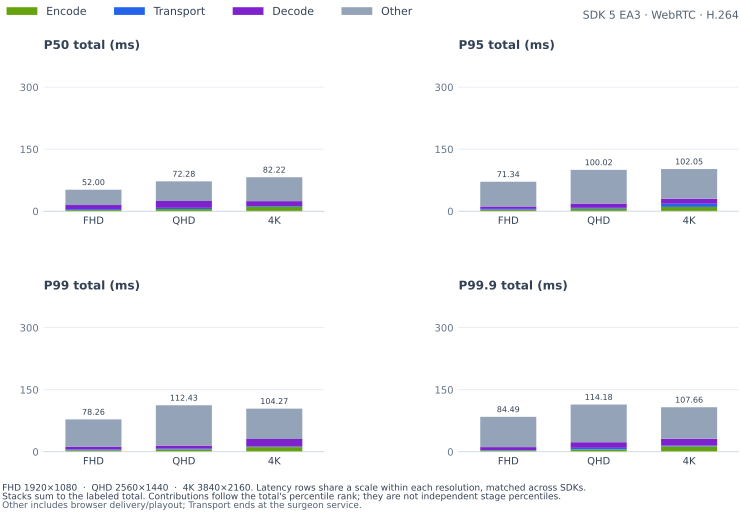

<details>
<summary>

#### P50

</summary>

<table>
    <thead>
        <tr><th align="left">RES</th><th align="left">CC</th><th align="right">FPS</th><th align="right">FS</th><th align="right">Encode (ms)</th><th align="right">Transport (ms)</th><th align="right">Decode (ms)</th><th align="right">Total (ms)</th></tr>
    </thead>
    <tbody>
        <tr><td>FHD</td><td><strong>H.264</strong></td><td align="right"><strong>16.26</strong></td><td align="right"><strong>35.4 KiB</strong></td><td align="right"><strong>3.09</strong></td><td align="right"><strong>1.94</strong></td><td align="right"><strong>8.80</strong></td><td align="right"><strong>52.00</strong></td></tr>
        <tr><td>QHD</td><td><strong>H.264</strong></td><td align="right"><strong>11.36</strong></td><td align="right"><strong>56.7 KiB</strong></td><td align="right"><strong>5.52</strong></td><td align="right"><strong>2.20</strong></td><td align="right"><strong>11.00</strong></td><td align="right"><strong>72.28</strong></td></tr>
        <tr><td>4K</td><td><strong>H.264</strong></td><td align="right"><strong>6.46</strong></td><td align="right"><strong>96.8 KiB</strong></td><td align="right"><strong>11.23</strong></td><td align="right"><strong>1.57</strong></td><td align="right"><strong>13.05</strong></td><td align="right"><strong>82.22</strong></td></tr>
    </tbody>
</table>

</details>

<details>
<summary>

#### P95

</summary>

<table>
    <thead>
        <tr><th align="left">RES</th><th align="left">CC</th><th align="right">FPS</th><th align="right">FS</th><th align="right">Encode (ms)</th><th align="right">Transport (ms)</th><th align="right">Decode (ms)</th><th align="right">Total (ms)</th></tr>
    </thead>
    <tbody>
        <tr><td>FHD</td><td><strong>H.264</strong></td><td align="right"><strong>16.26</strong></td><td align="right"><strong>35.4 KiB</strong></td><td align="right"><strong>4.56</strong></td><td align="right"><strong>7.32</strong></td><td align="right"><strong>15.00</strong></td><td align="right"><strong>71.34</strong></td></tr>
        <tr><td>QHD</td><td><strong>H.264</strong></td><td align="right"><strong>11.36</strong></td><td align="right"><strong>56.7 KiB</strong></td><td align="right"><strong>7.42</strong></td><td align="right"><strong>10.03</strong></td><td align="right"><strong>20.30</strong></td><td align="right"><strong>100.02</strong></td></tr>
        <tr><td>4K</td><td><strong>H.264</strong></td><td align="right"><strong>6.46</strong></td><td align="right"><strong>96.8 KiB</strong></td><td align="right"><strong>14.13</strong></td><td align="right"><strong>8.44</strong></td><td align="right"><strong>20.67</strong></td><td align="right"><strong>102.05</strong></td></tr>
    </tbody>
</table>

</details>

<details open>
<summary>

#### P99

</summary>

<table>
    <thead>
        <tr><th align="left">RES</th><th align="left">CC</th><th align="right">FPS</th><th align="right">FS</th><th align="right">Encode (ms)</th><th align="right">Transport (ms)</th><th align="right">Decode (ms)</th><th align="right">Total (ms)</th></tr>
    </thead>
    <tbody>
        <tr><td>FHD</td><td><strong>H.264</strong></td><td align="right"><strong>16.26</strong></td><td align="right"><strong>35.4 KiB</strong></td><td align="right"><strong>5.10</strong></td><td align="right"><strong>8.51</strong></td><td align="right"><strong>15.96</strong></td><td align="right"><strong>78.26</strong></td></tr>
        <tr><td>QHD</td><td><strong>H.264</strong></td><td align="right"><strong>11.36</strong></td><td align="right"><strong>56.7 KiB</strong></td><td align="right"><strong>8.04</strong></td><td align="right"><strong>11.21</strong></td><td align="right"><strong>21.38</strong></td><td align="right"><strong>112.43</strong></td></tr>
        <tr><td>4K</td><td><strong>H.264</strong></td><td align="right"><strong>6.46</strong></td><td align="right"><strong>96.8 KiB</strong></td><td align="right"><strong>15.72</strong></td><td align="right"><strong>13.09</strong></td><td align="right"><strong>25.33</strong></td><td align="right"><strong>104.27</strong></td></tr>
    </tbody>
</table>

</details>

<details open>
<summary>

#### P99.9

</summary>

<table>
    <thead>
        <tr><th align="left">RES</th><th align="left">CC</th><th align="right">FPS</th><th align="right">FS</th><th align="right">Encode (ms)</th><th align="right">Transport (ms)</th><th align="right">Decode (ms)</th><th align="right">Total (ms)</th></tr>
    </thead>
    <tbody>
        <tr><td>FHD</td><td><strong>H.264</strong></td><td align="right"><strong>16.26</strong></td><td align="right"><strong>35.4 KiB</strong></td><td align="right"><strong>5.33</strong></td><td align="right"><strong>9.53</strong></td><td align="right"><strong>17.75</strong></td><td align="right"><strong>84.49</strong></td></tr>
        <tr><td>QHD</td><td><strong>H.264</strong></td><td align="right"><strong>11.36</strong></td><td align="right"><strong>56.7 KiB</strong></td><td align="right"><strong>8.30</strong></td><td align="right"><strong>12.84</strong></td><td align="right"><strong>23.79</strong></td><td align="right"><strong>114.18</strong></td></tr>
        <tr><td>4K</td><td><strong>H.264</strong></td><td align="right"><strong>6.46</strong></td><td align="right"><strong>96.8 KiB</strong></td><td align="right"><strong>18.81</strong></td><td align="right"><strong>15.28</strong></td><td align="right"><strong>26.33</strong></td><td align="right"><strong>107.66</strong></td></tr>
    </tbody>
</table>

</details>

</details>

</details>
