# SDK 5 benchmark

<!-- markdownlint-configure-file {"MD024": {"siblings_only": true}, "MD033": {"allowed_elements": ["details", "summary", "table", "thead", "tbody", "tr", "th", "td", "strong"]}} -->

October 2026 · Holoscan `5.0.0a3 (public EA3)` · **48 configurations, 74 camera results**.

SDK 5 measurements collected 2026-10-17 on public EA3. The SDK 4 baseline is retained from October 2, 2026.

HSB capture runs SDK 4.6.0; its coordinator and surgeon run SDK 5. All other refreshed sources run SDK 5.

Compare resolutions and codecs for each patient source. **The surgeon always runs on the x86 workstation.** The main tables use Holoviz; [WebRTC](#appendix-webrtc) is in the appendix. [SDK 4 report](docs/BENCHMARK_SDK4.md) · [SDK comparison](docs/BENCHMARK_COMPARISON.md).

[Measurements](benchmarks/results/summary.csv) · [Matched-frame breakdowns](benchmarks/results/stages.csv) · [Raw records](benchmarks/results/matrix/) · [Hardware details](benchmarks/results/matrix/hardware-ea3.json)

## Sources and hosts

Titles identify the patient and surgeon roles. **x86** is the Host Machine described below.

| Patient → Surgeon | Scenario | Camera |
| ----------------------------------- | ------------------------ | ------------------------ |
| x86 (Patient) → x86 (Surgeon) | Same host · Simulation | MIRA procedure and room |
| x86 (Patient) → x86 (Surgeon) | Same host · Physical | Logitech BRIO webcam |
| Thor (Patient) → x86 (Surgeon) | Remote host · Physical | IMX274 via HSB, sensor 0 |
| DGX Spark (Patient) → x86 (Surgeon) | Remote host · Simulation | MIRA procedure and room |

Both MIRA cameras stream simultaneously.

Same-host tests run patient and surgeon on the same physical workstation. Remote patient nodes capture, encode and send directly to the surgeon. The patient dashboard/coordinator runs on the x86 workstation in all tests; it does not relay remote video.

| Host | Hardware | Ethernet link |
| --------- | --------------------------------------------------------------------------------------------------- | ------------: |
| x86 | x86_64 · Intel Core i9-14900K · NVIDIA RTX PRO 6000 Blackwell GPUs (Workstation and Max-Q editions) | 10 Gbit/s |
| Thor | ARM64 · NVIDIA Thor | 5 Gbit/s |
| DGX Spark | ARM64 · NVIDIA GB10 | 10 Gbit/s |

Link rates are the negotiated Ethernet speeds during testing.

| Resolution | Name | Pixels |
| ---------- | -------------- | --------- |
| FHD | Full HD | 1920×1080 |
| QHD | Quad HD | 2560×1440 |
| 4K | Ultra HD (UHD) | 3840×2160 |

MIRA and BRIO request 30 FPS; IMX274 requests 60 FPS in its native FHD and 4K modes. QHD has no IMX274 result. H.265 is tested only at 4K.

## Reading the charts and tables

Latency is in **milliseconds**. **RES** = resolution; **CC** = codec; **FPS** = viewer frame rate; **FS** = mean transport frame size.

**Total** is measured end-to-end latency, including preparation, queues and display handoff. Table stages are independent percentiles; they need not sum to Total. For BGR8, Encode/Decode mean packing/upload.

<details open>
<summary>

## x86 (Patient) → x86 (Surgeon): MIRA Procedure Camera

</summary>

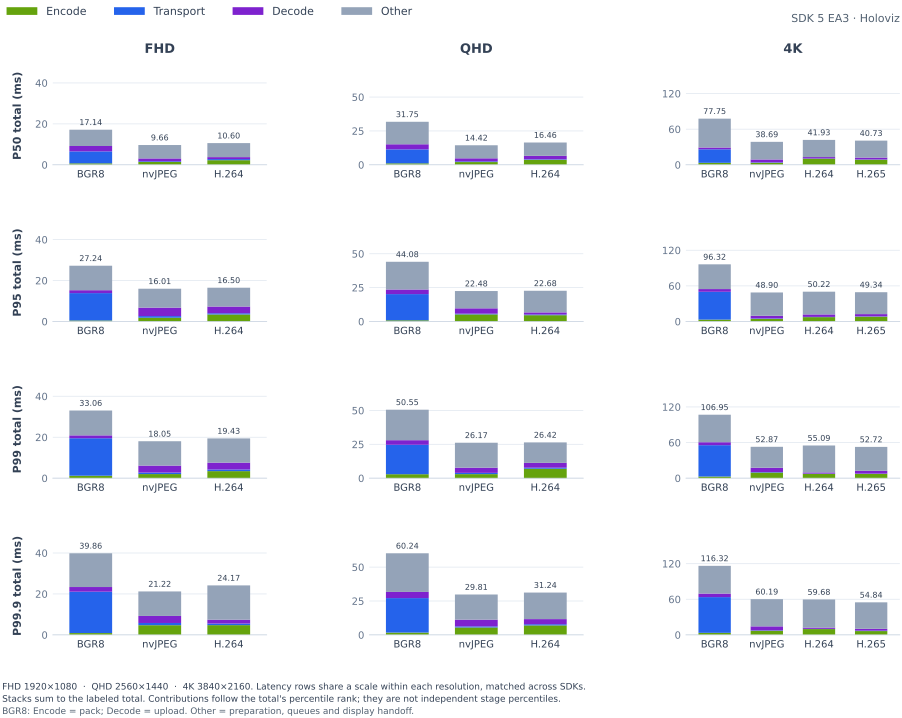

<details>
<summary>

### P50

</summary>

<table>
    <thead>
        <tr><th align="left">RES</th><th align="left">CC</th><th align="right">FPS</th><th align="right">FS</th><th align="right">Encode (ms)</th><th align="right">Transport (ms)</th><th align="right">Decode (ms)</th><th align="right">Total (ms)</th></tr>
    </thead>
    <tbody>
        <tr><td rowspan="3">FHD</td><td>BGR8</td><td align="right">29.55</td><td align="right">5.93 MiB</td><td align="right">0.53</td><td align="right">5.58</td><td align="right">1.37</td><td align="right">17.14</td></tr>
        <tr><td>nvJPEG</td><td align="right">28.58</td><td align="right">106.3 KiB</td><td align="right">1.41</td><td align="right">0.40</td><td align="right">1.32</td><td align="right">9.66</td></tr>
        <tr><td><strong>H.264</strong></td><td align="right"><strong>28.23</strong></td><td align="right"><strong>43.6 KiB</strong></td><td align="right"><strong>2.36</strong></td><td align="right"><strong>0.34</strong></td><td align="right"><strong>1.06</strong></td><td align="right"><strong>10.60</strong></td></tr>
        <tr><td rowspan="3">QHD</td><td>BGR8</td><td align="right">28.60</td><td align="right">10.55 MiB</td><td align="right">1.15</td><td align="right">11.64</td><td align="right">2.57</td><td align="right">31.75</td></tr>
        <tr><td>nvJPEG</td><td align="right">27.63</td><td align="right">163.3 KiB</td><td align="right">2.20</td><td align="right">0.45</td><td align="right">1.93</td><td align="right">14.42</td></tr>
        <tr><td><strong>H.264</strong></td><td align="right"><strong>27.55</strong></td><td align="right"><strong>61.2 KiB</strong></td><td align="right"><strong>3.89</strong></td><td align="right"><strong>0.36</strong></td><td align="right"><strong>1.74</strong></td><td align="right"><strong>16.46</strong></td></tr>
        <tr><td rowspan="4">4K</td><td>BGR8</td><td align="right">14.61</td><td align="right">23.73 MiB</td><td align="right">1.65</td><td align="right">27.43</td><td align="right">4.58</td><td align="right">77.75</td></tr>
        <tr><td>nvJPEG</td><td align="right">15.50</td><td align="right">309.1 KiB</td><td align="right">3.73</td><td align="right">0.72</td><td align="right">4.15</td><td align="right">38.69</td></tr>
        <tr><td><strong>H.264</strong></td><td align="right"><strong>15.36</strong></td><td align="right"><strong>99.9 KiB</strong></td><td align="right"><strong>7.65</strong></td><td align="right"><strong>0.40</strong></td><td align="right"><strong>2.99</strong></td><td align="right"><strong>41.93</strong></td></tr>
        <tr><td><strong>H.265</strong></td><td align="right"><strong>15.53</strong></td><td align="right"><strong>77.9 KiB</strong></td><td align="right"><strong>6.65</strong></td><td align="right"><strong>0.39</strong></td><td align="right"><strong>3.12</strong></td><td align="right"><strong>40.73</strong></td></tr>
    </tbody>
</table>

</details>

<details>
<summary>

### P95

</summary>

<table>
    <thead>
        <tr><th align="left">RES</th><th align="left">CC</th><th align="right">FPS</th><th align="right">FS</th><th align="right">Encode (ms)</th><th align="right">Transport (ms)</th><th align="right">Decode (ms)</th><th align="right">Total (ms)</th></tr>
    </thead>
    <tbody>
        <tr><td rowspan="3">FHD</td><td>BGR8</td><td align="right">29.55</td><td align="right">5.93 MiB</td><td align="right">1.21</td><td align="right">12.87</td><td align="right">2.98</td><td align="right">27.24</td></tr>
        <tr><td>nvJPEG</td><td align="right">28.58</td><td align="right">106.3 KiB</td><td align="right">2.45</td><td align="right">0.82</td><td align="right">3.99</td><td align="right">16.01</td></tr>
        <tr><td><strong>H.264</strong></td><td align="right"><strong>28.23</strong></td><td align="right"><strong>43.6 KiB</strong></td><td align="right"><strong>3.54</strong></td><td align="right"><strong>0.69</strong></td><td align="right"><strong>3.56</strong></td><td align="right"><strong>16.50</strong></td></tr>
        <tr><td rowspan="3">QHD</td><td>BGR8</td><td align="right">28.60</td><td align="right">10.55 MiB</td><td align="right">2.65</td><td align="right">19.70</td><td align="right">4.47</td><td align="right">44.08</td></tr>
        <tr><td>nvJPEG</td><td align="right">27.63</td><td align="right">163.3 KiB</td><td align="right">5.34</td><td align="right">0.76</td><td align="right">4.52</td><td align="right">22.48</td></tr>
        <tr><td><strong>H.264</strong></td><td align="right"><strong>27.55</strong></td><td align="right"><strong>61.2 KiB</strong></td><td align="right"><strong>6.10</strong></td><td align="right"><strong>0.64</strong></td><td align="right"><strong>3.92</strong></td><td align="right"><strong>22.68</strong></td></tr>
        <tr><td rowspan="4">4K</td><td>BGR8</td><td align="right">14.61</td><td align="right">23.73 MiB</td><td align="right">4.22</td><td align="right">46.17</td><td align="right">9.62</td><td align="right">96.32</td></tr>
        <tr><td>nvJPEG</td><td align="right">15.50</td><td align="right">309.1 KiB</td><td align="right">6.23</td><td align="right">1.45</td><td align="right">6.37</td><td align="right">48.90</td></tr>
        <tr><td><strong>H.264</strong></td><td align="right"><strong>15.36</strong></td><td align="right"><strong>99.9 KiB</strong></td><td align="right"><strong>10.17</strong></td><td align="right"><strong>0.54</strong></td><td align="right"><strong>4.74</strong></td><td align="right"><strong>50.22</strong></td></tr>
        <tr><td><strong>H.265</strong></td><td align="right"><strong>15.53</strong></td><td align="right"><strong>77.9 KiB</strong></td><td align="right"><strong>9.12</strong></td><td align="right"><strong>0.57</strong></td><td align="right"><strong>5.09</strong></td><td align="right"><strong>49.34</strong></td></tr>
    </tbody>
</table>

</details>

<details open>
<summary>

### P99

</summary>

<table>
    <thead>
        <tr><th align="left">RES</th><th align="left">CC</th><th align="right">FPS</th><th align="right">FS</th><th align="right">Encode (ms)</th><th align="right">Transport (ms)</th><th align="right">Decode (ms)</th><th align="right">Total (ms)</th></tr>
    </thead>
    <tbody>
        <tr><td rowspan="3">FHD</td><td>BGR8</td><td align="right">29.55</td><td align="right">5.93 MiB</td><td align="right">1.46</td><td align="right">17.17</td><td align="right">3.51</td><td align="right">33.06</td></tr>
        <tr><td>nvJPEG</td><td align="right">28.58</td><td align="right">106.3 KiB</td><td align="right">4.23</td><td align="right">1.29</td><td align="right">4.47</td><td align="right">18.05</td></tr>
        <tr><td><strong>H.264</strong></td><td align="right"><strong>28.23</strong></td><td align="right"><strong>43.6 KiB</strong></td><td align="right"><strong>4.57</strong></td><td align="right"><strong>1.01</strong></td><td align="right"><strong>3.88</strong></td><td align="right"><strong>19.43</strong></td></tr>
        <tr><td rowspan="3">QHD</td><td>BGR8</td><td align="right">28.60</td><td align="right">10.55 MiB</td><td align="right">3.08</td><td align="right">23.69</td><td align="right">5.13</td><td align="right">50.55</td></tr>
        <tr><td>nvJPEG</td><td align="right">27.63</td><td align="right">163.3 KiB</td><td align="right">7.16</td><td align="right">1.13</td><td align="right">4.95</td><td align="right">26.17</td></tr>
        <tr><td><strong>H.264</strong></td><td align="right"><strong>27.55</strong></td><td align="right"><strong>61.2 KiB</strong></td><td align="right"><strong>7.33</strong></td><td align="right"><strong>0.92</strong></td><td align="right"><strong>4.26</strong></td><td align="right"><strong>26.42</strong></td></tr>
        <tr><td rowspan="4">4K</td><td>BGR8</td><td align="right">14.61</td><td align="right">23.73 MiB</td><td align="right">4.98</td><td align="right">55.52</td><td align="right">11.04</td><td align="right">106.95</td></tr>
        <tr><td>nvJPEG</td><td align="right">15.50</td><td align="right">309.1 KiB</td><td align="right">8.62</td><td align="right">1.67</td><td align="right">7.83</td><td align="right">52.87</td></tr>
        <tr><td><strong>H.264</strong></td><td align="right"><strong>15.36</strong></td><td align="right"><strong>99.9 KiB</strong></td><td align="right"><strong>10.96</strong></td><td align="right"><strong>0.66</strong></td><td align="right"><strong>5.05</strong></td><td align="right"><strong>55.09</strong></td></tr>
        <tr><td><strong>H.265</strong></td><td align="right"><strong>15.53</strong></td><td align="right"><strong>77.9 KiB</strong></td><td align="right"><strong>9.83</strong></td><td align="right"><strong>0.78</strong></td><td align="right"><strong>5.24</strong></td><td align="right"><strong>52.72</strong></td></tr>
    </tbody>
</table>

</details>

<details open>
<summary>

### P99.9

</summary>

<table>
    <thead>
        <tr><th align="left">RES</th><th align="left">CC</th><th align="right">FPS</th><th align="right">FS</th><th align="right">Encode (ms)</th><th align="right">Transport (ms)</th><th align="right">Decode (ms)</th><th align="right">Total (ms)</th></tr>
    </thead>
    <tbody>
        <tr><td rowspan="3">FHD</td><td>BGR8</td><td align="right">29.55</td><td align="right">5.93 MiB</td><td align="right">2.48</td><td align="right">20.53</td><td align="right">4.09</td><td align="right">39.86</td></tr>
        <tr><td>nvJPEG</td><td align="right">28.58</td><td align="right">106.3 KiB</td><td align="right">6.29</td><td align="right">2.03</td><td align="right">5.14</td><td align="right">21.22</td></tr>
        <tr><td><strong>H.264</strong></td><td align="right"><strong>28.23</strong></td><td align="right"><strong>43.6 KiB</strong></td><td align="right"><strong>5.54</strong></td><td align="right"><strong>1.47</strong></td><td align="right"><strong>4.14</strong></td><td align="right"><strong>24.17</strong></td></tr>
        <tr><td rowspan="3">QHD</td><td>BGR8</td><td align="right">28.60</td><td align="right">10.55 MiB</td><td align="right">3.43</td><td align="right">27.14</td><td align="right">5.97</td><td align="right">60.24</td></tr>
        <tr><td>nvJPEG</td><td align="right">27.63</td><td align="right">163.3 KiB</td><td align="right">8.01</td><td align="right">1.58</td><td align="right">6.40</td><td align="right">29.81</td></tr>
        <tr><td><strong>H.264</strong></td><td align="right"><strong>27.55</strong></td><td align="right"><strong>61.2 KiB</strong></td><td align="right"><strong>8.54</strong></td><td align="right"><strong>1.49</strong></td><td align="right"><strong>4.61</strong></td><td align="right"><strong>31.24</strong></td></tr>
        <tr><td rowspan="4">4K</td><td>BGR8</td><td align="right">14.61</td><td align="right">23.73 MiB</td><td align="right">5.77</td><td align="right">64.32</td><td align="right">12.31</td><td align="right">116.32</td></tr>
        <tr><td>nvJPEG</td><td align="right">15.50</td><td align="right">309.1 KiB</td><td align="right">9.82</td><td align="right">1.97</td><td align="right">8.33</td><td align="right">60.19</td></tr>
        <tr><td><strong>H.264</strong></td><td align="right"><strong>15.36</strong></td><td align="right"><strong>99.9 KiB</strong></td><td align="right"><strong>11.85</strong></td><td align="right"><strong>0.89</strong></td><td align="right"><strong>5.40</strong></td><td align="right"><strong>59.68</strong></td></tr>
        <tr><td><strong>H.265</strong></td><td align="right"><strong>15.53</strong></td><td align="right"><strong>77.9 KiB</strong></td><td align="right"><strong>10.72</strong></td><td align="right"><strong>1.07</strong></td><td align="right"><strong>5.37</strong></td><td align="right"><strong>54.84</strong></td></tr>
    </tbody>
</table>

</details>

</details>

<details>
<summary>

## x86 (Patient) → x86 (Surgeon): MIRA Room Camera

</summary>

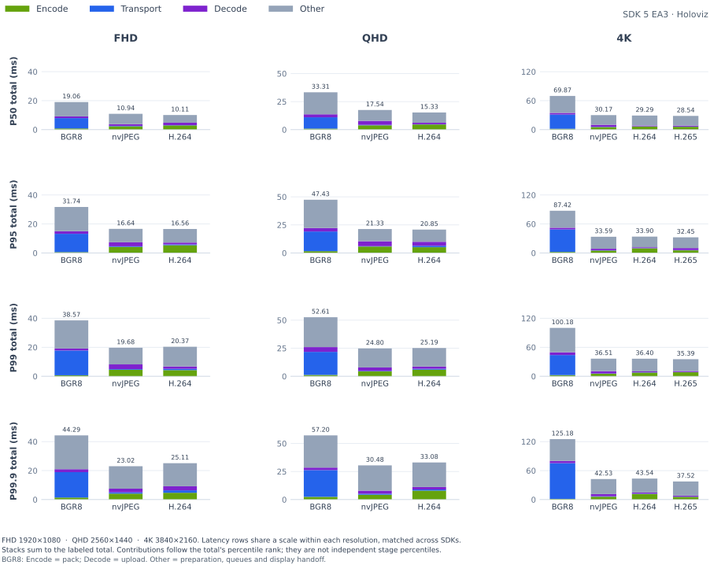

<details>
<summary>

### P50

</summary>

<table>
    <thead>
        <tr><th align="left">RES</th><th align="left">CC</th><th align="right">FPS</th><th align="right">FS</th><th align="right">Encode (ms)</th><th align="right">Transport (ms)</th><th align="right">Decode (ms)</th><th align="right">Total (ms)</th></tr>
    </thead>
    <tbody>
        <tr><td rowspan="3">FHD</td><td>BGR8</td><td align="right">29.56</td><td align="right">5.93 MiB</td><td align="right">0.53</td><td align="right">6.00</td><td align="right">1.46</td><td align="right">18.30</td></tr>
        <tr><td>nvJPEG</td><td align="right">28.56</td><td align="right">82.8 KiB</td><td align="right">1.28</td><td align="right">0.31</td><td align="right">1.20</td><td align="right">9.13</td></tr>
        <tr><td><strong>H.264</strong></td><td align="right"><strong>28.21</strong></td><td align="right"><strong>28.6 KiB</strong></td><td align="right"><strong>2.15</strong></td><td align="right"><strong>0.27</strong></td><td align="right"><strong>0.97</strong></td><td align="right"><strong>9.84</strong></td></tr>
        <tr><td rowspan="3">QHD</td><td>BGR8</td><td align="right">28.58</td><td align="right">10.55 MiB</td><td align="right">1.15</td><td align="right">10.92</td><td align="right">2.58</td><td align="right">34.05</td></tr>
        <tr><td>nvJPEG</td><td align="right">27.63</td><td align="right">131.6 KiB</td><td align="right">2.23</td><td align="right">0.38</td><td align="right">3.39</td><td align="right">16.42</td></tr>
        <tr><td><strong>H.264</strong></td><td align="right"><strong>27.56</strong></td><td align="right"><strong>40.6 KiB</strong></td><td align="right"><strong>4.07</strong></td><td align="right"><strong>0.30</strong></td><td align="right"><strong>2.25</strong></td><td align="right"><strong>16.39</strong></td></tr>
        <tr><td rowspan="4">4K</td><td>BGR8</td><td align="right">14.70</td><td align="right">23.73 MiB</td><td align="right">1.68</td><td align="right">28.58</td><td align="right">3.65</td><td align="right">68.32</td></tr>
        <tr><td>nvJPEG</td><td align="right">15.51</td><td align="right">263.1 KiB</td><td align="right">5.62</td><td align="right">0.57</td><td align="right">6.36</td><td align="right">31.78</td></tr>
        <tr><td><strong>H.264</strong></td><td align="right"><strong>15.38</strong></td><td align="right"><strong>67.5 KiB</strong></td><td align="right"><strong>7.80</strong></td><td align="right"><strong>0.32</strong></td><td align="right"><strong>2.97</strong></td><td align="right"><strong>31.42</strong></td></tr>
        <tr><td><strong>H.265</strong></td><td align="right"><strong>15.55</strong></td><td align="right"><strong>50.7 KiB</strong></td><td align="right"><strong>6.51</strong></td><td align="right"><strong>0.29</strong></td><td align="right"><strong>3.43</strong></td><td align="right"><strong>30.63</strong></td></tr>
    </tbody>
</table>

</details>

<details>
<summary>

### P95

</summary>

<table>
    <thead>
        <tr><th align="left">RES</th><th align="left">CC</th><th align="right">FPS</th><th align="right">FS</th><th align="right">Encode (ms)</th><th align="right">Transport (ms)</th><th align="right">Decode (ms)</th><th align="right">Total (ms)</th></tr>
    </thead>
    <tbody>
        <tr><td rowspan="3">FHD</td><td>BGR8</td><td align="right">29.56</td><td align="right">5.93 MiB</td><td align="right">1.24</td><td align="right">11.84</td><td align="right">2.96</td><td align="right">28.59</td></tr>
        <tr><td>nvJPEG</td><td align="right">28.56</td><td align="right">82.8 KiB</td><td align="right">4.87</td><td align="right">0.66</td><td align="right">3.69</td><td align="right">17.25</td></tr>
        <tr><td><strong>H.264</strong></td><td align="right"><strong>28.21</strong></td><td align="right"><strong>28.6 KiB</strong></td><td align="right"><strong>4.23</strong></td><td align="right"><strong>0.56</strong></td><td align="right"><strong>3.35</strong></td><td align="right"><strong>16.04</strong></td></tr>
        <tr><td rowspan="3">QHD</td><td>BGR8</td><td align="right">28.58</td><td align="right">10.55 MiB</td><td align="right">2.49</td><td align="right">20.06</td><td align="right">4.62</td><td align="right">48.35</td></tr>
        <tr><td>nvJPEG</td><td align="right">27.63</td><td align="right">131.6 KiB</td><td align="right">5.52</td><td align="right">0.65</td><td align="right">4.39</td><td align="right">21.48</td></tr>
        <tr><td><strong>H.264</strong></td><td align="right"><strong>27.56</strong></td><td align="right"><strong>40.6 KiB</strong></td><td align="right"><strong>5.92</strong></td><td align="right"><strong>0.62</strong></td><td align="right"><strong>3.63</strong></td><td align="right"><strong>21.50</strong></td></tr>
        <tr><td rowspan="4">4K</td><td>BGR8</td><td align="right">14.70</td><td align="right">23.73 MiB</td><td align="right">3.52</td><td align="right">44.95</td><td align="right">7.07</td><td align="right">91.16</td></tr>
        <tr><td>nvJPEG</td><td align="right">15.51</td><td align="right">263.1 KiB</td><td align="right">7.06</td><td align="right">0.75</td><td align="right">7.26</td><td align="right">35.26</td></tr>
        <tr><td><strong>H.264</strong></td><td align="right"><strong>15.38</strong></td><td align="right"><strong>67.5 KiB</strong></td><td align="right"><strong>9.86</strong></td><td align="right"><strong>0.41</strong></td><td align="right"><strong>4.21</strong></td><td align="right"><strong>34.73</strong></td></tr>
        <tr><td><strong>H.265</strong></td><td align="right"><strong>15.55</strong></td><td align="right"><strong>50.7 KiB</strong></td><td align="right"><strong>8.72</strong></td><td align="right"><strong>0.38</strong></td><td align="right"><strong>4.70</strong></td><td align="right"><strong>33.34</strong></td></tr>
    </tbody>
</table>

</details>

<details open>
<summary>

### P99

</summary>

<table>
    <thead>
        <tr><th align="left">RES</th><th align="left">CC</th><th align="right">FPS</th><th align="right">FS</th><th align="right">Encode (ms)</th><th align="right">Transport (ms)</th><th align="right">Decode (ms)</th><th align="right">Total (ms)</th></tr>
    </thead>
    <tbody>
        <tr><td rowspan="3">FHD</td><td>BGR8</td><td align="right">29.56</td><td align="right">5.93 MiB</td><td align="right">1.41</td><td align="right">15.25</td><td align="right">3.41</td><td align="right">34.16</td></tr>
        <tr><td>nvJPEG</td><td align="right">28.56</td><td align="right">82.8 KiB</td><td align="right">5.47</td><td align="right">0.98</td><td align="right">3.97</td><td align="right">19.48</td></tr>
        <tr><td><strong>H.264</strong></td><td align="right"><strong>28.21</strong></td><td align="right"><strong>28.6 KiB</strong></td><td align="right"><strong>5.17</strong></td><td align="right"><strong>0.97</strong></td><td align="right"><strong>3.61</strong></td><td align="right"><strong>19.16</strong></td></tr>
        <tr><td rowspan="3">QHD</td><td>BGR8</td><td align="right">28.58</td><td align="right">10.55 MiB</td><td align="right">2.85</td><td align="right">23.02</td><td align="right">5.32</td><td align="right">53.98</td></tr>
        <tr><td>nvJPEG</td><td align="right">27.63</td><td align="right">131.6 KiB</td><td align="right">6.31</td><td align="right">1.00</td><td align="right">4.87</td><td align="right">24.82</td></tr>
        <tr><td><strong>H.264</strong></td><td align="right"><strong>27.56</strong></td><td align="right"><strong>40.6 KiB</strong></td><td align="right"><strong>6.80</strong></td><td align="right"><strong>1.08</strong></td><td align="right"><strong>3.89</strong></td><td align="right"><strong>25.99</strong></td></tr>
        <tr><td rowspan="4">4K</td><td>BGR8</td><td align="right">14.70</td><td align="right">23.73 MiB</td><td align="right">3.81</td><td align="right">53.03</td><td align="right">9.22</td><td align="right">102.21</td></tr>
        <tr><td>nvJPEG</td><td align="right">15.51</td><td align="right">263.1 KiB</td><td align="right">8.01</td><td align="right">0.89</td><td align="right">7.52</td><td align="right">38.70</td></tr>
        <tr><td><strong>H.264</strong></td><td align="right"><strong>15.38</strong></td><td align="right"><strong>67.5 KiB</strong></td><td align="right"><strong>10.51</strong></td><td align="right"><strong>0.57</strong></td><td align="right"><strong>4.40</strong></td><td align="right"><strong>38.86</strong></td></tr>
        <tr><td><strong>H.265</strong></td><td align="right"><strong>15.55</strong></td><td align="right"><strong>50.7 KiB</strong></td><td align="right"><strong>9.29</strong></td><td align="right"><strong>0.50</strong></td><td align="right"><strong>4.82</strong></td><td align="right"><strong>35.89</strong></td></tr>
    </tbody>
</table>

</details>

<details open>
<summary>

### P99.9

</summary>

<table>
    <thead>
        <tr><th align="left">RES</th><th align="left">CC</th><th align="right">FPS</th><th align="right">FS</th><th align="right">Encode (ms)</th><th align="right">Transport (ms)</th><th align="right">Decode (ms)</th><th align="right">Total (ms)</th></tr>
    </thead>
    <tbody>
        <tr><td rowspan="3">FHD</td><td>BGR8</td><td align="right">29.56</td><td align="right">5.93 MiB</td><td align="right">2.09</td><td align="right">18.95</td><td align="right">4.06</td><td align="right">43.15</td></tr>
        <tr><td>nvJPEG</td><td align="right">28.56</td><td align="right">82.8 KiB</td><td align="right">5.93</td><td align="right">1.56</td><td align="right">4.38</td><td align="right">21.84</td></tr>
        <tr><td><strong>H.264</strong></td><td align="right"><strong>28.21</strong></td><td align="right"><strong>28.6 KiB</strong></td><td align="right"><strong>6.01</strong></td><td align="right"><strong>1.40</strong></td><td align="right"><strong>3.78</strong></td><td align="right"><strong>24.20</strong></td></tr>
        <tr><td rowspan="3">QHD</td><td>BGR8</td><td align="right">28.58</td><td align="right">10.55 MiB</td><td align="right">3.21</td><td align="right">24.91</td><td align="right">6.12</td><td align="right">56.85</td></tr>
        <tr><td>nvJPEG</td><td align="right">27.63</td><td align="right">131.6 KiB</td><td align="right">7.19</td><td align="right">1.89</td><td align="right">6.74</td><td align="right">29.94</td></tr>
        <tr><td><strong>H.264</strong></td><td align="right"><strong>27.56</strong></td><td align="right"><strong>40.6 KiB</strong></td><td align="right"><strong>7.65</strong></td><td align="right"><strong>1.66</strong></td><td align="right"><strong>4.23</strong></td><td align="right"><strong>29.90</strong></td></tr>
        <tr><td rowspan="4">4K</td><td>BGR8</td><td align="right">14.70</td><td align="right">23.73 MiB</td><td align="right">4.35</td><td align="right">64.54</td><td align="right">10.60</td><td align="right">122.73</td></tr>
        <tr><td>nvJPEG</td><td align="right">15.51</td><td align="right">263.1 KiB</td><td align="right">9.06</td><td align="right">1.08</td><td align="right">7.81</td><td align="right">43.66</td></tr>
        <tr><td><strong>H.264</strong></td><td align="right"><strong>15.38</strong></td><td align="right"><strong>67.5 KiB</strong></td><td align="right"><strong>10.63</strong></td><td align="right"><strong>0.79</strong></td><td align="right"><strong>4.59</strong></td><td align="right"><strong>44.20</strong></td></tr>
        <tr><td><strong>H.265</strong></td><td align="right"><strong>15.55</strong></td><td align="right"><strong>50.7 KiB</strong></td><td align="right"><strong>9.71</strong></td><td align="right"><strong>0.74</strong></td><td align="right"><strong>4.98</strong></td><td align="right"><strong>37.70</strong></td></tr>
    </tbody>
</table>

</details>

</details>

<details>
<summary>

## x86 (Patient) → x86 (Surgeon): Logitech BRIO Camera

</summary>

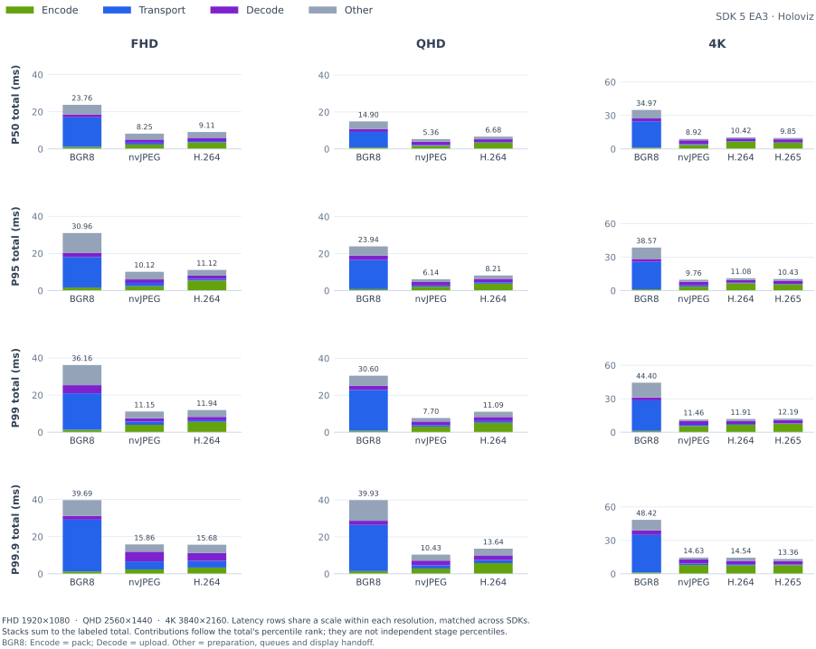

<details>
<summary>

### P50

</summary>

<table>
    <thead>
        <tr><th align="left">RES</th><th align="left">CC</th><th align="right">FPS</th><th align="right">FS</th><th align="right">Encode (ms)</th><th align="right">Transport (ms)</th><th align="right">Decode (ms)</th><th align="right">Total (ms)</th></tr>
    </thead>
    <tbody>
        <tr><td rowspan="3">FHD</td><td>BGR8</td><td align="right">29.83</td><td align="right">5.93 MiB</td><td align="right">1.29</td><td align="right">13.47</td><td align="right">1.60</td><td align="right">23.76</td></tr>
        <tr><td>nvJPEG</td><td align="right">29.96</td><td align="right">172.9 KiB</td><td align="right">2.37</td><td align="right">1.03</td><td align="right">1.77</td><td align="right">8.25</td></tr>
        <tr><td><strong>H.264</strong></td><td align="right"><strong>29.96</strong></td><td align="right"><strong>66.4 KiB</strong></td><td align="right"><strong>3.48</strong></td><td align="right"><strong>0.82</strong></td><td align="right"><strong>1.75</strong></td><td align="right"><strong>9.11</strong></td></tr>
        <tr><td rowspan="3">QHD</td><td>BGR8</td><td align="right">17.01</td><td align="right">10.55 MiB</td><td align="right">0.80</td><td align="right">8.72</td><td align="right">1.56</td><td align="right">14.90</td></tr>
        <tr><td>nvJPEG</td><td align="right">17.01</td><td align="right">363.4 KiB</td><td align="right">1.74</td><td align="right">0.46</td><td align="right">1.76</td><td align="right">5.36</td></tr>
        <tr><td><strong>H.264</strong></td><td align="right"><strong>17.03</strong></td><td align="right"><strong>145.3 KiB</strong></td><td align="right"><strong>3.44</strong></td><td align="right"><strong>0.32</strong></td><td align="right"><strong>1.55</strong></td><td align="right"><strong>6.68</strong></td></tr>
        <tr><td rowspan="4">4K</td><td>BGR8</td><td align="right">17.13</td><td align="right">23.73 MiB</td><td align="right">1.18</td><td align="right">24.00</td><td align="right">2.62</td><td align="right">34.97</td></tr>
        <tr><td>nvJPEG</td><td align="right">17.15</td><td align="right">683.5 KiB</td><td align="right">3.50</td><td align="right">0.69</td><td align="right">3.36</td><td align="right">8.92</td></tr>
        <tr><td><strong>H.264</strong></td><td align="right"><strong>17.15</strong></td><td align="right"><strong>256.4 KiB</strong></td><td align="right"><strong>6.56</strong></td><td align="right"><strong>0.32</strong></td><td align="right"><strong>2.30</strong></td><td align="right"><strong>10.42</strong></td></tr>
        <tr><td><strong>H.265</strong></td><td align="right"><strong>17.13</strong></td><td align="right"><strong>228.9 KiB</strong></td><td align="right"><strong>5.57</strong></td><td align="right"><strong>0.30</strong></td><td align="right"><strong>2.78</strong></td><td align="right"><strong>9.85</strong></td></tr>
    </tbody>
</table>

</details>

<details>
<summary>

### P95

</summary>

<table>
    <thead>
        <tr><th align="left">RES</th><th align="left">CC</th><th align="right">FPS</th><th align="right">FS</th><th align="right">Encode (ms)</th><th align="right">Transport (ms)</th><th align="right">Decode (ms)</th><th align="right">Total (ms)</th></tr>
    </thead>
    <tbody>
        <tr><td rowspan="3">FHD</td><td>BGR8</td><td align="right">29.83</td><td align="right">5.93 MiB</td><td align="right">2.03</td><td align="right">18.75</td><td align="right">2.29</td><td align="right">30.96</td></tr>
        <tr><td>nvJPEG</td><td align="right">29.96</td><td align="right">172.9 KiB</td><td align="right">3.29</td><td align="right">1.73</td><td align="right">2.19</td><td align="right">10.12</td></tr>
        <tr><td><strong>H.264</strong></td><td align="right"><strong>29.96</strong></td><td align="right"><strong>66.4 KiB</strong></td><td align="right"><strong>5.15</strong></td><td align="right"><strong>1.32</strong></td><td align="right"><strong>2.41</strong></td><td align="right"><strong>11.12</strong></td></tr>
        <tr><td rowspan="3">QHD</td><td>BGR8</td><td align="right">17.01</td><td align="right">10.55 MiB</td><td align="right">1.11</td><td align="right">16.44</td><td align="right">2.39</td><td align="right">23.94</td></tr>
        <tr><td>nvJPEG</td><td align="right">17.01</td><td align="right">363.4 KiB</td><td align="right">1.92</td><td align="right">0.81</td><td align="right">1.89</td><td align="right">6.14</td></tr>
        <tr><td><strong>H.264</strong></td><td align="right"><strong>17.03</strong></td><td align="right"><strong>145.3 KiB</strong></td><td align="right"><strong>3.97</strong></td><td align="right"><strong>0.67</strong></td><td align="right"><strong>1.91</strong></td><td align="right"><strong>8.21</strong></td></tr>
        <tr><td rowspan="4">4K</td><td>BGR8</td><td align="right">17.13</td><td align="right">23.73 MiB</td><td align="right">1.23</td><td align="right">25.95</td><td align="right">2.79</td><td align="right">38.57</td></tr>
        <tr><td>nvJPEG</td><td align="right">17.15</td><td align="right">683.5 KiB</td><td align="right">3.68</td><td align="right">1.20</td><td align="right">3.48</td><td align="right">9.76</td></tr>
        <tr><td><strong>H.264</strong></td><td align="right"><strong>17.15</strong></td><td align="right"><strong>256.4 KiB</strong></td><td align="right"><strong>6.65</strong></td><td align="right"><strong>0.56</strong></td><td align="right"><strong>2.46</strong></td><td align="right"><strong>11.08</strong></td></tr>
        <tr><td><strong>H.265</strong></td><td align="right"><strong>17.13</strong></td><td align="right"><strong>228.9 KiB</strong></td><td align="right"><strong>5.68</strong></td><td align="right"><strong>0.47</strong></td><td align="right"><strong>2.91</strong></td><td align="right"><strong>10.43</strong></td></tr>
    </tbody>
</table>

</details>

<details open>
<summary>

### P99

</summary>

<table>
    <thead>
        <tr><th align="left">RES</th><th align="left">CC</th><th align="right">FPS</th><th align="right">FS</th><th align="right">Encode (ms)</th><th align="right">Transport (ms)</th><th align="right">Decode (ms)</th><th align="right">Total (ms)</th></tr>
    </thead>
    <tbody>
        <tr><td rowspan="3">FHD</td><td>BGR8</td><td align="right">29.83</td><td align="right">5.93 MiB</td><td align="right">2.66</td><td align="right">23.42</td><td align="right">2.99</td><td align="right">36.16</td></tr>
        <tr><td>nvJPEG</td><td align="right">29.96</td><td align="right">172.9 KiB</td><td align="right">4.36</td><td align="right">1.97</td><td align="right">2.43</td><td align="right">11.15</td></tr>
        <tr><td><strong>H.264</strong></td><td align="right"><strong>29.96</strong></td><td align="right"><strong>66.4 KiB</strong></td><td align="right"><strong>5.77</strong></td><td align="right"><strong>1.49</strong></td><td align="right"><strong>2.64</strong></td><td align="right"><strong>11.94</strong></td></tr>
        <tr><td rowspan="3">QHD</td><td>BGR8</td><td align="right">17.01</td><td align="right">10.55 MiB</td><td align="right">2.08</td><td align="right">20.58</td><td align="right">2.70</td><td align="right">30.60</td></tr>
        <tr><td>nvJPEG</td><td align="right">17.01</td><td align="right">363.4 KiB</td><td align="right">2.94</td><td align="right">1.13</td><td align="right">2.09</td><td align="right">7.70</td></tr>
        <tr><td><strong>H.264</strong></td><td align="right"><strong>17.03</strong></td><td align="right"><strong>145.3 KiB</strong></td><td align="right"><strong>5.07</strong></td><td align="right"><strong>0.97</strong></td><td align="right"><strong>2.38</strong></td><td align="right"><strong>11.09</strong></td></tr>
        <tr><td rowspan="4">4K</td><td>BGR8</td><td align="right">17.13</td><td align="right">23.73 MiB</td><td align="right">1.25</td><td align="right">31.09</td><td align="right">4.61</td><td align="right">44.40</td></tr>
        <tr><td>nvJPEG</td><td align="right">17.15</td><td align="right">683.5 KiB</td><td align="right">5.26</td><td align="right">1.29</td><td align="right">3.55</td><td align="right">11.46</td></tr>
        <tr><td><strong>H.264</strong></td><td align="right"><strong>17.15</strong></td><td align="right"><strong>256.4 KiB</strong></td><td align="right"><strong>6.90</strong></td><td align="right"><strong>0.67</strong></td><td align="right"><strong>2.61</strong></td><td align="right"><strong>11.91</strong></td></tr>
        <tr><td><strong>H.265</strong></td><td align="right"><strong>17.13</strong></td><td align="right"><strong>228.9 KiB</strong></td><td align="right"><strong>7.64</strong></td><td align="right"><strong>0.53</strong></td><td align="right"><strong>3.04</strong></td><td align="right"><strong>12.19</strong></td></tr>
    </tbody>
</table>

</details>

<details open>
<summary>

### P99.9

</summary>

<table>
    <thead>
        <tr><th align="left">RES</th><th align="left">CC</th><th align="right">FPS</th><th align="right">FS</th><th align="right">Encode (ms)</th><th align="right">Transport (ms)</th><th align="right">Decode (ms)</th><th align="right">Total (ms)</th></tr>
    </thead>
    <tbody>
        <tr><td rowspan="3">FHD</td><td>BGR8</td><td align="right">29.83</td><td align="right">5.93 MiB</td><td align="right">2.87</td><td align="right">28.15</td><td align="right">3.85</td><td align="right">39.69</td></tr>
        <tr><td>nvJPEG</td><td align="right">29.96</td><td align="right">172.9 KiB</td><td align="right">4.64</td><td align="right">5.76</td><td align="right">4.56</td><td align="right">15.86</td></tr>
        <tr><td><strong>H.264</strong></td><td align="right"><strong>29.96</strong></td><td align="right"><strong>66.4 KiB</strong></td><td align="right"><strong>6.04</strong></td><td align="right"><strong>2.69</strong></td><td align="right"><strong>3.96</strong></td><td align="right"><strong>15.68</strong></td></tr>
        <tr><td rowspan="3">QHD</td><td>BGR8</td><td align="right">17.01</td><td align="right">10.55 MiB</td><td align="right">2.29</td><td align="right">27.15</td><td align="right">3.89</td><td align="right">39.93</td></tr>
        <tr><td>nvJPEG</td><td align="right">17.01</td><td align="right">363.4 KiB</td><td align="right">3.28</td><td align="right">2.04</td><td align="right">2.64</td><td align="right">10.43</td></tr>
        <tr><td><strong>H.264</strong></td><td align="right"><strong>17.03</strong></td><td align="right"><strong>145.3 KiB</strong></td><td align="right"><strong>5.89</strong></td><td align="right"><strong>1.51</strong></td><td align="right"><strong>2.61</strong></td><td align="right"><strong>13.64</strong></td></tr>
        <tr><td rowspan="4">4K</td><td>BGR8</td><td align="right">17.13</td><td align="right">23.73 MiB</td><td align="right">1.36</td><td align="right">34.56</td><td align="right">4.82</td><td align="right">48.42</td></tr>
        <tr><td>nvJPEG</td><td align="right">17.15</td><td align="right">683.5 KiB</td><td align="right">7.95</td><td align="right">1.58</td><td align="right">3.73</td><td align="right">14.63</td></tr>
        <tr><td><strong>H.264</strong></td><td align="right"><strong>17.15</strong></td><td align="right"><strong>256.4 KiB</strong></td><td align="right"><strong>8.89</strong></td><td align="right"><strong>1.70</strong></td><td align="right"><strong>3.01</strong></td><td align="right"><strong>14.54</strong></td></tr>
        <tr><td><strong>H.265</strong></td><td align="right"><strong>17.13</strong></td><td align="right"><strong>228.9 KiB</strong></td><td align="right"><strong>7.83</strong></td><td align="right"><strong>0.83</strong></td><td align="right"><strong>3.60</strong></td><td align="right"><strong>13.36</strong></td></tr>
    </tbody>
</table>

</details>

</details>

<details open>
<summary>

## Thor (Patient) → x86 (Surgeon): IMX274 Camera

</summary>

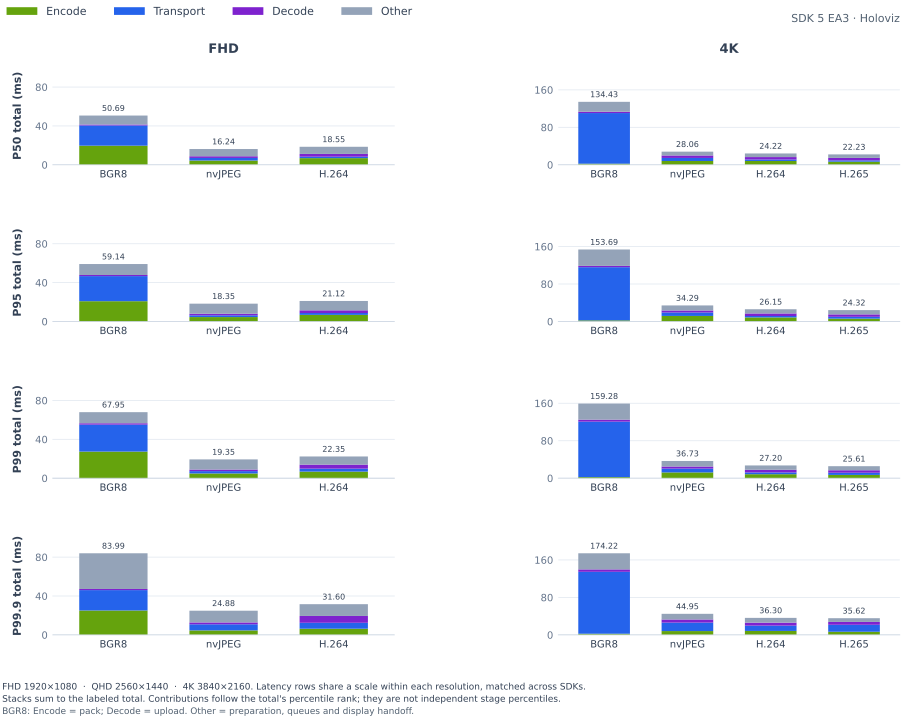

<details>
<summary>

### P50

</summary>

<table>
    <thead>
        <tr><th align="left">RES</th><th align="left">CC</th><th align="right">FPS</th><th align="right">FS</th><th align="right">Encode (ms)</th><th align="right">Transport (ms)</th><th align="right">Decode (ms)</th><th align="right">Total (ms)</th></tr>
    </thead>
    <tbody>
        <tr><td rowspan="3">FHD</td><td>BGR8</td><td align="right">50.33</td><td align="right">5.93 MiB</td><td align="right">20.11</td><td align="right">22.81</td><td align="right">1.02</td><td align="right">52.78</td></tr>
        <tr><td>nvJPEG</td><td align="right">59.91</td><td align="right">225.8 KiB</td><td align="right">4.46</td><td align="right">1.68</td><td align="right">1.61</td><td align="right">16.15</td></tr>
        <tr><td><strong>H.264</strong></td><td align="right"><strong>59.95</strong></td><td align="right"><strong>57.1 KiB</strong></td><td align="right"><strong>6.80</strong></td><td align="right"><strong>0.77</strong></td><td align="right"><strong>1.61</strong></td><td align="right"><strong>16.90</strong></td></tr>
        <tr><td rowspan="4">4K</td><td>BGR8</td><td align="right">15.10</td><td align="right">23.73 MiB</td><td align="right">2.18</td><td align="right">103.97</td><td align="right">2.75</td><td align="right">133.35</td></tr>
        <tr><td>nvJPEG</td><td align="right">60.03</td><td align="right">1.03 MiB</td><td align="right">9.76</td><td align="right">5.74</td><td align="right">4.31</td><td align="right">28.72</td></tr>
        <tr><td><strong>H.264</strong></td><td align="right"><strong>60.07</strong></td><td align="right"><strong>366.3 KiB</strong></td><td align="right"><strong>7.31</strong></td><td align="right"><strong>2.39</strong></td><td align="right"><strong>4.58</strong></td><td align="right"><strong>22.18</strong></td></tr>
        <tr><td><strong>H.265</strong></td><td align="right"><strong>60.09</strong></td><td align="right"><strong>373.4 KiB</strong></td><td align="right"><strong>6.49</strong></td><td align="right"><strong>2.34</strong></td><td align="right"><strong>4.58</strong></td><td align="right"><strong>21.32</strong></td></tr>
    </tbody>
</table>

</details>

<details>
<summary>

### P95

</summary>

<table>
    <thead>
        <tr><th align="left">RES</th><th align="left">CC</th><th align="right">FPS</th><th align="right">FS</th><th align="right">Encode (ms)</th><th align="right">Transport (ms)</th><th align="right">Decode (ms)</th><th align="right">Total (ms)</th></tr>
    </thead>
    <tbody>
        <tr><td rowspan="3">FHD</td><td>BGR8</td><td align="right">50.33</td><td align="right">5.93 MiB</td><td align="right">22.49</td><td align="right">27.97</td><td align="right">1.41</td><td align="right">68.60</td></tr>
        <tr><td>nvJPEG</td><td align="right">59.91</td><td align="right">225.8 KiB</td><td align="right">4.55</td><td align="right">2.52</td><td align="right">1.81</td><td align="right">17.36</td></tr>
        <tr><td><strong>H.264</strong></td><td align="right"><strong>59.95</strong></td><td align="right"><strong>57.1 KiB</strong></td><td align="right"><strong>7.45</strong></td><td align="right"><strong>1.29</strong></td><td align="right"><strong>1.93</strong></td><td align="right"><strong>18.47</strong></td></tr>
        <tr><td rowspan="4">4K</td><td>BGR8</td><td align="right">15.10</td><td align="right">23.73 MiB</td><td align="right">2.48</td><td align="right">112.03</td><td align="right">4.69</td><td align="right">148.16</td></tr>
        <tr><td>nvJPEG</td><td align="right">60.03</td><td align="right">1.03 MiB</td><td align="right">13.45</td><td align="right">7.64</td><td align="right">4.54</td><td align="right">34.04</td></tr>
        <tr><td><strong>H.264</strong></td><td align="right"><strong>60.07</strong></td><td align="right"><strong>366.3 KiB</strong></td><td align="right"><strong>7.59</strong></td><td align="right"><strong>3.63</strong></td><td align="right"><strong>4.89</strong></td><td align="right"><strong>23.58</strong></td></tr>
        <tr><td><strong>H.265</strong></td><td align="right"><strong>60.09</strong></td><td align="right"><strong>373.4 KiB</strong></td><td align="right"><strong>7.19</strong></td><td align="right"><strong>3.60</strong></td><td align="right"><strong>5.16</strong></td><td align="right"><strong>23.30</strong></td></tr>
    </tbody>
</table>

</details>

<details open>
<summary>

### P99

</summary>

<table>
    <thead>
        <tr><th align="left">RES</th><th align="left">CC</th><th align="right">FPS</th><th align="right">FS</th><th align="right">Encode (ms)</th><th align="right">Transport (ms)</th><th align="right">Decode (ms)</th><th align="right">Total (ms)</th></tr>
    </thead>
    <tbody>
        <tr><td rowspan="3">FHD</td><td>BGR8</td><td align="right">50.33</td><td align="right">5.93 MiB</td><td align="right">25.35</td><td align="right">29.61</td><td align="right">2.00</td><td align="right">79.67</td></tr>
        <tr><td>nvJPEG</td><td align="right">59.91</td><td align="right">225.8 KiB</td><td align="right">4.62</td><td align="right">2.75</td><td align="right">2.09</td><td align="right">18.24</td></tr>
        <tr><td><strong>H.264</strong></td><td align="right"><strong>59.95</strong></td><td align="right"><strong>57.1 KiB</strong></td><td align="right"><strong>7.72</strong></td><td align="right"><strong>1.52</strong></td><td align="right"><strong>2.25</strong></td><td align="right"><strong>19.39</strong></td></tr>
        <tr><td rowspan="4">4K</td><td>BGR8</td><td align="right">15.10</td><td align="right">23.73 MiB</td><td align="right">2.65</td><td align="right">116.61</td><td align="right">5.04</td><td align="right">154.80</td></tr>
        <tr><td>nvJPEG</td><td align="right">60.03</td><td align="right">1.03 MiB</td><td align="right">15.59</td><td align="right">8.38</td><td align="right">4.82</td><td align="right">37.17</td></tr>
        <tr><td><strong>H.264</strong></td><td align="right"><strong>60.07</strong></td><td align="right"><strong>366.3 KiB</strong></td><td align="right"><strong>7.72</strong></td><td align="right"><strong>4.00</strong></td><td align="right"><strong>5.90</strong></td><td align="right"><strong>24.45</strong></td></tr>
        <tr><td><strong>H.265</strong></td><td align="right"><strong>60.09</strong></td><td align="right"><strong>373.4 KiB</strong></td><td align="right"><strong>7.42</strong></td><td align="right"><strong>4.14</strong></td><td align="right"><strong>6.03</strong></td><td align="right"><strong>24.45</strong></td></tr>
    </tbody>
</table>

</details>

<details open>
<summary>

### P99.9

</summary>

<table>
    <thead>
        <tr><th align="left">RES</th><th align="left">CC</th><th align="right">FPS</th><th align="right">FS</th><th align="right">Encode (ms)</th><th align="right">Transport (ms)</th><th align="right">Decode (ms)</th><th align="right">Total (ms)</th></tr>
    </thead>
    <tbody>
        <tr><td rowspan="3">FHD</td><td>BGR8</td><td align="right">50.33</td><td align="right">5.93 MiB</td><td align="right">26.49</td><td align="right">34.03</td><td align="right">2.39</td><td align="right">84.65</td></tr>
        <tr><td>nvJPEG</td><td align="right">59.91</td><td align="right">225.8 KiB</td><td align="right">5.56</td><td align="right">10.55</td><td align="right">3.17</td><td align="right">26.38</td></tr>
        <tr><td><strong>H.264</strong></td><td align="right"><strong>59.95</strong></td><td align="right"><strong>57.1 KiB</strong></td><td align="right"><strong>8.10</strong></td><td align="right"><strong>4.46</strong></td><td align="right"><strong>3.63</strong></td><td align="right"><strong>24.93</strong></td></tr>
        <tr><td rowspan="4">4K</td><td>BGR8</td><td align="right">15.10</td><td align="right">23.73 MiB</td><td align="right">5.57</td><td align="right">133.11</td><td align="right">6.20</td><td align="right">167.52</td></tr>
        <tr><td>nvJPEG</td><td align="right">60.03</td><td align="right">1.03 MiB</td><td align="right">16.37</td><td align="right">19.68</td><td align="right">5.68</td><td align="right">42.98</td></tr>
        <tr><td><strong>H.264</strong></td><td align="right"><strong>60.07</strong></td><td align="right"><strong>366.3 KiB</strong></td><td align="right"><strong>8.04</strong></td><td align="right"><strong>9.70</strong></td><td align="right"><strong>6.89</strong></td><td align="right"><strong>33.26</strong></td></tr>
        <tr><td><strong>H.265</strong></td><td align="right"><strong>60.09</strong></td><td align="right"><strong>373.4 KiB</strong></td><td align="right"><strong>7.69</strong></td><td align="right"><strong>10.73</strong></td><td align="right"><strong>6.84</strong></td><td align="right"><strong>31.60</strong></td></tr>
    </tbody>
</table>

</details>

</details>

<details>
<summary>

## DGX Spark (Patient) → x86 (Surgeon): MIRA Procedure Camera

</summary>

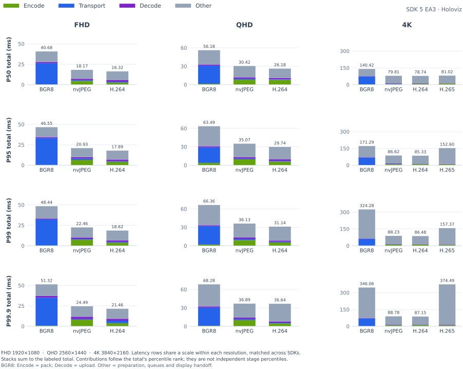

<details>
<summary>

### P50

</summary>

<table>
    <thead>
        <tr><th align="left">RES</th><th align="left">CC</th><th align="right">FPS</th><th align="right">FS</th><th align="right">Encode (ms)</th><th align="right">Transport (ms)</th><th align="right">Decode (ms)</th><th align="right">Total (ms)</th></tr>
    </thead>
    <tbody>
        <tr><td rowspan="3">FHD</td><td>BGR8</td><td align="right">16.11</td><td align="right">5.93 MiB</td><td align="right">0.53</td><td align="right">25.66</td><td align="right">1.15</td><td align="right">40.68</td></tr>
        <tr><td>nvJPEG</td><td align="right">16.00</td><td align="right">106.7 KiB</td><td align="right">5.09</td><td align="right">1.05</td><td align="right">1.65</td><td align="right">18.17</td></tr>
        <tr><td><strong>H.264</strong></td><td align="right"><strong>16.00</strong></td><td align="right"><strong>44.3 KiB</strong></td><td align="right"><strong>3.37</strong></td><td align="right"><strong>0.84</strong></td><td align="right"><strong>1.66</strong></td><td align="right"><strong>16.32</strong></td></tr>
        <tr><td rowspan="3">QHD</td><td>BGR8</td><td align="right">10.85</td><td align="right">10.55 MiB</td><td align="right">1.81</td><td align="right">28.16</td><td align="right">1.77</td><td align="right">56.18</td></tr>
        <tr><td>nvJPEG</td><td align="right">10.81</td><td align="right">164.4 KiB</td><td align="right">8.03</td><td align="right">1.38</td><td align="right">2.35</td><td align="right">30.42</td></tr>
        <tr><td><strong>H.264</strong></td><td align="right"><strong>10.96</strong></td><td align="right"><strong>62.3 KiB</strong></td><td align="right"><strong>6.65</strong></td><td align="right"><strong>1.02</strong></td><td align="right"><strong>1.96</strong></td><td align="right"><strong>26.18</strong></td></tr>
        <tr><td rowspan="4">4K</td><td>BGR8</td><td align="right">6.32</td><td align="right">23.73 MiB</td><td align="right">2.58</td><td align="right">65.45</td><td align="right">2.79</td><td align="right">140.42</td></tr>
        <tr><td>nvJPEG</td><td align="right">6.26</td><td align="right">310.5 KiB</td><td align="right">7.66</td><td align="right">2.17</td><td align="right">4.13</td><td align="right">79.81</td></tr>
        <tr><td><strong>H.264</strong></td><td align="right"><strong>6.30</strong></td><td align="right"><strong>101.3 KiB</strong></td><td align="right"><strong>9.35</strong></td><td align="right"><strong>1.30</strong></td><td align="right"><strong>2.82</strong></td><td align="right"><strong>78.74</strong></td></tr>
        <tr><td><strong>H.265</strong></td><td align="right"><strong>6.18</strong></td><td align="right"><strong>79.3 KiB</strong></td><td align="right"><strong>10.70</strong></td><td align="right"><strong>1.21</strong></td><td align="right"><strong>3.23</strong></td><td align="right"><strong>81.02</strong></td></tr>
    </tbody>
</table>

</details>

<details>
<summary>

### P95

</summary>

<table>
    <thead>
        <tr><th align="left">RES</th><th align="left">CC</th><th align="right">FPS</th><th align="right">FS</th><th align="right">Encode (ms)</th><th align="right">Transport (ms)</th><th align="right">Decode (ms)</th><th align="right">Total (ms)</th></tr>
    </thead>
    <tbody>
        <tr><td rowspan="3">FHD</td><td>BGR8</td><td align="right">16.11</td><td align="right">5.93 MiB</td><td align="right">1.02</td><td align="right">31.14</td><td align="right">1.84</td><td align="right">46.55</td></tr>
        <tr><td>nvJPEG</td><td align="right">16.00</td><td align="right">106.7 KiB</td><td align="right">6.67</td><td align="right">1.72</td><td align="right">1.92</td><td align="right">20.93</td></tr>
        <tr><td><strong>H.264</strong></td><td align="right"><strong>16.00</strong></td><td align="right"><strong>44.3 KiB</strong></td><td align="right"><strong>4.40</strong></td><td align="right"><strong>1.23</strong></td><td align="right"><strong>2.23</strong></td><td align="right"><strong>17.89</strong></td></tr>
        <tr><td rowspan="3">QHD</td><td>BGR8</td><td align="right">10.85</td><td align="right">10.55 MiB</td><td align="right">4.13</td><td align="right">34.12</td><td align="right">2.95</td><td align="right">63.49</td></tr>
        <tr><td>nvJPEG</td><td align="right">10.81</td><td align="right">164.4 KiB</td><td align="right">10.69</td><td align="right">2.10</td><td align="right">2.70</td><td align="right">35.07</td></tr>
        <tr><td><strong>H.264</strong></td><td align="right"><strong>10.96</strong></td><td align="right"><strong>62.3 KiB</strong></td><td align="right"><strong>9.43</strong></td><td align="right"><strong>1.59</strong></td><td align="right"><strong>2.43</strong></td><td align="right"><strong>29.74</strong></td></tr>
        <tr><td rowspan="4">4K</td><td>BGR8</td><td align="right">6.32</td><td align="right">23.73 MiB</td><td align="right">7.90</td><td align="right">78.39</td><td align="right">4.42</td><td align="right">171.29</td></tr>
        <tr><td>nvJPEG</td><td align="right">6.26</td><td align="right">310.5 KiB</td><td align="right">9.86</td><td align="right">3.74</td><td align="right">4.44</td><td align="right">86.62</td></tr>
        <tr><td><strong>H.264</strong></td><td align="right"><strong>6.30</strong></td><td align="right"><strong>101.3 KiB</strong></td><td align="right"><strong>11.70</strong></td><td align="right"><strong>1.87</strong></td><td align="right"><strong>3.44</strong></td><td align="right"><strong>85.33</strong></td></tr>
        <tr><td><strong>H.265</strong></td><td align="right"><strong>6.18</strong></td><td align="right"><strong>79.3 KiB</strong></td><td align="right"><strong>13.56</strong></td><td align="right"><strong>1.77</strong></td><td align="right"><strong>3.94</strong></td><td align="right"><strong>152.60</strong></td></tr>
    </tbody>
</table>

</details>

<details open>
<summary>

### P99

</summary>

<table>
    <thead>
        <tr><th align="left">RES</th><th align="left">CC</th><th align="right">FPS</th><th align="right">FS</th><th align="right">Encode (ms)</th><th align="right">Transport (ms)</th><th align="right">Decode (ms)</th><th align="right">Total (ms)</th></tr>
    </thead>
    <tbody>
        <tr><td rowspan="3">FHD</td><td>BGR8</td><td align="right">16.11</td><td align="right">5.93 MiB</td><td align="right">1.46</td><td align="right">32.86</td><td align="right">2.31</td><td align="right">48.44</td></tr>
        <tr><td>nvJPEG</td><td align="right">16.00</td><td align="right">106.7 KiB</td><td align="right">7.01</td><td align="right">1.92</td><td align="right">2.24</td><td align="right">22.46</td></tr>
        <tr><td><strong>H.264</strong></td><td align="right"><strong>16.00</strong></td><td align="right"><strong>44.3 KiB</strong></td><td align="right"><strong>5.12</strong></td><td align="right"><strong>1.41</strong></td><td align="right"><strong>2.48</strong></td><td align="right"><strong>18.62</strong></td></tr>
        <tr><td rowspan="3">QHD</td><td>BGR8</td><td align="right">10.85</td><td align="right">10.55 MiB</td><td align="right">4.43</td><td align="right">37.37</td><td align="right">3.68</td><td align="right">66.36</td></tr>
        <tr><td>nvJPEG</td><td align="right">10.81</td><td align="right">164.4 KiB</td><td align="right">11.69</td><td align="right">2.46</td><td align="right">2.89</td><td align="right">36.13</td></tr>
        <tr><td><strong>H.264</strong></td><td align="right"><strong>10.96</strong></td><td align="right"><strong>62.3 KiB</strong></td><td align="right"><strong>9.82</strong></td><td align="right"><strong>1.86</strong></td><td align="right"><strong>2.82</strong></td><td align="right"><strong>31.14</strong></td></tr>
        <tr><td rowspan="4">4K</td><td>BGR8</td><td align="right">6.32</td><td align="right">23.73 MiB</td><td align="right">9.75</td><td align="right">81.96</td><td align="right">4.99</td><td align="right">324.28</td></tr>
        <tr><td>nvJPEG</td><td align="right">6.26</td><td align="right">310.5 KiB</td><td align="right">10.26</td><td align="right">4.32</td><td align="right">4.82</td><td align="right">88.23</td></tr>
        <tr><td><strong>H.264</strong></td><td align="right"><strong>6.30</strong></td><td align="right"><strong>101.3 KiB</strong></td><td align="right"><strong>12.17</strong></td><td align="right"><strong>2.19</strong></td><td align="right"><strong>3.79</strong></td><td align="right"><strong>86.48</strong></td></tr>
        <tr><td><strong>H.265</strong></td><td align="right"><strong>6.18</strong></td><td align="right"><strong>79.3 KiB</strong></td><td align="right"><strong>16.65</strong></td><td align="right"><strong>2.13</strong></td><td align="right"><strong>4.13</strong></td><td align="right"><strong>157.37</strong></td></tr>
    </tbody>
</table>

</details>

<details open>
<summary>

### P99.9

</summary>

<table>
    <thead>
        <tr><th align="left">RES</th><th align="left">CC</th><th align="right">FPS</th><th align="right">FS</th><th align="right">Encode (ms)</th><th align="right">Transport (ms)</th><th align="right">Decode (ms)</th><th align="right">Total (ms)</th></tr>
    </thead>
    <tbody>
        <tr><td rowspan="3">FHD</td><td>BGR8</td><td align="right">16.11</td><td align="right">5.93 MiB</td><td align="right">2.17</td><td align="right">34.76</td><td align="right">2.80</td><td align="right">51.32</td></tr>
        <tr><td>nvJPEG</td><td align="right">16.00</td><td align="right">106.7 KiB</td><td align="right">8.64</td><td align="right">3.57</td><td align="right">3.76</td><td align="right">24.49</td></tr>
        <tr><td><strong>H.264</strong></td><td align="right"><strong>16.00</strong></td><td align="right"><strong>44.3 KiB</strong></td><td align="right"><strong>5.55</strong></td><td align="right"><strong>1.80</strong></td><td align="right"><strong>4.57</strong></td><td align="right"><strong>21.46</strong></td></tr>
        <tr><td rowspan="3">QHD</td><td>BGR8</td><td align="right">10.85</td><td align="right">10.55 MiB</td><td align="right">4.54</td><td align="right">39.48</td><td align="right">4.32</td><td align="right">68.28</td></tr>
        <tr><td>nvJPEG</td><td align="right">10.81</td><td align="right">164.4 KiB</td><td align="right">12.62</td><td align="right">3.11</td><td align="right">3.11</td><td align="right">36.89</td></tr>
        <tr><td><strong>H.264</strong></td><td align="right"><strong>10.96</strong></td><td align="right"><strong>62.3 KiB</strong></td><td align="right"><strong>10.07</strong></td><td align="right"><strong>3.00</strong></td><td align="right"><strong>2.92</strong></td><td align="right"><strong>36.64</strong></td></tr>
        <tr><td rowspan="4">4K</td><td>BGR8</td><td align="right">6.32</td><td align="right">23.73 MiB</td><td align="right">10.47</td><td align="right">85.01</td><td align="right">5.74</td><td align="right">346.06</td></tr>
        <tr><td>nvJPEG</td><td align="right">6.26</td><td align="right">310.5 KiB</td><td align="right">10.65</td><td align="right">5.01</td><td align="right">4.94</td><td align="right">88.78</td></tr>
        <tr><td><strong>H.264</strong></td><td align="right"><strong>6.30</strong></td><td align="right"><strong>101.3 KiB</strong></td><td align="right"><strong>13.30</strong></td><td align="right"><strong>2.28</strong></td><td align="right"><strong>3.87</strong></td><td align="right"><strong>87.15</strong></td></tr>
        <tr><td><strong>H.265</strong></td><td align="right"><strong>6.18</strong></td><td align="right"><strong>79.3 KiB</strong></td><td align="right"><strong>19.70</strong></td><td align="right"><strong>2.34</strong></td><td align="right"><strong>4.31</strong></td><td align="right"><strong>374.49</strong></td></tr>
    </tbody>
</table>

</details>

</details>

<details>
<summary>

## DGX Spark (Patient) → x86 (Surgeon): MIRA Room Camera

</summary>

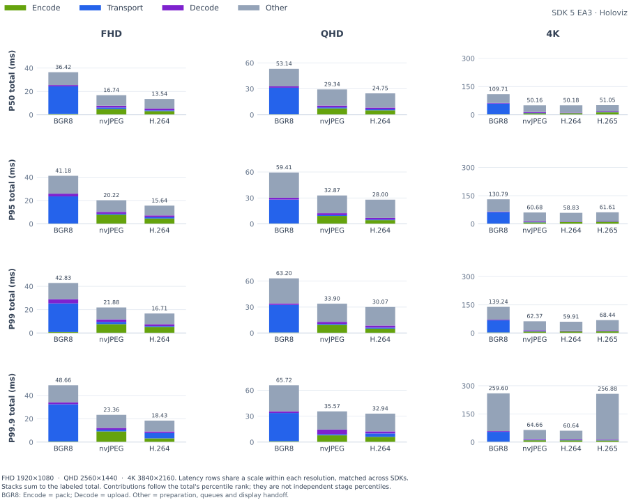

<details>
<summary>

### P50

</summary>

<table>
    <thead>
        <tr><th align="left">RES</th><th align="left">CC</th><th align="right">FPS</th><th align="right">FS</th><th align="right">Encode (ms)</th><th align="right">Transport (ms)</th><th align="right">Decode (ms)</th><th align="right">Total (ms)</th></tr>
    </thead>
    <tbody>
        <tr><td rowspan="3">FHD</td><td>BGR8</td><td align="right">16.21</td><td align="right">5.93 MiB</td><td align="right">0.43</td><td align="right">21.85</td><td align="right">1.13</td><td align="right">36.42</td></tr>
        <tr><td>nvJPEG</td><td align="right">16.03</td><td align="right">82.8 KiB</td><td align="right">5.69</td><td align="right">1.15</td><td align="right">1.61</td><td align="right">16.74</td></tr>
        <tr><td><strong>H.264</strong></td><td align="right"><strong>16.01</strong></td><td align="right"><strong>28.6 KiB</strong></td><td align="right"><strong>3.00</strong></td><td align="right"><strong>0.75</strong></td><td align="right"><strong>1.49</strong></td><td align="right"><strong>13.54</strong></td></tr>
        <tr><td rowspan="3">QHD</td><td>BGR8</td><td align="right">10.83</td><td align="right">10.55 MiB</td><td align="right">0.82</td><td align="right">25.39</td><td align="right">1.63</td><td align="right">53.14</td></tr>
        <tr><td>nvJPEG</td><td align="right">10.81</td><td align="right">131.7 KiB</td><td align="right">8.36</td><td align="right">1.17</td><td align="right">2.22</td><td align="right">29.34</td></tr>
        <tr><td><strong>H.264</strong></td><td align="right"><strong>10.98</strong></td><td align="right"><strong>40.6 KiB</strong></td><td align="right"><strong>5.16</strong></td><td align="right"><strong>0.84</strong></td><td align="right"><strong>1.80</strong></td><td align="right"><strong>24.75</strong></td></tr>
        <tr><td rowspan="4">4K</td><td>BGR8</td><td align="right">6.35</td><td align="right">23.73 MiB</td><td align="right">1.41</td><td align="right">54.27</td><td align="right">2.63</td><td align="right">109.71</td></tr>
        <tr><td>nvJPEG</td><td align="right">6.28</td><td align="right">263.1 KiB</td><td align="right">9.62</td><td align="right">1.82</td><td align="right">3.99</td><td align="right">50.16</td></tr>
        <tr><td><strong>H.264</strong></td><td align="right"><strong>6.30</strong></td><td align="right"><strong>67.5 KiB</strong></td><td align="right"><strong>9.95</strong></td><td align="right"><strong>1.14</strong></td><td align="right"><strong>2.65</strong></td><td align="right"><strong>50.18</strong></td></tr>
        <tr><td><strong>H.265</strong></td><td align="right"><strong>6.18</strong></td><td align="right"><strong>50.6 KiB</strong></td><td align="right"><strong>10.74</strong></td><td align="right"><strong>1.02</strong></td><td align="right"><strong>3.02</strong></td><td align="right"><strong>51.05</strong></td></tr>
    </tbody>
</table>

</details>

<details>
<summary>

### P95

</summary>

<table>
    <thead>
        <tr><th align="left">RES</th><th align="left">CC</th><th align="right">FPS</th><th align="right">FS</th><th align="right">Encode (ms)</th><th align="right">Transport (ms)</th><th align="right">Decode (ms)</th><th align="right">Total (ms)</th></tr>
    </thead>
    <tbody>
        <tr><td rowspan="3">FHD</td><td>BGR8</td><td align="right">16.21</td><td align="right">5.93 MiB</td><td align="right">0.71</td><td align="right">25.31</td><td align="right">2.01</td><td align="right">41.18</td></tr>
        <tr><td>nvJPEG</td><td align="right">16.03</td><td align="right">82.8 KiB</td><td align="right">8.28</td><td align="right">1.55</td><td align="right">2.00</td><td align="right">20.22</td></tr>
        <tr><td><strong>H.264</strong></td><td align="right"><strong>16.01</strong></td><td align="right"><strong>28.6 KiB</strong></td><td align="right"><strong>4.41</strong></td><td align="right"><strong>1.18</strong></td><td align="right"><strong>2.12</strong></td><td align="right"><strong>15.64</strong></td></tr>
        <tr><td rowspan="3">QHD</td><td>BGR8</td><td align="right">10.83</td><td align="right">10.55 MiB</td><td align="right">1.71</td><td align="right">30.77</td><td align="right">2.23</td><td align="right">59.41</td></tr>
        <tr><td>nvJPEG</td><td align="right">10.81</td><td align="right">131.7 KiB</td><td align="right">9.87</td><td align="right">1.85</td><td align="right">2.64</td><td align="right">32.87</td></tr>
        <tr><td><strong>H.264</strong></td><td align="right"><strong>10.98</strong></td><td align="right"><strong>40.6 KiB</strong></td><td align="right"><strong>7.06</strong></td><td align="right"><strong>1.21</strong></td><td align="right"><strong>2.51</strong></td><td align="right"><strong>28.00</strong></td></tr>
        <tr><td rowspan="4">4K</td><td>BGR8</td><td align="right">6.35</td><td align="right">23.73 MiB</td><td align="right">3.61</td><td align="right">65.13</td><td align="right">4.16</td><td align="right">130.79</td></tr>
        <tr><td>nvJPEG</td><td align="right">6.28</td><td align="right">263.1 KiB</td><td align="right">12.14</td><td align="right">3.21</td><td align="right">4.34</td><td align="right">60.68</td></tr>
        <tr><td><strong>H.264</strong></td><td align="right"><strong>6.30</strong></td><td align="right"><strong>67.5 KiB</strong></td><td align="right"><strong>12.16</strong></td><td align="right"><strong>1.70</strong></td><td align="right"><strong>2.87</strong></td><td align="right"><strong>58.83</strong></td></tr>
        <tr><td><strong>H.265</strong></td><td align="right"><strong>6.18</strong></td><td align="right"><strong>50.6 KiB</strong></td><td align="right"><strong>13.36</strong></td><td align="right"><strong>1.77</strong></td><td align="right"><strong>3.26</strong></td><td align="right"><strong>61.61</strong></td></tr>
    </tbody>
</table>

</details>

<details open>
<summary>

### P99

</summary>

<table>
    <thead>
        <tr><th align="left">RES</th><th align="left">CC</th><th align="right">FPS</th><th align="right">FS</th><th align="right">Encode (ms)</th><th align="right">Transport (ms)</th><th align="right">Decode (ms)</th><th align="right">Total (ms)</th></tr>
    </thead>
    <tbody>
        <tr><td rowspan="3">FHD</td><td>BGR8</td><td align="right">16.21</td><td align="right">5.93 MiB</td><td align="right">0.91</td><td align="right">26.74</td><td align="right">2.64</td><td align="right">42.83</td></tr>
        <tr><td>nvJPEG</td><td align="right">16.03</td><td align="right">82.8 KiB</td><td align="right">9.20</td><td align="right">1.76</td><td align="right">2.17</td><td align="right">21.88</td></tr>
        <tr><td><strong>H.264</strong></td><td align="right"><strong>16.01</strong></td><td align="right"><strong>28.6 KiB</strong></td><td align="right"><strong>5.04</strong></td><td align="right"><strong>1.44</strong></td><td align="right"><strong>2.41</strong></td><td align="right"><strong>16.71</strong></td></tr>
        <tr><td rowspan="3">QHD</td><td>BGR8</td><td align="right">10.83</td><td align="right">10.55 MiB</td><td align="right">2.27</td><td align="right">33.73</td><td align="right">3.01</td><td align="right">63.20</td></tr>
        <tr><td>nvJPEG</td><td align="right">10.81</td><td align="right">131.7 KiB</td><td align="right">10.49</td><td align="right">2.05</td><td align="right">2.85</td><td align="right">33.90</td></tr>
        <tr><td><strong>H.264</strong></td><td align="right"><strong>10.98</strong></td><td align="right"><strong>40.6 KiB</strong></td><td align="right"><strong>8.09</strong></td><td align="right"><strong>1.37</strong></td><td align="right"><strong>2.67</strong></td><td align="right"><strong>30.07</strong></td></tr>
        <tr><td rowspan="4">4K</td><td>BGR8</td><td align="right">6.35</td><td align="right">23.73 MiB</td><td align="right">5.42</td><td align="right">71.23</td><td align="right">5.14</td><td align="right">139.24</td></tr>
        <tr><td>nvJPEG</td><td align="right">6.28</td><td align="right">263.1 KiB</td><td align="right">12.68</td><td align="right">3.53</td><td align="right">4.57</td><td align="right">62.37</td></tr>
        <tr><td><strong>H.264</strong></td><td align="right"><strong>6.30</strong></td><td align="right"><strong>67.5 KiB</strong></td><td align="right"><strong>12.55</strong></td><td align="right"><strong>1.92</strong></td><td align="right"><strong>3.35</strong></td><td align="right"><strong>59.91</strong></td></tr>
        <tr><td><strong>H.265</strong></td><td align="right"><strong>6.18</strong></td><td align="right"><strong>50.6 KiB</strong></td><td align="right"><strong>13.70</strong></td><td align="right"><strong>2.24</strong></td><td align="right"><strong>3.90</strong></td><td align="right"><strong>68.44</strong></td></tr>
    </tbody>
</table>

</details>

<details open>
<summary>

### P99.9

</summary>

<table>
    <thead>
        <tr><th align="left">RES</th><th align="left">CC</th><th align="right">FPS</th><th align="right">FS</th><th align="right">Encode (ms)</th><th align="right">Transport (ms)</th><th align="right">Decode (ms)</th><th align="right">Total (ms)</th></tr>
    </thead>
    <tbody>
        <tr><td rowspan="3">FHD</td><td>BGR8</td><td align="right">16.21</td><td align="right">5.93 MiB</td><td align="right">1.16</td><td align="right">32.50</td><td align="right">3.31</td><td align="right">48.66</td></tr>
        <tr><td>nvJPEG</td><td align="right">16.03</td><td align="right">82.8 KiB</td><td align="right">9.68</td><td align="right">2.98</td><td align="right">2.82</td><td align="right">23.36</td></tr>
        <tr><td><strong>H.264</strong></td><td align="right"><strong>16.01</strong></td><td align="right"><strong>28.6 KiB</strong></td><td align="right"><strong>5.47</strong></td><td align="right"><strong>2.61</strong></td><td align="right"><strong>2.49</strong></td><td align="right"><strong>18.43</strong></td></tr>
        <tr><td rowspan="3">QHD</td><td>BGR8</td><td align="right">10.83</td><td align="right">10.55 MiB</td><td align="right">2.89</td><td align="right">36.00</td><td align="right">3.51</td><td align="right">65.72</td></tr>
        <tr><td>nvJPEG</td><td align="right">10.81</td><td align="right">131.7 KiB</td><td align="right">11.47</td><td align="right">3.91</td><td align="right">5.01</td><td align="right">35.57</td></tr>
        <tr><td><strong>H.264</strong></td><td align="right"><strong>10.98</strong></td><td align="right"><strong>40.6 KiB</strong></td><td align="right"><strong>8.69</strong></td><td align="right"><strong>4.12</strong></td><td align="right"><strong>3.30</strong></td><td align="right"><strong>32.94</strong></td></tr>
        <tr><td rowspan="4">4K</td><td>BGR8</td><td align="right">6.35</td><td align="right">23.73 MiB</td><td align="right">6.21</td><td align="right">78.41</td><td align="right">5.95</td><td align="right">259.60</td></tr>
        <tr><td>nvJPEG</td><td align="right">6.28</td><td align="right">263.1 KiB</td><td align="right">12.95</td><td align="right">3.77</td><td align="right">4.69</td><td align="right">64.66</td></tr>
        <tr><td><strong>H.264</strong></td><td align="right"><strong>6.30</strong></td><td align="right"><strong>67.5 KiB</strong></td><td align="right"><strong>13.12</strong></td><td align="right"><strong>2.31</strong></td><td align="right"><strong>3.42</strong></td><td align="right"><strong>60.64</strong></td></tr>
        <tr><td><strong>H.265</strong></td><td align="right"><strong>6.18</strong></td><td align="right"><strong>50.6 KiB</strong></td><td align="right"><strong>14.23</strong></td><td align="right"><strong>3.88</strong></td><td align="right"><strong>4.47</strong></td><td align="right"><strong>256.88</strong></td></tr>
    </tbody>
</table>

</details>

</details>

## Method and limits

- The coordinator and receiver use Holoscan `5.0.0a3 (public EA3)`; HSB capture uses `4.6.0` and all other sources use SDK 5. All 48 configurations collect 60 seconds after a 30-second warmup. Actual durations, sample counts, incomplete timing coverage and frame-loss counters are in the CSV.
- H.264/H.265 use NVENC P1, ultra-low-latency, QP 24, independent frames, no B frames and no lookahead. nvJPEG quality is 85. Equal QP does not imply equal visual quality.
- BRIO captures YUYV at FHD and MJPEG at QHD/4K. MJPEG decoding inside camera capture precedes the measured buffer boundary. IMX274 uses native sensor modes. Simulation recreates each camera at the requested render resolution.
- Timing starts when a USB BGR buffer, processed HSB Bayer buffer or simulator RGB buffer is available. Sensor exposure, earlier producer work and physical scanout are excluded. The full path includes frame preparation, encoder queue, encode/pack, source relay/queue, send queue, transport, receive queue, decode/upload and viewer handoff.
- Percentiles use linear interpolation over at most 10,000 valid samples. Timing excludes the first two seconds after reset; native summaries refresh every five seconds. Browser totals use frames matched by RTP timestamp. Transport uses the receiver's recorded `steady_metrics.delivery_ms` percentiles.
- Same-host timing uses a monotonic clock. Remote timing uses fresh UTC bounds or four-timestamp relative estimates. Clock uncertainty is recorded in the CSV; unresolved timing remains unavailable.
- Frame size excludes TLS/TCP/IP overhead. FPS, frame spacing, sequence gaps and browser drops are separate from latency. Browser FPS subtracts dropped frames from the [total video frame counter](https://w3c.github.io/media-playback-quality/); sequence gaps use application stream numbers.
- Streams retain their requested resolution through decoding. Native windows are capped at 1280×720; Chromium uses a 1600×1000 dashboard viewport. These are stream-resolution tests with display scaling afterward. Browser hardware decoding was not confirmed.

Each configuration has one measured run. P99.9 can depend on only a few frames in a 60-second sample, especially for slower simulation sources. Unrelated telesurgery streams and simulations were stopped. Power and clocks were observed rather than fixed; physical camera scenes were not controlled. Remote tests also change source hardware, so their differences are not solely network overhead. Isaac Sim rendering and CPU readback/IPC can limit throughput independently of the codec.

## Repeat one configuration

Start patient, node and surgeon services on SDK 5 EA3, approve the node and discover the cameras, then collect a run:

```bash
.venv-sdk5/bin/python scripts/benchmark.py \
  --camera host:procedure --camera host:room \
  --width 3840 --height 2160 --fps 30 \
  --codec h265 --receiver holoviz \
  --seconds 60 --output runs/benchmark.json
```

The collector starts/stops the selected streams and viewers and resets their metrics. It never moves robots. `--patient`, `--surgeon` and `--endpoint` select service addresses. For browser viewing, use `--codec h264 --receiver webrtc`; install Playwright/Chromium as described in [Contributing](CONTRIBUTING.md).

<details>
<summary>

## Appendix: WebRTC

</summary>

H.264 viewing in a visible Chromium browser on the surgeon's x86 workstation. The same source titles and percentiles apply. Total includes browser delivery and scheduling; Transport covers patient-to-surgeon-service delivery only.

<details open>
<summary>

### x86 (Patient) → x86 (Surgeon): MIRA Procedure Camera

</summary>

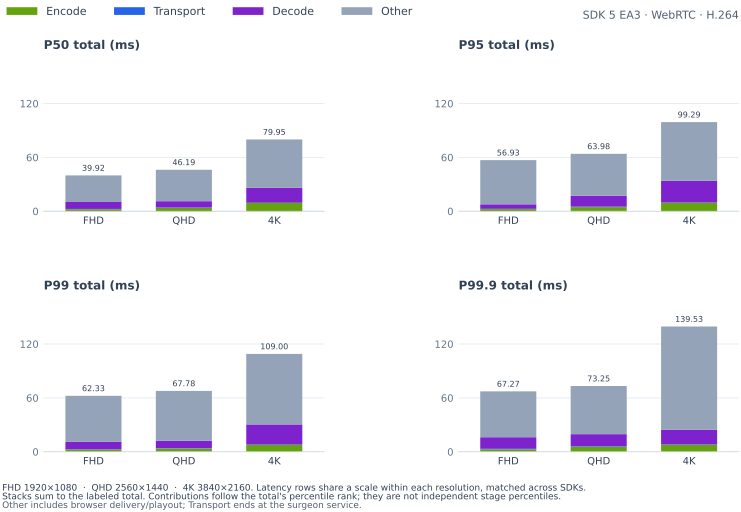

<details>
<summary>

#### P50

</summary>

<table>
    <thead>
        <tr><th align="left">RES</th><th align="left">CC</th><th align="right">FPS</th><th align="right">FS</th><th align="right">Encode (ms)</th><th align="right">Transport (ms)</th><th align="right">Decode (ms)</th><th align="right">Total (ms)</th></tr>
    </thead>
    <tbody>
        <tr><td>FHD</td><td><strong>H.264</strong></td><td align="right"><strong>26.93</strong></td><td align="right"><strong>43.6 KiB</strong></td><td align="right"><strong>2.36</strong></td><td align="right"><strong>0.33</strong></td><td align="right"><strong>5.60</strong></td><td align="right"><strong>39.92</strong></td></tr>
        <tr><td>QHD</td><td><strong>H.264</strong></td><td align="right"><strong>27.45</strong></td><td align="right"><strong>61.1 KiB</strong></td><td align="right"><strong>3.89</strong></td><td align="right"><strong>0.36</strong></td><td align="right"><strong>7.30</strong></td><td align="right"><strong>46.19</strong></td></tr>
        <tr><td>4K</td><td><strong>H.264</strong></td><td align="right"><strong>15.84</strong></td><td align="right"><strong>100.3 KiB</strong></td><td align="right"><strong>7.89</strong></td><td align="right"><strong>0.43</strong></td><td align="right"><strong>13.80</strong></td><td align="right"><strong>79.95</strong></td></tr>
    </tbody>
</table>

</details>

<details>
<summary>

#### P95

</summary>

<table>
    <thead>
        <tr><th align="left">RES</th><th align="left">CC</th><th align="right">FPS</th><th align="right">FS</th><th align="right">Encode (ms)</th><th align="right">Transport (ms)</th><th align="right">Decode (ms)</th><th align="right">Total (ms)</th></tr>
    </thead>
    <tbody>
        <tr><td>FHD</td><td><strong>H.264</strong></td><td align="right"><strong>26.93</strong></td><td align="right"><strong>43.6 KiB</strong></td><td align="right"><strong>3.27</strong></td><td align="right"><strong>0.59</strong></td><td align="right"><strong>11.60</strong></td><td align="right"><strong>56.93</strong></td></tr>
        <tr><td>QHD</td><td><strong>H.264</strong></td><td align="right"><strong>27.45</strong></td><td align="right"><strong>61.1 KiB</strong></td><td align="right"><strong>5.78</strong></td><td align="right"><strong>0.49</strong></td><td align="right"><strong>10.80</strong></td><td align="right"><strong>63.98</strong></td></tr>
        <tr><td>4K</td><td><strong>H.264</strong></td><td align="right"><strong>15.84</strong></td><td align="right"><strong>100.3 KiB</strong></td><td align="right"><strong>10.43</strong></td><td align="right"><strong>0.61</strong></td><td align="right"><strong>18.40</strong></td><td align="right"><strong>99.29</strong></td></tr>
    </tbody>
</table>

</details>

<details open>
<summary>

#### P99

</summary>

<table>
    <thead>
        <tr><th align="left">RES</th><th align="left">CC</th><th align="right">FPS</th><th align="right">FS</th><th align="right">Encode (ms)</th><th align="right">Transport (ms)</th><th align="right">Decode (ms)</th><th align="right">Total (ms)</th></tr>
    </thead>
    <tbody>
        <tr><td>FHD</td><td><strong>H.264</strong></td><td align="right"><strong>26.93</strong></td><td align="right"><strong>43.6 KiB</strong></td><td align="right"><strong>4.23</strong></td><td align="right"><strong>0.90</strong></td><td align="right"><strong>15.40</strong></td><td align="right"><strong>62.33</strong></td></tr>
        <tr><td>QHD</td><td><strong>H.264</strong></td><td align="right"><strong>27.45</strong></td><td align="right"><strong>61.1 KiB</strong></td><td align="right"><strong>7.01</strong></td><td align="right"><strong>0.71</strong></td><td align="right"><strong>14.31</strong></td><td align="right"><strong>67.78</strong></td></tr>
        <tr><td>4K</td><td><strong>H.264</strong></td><td align="right"><strong>15.84</strong></td><td align="right"><strong>100.3 KiB</strong></td><td align="right"><strong>11.04</strong></td><td align="right"><strong>0.80</strong></td><td align="right"><strong>22.51</strong></td><td align="right"><strong>109.00</strong></td></tr>
    </tbody>
</table>

</details>

<details open>
<summary>

#### P99.9

</summary>

<table>
    <thead>
        <tr><th align="left">RES</th><th align="left">CC</th><th align="right">FPS</th><th align="right">FS</th><th align="right">Encode (ms)</th><th align="right">Transport (ms)</th><th align="right">Decode (ms)</th><th align="right">Total (ms)</th></tr>
    </thead>
    <tbody>
        <tr><td>FHD</td><td><strong>H.264</strong></td><td align="right"><strong>26.93</strong></td><td align="right"><strong>43.6 KiB</strong></td><td align="right"><strong>5.09</strong></td><td align="right"><strong>1.33</strong></td><td align="right"><strong>20.49</strong></td><td align="right"><strong>67.27</strong></td></tr>
        <tr><td>QHD</td><td><strong>H.264</strong></td><td align="right"><strong>27.45</strong></td><td align="right"><strong>61.1 KiB</strong></td><td align="right"><strong>7.53</strong></td><td align="right"><strong>1.11</strong></td><td align="right"><strong>17.61</strong></td><td align="right"><strong>73.25</strong></td></tr>
        <tr><td>4K</td><td><strong>H.264</strong></td><td align="right"><strong>15.84</strong></td><td align="right"><strong>100.3 KiB</strong></td><td align="right"><strong>11.42</strong></td><td align="right"><strong>1.37</strong></td><td align="right"><strong>28.76</strong></td><td align="right"><strong>139.53</strong></td></tr>
    </tbody>
</table>

</details>

</details>

<details>
<summary>

### x86 (Patient) → x86 (Surgeon): MIRA Room Camera

</summary>

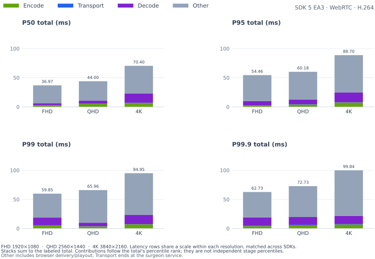

<details>
<summary>

#### P50

</summary>

<table>
    <thead>
        <tr><th align="left">RES</th><th align="left">CC</th><th align="right">FPS</th><th align="right">FS</th><th align="right">Encode (ms)</th><th align="right">Transport (ms)</th><th align="right">Decode (ms)</th><th align="right">Total (ms)</th></tr>
    </thead>
    <tbody>
        <tr><td>FHD</td><td><strong>H.264</strong></td><td align="right"><strong>26.97</strong></td><td align="right"><strong>28.6 KiB</strong></td><td align="right"><strong>2.06</strong></td><td align="right"><strong>0.26</strong></td><td align="right"><strong>4.60</strong></td><td align="right"><strong>38.06</strong></td></tr>
        <tr><td>QHD</td><td><strong>H.264</strong></td><td align="right"><strong>27.37</strong></td><td align="right"><strong>40.6 KiB</strong></td><td align="right"><strong>3.96</strong></td><td align="right"><strong>0.25</strong></td><td align="right"><strong>6.10</strong></td><td align="right"><strong>44.55</strong></td></tr>
        <tr><td>4K</td><td><strong>H.264</strong></td><td align="right"><strong>15.81</strong></td><td align="right"><strong>67.5 KiB</strong></td><td align="right"><strong>7.75</strong></td><td align="right"><strong>0.31</strong></td><td align="right"><strong>13.80</strong></td><td align="right"><strong>68.36</strong></td></tr>
    </tbody>
</table>

</details>

<details>
<summary>

#### P95

</summary>

<table>
    <thead>
        <tr><th align="left">RES</th><th align="left">CC</th><th align="right">FPS</th><th align="right">FS</th><th align="right">Encode (ms)</th><th align="right">Transport (ms)</th><th align="right">Decode (ms)</th><th align="right">Total (ms)</th></tr>
    </thead>
    <tbody>
        <tr><td>FHD</td><td><strong>H.264</strong></td><td align="right"><strong>26.97</strong></td><td align="right"><strong>28.6 KiB</strong></td><td align="right"><strong>3.91</strong></td><td align="right"><strong>1.35</strong></td><td align="right"><strong>9.60</strong></td><td align="right"><strong>54.32</strong></td></tr>
        <tr><td>QHD</td><td><strong>H.264</strong></td><td align="right"><strong>27.37</strong></td><td align="right"><strong>40.6 KiB</strong></td><td align="right"><strong>5.68</strong></td><td align="right"><strong>0.99</strong></td><td align="right"><strong>9.28</strong></td><td align="right"><strong>61.54</strong></td></tr>
        <tr><td>4K</td><td><strong>H.264</strong></td><td align="right"><strong>15.81</strong></td><td align="right"><strong>67.5 KiB</strong></td><td align="right"><strong>9.57</strong></td><td align="right"><strong>0.44</strong></td><td align="right"><strong>18.73</strong></td><td align="right"><strong>91.99</strong></td></tr>
    </tbody>
</table>

</details>

<details open>
<summary>

#### P99

</summary>

<table>
    <thead>
        <tr><th align="left">RES</th><th align="left">CC</th><th align="right">FPS</th><th align="right">FS</th><th align="right">Encode (ms)</th><th align="right">Transport (ms)</th><th align="right">Decode (ms)</th><th align="right">Total (ms)</th></tr>
    </thead>
    <tbody>
        <tr><td>FHD</td><td><strong>H.264</strong></td><td align="right"><strong>26.97</strong></td><td align="right"><strong>28.6 KiB</strong></td><td align="right"><strong>4.81</strong></td><td align="right"><strong>2.09</strong></td><td align="right"><strong>12.25</strong></td><td align="right"><strong>58.54</strong></td></tr>
        <tr><td>QHD</td><td><strong>H.264</strong></td><td align="right"><strong>27.37</strong></td><td align="right"><strong>40.6 KiB</strong></td><td align="right"><strong>6.47</strong></td><td align="right"><strong>1.74</strong></td><td align="right"><strong>11.18</strong></td><td align="right"><strong>66.30</strong></td></tr>
        <tr><td>4K</td><td><strong>H.264</strong></td><td align="right"><strong>15.81</strong></td><td align="right"><strong>67.5 KiB</strong></td><td align="right"><strong>10.49</strong></td><td align="right"><strong>0.71</strong></td><td align="right"><strong>21.71</strong></td><td align="right"><strong>111.49</strong></td></tr>
    </tbody>
</table>

</details>

<details open>
<summary>

#### P99.9

</summary>

<table>
    <thead>
        <tr><th align="left">RES</th><th align="left">CC</th><th align="right">FPS</th><th align="right">FS</th><th align="right">Encode (ms)</th><th align="right">Transport (ms)</th><th align="right">Decode (ms)</th><th align="right">Total (ms)</th></tr>
    </thead>
    <tbody>
        <tr><td>FHD</td><td><strong>H.264</strong></td><td align="right"><strong>26.97</strong></td><td align="right"><strong>28.6 KiB</strong></td><td align="right"><strong>5.62</strong></td><td align="right"><strong>4.45</strong></td><td align="right"><strong>15.35</strong></td><td align="right"><strong>65.24</strong></td></tr>
        <tr><td>QHD</td><td><strong>H.264</strong></td><td align="right"><strong>27.37</strong></td><td align="right"><strong>40.6 KiB</strong></td><td align="right"><strong>7.24</strong></td><td align="right"><strong>3.02</strong></td><td align="right"><strong>14.60</strong></td><td align="right"><strong>69.32</strong></td></tr>
        <tr><td>4K</td><td><strong>H.264</strong></td><td align="right"><strong>15.81</strong></td><td align="right"><strong>67.5 KiB</strong></td><td align="right"><strong>10.93</strong></td><td align="right"><strong>0.83</strong></td><td align="right"><strong>23.64</strong></td><td align="right"><strong>121.25</strong></td></tr>
    </tbody>
</table>

</details>

</details>

<details>
<summary>

### x86 (Patient) → x86 (Surgeon): Logitech BRIO Camera

</summary>

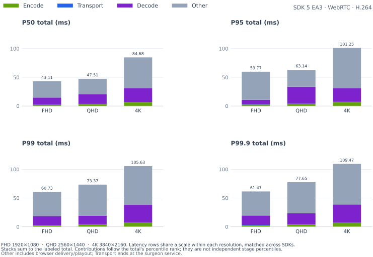

<details>
<summary>

#### P50

</summary>

<table>
    <thead>
        <tr><th align="left">RES</th><th align="left">CC</th><th align="right">FPS</th><th align="right">FS</th><th align="right">Encode (ms)</th><th align="right">Transport (ms)</th><th align="right">Decode (ms)</th><th align="right">Total (ms)</th></tr>
    </thead>
    <tbody>
        <tr><td>FHD</td><td><strong>H.264</strong></td><td align="right"><strong>28.26</strong></td><td align="right"><strong>66.2 KiB</strong></td><td align="right"><strong>2.81</strong></td><td align="right"><strong>0.46</strong></td><td align="right"><strong>13.90</strong></td><td align="right"><strong>43.11</strong></td></tr>
        <tr><td>QHD</td><td><strong>H.264</strong></td><td align="right"><strong>17.16</strong></td><td align="right"><strong>145.5 KiB</strong></td><td align="right"><strong>3.56</strong></td><td align="right"><strong>0.42</strong></td><td align="right"><strong>19.00</strong></td><td align="right"><strong>47.51</strong></td></tr>
        <tr><td>4K</td><td><strong>H.264</strong></td><td align="right"><strong>17.17</strong></td><td align="right"><strong>260.7 KiB</strong></td><td align="right"><strong>6.64</strong></td><td align="right"><strong>0.44</strong></td><td align="right"><strong>27.05</strong></td><td align="right"><strong>84.68</strong></td></tr>
    </tbody>
</table>

</details>

<details>
<summary>

#### P95

</summary>

<table>
    <thead>
        <tr><th align="left">RES</th><th align="left">CC</th><th align="right">FPS</th><th align="right">FS</th><th align="right">Encode (ms)</th><th align="right">Transport (ms)</th><th align="right">Decode (ms)</th><th align="right">Total (ms)</th></tr>
    </thead>
    <tbody>
        <tr><td>FHD</td><td><strong>H.264</strong></td><td align="right"><strong>28.26</strong></td><td align="right"><strong>66.2 KiB</strong></td><td align="right"><strong>3.75</strong></td><td align="right"><strong>1.14</strong></td><td align="right"><strong>21.00</strong></td><td align="right"><strong>59.77</strong></td></tr>
        <tr><td>QHD</td><td><strong>H.264</strong></td><td align="right"><strong>17.16</strong></td><td align="right"><strong>145.5 KiB</strong></td><td align="right"><strong>3.93</strong></td><td align="right"><strong>0.75</strong></td><td align="right"><strong>27.00</strong></td><td align="right"><strong>63.14</strong></td></tr>
        <tr><td>4K</td><td><strong>H.264</strong></td><td align="right"><strong>17.17</strong></td><td align="right"><strong>260.7 KiB</strong></td><td align="right"><strong>8.64</strong></td><td align="right"><strong>0.73</strong></td><td align="right"><strong>33.15</strong></td><td align="right"><strong>101.25</strong></td></tr>
    </tbody>
</table>

</details>

<details open>
<summary>

#### P99

</summary>

<table>
    <thead>
        <tr><th align="left">RES</th><th align="left">CC</th><th align="right">FPS</th><th align="right">FS</th><th align="right">Encode (ms)</th><th align="right">Transport (ms)</th><th align="right">Decode (ms)</th><th align="right">Total (ms)</th></tr>
    </thead>
    <tbody>
        <tr><td>FHD</td><td><strong>H.264</strong></td><td align="right"><strong>28.26</strong></td><td align="right"><strong>66.2 KiB</strong></td><td align="right"><strong>4.72</strong></td><td align="right"><strong>1.52</strong></td><td align="right"><strong>24.72</strong></td><td align="right"><strong>60.73</strong></td></tr>
        <tr><td>QHD</td><td><strong>H.264</strong></td><td align="right"><strong>17.16</strong></td><td align="right"><strong>145.5 KiB</strong></td><td align="right"><strong>5.03</strong></td><td align="right"><strong>0.92</strong></td><td align="right"><strong>31.73</strong></td><td align="right"><strong>73.37</strong></td></tr>
        <tr><td>4K</td><td><strong>H.264</strong></td><td align="right"><strong>17.17</strong></td><td align="right"><strong>260.7 KiB</strong></td><td align="right"><strong>8.98</strong></td><td align="right"><strong>0.88</strong></td><td align="right"><strong>36.30</strong></td><td align="right"><strong>105.63</strong></td></tr>
    </tbody>
</table>

</details>

<details open>
<summary>

#### P99.9

</summary>

<table>
    <thead>
        <tr><th align="left">RES</th><th align="left">CC</th><th align="right">FPS</th><th align="right">FS</th><th align="right">Encode (ms)</th><th align="right">Transport (ms)</th><th align="right">Decode (ms)</th><th align="right">Total (ms)</th></tr>
    </thead>
    <tbody>
        <tr><td>FHD</td><td><strong>H.264</strong></td><td align="right"><strong>28.26</strong></td><td align="right"><strong>66.2 KiB</strong></td><td align="right"><strong>5.83</strong></td><td align="right"><strong>1.64</strong></td><td align="right"><strong>27.89</strong></td><td align="right"><strong>61.47</strong></td></tr>
        <tr><td>QHD</td><td><strong>H.264</strong></td><td align="right"><strong>17.16</strong></td><td align="right"><strong>145.5 KiB</strong></td><td align="right"><strong>5.69</strong></td><td align="right"><strong>1.15</strong></td><td align="right"><strong>35.92</strong></td><td align="right"><strong>77.65</strong></td></tr>
        <tr><td>4K</td><td><strong>H.264</strong></td><td align="right"><strong>17.17</strong></td><td align="right"><strong>260.7 KiB</strong></td><td align="right"><strong>9.12</strong></td><td align="right"><strong>1.60</strong></td><td align="right"><strong>40.43</strong></td><td align="right"><strong>109.47</strong></td></tr>
    </tbody>
</table>

</details>

</details>

<details open>
<summary>

### Thor (Patient) → x86 (Surgeon): IMX274 Camera

</summary>

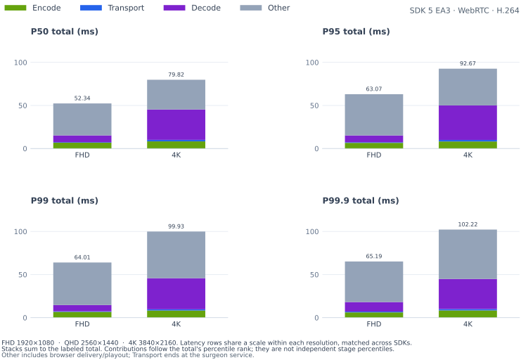

<details>
<summary>

#### P50

</summary>

<table>
    <thead>
        <tr><th align="left">RES</th><th align="left">CC</th><th align="right">FPS</th><th align="right">FS</th><th align="right">Encode (ms)</th><th align="right">Transport (ms)</th><th align="right">Decode (ms)</th><th align="right">Total (ms)</th></tr>
    </thead>
    <tbody>
        <tr><td>FHD</td><td><strong>H.264</strong></td><td align="right"><strong>58.92</strong></td><td align="right"><strong>57.1 KiB</strong></td><td align="right"><strong>6.91</strong></td><td align="right"><strong>0.58</strong></td><td align="right"><strong>7.30</strong></td><td align="right"><strong>53.55</strong></td></tr>
        <tr><td>4K</td><td><strong>H.264</strong></td><td align="right"><strong>28.88</strong></td><td align="right"><strong>443.0 KiB</strong></td><td align="right"><strong>8.05</strong></td><td align="right"><strong>1.79</strong></td><td align="right"><strong>32.60</strong></td><td align="right"><strong>77.06</strong></td></tr>
    </tbody>
</table>

</details>

<details>
<summary>

#### P95

</summary>

<table>
    <thead>
        <tr><th align="left">RES</th><th align="left">CC</th><th align="right">FPS</th><th align="right">FS</th><th align="right">Encode (ms)</th><th align="right">Transport (ms)</th><th align="right">Decode (ms)</th><th align="right">Total (ms)</th></tr>
    </thead>
    <tbody>
        <tr><td>FHD</td><td><strong>H.264</strong></td><td align="right"><strong>58.92</strong></td><td align="right"><strong>57.1 KiB</strong></td><td align="right"><strong>7.48</strong></td><td align="right"><strong>0.95</strong></td><td align="right"><strong>14.80</strong></td><td align="right"><strong>61.96</strong></td></tr>
        <tr><td>4K</td><td><strong>H.264</strong></td><td align="right"><strong>28.88</strong></td><td align="right"><strong>443.0 KiB</strong></td><td align="right"><strong>8.30</strong></td><td align="right"><strong>2.03</strong></td><td align="right"><strong>36.16</strong></td><td align="right"><strong>86.60</strong></td></tr>
    </tbody>
</table>

</details>

<details open>
<summary>

#### P99

</summary>

<table>
    <thead>
        <tr><th align="left">RES</th><th align="left">CC</th><th align="right">FPS</th><th align="right">FS</th><th align="right">Encode (ms)</th><th align="right">Transport (ms)</th><th align="right">Decode (ms)</th><th align="right">Total (ms)</th></tr>
    </thead>
    <tbody>
        <tr><td>FHD</td><td><strong>H.264</strong></td><td align="right"><strong>58.92</strong></td><td align="right"><strong>57.1 KiB</strong></td><td align="right"><strong>7.80</strong></td><td align="right"><strong>1.30</strong></td><td align="right"><strong>16.40</strong></td><td align="right"><strong>65.02</strong></td></tr>
        <tr><td>4K</td><td><strong>H.264</strong></td><td align="right"><strong>28.88</strong></td><td align="right"><strong>443.0 KiB</strong></td><td align="right"><strong>8.38</strong></td><td align="right"><strong>2.18</strong></td><td align="right"><strong>39.73</strong></td><td align="right"><strong>89.58</strong></td></tr>
    </tbody>
</table>

</details>

<details open>
<summary>

#### P99.9

</summary>

<table>
    <thead>
        <tr><th align="left">RES</th><th align="left">CC</th><th align="right">FPS</th><th align="right">FS</th><th align="right">Encode (ms)</th><th align="right">Transport (ms)</th><th align="right">Decode (ms)</th><th align="right">Total (ms)</th></tr>
    </thead>
    <tbody>
        <tr><td>FHD</td><td><strong>H.264</strong></td><td align="right"><strong>58.92</strong></td><td align="right"><strong>57.1 KiB</strong></td><td align="right"><strong>7.94</strong></td><td align="right"><strong>1.64</strong></td><td align="right"><strong>21.62</strong></td><td align="right"><strong>65.76</strong></td></tr>
        <tr><td>4K</td><td><strong>H.264</strong></td><td align="right"><strong>28.88</strong></td><td align="right"><strong>443.0 KiB</strong></td><td align="right"><strong>8.63</strong></td><td align="right"><strong>2.58</strong></td><td align="right"><strong>43.97</strong></td><td align="right"><strong>91.94</strong></td></tr>
    </tbody>
</table>

</details>

</details>

<details>
<summary>

### DGX Spark (Patient) → x86 (Surgeon): MIRA Procedure Camera

</summary>

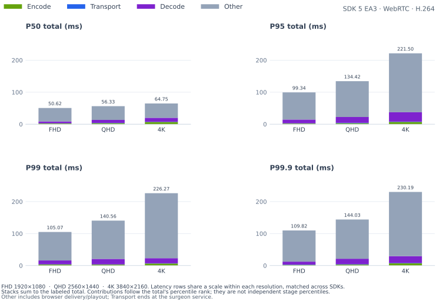

<details>
<summary>

#### P50

</summary>

<table>
    <thead>
        <tr><th align="left">RES</th><th align="left">CC</th><th align="right">FPS</th><th align="right">FS</th><th align="right">Encode (ms)</th><th align="right">Transport (ms)</th><th align="right">Decode (ms)</th><th align="right">Total (ms)</th></tr>
    </thead>
    <tbody>
        <tr><td>FHD</td><td><strong>H.264</strong></td><td align="right"><strong>16.05</strong></td><td align="right"><strong>44.3 KiB</strong></td><td align="right"><strong>3.37</strong></td><td align="right"><strong>1.04</strong></td><td align="right"><strong>17.10</strong></td><td align="right"><strong>59.91</strong></td></tr>
        <tr><td>QHD</td><td><strong>H.264</strong></td><td align="right"><strong>11.04</strong></td><td align="right"><strong>62.3 KiB</strong></td><td align="right"><strong>6.90</strong></td><td align="right"><strong>1.25</strong></td><td align="right"><strong>21.90</strong></td><td align="right"><strong>77.85</strong></td></tr>
        <tr><td>4K</td><td><strong>H.264</strong></td><td align="right"><strong>6.28</strong></td><td align="right"><strong>101.3 KiB</strong></td><td align="right"><strong>9.49</strong></td><td align="right"><strong>1.44</strong></td><td align="right"><strong>28.35</strong></td><td align="right"><strong>130.71</strong></td></tr>
    </tbody>
</table>

</details>

<details>
<summary>

#### P95

</summary>

<table>
    <thead>
        <tr><th align="left">RES</th><th align="left">CC</th><th align="right">FPS</th><th align="right">FS</th><th align="right">Encode (ms)</th><th align="right">Transport (ms)</th><th align="right">Decode (ms)</th><th align="right">Total (ms)</th></tr>
    </thead>
    <tbody>
        <tr><td>FHD</td><td><strong>H.264</strong></td><td align="right"><strong>16.05</strong></td><td align="right"><strong>44.3 KiB</strong></td><td align="right"><strong>4.36</strong></td><td align="right"><strong>1.53</strong></td><td align="right"><strong>18.70</strong></td><td align="right"><strong>77.42</strong></td></tr>
        <tr><td>QHD</td><td><strong>H.264</strong></td><td align="right"><strong>11.04</strong></td><td align="right"><strong>62.3 KiB</strong></td><td align="right"><strong>9.43</strong></td><td align="right"><strong>1.85</strong></td><td align="right"><strong>23.80</strong></td><td align="right"><strong>101.47</strong></td></tr>
        <tr><td>4K</td><td><strong>H.264</strong></td><td align="right"><strong>6.28</strong></td><td align="right"><strong>101.3 KiB</strong></td><td align="right"><strong>11.75</strong></td><td align="right"><strong>2.22</strong></td><td align="right"><strong>32.52</strong></td><td align="right"><strong>157.79</strong></td></tr>
    </tbody>
</table>

</details>

<details open>
<summary>

#### P99

</summary>

<table>
    <thead>
        <tr><th align="left">RES</th><th align="left">CC</th><th align="right">FPS</th><th align="right">FS</th><th align="right">Encode (ms)</th><th align="right">Transport (ms)</th><th align="right">Decode (ms)</th><th align="right">Total (ms)</th></tr>
    </thead>
    <tbody>
        <tr><td>FHD</td><td><strong>H.264</strong></td><td align="right"><strong>16.05</strong></td><td align="right"><strong>44.3 KiB</strong></td><td align="right"><strong>4.92</strong></td><td align="right"><strong>1.93</strong></td><td align="right"><strong>20.08</strong></td><td align="right"><strong>83.08</strong></td></tr>
        <tr><td>QHD</td><td><strong>H.264</strong></td><td align="right"><strong>11.04</strong></td><td align="right"><strong>62.3 KiB</strong></td><td align="right"><strong>9.99</strong></td><td align="right"><strong>2.36</strong></td><td align="right"><strong>29.04</strong></td><td align="right"><strong>114.47</strong></td></tr>
        <tr><td>4K</td><td><strong>H.264</strong></td><td align="right"><strong>6.28</strong></td><td align="right"><strong>101.3 KiB</strong></td><td align="right"><strong>12.13</strong></td><td align="right"><strong>2.69</strong></td><td align="right"><strong>39.06</strong></td><td align="right"><strong>221.90</strong></td></tr>
    </tbody>
</table>

</details>

<details open>
<summary>

#### P99.9

</summary>

<table>
    <thead>
        <tr><th align="left">RES</th><th align="left">CC</th><th align="right">FPS</th><th align="right">FS</th><th align="right">Encode (ms)</th><th align="right">Transport (ms)</th><th align="right">Decode (ms)</th><th align="right">Total (ms)</th></tr>
    </thead>
    <tbody>
        <tr><td>FHD</td><td><strong>H.264</strong></td><td align="right"><strong>16.05</strong></td><td align="right"><strong>44.3 KiB</strong></td><td align="right"><strong>5.36</strong></td><td align="right"><strong>4.32</strong></td><td align="right"><strong>21.58</strong></td><td align="right"><strong>98.55</strong></td></tr>
        <tr><td>QHD</td><td><strong>H.264</strong></td><td align="right"><strong>11.04</strong></td><td align="right"><strong>62.3 KiB</strong></td><td align="right"><strong>10.20</strong></td><td align="right"><strong>4.15</strong></td><td align="right"><strong>31.40</strong></td><td align="right"><strong>117.33</strong></td></tr>
        <tr><td>4K</td><td><strong>H.264</strong></td><td align="right"><strong>6.28</strong></td><td align="right"><strong>101.3 KiB</strong></td><td align="right"><strong>12.69</strong></td><td align="right"><strong>5.20</strong></td><td align="right"><strong>43.34</strong></td><td align="right"><strong>232.66</strong></td></tr>
    </tbody>
</table>

</details>

</details>

<details>
<summary>

### DGX Spark (Patient) → x86 (Surgeon): MIRA Room Camera

</summary>

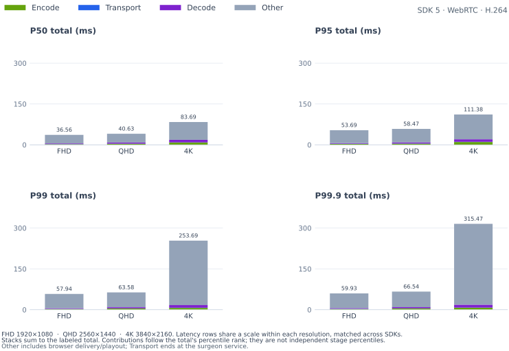

<details>
<summary>

#### P50

</summary>

<table>
    <thead>
        <tr><th align="left">RES</th><th align="left">CC</th><th align="right">FPS</th><th align="right">FS</th><th align="right">Encode (ms)</th><th align="right">Transport (ms)</th><th align="right">Decode (ms)</th><th align="right">Total (ms)</th></tr>
    </thead>
    <tbody>
        <tr><td>FHD</td><td><strong>H.264</strong></td><td align="right"><strong>16.05</strong></td><td align="right"><strong>28.6 KiB</strong></td><td align="right"><strong>3.02</strong></td><td align="right"><strong>3.19</strong></td><td align="right"><strong>13.80</strong></td><td align="right"><strong>54.19</strong></td></tr>
        <tr><td>QHD</td><td><strong>H.264</strong></td><td align="right"><strong>11.04</strong></td><td align="right"><strong>40.6 KiB</strong></td><td align="right"><strong>5.26</strong></td><td align="right"><strong>2.52</strong></td><td align="right"><strong>18.00</strong></td><td align="right"><strong>70.57</strong></td></tr>
        <tr><td>4K</td><td><strong>H.264</strong></td><td align="right"><strong>6.28</strong></td><td align="right"><strong>67.5 KiB</strong></td><td align="right"><strong>9.74</strong></td><td align="right"><strong>0.74</strong></td><td align="right"><strong>11.00</strong></td><td align="right"><strong>81.43</strong></td></tr>
    </tbody>
</table>

</details>

<details>
<summary>

#### P95

</summary>

<table>
    <thead>
        <tr><th align="left">RES</th><th align="left">CC</th><th align="right">FPS</th><th align="right">FS</th><th align="right">Encode (ms)</th><th align="right">Transport (ms)</th><th align="right">Decode (ms)</th><th align="right">Total (ms)</th></tr>
    </thead>
    <tbody>
        <tr><td>FHD</td><td><strong>H.264</strong></td><td align="right"><strong>16.05</strong></td><td align="right"><strong>28.6 KiB</strong></td><td align="right"><strong>4.42</strong></td><td align="right"><strong>8.27</strong></td><td align="right"><strong>15.70</strong></td><td align="right"><strong>70.90</strong></td></tr>
        <tr><td>QHD</td><td><strong>H.264</strong></td><td align="right"><strong>11.04</strong></td><td align="right"><strong>40.6 KiB</strong></td><td align="right"><strong>6.86</strong></td><td align="right"><strong>8.36</strong></td><td align="right"><strong>21.00</strong></td><td align="right"><strong>95.19</strong></td></tr>
        <tr><td>4K</td><td><strong>H.264</strong></td><td align="right"><strong>6.28</strong></td><td align="right"><strong>67.5 KiB</strong></td><td align="right"><strong>12.11</strong></td><td align="right"><strong>1.56</strong></td><td align="right"><strong>19.78</strong></td><td align="right"><strong>97.93</strong></td></tr>
    </tbody>
</table>

</details>

<details open>
<summary>

#### P99

</summary>

<table>
    <thead>
        <tr><th align="left">RES</th><th align="left">CC</th><th align="right">FPS</th><th align="right">FS</th><th align="right">Encode (ms)</th><th align="right">Transport (ms)</th><th align="right">Decode (ms)</th><th align="right">Total (ms)</th></tr>
    </thead>
    <tbody>
        <tr><td>FHD</td><td><strong>H.264</strong></td><td align="right"><strong>16.05</strong></td><td align="right"><strong>28.6 KiB</strong></td><td align="right"><strong>4.86</strong></td><td align="right"><strong>9.10</strong></td><td align="right"><strong>16.09</strong></td><td align="right"><strong>77.09</strong></td></tr>
        <tr><td>QHD</td><td><strong>H.264</strong></td><td align="right"><strong>11.04</strong></td><td align="right"><strong>40.6 KiB</strong></td><td align="right"><strong>7.92</strong></td><td align="right"><strong>10.35</strong></td><td align="right"><strong>22.12</strong></td><td align="right"><strong>108.81</strong></td></tr>
        <tr><td>4K</td><td><strong>H.264</strong></td><td align="right"><strong>6.28</strong></td><td align="right"><strong>67.5 KiB</strong></td><td align="right"><strong>12.60</strong></td><td align="right"><strong>3.05</strong></td><td align="right"><strong>26.77</strong></td><td align="right"><strong>105.04</strong></td></tr>
    </tbody>
</table>

</details>

<details open>
<summary>

#### P99.9

</summary>

<table>
    <thead>
        <tr><th align="left">RES</th><th align="left">CC</th><th align="right">FPS</th><th align="right">FS</th><th align="right">Encode (ms)</th><th align="right">Transport (ms)</th><th align="right">Decode (ms)</th><th align="right">Total (ms)</th></tr>
    </thead>
    <tbody>
        <tr><td>FHD</td><td><strong>H.264</strong></td><td align="right"><strong>16.05</strong></td><td align="right"><strong>28.6 KiB</strong></td><td align="right"><strong>5.34</strong></td><td align="right"><strong>10.37</strong></td><td align="right"><strong>17.55</strong></td><td align="right"><strong>98.40</strong></td></tr>
        <tr><td>QHD</td><td><strong>H.264</strong></td><td align="right"><strong>11.04</strong></td><td align="right"><strong>40.6 KiB</strong></td><td align="right"><strong>8.56</strong></td><td align="right"><strong>11.32</strong></td><td align="right"><strong>23.11</strong></td><td align="right"><strong>113.38</strong></td></tr>
        <tr><td>4K</td><td><strong>H.264</strong></td><td align="right"><strong>6.28</strong></td><td align="right"><strong>67.5 KiB</strong></td><td align="right"><strong>12.95</strong></td><td align="right"><strong>6.10</strong></td><td align="right"><strong>29.49</strong></td><td align="right"><strong>121.97</strong></td></tr>
    </tbody>
</table>

</details>

</details>
</details>
