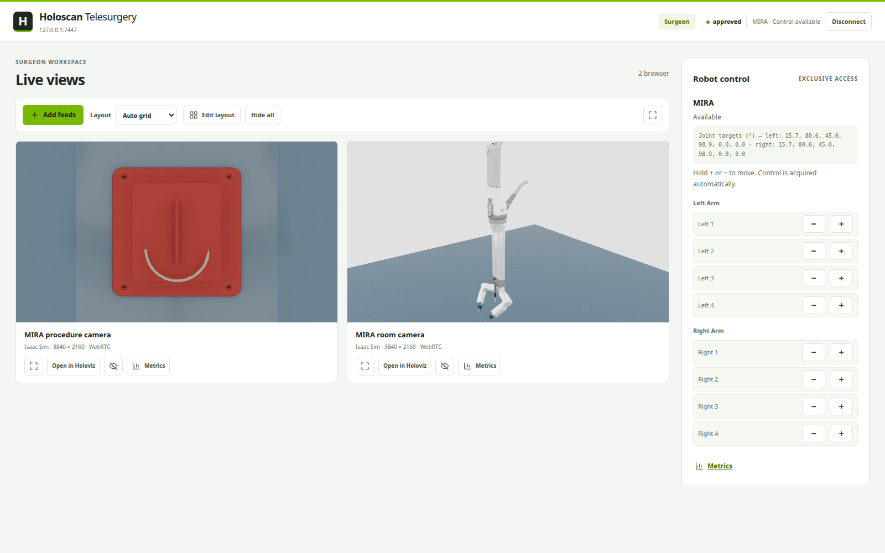

# Holoscan Telesurgery

A distributed telesurgery demo built with **NVIDIA Holoscan and Holoscan Sensor Bridge**. A patient operator brings cameras and robot interfaces from multiple machines into one room. Approved surgeons watch the feeds they choose and share exclusive robot control—all through Holoscan pipelines.

Use HSB sensors and USB cameras on Thor, DGX Spark or x86, or explore **MIRA** and **Franka** rooms in Isaac Sim. Each side has its own local dashboard, with native Holoviz viewing and per-stream latency metrics.



*MIRA simulation with H.264 browser viewing. [See the patient dashboard](docs/images/patient.png).*

## System requirements

- Ubuntu 24.04.
- NVIDIA GPU and driver supporting CUDA 13.
- Docker with NVIDIA Container Toolkit.
- SSH access to the pinned NVIDIA GitLab sources.
- A local desktop display for Holoviz.

## Quickstart

1. **Start the patient simulation:**

   ```bash
   ./run.sh --docker patient --sim mira
   ```

   Use `--sim franka` for Franka. Open **[localhost:8000](http://localhost:8000)**, wait for the cameras to appear, then click **Stream**.

2. **Start the surgeon** in another terminal or on another machine:

   ```bash
   ./run.sh --docker surgeon
   ```

   Open **[localhost:8002](http://localhost:8002)**. Enter the patient hostname (same machine: `127.0.0.1`), your name and requested access. Approve the request under **Surgeons** on the patient dashboard, then **Add feeds** on the surgeon dashboard.

## Physical devices

Connect USB cameras or a configured HSB/IMX274 to the patient machine, then start:

```bash
./run.sh --docker patient
```

For cameras on other machines, run on each device host:

```bash
./run.sh --docker node
```

In the patient dashboard, choose **Add node → Connect running service** and enter its hostname and printed pairing code. **Deploy over SSH** is also available.

Choose **Physical devices**, **MIRA** or **Franka** when deploying over SSH. To change an SSH node, stop its streams and use **Environment** on its node page. For a manually started node, restart with `./run.sh node --sim mira` (or `franka`); omit `--sim` for physical devices. The dashboard reconnects automatically.

Open a node, choose each camera's settings and click **Stream**. Connect the surgeon as in Quickstart. See [HSB configuration](docs/architecture.md#camera-configuration) for sensor setup.

Physical robot control is not implemented.

## Native execution

Requires the CUDA 13 development toolkit. Run setup once on each machine:

```bash
./setup.sh
./run.sh patient --sim mira

# Another terminal or machine:
./run.sh surgeon
```

SDK 5 is the default. Add `--sdk 4` to setup and run commands to use SDK 4.

Each dashboard runs locally. Services connect over TCP **7447** (patient) and **7448** (node control) and **7449** (direct node video). Use `--port` for additional dashboards on one machine.

This is a research demonstration.

[Architecture](docs/architecture.md) · [System proposal](docs/system-proposal.md) · [Benchmarks](BENCHMARK.md) · [Contributing](CONTRIBUTING.md)
