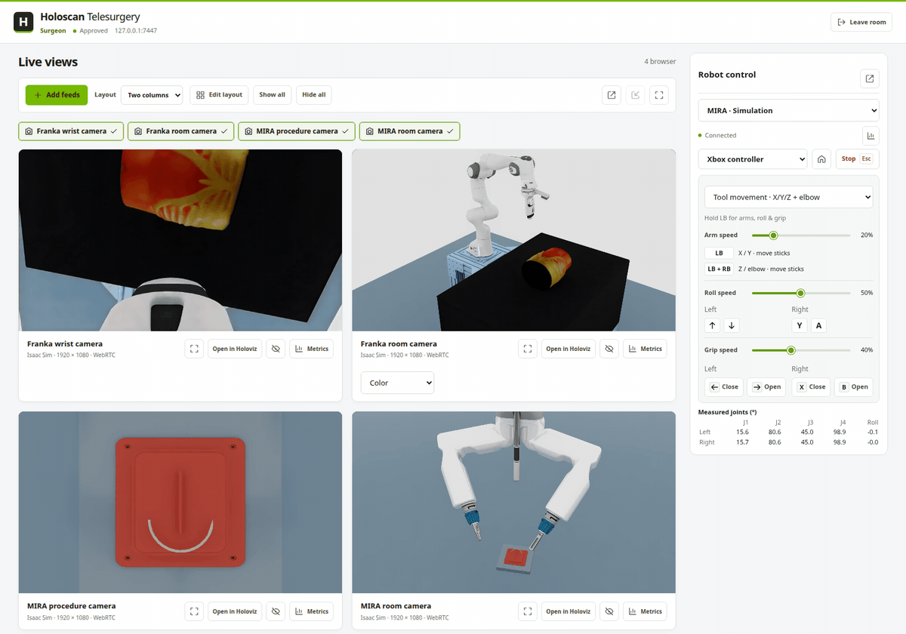

# Holoscan Telesurgery

A distributed telesurgery demo built with **NVIDIA Holoscan and Holoscan Sensor Bridge**. Device nodes bring cameras and robots into a patient room. The patient approves nodes and surgeons; surgeons view live feeds and control permitted robots from their own dashboard.

Use physical devices or **MIRA, Franka and Versius simulations**, with browser or native Holoviz viewing and per-stream latency metrics.



[Patient dashboard](docs/images/patient-walkthrough.gif) · [Architecture](docs/architecture.md) · [Benchmarks](BENCHMARK.md)

## System requirements

| Component        | Requirement                                                                                                                                                                                               |
| ---------------- | --------------------------------------------------------------------------------------------------------------------------------------------------------------------------------------------------------- |
| Operating system | Ubuntu 24.04 on x86 or ARM64. Use Docker on Ubuntu 22.04.                                                                                                                                                 |
| GPU              | NVIDIA GPU with hardware video encoding/decoding and a CUDA 13-compatible driver.                                                                                                                         |
| Docker           | Docker with [NVIDIA Container Toolkit](https://docs.nvidia.com/datacenter/cloud-native/container-toolkit/latest/install-guide.html), usable without `sudo`. Required for `--docker` and simulation nodes. |
| Native builds    | CUDA 13 development toolkit and GCC 13+. `setup.sh` installs the remaining build dependencies.                                                                                                            |
| Simulation nodes | x86 with an RTX GPU, or DGX Spark, meeting [Isaac Sim requirements](https://docs.isaacsim.omniverse.nvidia.com/6.0.0/installation/requirements.html).                                                     |
| Viewing          | A browser for dashboards; a local desktop display for Holoviz or the Isaac Sim window.                                                                                                                    |
| Robot input      | Keyboard, Xbox/PlayStation/Nintendo Switch gamepad, or Haply Inverse3 (MIRA, Franka and Versius simulations).                                                                                             |
| Build access     | SSH access to NVIDIA GitLab for the current SDK 5 Hololink dependency.                                                                                                                                    |

## Setup

Run commands from the repository root on each machine. [Holoscan SDK 5 EA3](https://github.com/nvidia-holoscan/holoscan-sdk/tree/v5.0.0-ea3) is the default; add `--sdk 4` to setup and run commands for SDK 4.

### Docker execution

Prepare the host once:

```bash
./setup.sh --docker
```

`run.sh --docker` builds the image automatically: `holoscan-telesurgery:0.1.0`.

### Native execution

With the CUDA 13 development toolkit installed, run:

```bash
./setup.sh
```

Unchanged setups are reused automatically. Use `./setup.sh --force` to rerun installation and validation.

Follow the quickstart below, omitting `--docker` from run commands. Simulation nodes still require Docker for Isaac Sim.

## Quickstart

Start each service in a separate terminal. The commands below use Docker.

### 1. Patient

```bash
./run.sh --docker patient
```

Open **[localhost:8000](http://localhost:8000)**. Your room starts empty.

### 2. Nodes

Start a simulation (`mira`, `franka` or [CMR Versius](#cmr-versius-simulation)):

```bash
./run.sh --docker node --patient 127.0.0.1 --sim mira
```

For hardware, use the [physical device commands](#physical-devices). On another machine, replace `127.0.0.1` with the patient IP.

Approve each node under **Nodes** in Patient, then start streams and connect robots.

### 3. Surgeon

On the surgeon's machine:

```bash
./run.sh --docker surgeon
```

Open **[localhost:8002](http://localhost:8002)**. Enter the patient hostname, your name and requested access. The default endpoint works when both services run on the same machine.

Approve the request in Patient, then select feeds and a robot in Surgeon. See [robot controls](docs/robot-controls.md) for keyboard, gamepad and Haply mappings.

## Node configuration

Replace `PATIENT_IP` below with the patient hostname or IP.

### CMR Versius simulation

Extract `CMR_Versius_All_Assets.zip` on the simulation host, preserving its folders:

```bash
mkdir -p workspace/assets/versius
unzip CMR_Versius_All_Assets.zip -d workspace/assets/versius
```

Start the simulation node:

```bash
./run.sh --docker node --patient PATIENT_IP --sim versius
```

See [Versius controls](docs/robot-controls.md#versius-simulation) for the two-surgeon handoff demo.

### Physical devices

- **MIRA:** Copy the vendor API executable to `workspace/mira-api` (or provide `--mira-api PATH`) and run `./run.sh --docker node --patient PATIENT_IP --profile mira`.
- **Franka:** Enable FCI in Desk and run `./run.sh --docker node --patient PATIENT_IP --profile franka` (native: run `./setup.sh --profile franka` first and omit `--docker`); the default address is `172.16.0.3`, overridden with `--franka-address ROBOT_IP`.
- **HSB camera:** Connect the board to the node's camera network and run `./run.sh --docker node --patient PATIENT_IP`; boards are discovered automatically with IMX274 sensor 0 as the default ([other sensors](docs/architecture.md#camera-configuration)).

## Miscellaneous

### Streams

- See [camera configuration](docs/architecture.md#camera-configuration) for source and format settings.

> For 720p or 1080p streams, try **Surgical Neural Tokenizer (trial)** in **Stream settings**.

### Network

- Dashboard ports are **8000** and **8002** (`--port`). The patient endpoint is **7447** (`--endpoint-port`).
- Dashboards bind to `127.0.0.1`. Add `--host 0.0.0.0 --ssl` for HTTPS from another machine. There is no login.
- Custom HTTPS certificates must cover a local hostname or IP address for native controls.

### Workspace

- Data is stored in `./workspace`, with logs under `logs/`. Override with `--workspace PATH`.

### Stopping services

Works for native and Docker services on the local host:

```bash
./run.sh status
./run.sh stop patient
./run.sh stop surgeon
./run.sh stop node --name uni-mira
./run.sh stop --all
```

A role alone stops its only running instance. If several match, specify `--name` / `--port`, or add `--all`. Use `--workspace PATH` for another workspace. Shutdown allows 30 seconds for cleanup. Change this with `--timeout SECONDS`; add `--force` to kill after the timeout.

----
Research demonstration. [Architecture](docs/architecture.md) · [Contributing](CONTRIBUTING.md) · [Security](SECURITY.md) · [TODO](docs/TODO.md)
