# SDK 4 vs SDK 5 benchmark comparison

<!-- markdownlint-configure-file {"MD024": {"siblings_only": true}, "MD033": {"allowed_elements": ["details", "summary", "table", "thead", "tbody", "tr", "th", "td", "strong"]}} -->

October 2026 · Holoscan **4.6.0** vs **5.0.0a3 (public EA3)**.

SDK 5 measurements collected 2026-10-17 on public EA3. The SDK 4 baseline is retained from October 2, 2026.

HSB capture runs SDK 4.6.0; its coordinator and surgeon run SDK 5. All other refreshed sources run SDK 5.

[SDK 5 benchmark](../BENCHMARK.md) · [SDK 4 benchmark](BENCHMARK_SDK4.md) · [Measurements](../benchmarks/results/summary.csv)

**The surgeon always runs on the x86 workstation.** Matching results use the same patient host, camera, resolution, codec and receiver. This report pairs **57 Holoviz camera results** and **17 WebRTC camera results** per SDK; both MIRA cameras stream simultaneously.

## P99 overview

SDK 5 EA3 has lower P99 total latency in **16 of 57** matched Holoviz results. The median per-result change is **+9.8%**. These runs also include application and capture-backend changes since the SDK 4 baseline; differences cannot be attributed to the SDK alone.

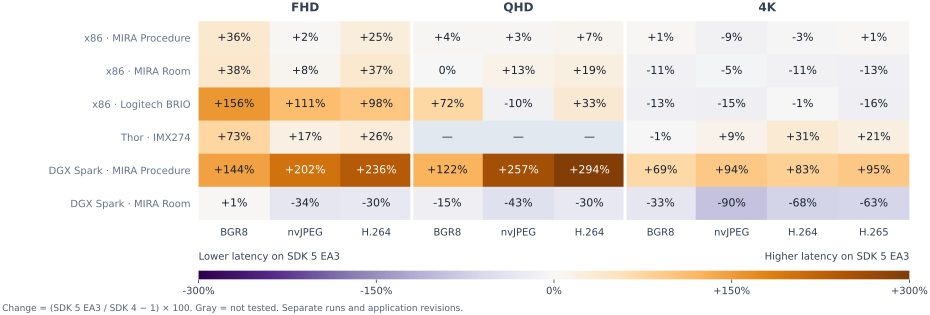

**Change = (SDK 5 / SDK 4 − 1) × 100.** Negative latency changes favor SDK 5. Gray cells were not tested. FHD = 1920×1080; QHD = 2560×1440; 4K = 3840×2160. H.265 was tested only at 4K.

## Total latency change

Each cell is the median percentage change across that camera’s matched resolution/codec configurations. These are summaries of per-configuration changes, not percentiles of pooled frames. Each configuration has equal weight.

| Patient · Camera | P50 | P95 | P99 | P99.9 |
| --------------------------------- | ------- | ------- | ------- | ------- |
| x86 · MIRA Procedure Camera | -4.3% | +5.3% | +5.5% | +3.3% |
| x86 · MIRA Room Camera | -8.4% | +1.1% | +4.7% | -0.0% |
| x86 · Logitech BRIO Camera | +1.2% | +4.4% | +12.4% | +25.8% |
| Thor · IMX274 Camera | +14.9% | +9.6% | +10.8% | +32.6% |
| DGX Spark · MIRA Procedure Camera | +53.7% | +7.8% | +21.4% | +10.2% |
| DGX Spark · MIRA Room Camera | +21.3% | +2.2% | +1.2% | +4.9% |

## Stage and FPS changes

The same paired median calculation, using **P99** for each latency stage and observed viewer FPS. Positive FPS changes favor SDK 5. BGR8 uses pack/upload for Encode/Decode. Independent stage percentiles do not sum to Total.

| Patient · Camera | Encode | Transport | Decode | FPS |
| --------------------------------- | ------ | --------- | ------ | ------ |
| x86 · MIRA Procedure Camera | -8.9% | +42.4% | -18.4% | +4.6% |
| x86 · MIRA Room Camera | -8.0% | +29.7% | -16.0% | +5.1% |
| x86 · Logitech BRIO Camera | +7.3% | +18.2% | +38.3% | -20.1% |
| Thor · IMX274 Camera | -4.5% | +74.2% | +52.3% | -0.0% |
| DGX Spark · MIRA Procedure Camera | -6.9% | +65.4% | +50.0% | -18.4% |
| DGX Spark · MIRA Room Camera | +14.6% | +61.9% | +55.5% | -18.0% |

## Measurements

Each chart has **FHD, QHD and 4K columns** and **P50, P95, P99 and P99.9 rows**. Within each codec, **SDK 5 is on the left and SDK 4 on the right**. Colors split latency into Encode, Transport, Decode and Other; Other includes preparation, queues and display handoff. Labels above each pair read **SDK 5 / SDK 4**, in milliseconds. Each stack uses matched contributions at that SDK’s total percentile, so its parts sum to its total.

Table cells read **SDK 4 → SDK 5**. **P50–P99.9 show measured total latency in milliseconds**; FPS is the observed Holoviz viewer rate. CC = codec. H.264/H.265 rows are highlighted. The SDK reports include frame sizes and individual stage measurements.

### x86 (Patient) → x86 (Surgeon): MIRA Procedure Camera

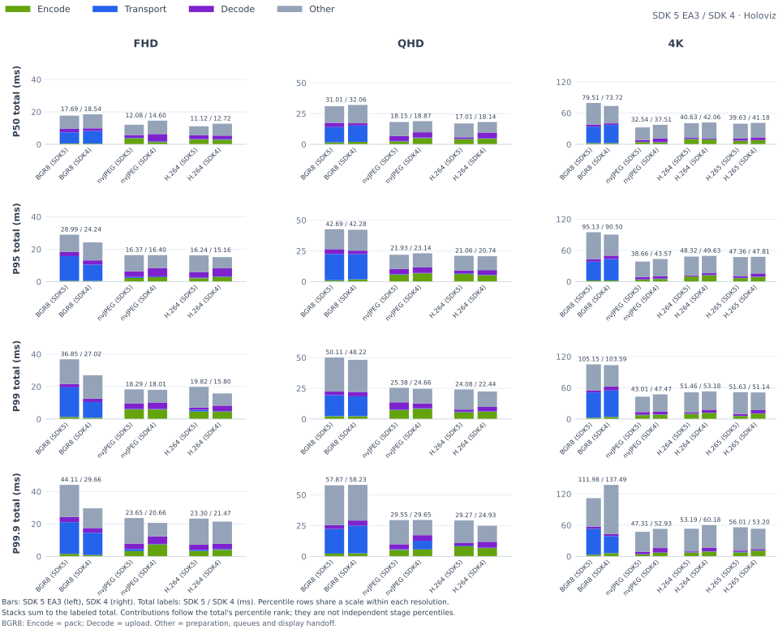

<table>
    <thead>
        <tr><th align="left">RES</th><th align="left">CC</th><th align="right">FPS</th><th align="right">P50</th><th align="right">P95</th><th align="right">P99</th><th align="right">P99.9</th></tr>
    </thead>
    <tbody>
        <tr><td rowspan="3">FHD</td><td>BGR8</td><td align="right">26.88 → 29.55</td><td align="right">18.54 → 17.14</td><td align="right">24.24 → 27.24</td><td align="right">27.02 → 33.06</td><td align="right">29.66 → 39.86</td></tr>
        <tr><td>nvJPEG</td><td align="right">26.88 → 28.58</td><td align="right">14.60 → 9.66</td><td align="right">16.40 → 16.01</td><td align="right">18.01 → 18.05</td><td align="right">20.66 → 21.22</td></tr>
        <tr><td><strong>H.264</strong></td><td align="right"><strong>27.43 → 28.23</strong></td><td align="right"><strong>12.72 → 10.60</strong></td><td align="right"><strong>15.16 → 16.50</strong></td><td align="right"><strong>15.80 → 19.43</strong></td><td align="right"><strong>21.47 → 24.17</strong></td></tr>
        <tr><td rowspan="3">QHD</td><td>BGR8</td><td align="right">23.81 → 28.60</td><td align="right">32.06 → 31.75</td><td align="right">42.28 → 44.08</td><td align="right">48.22 → 50.55</td><td align="right">58.23 → 60.24</td></tr>
        <tr><td>nvJPEG</td><td align="right">24.78 → 27.63</td><td align="right">18.87 → 14.42</td><td align="right">23.14 → 22.48</td><td align="right">24.66 → 26.17</td><td align="right">29.65 → 29.81</td></tr>
        <tr><td><strong>H.264</strong></td><td align="right"><strong>25.00 → 27.55</strong></td><td align="right"><strong>18.14 → 16.46</strong></td><td align="right"><strong>20.74 → 22.68</strong></td><td align="right"><strong>22.44 → 26.42</strong></td><td align="right"><strong>24.93 → 31.24</strong></td></tr>
        <tr><td rowspan="4">4K</td><td>BGR8</td><td align="right">15.61 → 14.61</td><td align="right">73.72 → 77.75</td><td align="right">90.50 → 96.32</td><td align="right">103.59 → 106.95</td><td align="right">137.49 → 116.32</td></tr>
        <tr><td>nvJPEG</td><td align="right">15.55 → 15.50</td><td align="right">37.51 → 38.69</td><td align="right">43.57 → 48.90</td><td align="right">47.47 → 52.87</td><td align="right">52.93 → 60.19</td></tr>
        <tr><td><strong>H.264</strong></td><td align="right"><strong>14.93 → 15.36</strong></td><td align="right"><strong>42.06 → 41.93</strong></td><td align="right"><strong>49.63 → 50.22</strong></td><td align="right"><strong>53.18 → 55.09</strong></td><td align="right"><strong>60.18 → 59.68</strong></td></tr>
        <tr><td><strong>H.265</strong></td><td align="right"><strong>15.10 → 15.53</strong></td><td align="right"><strong>41.18 → 40.73</strong></td><td align="right"><strong>47.81 → 49.34</strong></td><td align="right"><strong>51.14 → 52.72</strong></td><td align="right"><strong>53.20 → 54.84</strong></td></tr>
    </tbody>
</table>

### x86 (Patient) → x86 (Surgeon): MIRA Room Camera

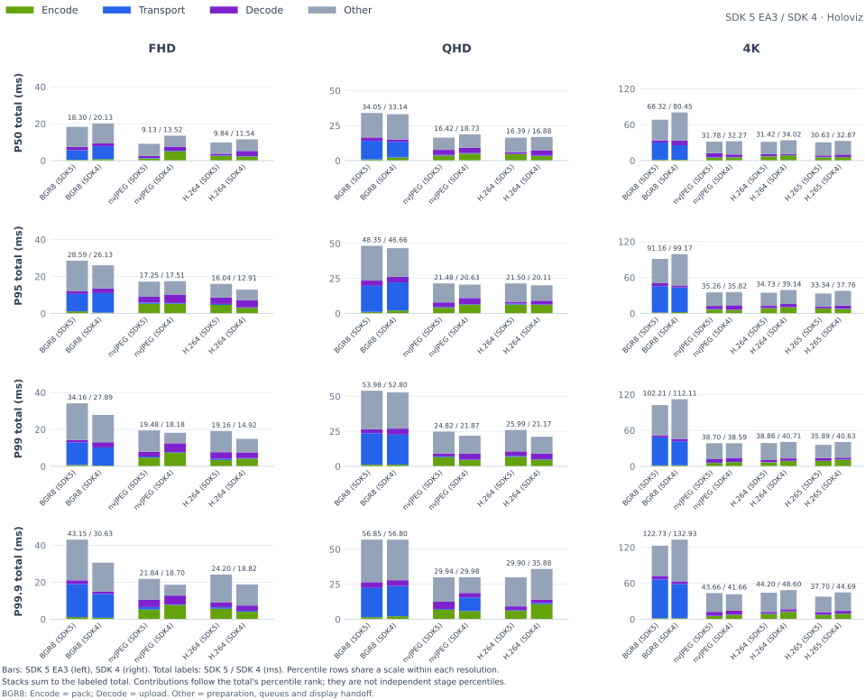

<table>
    <thead>
        <tr><th align="left">RES</th><th align="left">CC</th><th align="right">FPS</th><th align="right">P50</th><th align="right">P95</th><th align="right">P99</th><th align="right">P99.9</th></tr>
    </thead>
    <tbody>
        <tr><td rowspan="3">FHD</td><td>BGR8</td><td align="right">26.65 → 29.56</td><td align="right">20.13 → 18.30</td><td align="right">26.13 → 28.59</td><td align="right">27.89 → 34.16</td><td align="right">30.63 → 43.15</td></tr>
        <tr><td>nvJPEG</td><td align="right">26.88 → 28.56</td><td align="right">13.52 → 9.13</td><td align="right">17.51 → 17.25</td><td align="right">18.18 → 19.48</td><td align="right">18.70 → 21.84</td></tr>
        <tr><td><strong>H.264</strong></td><td align="right"><strong>27.20 → 28.21</strong></td><td align="right"><strong>11.54 → 9.84</strong></td><td align="right"><strong>12.91 → 16.04</strong></td><td align="right"><strong>14.92 → 19.16</strong></td><td align="right"><strong>18.82 → 24.20</strong></td></tr>
        <tr><td rowspan="3">QHD</td><td>BGR8</td><td align="right">23.81 → 28.58</td><td align="right">33.14 → 34.05</td><td align="right">46.66 → 48.35</td><td align="right">52.80 → 53.98</td><td align="right">56.80 → 56.85</td></tr>
        <tr><td>nvJPEG</td><td align="right">24.56 → 27.63</td><td align="right">18.73 → 16.42</td><td align="right">20.63 → 21.48</td><td align="right">21.87 → 24.82</td><td align="right">29.98 → 29.94</td></tr>
        <tr><td><strong>H.264</strong></td><td align="right"><strong>24.78 → 27.56</strong></td><td align="right"><strong>16.88 → 16.39</strong></td><td align="right"><strong>20.11 → 21.50</strong></td><td align="right"><strong>21.17 → 25.99</strong></td><td align="right"><strong>35.88 → 29.90</strong></td></tr>
        <tr><td rowspan="4">4K</td><td>BGR8</td><td align="right">15.60 → 14.70</td><td align="right">80.45 → 68.32</td><td align="right">99.17 → 91.16</td><td align="right">112.11 → 102.21</td><td align="right">132.93 → 122.73</td></tr>
        <tr><td>nvJPEG</td><td align="right">15.55 → 15.51</td><td align="right">32.27 → 31.78</td><td align="right">35.82 → 35.26</td><td align="right">38.59 → 38.70</td><td align="right">41.66 → 43.66</td></tr>
        <tr><td><strong>H.264</strong></td><td align="right"><strong>14.81 → 15.38</strong></td><td align="right"><strong>34.02 → 31.42</strong></td><td align="right"><strong>39.14 → 34.73</strong></td><td align="right"><strong>40.71 → 38.86</strong></td><td align="right"><strong>48.60 → 44.20</strong></td></tr>
        <tr><td><strong>H.265</strong></td><td align="right"><strong>14.97 → 15.55</strong></td><td align="right"><strong>32.87 → 30.63</strong></td><td align="right"><strong>37.76 → 33.34</strong></td><td align="right"><strong>40.63 → 35.89</strong></td><td align="right"><strong>44.69 → 37.70</strong></td></tr>
    </tbody>
</table>

### x86 (Patient) → x86 (Surgeon): Logitech BRIO Camera

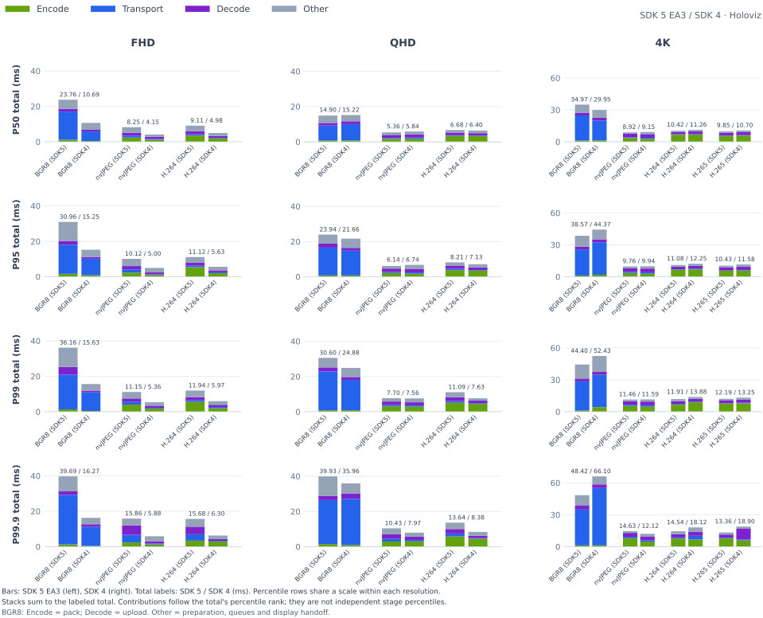

<table>
    <thead>
        <tr><th align="left">RES</th><th align="left">CC</th><th align="right">FPS</th><th align="right">P50</th><th align="right">P95</th><th align="right">P99</th><th align="right">P99.9</th></tr>
    </thead>
    <tbody>
        <tr><td rowspan="3">FHD</td><td>BGR8</td><td align="right">16.87 → 29.83</td><td align="right">10.69 → 23.76</td><td align="right">15.25 → 30.96</td><td align="right">15.63 → 36.16</td><td align="right">16.27 → 39.69</td></tr>
        <tr><td>nvJPEG</td><td align="right">16.95 → 29.96</td><td align="right">4.15 → 8.25</td><td align="right">5.00 → 10.12</td><td align="right">5.36 → 11.15</td><td align="right">5.88 → 15.86</td></tr>
        <tr><td><strong>H.264</strong></td><td align="right"><strong>16.88 → 29.96</strong></td><td align="right"><strong>4.98 → 9.11</strong></td><td align="right"><strong>5.63 → 11.12</strong></td><td align="right"><strong>5.97 → 11.94</strong></td><td align="right"><strong>6.30 → 15.68</strong></td></tr>
        <tr><td rowspan="3">QHD</td><td>BGR8</td><td align="right">29.83 → 17.01</td><td align="right">15.22 → 14.90</td><td align="right">21.66 → 23.94</td><td align="right">24.88 → 30.60</td><td align="right">35.96 → 39.93</td></tr>
        <tr><td>nvJPEG</td><td align="right">29.85 → 17.01</td><td align="right">5.84 → 5.36</td><td align="right">6.74 → 6.14</td><td align="right">7.56 → 7.70</td><td align="right">7.97 → 10.43</td></tr>
        <tr><td><strong>H.264</strong></td><td align="right"><strong>29.85 → 17.03</strong></td><td align="right"><strong>6.40 → 6.68</strong></td><td align="right"><strong>7.13 → 8.21</strong></td><td align="right"><strong>7.63 → 11.09</strong></td><td align="right"><strong>8.38 → 13.64</strong></td></tr>
        <tr><td rowspan="4">4K</td><td>BGR8</td><td align="right">16.70 → 17.13</td><td align="right">29.95 → 34.97</td><td align="right">44.37 → 38.57</td><td align="right">52.43 → 44.40</td><td align="right">66.10 → 48.42</td></tr>
        <tr><td>nvJPEG</td><td align="right">16.70 → 17.15</td><td align="right">9.15 → 8.92</td><td align="right">9.94 → 9.76</td><td align="right">11.59 → 11.46</td><td align="right">12.12 → 14.63</td></tr>
        <tr><td><strong>H.264</strong></td><td align="right"><strong>29.95 → 17.15</strong></td><td align="right"><strong>11.26 → 10.42</strong></td><td align="right"><strong>12.25 → 11.08</strong></td><td align="right"><strong>13.88 → 11.91</strong></td><td align="right"><strong>18.12 → 14.54</strong></td></tr>
        <tr><td><strong>H.265</strong></td><td align="right"><strong>29.94 → 17.13</strong></td><td align="right"><strong>10.70 → 9.85</strong></td><td align="right"><strong>11.58 → 10.43</strong></td><td align="right"><strong>13.25 → 12.19</strong></td><td align="right"><strong>18.90 → 13.36</strong></td></tr>
    </tbody>
</table>

### Thor (Patient) → x86 (Surgeon): IMX274 Camera

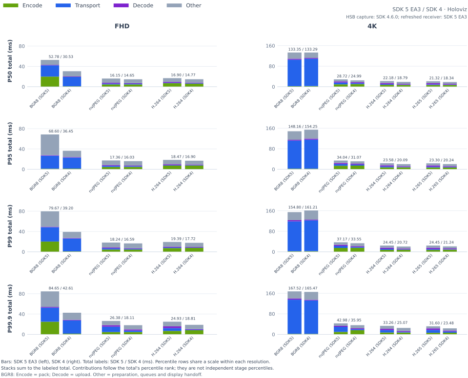

<table>
    <thead>
        <tr><th align="left">RES</th><th align="left">CC</th><th align="right">FPS</th><th align="right">P50</th><th align="right">P95</th><th align="right">P99</th><th align="right">P99.9</th></tr>
    </thead>
    <tbody>
        <tr><td rowspan="3">FHD</td><td>BGR8</td><td align="right">59.64 → 50.33</td><td align="right">30.53 → 52.78</td><td align="right">36.45 → 68.60</td><td align="right">39.20 → 79.67</td><td align="right">42.61 → 84.65</td></tr>
        <tr><td>nvJPEG</td><td align="right">59.68 → 59.91</td><td align="right">14.65 → 16.15</td><td align="right">16.03 → 17.36</td><td align="right">16.59 → 18.24</td><td align="right">18.11 → 26.38</td></tr>
        <tr><td><strong>H.264</strong></td><td align="right"><strong>59.66 → 59.95</strong></td><td align="right"><strong>14.77 → 16.90</strong></td><td align="right"><strong>16.90 → 18.47</strong></td><td align="right"><strong>17.72 → 19.39</strong></td><td align="right"><strong>18.81 → 24.93</strong></td></tr>
        <tr><td rowspan="4">4K</td><td>BGR8</td><td align="right">15.23 → 15.10</td><td align="right">133.29 → 133.35</td><td align="right">154.25 → 148.16</td><td align="right">161.21 → 154.80</td><td align="right">165.47 → 167.52</td></tr>
        <tr><td>nvJPEG</td><td align="right">59.84 → 60.03</td><td align="right">24.99 → 28.72</td><td align="right">31.07 → 34.04</td><td align="right">33.55 → 37.17</td><td align="right">35.95 → 42.98</td></tr>
        <tr><td><strong>H.264</strong></td><td align="right"><strong>60.12 → 60.07</strong></td><td align="right"><strong>18.79 → 22.18</strong></td><td align="right"><strong>20.09 → 23.58</strong></td><td align="right"><strong>20.72 → 24.45</strong></td><td align="right"><strong>25.07 → 33.26</strong></td></tr>
        <tr><td><strong>H.265</strong></td><td align="right"><strong>60.11 → 60.09</strong></td><td align="right"><strong>18.34 → 21.32</strong></td><td align="right"><strong>20.24 → 23.30</strong></td><td align="right"><strong>21.24 → 24.45</strong></td><td align="right"><strong>23.48 → 31.60</strong></td></tr>
    </tbody>
</table>

### DGX Spark (Patient) → x86 (Surgeon): MIRA Procedure Camera

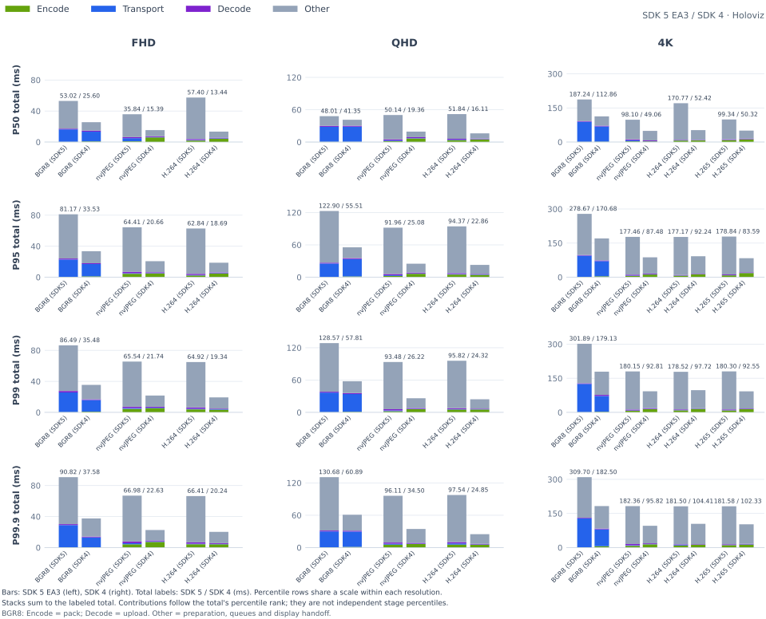

<table>
    <thead>
        <tr><th align="left">RES</th><th align="left">CC</th><th align="right">FPS</th><th align="right">P50</th><th align="right">P95</th><th align="right">P99</th><th align="right">P99.9</th></tr>
    </thead>
    <tbody>
        <tr><td rowspan="3">FHD</td><td>BGR8</td><td align="right">15.65 → 16.11</td><td align="right">25.60 → 40.68</td><td align="right">33.53 → 46.55</td><td align="right">35.48 → 48.44</td><td align="right">37.58 → 51.32</td></tr>
        <tr><td>nvJPEG</td><td align="right">15.38 → 16.00</td><td align="right">15.39 → 18.17</td><td align="right">20.66 → 20.93</td><td align="right">21.74 → 22.46</td><td align="right">22.63 → 24.49</td></tr>
        <tr><td><strong>H.264</strong></td><td align="right"><strong>15.57 → 16.00</strong></td><td align="right"><strong>13.44 → 16.32</strong></td><td align="right"><strong>18.69 → 17.89</strong></td><td align="right"><strong>19.34 → 18.62</strong></td><td align="right"><strong>20.24 → 21.46</strong></td></tr>
        <tr><td rowspan="3">QHD</td><td>BGR8</td><td align="right">13.38 → 10.85</td><td align="right">41.35 → 56.18</td><td align="right">55.51 → 63.49</td><td align="right">57.81 → 66.36</td><td align="right">60.89 → 68.28</td></tr>
        <tr><td>nvJPEG</td><td align="right">13.15 → 10.81</td><td align="right">19.36 → 30.42</td><td align="right">25.08 → 35.07</td><td align="right">26.22 → 36.13</td><td align="right">34.50 → 36.89</td></tr>
        <tr><td><strong>H.264</strong></td><td align="right"><strong>13.37 → 10.96</strong></td><td align="right"><strong>16.11 → 26.18</strong></td><td align="right"><strong>22.86 → 29.74</strong></td><td align="right"><strong>24.32 → 31.14</strong></td><td align="right"><strong>24.85 → 36.64</strong></td></tr>
        <tr><td rowspan="4">4K</td><td>BGR8</td><td align="right">8.10 → 6.32</td><td align="right">112.86 → 140.42</td><td align="right">170.68 → 171.29</td><td align="right">179.13 → 324.28</td><td align="right">182.50 → 346.06</td></tr>
        <tr><td>nvJPEG</td><td align="right">8.12 → 6.26</td><td align="right">49.06 → 79.81</td><td align="right">87.48 → 86.62</td><td align="right">92.81 → 88.23</td><td align="right">95.82 → 88.78</td></tr>
        <tr><td><strong>H.264</strong></td><td align="right"><strong>8.22 → 6.30</strong></td><td align="right"><strong>52.42 → 78.74</strong></td><td align="right"><strong>92.24 → 85.33</strong></td><td align="right"><strong>97.72 → 86.48</strong></td><td align="right"><strong>104.41 → 87.15</strong></td></tr>
        <tr><td><strong>H.265</strong></td><td align="right"><strong>8.46 → 6.18</strong></td><td align="right"><strong>50.32 → 81.02</strong></td><td align="right"><strong>83.59 → 152.60</strong></td><td align="right"><strong>92.55 → 157.37</strong></td><td align="right"><strong>102.33 → 374.49</strong></td></tr>
    </tbody>
</table>

### DGX Spark (Patient) → x86 (Surgeon): MIRA Room Camera

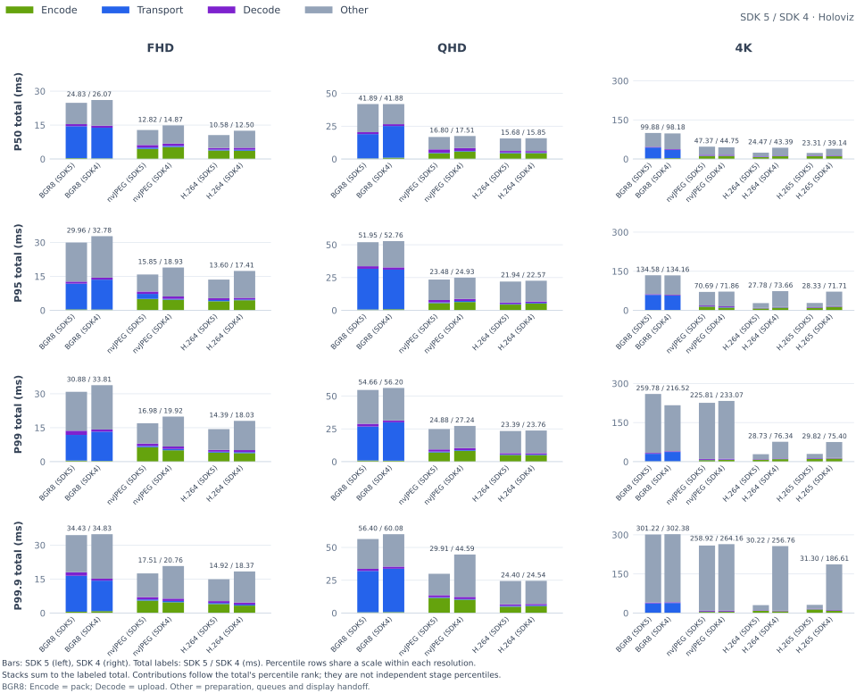

<table>
    <thead>
        <tr><th align="left">RES</th><th align="left">CC</th><th align="right">FPS</th><th align="right">P50</th><th align="right">P95</th><th align="right">P99</th><th align="right">P99.9</th></tr>
    </thead>
    <tbody>
        <tr><td rowspan="3">FHD</td><td>BGR8</td><td align="right">15.50 → 16.21</td><td align="right">26.07 → 36.42</td><td align="right">32.78 → 41.18</td><td align="right">33.81 → 42.83</td><td align="right">34.83 → 48.66</td></tr>
        <tr><td>nvJPEG</td><td align="right">15.38 → 16.03</td><td align="right">14.87 → 16.74</td><td align="right">18.93 → 20.22</td><td align="right">19.92 → 21.88</td><td align="right">20.76 → 23.36</td></tr>
        <tr><td><strong>H.264</strong></td><td align="right"><strong>15.45 → 16.01</strong></td><td align="right"><strong>12.50 → 13.54</strong></td><td align="right"><strong>17.41 → 15.64</strong></td><td align="right"><strong>18.03 → 16.71</strong></td><td align="right"><strong>18.37 → 18.43</strong></td></tr>
        <tr><td rowspan="3">QHD</td><td>BGR8</td><td align="right">13.26 → 10.83</td><td align="right">41.88 → 53.14</td><td align="right">52.76 → 59.41</td><td align="right">56.20 → 63.20</td><td align="right">60.08 → 65.72</td></tr>
        <tr><td>nvJPEG</td><td align="right">13.15 → 10.81</td><td align="right">17.51 → 29.34</td><td align="right">24.93 → 32.87</td><td align="right">27.24 → 33.90</td><td align="right">44.59 → 35.57</td></tr>
        <tr><td><strong>H.264</strong></td><td align="right"><strong>13.25 → 10.98</strong></td><td align="right"><strong>15.85 → 24.75</strong></td><td align="right"><strong>22.57 → 28.00</strong></td><td align="right"><strong>23.76 → 30.07</strong></td><td align="right"><strong>24.54 → 32.94</strong></td></tr>
        <tr><td rowspan="4">4K</td><td>BGR8</td><td align="right">8.10 → 6.35</td><td align="right">98.18 → 109.71</td><td align="right">134.16 → 130.79</td><td align="right">216.52 → 139.24</td><td align="right">302.38 → 259.60</td></tr>
        <tr><td>nvJPEG</td><td align="right">8.12 → 6.28</td><td align="right">44.75 → 50.16</td><td align="right">71.86 → 60.68</td><td align="right">233.07 → 62.37</td><td align="right">264.16 → 64.66</td></tr>
        <tr><td><strong>H.264</strong></td><td align="right"><strong>8.22 → 6.30</strong></td><td align="right"><strong>43.39 → 50.18</strong></td><td align="right"><strong>73.66 → 58.83</strong></td><td align="right"><strong>76.34 → 59.91</strong></td><td align="right"><strong>256.76 → 60.64</strong></td></tr>
        <tr><td><strong>H.265</strong></td><td align="right"><strong>8.45 → 6.18</strong></td><td align="right"><strong>39.14 → 51.05</strong></td><td align="right"><strong>71.71 → 61.61</strong></td><td align="right"><strong>75.40 → 68.44</strong></td><td align="right"><strong>186.61 → 256.88</strong></td></tr>
    </tbody>
</table>

## Interpretation and limits

- Total starts at application buffer availability and ends at Holoviz handoff; it excludes sensor exposure and physical display scanout. Changes in Total include preparation and queues as well as encoding, transport and decoding.
- These are separate, single runs per configuration. All EA3 configurations measured for 60 seconds after 30 seconds of warmup. The SDK 4 baseline retains its original durations, including earlier 10,000-sample runs. Application code, simulation scenes, duration, frame count, background load and power/clocks were not controlled identically between collection dates. P99.9 is especially sensitive to sparse samples. Differences do not establish an SDK-only cause or statistical significance.
- Remote totals use synchronized or estimated clock offsets. Bounds are recorded in the CSV; small differences may be within timing uncertainty. Compare latency together with FPS, especially for simulation.
- Refreshed BRIO runs requested 30 FPS; recorded source rates span 17.1–30.0 FPS. Exposure and dynamic framerate settings can reduce capture rate in low light. Source-rate differences confound FPS and latency comparisons with SDK 4; they do not establish an SDK regression.
- Codec settings match the source reports: NVENC P1, ultra-low-latency, QP 24, independent frames; nvJPEG quality 85. BRIO capture formats vary with resolution. This is not a comparison at equal visual quality.

## Appendix: WebRTC

H.264 in Chromium on the x86 surgeon. Values below are median paired percentage changes by camera, using the same calculation as the Holoviz summary. Browser Total includes delivery and scheduling; hardware decoding was not confirmed. Full per-resolution values are in the SDK report appendices.

| Patient · Camera | P50 | P95 | P99 | P99.9 |
| --------------------------------- | ------ | ------ | ------ | ------ |
| x86 · MIRA Procedure Camera | +7.7% | +6.8% | +11.6% | +15.5% |
| x86 · MIRA Room Camera | +2.2% | +6.1% | +6.8% | +4.7% |
| x86 · Logitech BRIO Camera | +58.8% | +8.0% | +15.4% | +11.4% |
| Thor · IMX274 Camera | +13.8% | +8.3% | +9.9% | +10.3% |
| DGX Spark · MIRA Procedure Camera | +59.9% | +39.6% | +58.2% | +57.3% |
| DGX Spark · MIRA Room Camera | +45.4% | +28.6% | +29.1% | +58.7% |

### x86 (Patient) → x86 (Surgeon): MIRA Procedure Camera

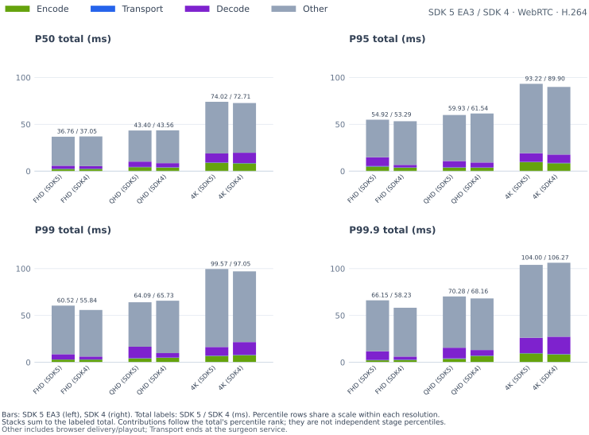

### x86 (Patient) → x86 (Surgeon): MIRA Room Camera

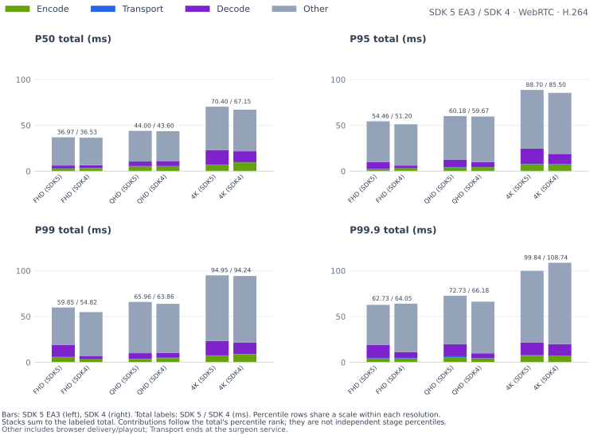

### x86 (Patient) → x86 (Surgeon): Logitech BRIO Camera

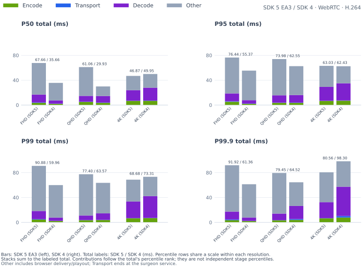

### Thor (Patient) → x86 (Surgeon): IMX274 Camera

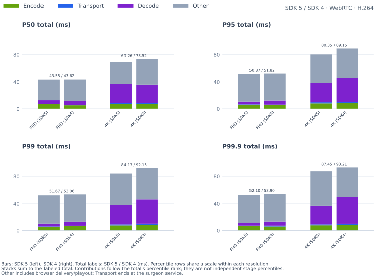

### DGX Spark (Patient) → x86 (Surgeon): MIRA Procedure Camera

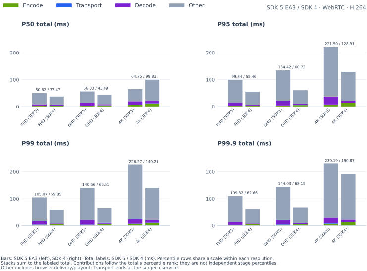

### DGX Spark (Patient) → x86 (Surgeon): MIRA Room Camera

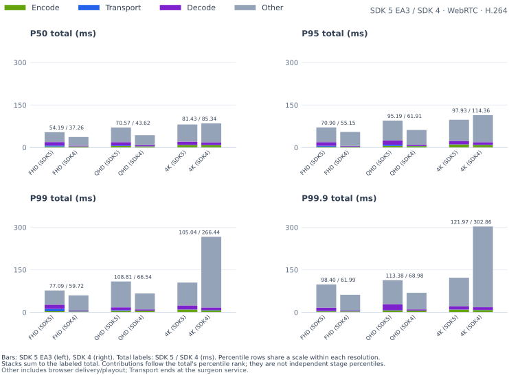

