# SDK 4 benchmark

<!-- markdownlint-configure-file {"MD024": {"siblings_only": true}, "MD033": {"allowed_elements": ["details", "summary", "table", "thead", "tbody", "tr", "th", "td", "strong"]}} -->

October 2026 · Holoscan `4.6.0` · **48 configurations, 74 camera results**.

Compare resolutions and codecs for each patient source. **The surgeon always runs on the x86 workstation.** The main tables use Holoviz; [WebRTC](#appendix-webrtc) is in the appendix. [SDK 5 report](../BENCHMARK.md) · [SDK comparison](BENCHMARK_COMPARISON.md).

[Measurements](../benchmarks/results/summary.csv) · [Matched-frame breakdowns](../benchmarks/results/stages.csv) · [Raw records](../benchmarks/results/matrix/) · [Hardware details](../benchmarks/results/matrix/hardware.json)

## Sources and hosts

Titles identify the patient and surgeon roles. **x86** is the Host Machine described below.

| Patient → Surgeon                   | Scenario                 | Camera                   |
| ----------------------------------- | ------------------------ | ------------------------ |
| x86 (Patient) → x86 (Surgeon)       | Same host · Simulation   | MIRA procedure and room  |
| x86 (Patient) → x86 (Surgeon)       | Same host · Physical     | Logitech BRIO webcam     |
| Thor (Patient) → x86 (Surgeon)      | Remote host · Physical   | IMX274 via HSB, sensor 0 |
| DGX Spark (Patient) → x86 (Surgeon) | Remote host · Simulation | MIRA procedure and room  |

Both MIRA cameras stream simultaneously.

Same-host tests run patient and surgeon on the same physical workstation. Remote patient nodes capture, encode and send directly to the surgeon. The patient dashboard/coordinator runs on the x86 workstation in all tests; it does not relay remote video.

| Host      | Hardware                                                                                            | Ethernet link |
| --------- | --------------------------------------------------------------------------------------------------- | ------------: |
| x86       | x86_64 · Intel Core i9-14900K · NVIDIA RTX PRO 6000 Blackwell GPUs (Workstation and Max-Q editions) |     10 Gbit/s |
| Thor      | ARM64 · NVIDIA Thor                                                                                 |      5 Gbit/s |
| DGX Spark | ARM64 · NVIDIA GB10                                                                                 |     10 Gbit/s |

Link rates are the negotiated Ethernet speeds during testing.

| Resolution | Name           | Pixels    |
| ---------- | -------------- | --------- |
| FHD        | Full HD        | 1920×1080 |
| QHD        | Quad HD        | 2560×1440 |
| 4K         | Ultra HD (UHD) | 3840×2160 |

MIRA and BRIO request 30 FPS; IMX274 requests 60 FPS in its native FHD and 4K modes. QHD has no IMX274 result. H.265 is tested only at 4K.

## Reading the charts and tables

Latency is in **milliseconds**. **RES** = resolution; **CC** = codec; **FPS** = viewer frame rate; **FS** = mean transport frame size.

**Total** is measured end-to-end latency, including preparation, queues and display handoff. Table stages are independent percentiles; they need not sum to Total. For BGR8, Encode/Decode mean packing/upload.

<details open>
<summary>

## x86 (Patient) → x86 (Surgeon): MIRA Procedure Camera

</summary>

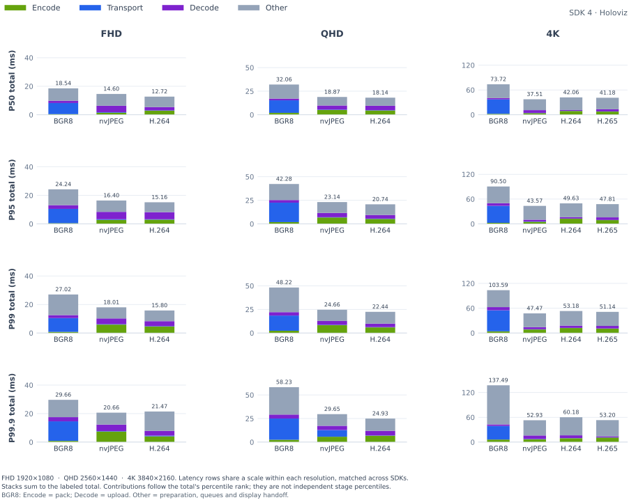

<details>
<summary>

### P50

</summary>

<table>
    <thead>
        <tr><th align="left">RES</th><th align="left">CC</th><th align="right">FPS</th><th align="right">FS</th><th align="right">Encode (ms)</th><th align="right">Transport (ms)</th><th align="right">Decode (ms)</th><th align="right">Total (ms)</th></tr>
    </thead>
    <tbody>
        <tr><td rowspan="3">FHD</td><td>BGR8</td><td align="right">26.88</td><td align="right">5.93 MiB</td><td align="right">0.56</td><td align="right">6.57</td><td align="right">2.03</td><td align="right">18.54</td></tr>
        <tr><td>nvJPEG</td><td align="right">26.88</td><td align="right">62.4 KiB</td><td align="right">2.98</td><td align="right">0.37</td><td align="right">3.96</td><td align="right">14.60</td></tr>
        <tr><td><strong>H.264</strong></td><td align="right"><strong>27.43</strong></td><td align="right"><strong>10.1 KiB</strong></td><td align="right"><strong>2.66</strong></td><td align="right"><strong>0.31</strong></td><td align="right"><strong>3.36</strong></td><td align="right"><strong>12.72</strong></td></tr>
        <tr><td rowspan="3">QHD</td><td>BGR8</td><td align="right">23.81</td><td align="right">10.55 MiB</td><td align="right">1.16</td><td align="right">12.21</td><td align="right">2.71</td><td align="right">32.06</td></tr>
        <tr><td>nvJPEG</td><td align="right">24.78</td><td align="right">101.9 KiB</td><td align="right">4.64</td><td align="right">0.42</td><td align="right">3.99</td><td align="right">18.87</td></tr>
        <tr><td><strong>H.264</strong></td><td align="right"><strong>25.00</strong></td><td align="right"><strong>14.0 KiB</strong></td><td align="right"><strong>4.51</strong></td><td align="right"><strong>0.32</strong></td><td align="right"><strong>3.20</strong></td><td align="right"><strong>18.14</strong></td></tr>
        <tr><td rowspan="4">4K</td><td>BGR8</td><td align="right">15.61</td><td align="right">23.73 MiB</td><td align="right">2.59</td><td align="right">28.80</td><td align="right">4.15</td><td align="right">73.72</td></tr>
        <tr><td>nvJPEG</td><td align="right">15.55</td><td align="right">209.6 KiB</td><td align="right">3.79</td><td align="right">0.64</td><td align="right">4.84</td><td align="right">37.51</td></tr>
        <tr><td><strong>H.264</strong></td><td align="right"><strong>14.93</strong></td><td align="right"><strong>23.2 KiB</strong></td><td align="right"><strong>8.85</strong></td><td align="right"><strong>0.33</strong></td><td align="right"><strong>3.18</strong></td><td align="right"><strong>42.06</strong></td></tr>
        <tr><td><strong>H.265</strong></td><td align="right"><strong>15.10</strong></td><td align="right"><strong>18.6 KiB</strong></td><td align="right"><strong>7.64</strong></td><td align="right"><strong>0.34</strong></td><td align="right"><strong>3.39</strong></td><td align="right"><strong>41.18</strong></td></tr>
    </tbody>
</table>

</details>

<details>
<summary>

### P95

</summary>

<table>
    <thead>
        <tr><th align="left">RES</th><th align="left">CC</th><th align="right">FPS</th><th align="right">FS</th><th align="right">Encode (ms)</th><th align="right">Transport (ms)</th><th align="right">Decode (ms)</th><th align="right">Total (ms)</th></tr>
    </thead>
    <tbody>
        <tr><td rowspan="3">FHD</td><td>BGR8</td><td align="right">26.88</td><td align="right">5.93 MiB</td><td align="right">1.24</td><td align="right">10.64</td><td align="right">3.38</td><td align="right">24.24</td></tr>
        <tr><td>nvJPEG</td><td align="right">26.88</td><td align="right">62.4 KiB</td><td align="right">5.47</td><td align="right">0.47</td><td align="right">5.17</td><td align="right">16.40</td></tr>
        <tr><td><strong>H.264</strong></td><td align="right"><strong>27.43</strong></td><td align="right"><strong>10.1 KiB</strong></td><td align="right"><strong>3.73</strong></td><td align="right"><strong>0.39</strong></td><td align="right"><strong>4.87</strong></td><td align="right"><strong>15.16</strong></td></tr>
        <tr><td rowspan="3">QHD</td><td>BGR8</td><td align="right">23.81</td><td align="right">10.55 MiB</td><td align="right">2.55</td><td align="right">19.48</td><td align="right">4.35</td><td align="right">42.28</td></tr>
        <tr><td>nvJPEG</td><td align="right">24.78</td><td align="right">101.9 KiB</td><td align="right">7.52</td><td align="right">0.53</td><td align="right">5.46</td><td align="right">23.14</td></tr>
        <tr><td><strong>H.264</strong></td><td align="right"><strong>25.00</strong></td><td align="right"><strong>14.0 KiB</strong></td><td align="right"><strong>6.59</strong></td><td align="right"><strong>0.40</strong></td><td align="right"><strong>5.00</strong></td><td align="right"><strong>20.74</strong></td></tr>
        <tr><td rowspan="4">4K</td><td>BGR8</td><td align="right">15.61</td><td align="right">23.73 MiB</td><td align="right">5.20</td><td align="right">40.45</td><td align="right">6.65</td><td align="right">90.50</td></tr>
        <tr><td>nvJPEG</td><td align="right">15.55</td><td align="right">209.6 KiB</td><td align="right">6.41</td><td align="right">1.34</td><td align="right">7.31</td><td align="right">43.57</td></tr>
        <tr><td><strong>H.264</strong></td><td align="right"><strong>14.93</strong></td><td align="right"><strong>23.2 KiB</strong></td><td align="right"><strong>11.65</strong></td><td align="right"><strong>0.45</strong></td><td align="right"><strong>5.94</strong></td><td align="right"><strong>49.63</strong></td></tr>
        <tr><td><strong>H.265</strong></td><td align="right"><strong>15.10</strong></td><td align="right"><strong>18.6 KiB</strong></td><td align="right"><strong>10.57</strong></td><td align="right"><strong>0.46</strong></td><td align="right"><strong>6.28</strong></td><td align="right"><strong>47.81</strong></td></tr>
    </tbody>
</table>

</details>

<details open>
<summary>

### P99

</summary>

<table>
    <thead>
        <tr><th align="left">RES</th><th align="left">CC</th><th align="right">FPS</th><th align="right">FS</th><th align="right">Encode (ms)</th><th align="right">Transport (ms)</th><th align="right">Decode (ms)</th><th align="right">Total (ms)</th></tr>
    </thead>
    <tbody>
        <tr><td rowspan="3">FHD</td><td>BGR8</td><td align="right">26.88</td><td align="right">5.93 MiB</td><td align="right">1.37</td><td align="right">11.87</td><td align="right">3.68</td><td align="right">27.02</td></tr>
        <tr><td>nvJPEG</td><td align="right">26.88</td><td align="right">62.4 KiB</td><td align="right">6.56</td><td align="right">0.58</td><td align="right">5.45</td><td align="right">18.01</td></tr>
        <tr><td><strong>H.264</strong></td><td align="right"><strong>27.43</strong></td><td align="right"><strong>10.1 KiB</strong></td><td align="right"><strong>4.64</strong></td><td align="right"><strong>0.47</strong></td><td align="right"><strong>5.18</strong></td><td align="right"><strong>15.80</strong></td></tr>
        <tr><td rowspan="3">QHD</td><td>BGR8</td><td align="right">23.81</td><td align="right">10.55 MiB</td><td align="right">2.77</td><td align="right">21.47</td><td align="right">4.91</td><td align="right">48.22</td></tr>
        <tr><td>nvJPEG</td><td align="right">24.78</td><td align="right">101.9 KiB</td><td align="right">8.55</td><td align="right">0.70</td><td align="right">6.10</td><td align="right">24.66</td></tr>
        <tr><td><strong>H.264</strong></td><td align="right"><strong>25.00</strong></td><td align="right"><strong>14.0 KiB</strong></td><td align="right"><strong>7.33</strong></td><td align="right"><strong>0.47</strong></td><td align="right"><strong>5.40</strong></td><td align="right"><strong>22.44</strong></td></tr>
        <tr><td rowspan="4">4K</td><td>BGR8</td><td align="right">15.61</td><td align="right">23.73 MiB</td><td align="right">6.08</td><td align="right">47.92</td><td align="right">7.68</td><td align="right">103.59</td></tr>
        <tr><td>nvJPEG</td><td align="right">15.55</td><td align="right">209.6 KiB</td><td align="right">9.05</td><td align="right">1.53</td><td align="right">7.62</td><td align="right">47.47</td></tr>
        <tr><td><strong>H.264</strong></td><td align="right"><strong>14.93</strong></td><td align="right"><strong>23.2 KiB</strong></td><td align="right"><strong>13.21</strong></td><td align="right"><strong>0.55</strong></td><td align="right"><strong>6.26</strong></td><td align="right"><strong>53.18</strong></td></tr>
        <tr><td><strong>H.265</strong></td><td align="right"><strong>15.10</strong></td><td align="right"><strong>18.6 KiB</strong></td><td align="right"><strong>11.30</strong></td><td align="right"><strong>0.56</strong></td><td align="right"><strong>6.63</strong></td><td align="right"><strong>51.14</strong></td></tr>
    </tbody>
</table>

</details>

<details open>
<summary>

### P99.9

</summary>

<table>
    <thead>
        <tr><th align="left">RES</th><th align="left">CC</th><th align="right">FPS</th><th align="right">FS</th><th align="right">Encode (ms)</th><th align="right">Transport (ms)</th><th align="right">Decode (ms)</th><th align="right">Total (ms)</th></tr>
    </thead>
    <tbody>
        <tr><td rowspan="3">FHD</td><td>BGR8</td><td align="right">26.88</td><td align="right">5.93 MiB</td><td align="right">1.48</td><td align="right">13.74</td><td align="right">4.04</td><td align="right">29.66</td></tr>
        <tr><td>nvJPEG</td><td align="right">26.88</td><td align="right">62.4 KiB</td><td align="right">7.25</td><td align="right">1.23</td><td align="right">5.80</td><td align="right">20.66</td></tr>
        <tr><td><strong>H.264</strong></td><td align="right"><strong>27.43</strong></td><td align="right"><strong>10.1 KiB</strong></td><td align="right"><strong>5.34</strong></td><td align="right"><strong>0.76</strong></td><td align="right"><strong>5.52</strong></td><td align="right"><strong>21.47</strong></td></tr>
        <tr><td rowspan="3">QHD</td><td>BGR8</td><td align="right">23.81</td><td align="right">10.55 MiB</td><td align="right">3.07</td><td align="right">23.49</td><td align="right">5.28</td><td align="right">58.23</td></tr>
        <tr><td>nvJPEG</td><td align="right">24.78</td><td align="right">101.9 KiB</td><td align="right">9.41</td><td align="right">1.98</td><td align="right">6.66</td><td align="right">29.65</td></tr>
        <tr><td><strong>H.264</strong></td><td align="right"><strong>25.00</strong></td><td align="right"><strong>14.0 KiB</strong></td><td align="right"><strong>8.03</strong></td><td align="right"><strong>1.50</strong></td><td align="right"><strong>5.70</strong></td><td align="right"><strong>24.93</strong></td></tr>
        <tr><td rowspan="4">4K</td><td>BGR8</td><td align="right">15.61</td><td align="right">23.73 MiB</td><td align="right">6.75</td><td align="right">59.25</td><td align="right">8.75</td><td align="right">137.49</td></tr>
        <tr><td>nvJPEG</td><td align="right">15.55</td><td align="right">209.6 KiB</td><td align="right">10.44</td><td align="right">2.26</td><td align="right">8.72</td><td align="right">52.93</td></tr>
        <tr><td><strong>H.264</strong></td><td align="right"><strong>14.93</strong></td><td align="right"><strong>23.2 KiB</strong></td><td align="right"><strong>15.18</strong></td><td align="right"><strong>0.79</strong></td><td align="right"><strong>7.53</strong></td><td align="right"><strong>60.18</strong></td></tr>
        <tr><td><strong>H.265</strong></td><td align="right"><strong>15.10</strong></td><td align="right"><strong>18.6 KiB</strong></td><td align="right"><strong>12.30</strong></td><td align="right"><strong>0.99</strong></td><td align="right"><strong>6.72</strong></td><td align="right"><strong>53.20</strong></td></tr>
    </tbody>
</table>

</details>

</details>

<details>
<summary>

## x86 (Patient) → x86 (Surgeon): MIRA Room Camera

</summary>

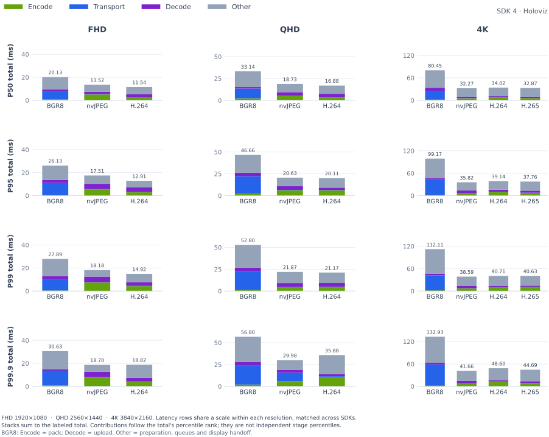

<details>
<summary>

### P50

</summary>

<table>
    <thead>
        <tr><th align="left">RES</th><th align="left">CC</th><th align="right">FPS</th><th align="right">FS</th><th align="right">Encode (ms)</th><th align="right">Transport (ms)</th><th align="right">Decode (ms)</th><th align="right">Total (ms)</th></tr>
    </thead>
    <tbody>
        <tr><td rowspan="3">FHD</td><td>BGR8</td><td align="right">26.65</td><td align="right">5.93 MiB</td><td align="right">0.88</td><td align="right">6.81</td><td align="right">1.68</td><td align="right">20.13</td></tr>
        <tr><td>nvJPEG</td><td align="right">26.88</td><td align="right">54.7 KiB</td><td align="right">4.64</td><td align="right">0.29</td><td align="right">3.79</td><td align="right">13.52</td></tr>
        <tr><td><strong>H.264</strong></td><td align="right"><strong>27.20</strong></td><td align="right"><strong>13.7 KiB</strong></td><td align="right"><strong>2.79</strong></td><td align="right"><strong>0.23</strong></td><td align="right"><strong>2.59</strong></td><td align="right"><strong>11.54</strong></td></tr>
        <tr><td rowspan="3">QHD</td><td>BGR8</td><td align="right">23.81</td><td align="right">10.55 MiB</td><td align="right">1.09</td><td align="right">11.54</td><td align="right">2.07</td><td align="right">33.14</td></tr>
        <tr><td>nvJPEG</td><td align="right">24.56</td><td align="right">88.9 KiB</td><td align="right">4.39</td><td align="right">0.33</td><td align="right">4.28</td><td align="right">18.73</td></tr>
        <tr><td><strong>H.264</strong></td><td align="right"><strong>24.78</strong></td><td align="right"><strong>19.1 KiB</strong></td><td align="right"><strong>4.61</strong></td><td align="right"><strong>0.26</strong></td><td align="right"><strong>2.91</strong></td><td align="right"><strong>16.88</strong></td></tr>
        <tr><td rowspan="4">4K</td><td>BGR8</td><td align="right">15.60</td><td align="right">23.73 MiB</td><td align="right">1.96</td><td align="right">29.82</td><td align="right">4.69</td><td align="right">80.45</td></tr>
        <tr><td>nvJPEG</td><td align="right">15.55</td><td align="right">181.4 KiB</td><td align="right">5.31</td><td align="right">0.46</td><td align="right">5.11</td><td align="right">32.27</td></tr>
        <tr><td><strong>H.264</strong></td><td align="right"><strong>14.81</strong></td><td align="right"><strong>31.6 KiB</strong></td><td align="right"><strong>8.49</strong></td><td align="right"><strong>0.29</strong></td><td align="right"><strong>3.47</strong></td><td align="right"><strong>34.02</strong></td></tr>
        <tr><td><strong>H.265</strong></td><td align="right"><strong>14.97</strong></td><td align="right"><strong>24.5 KiB</strong></td><td align="right"><strong>7.32</strong></td><td align="right"><strong>0.30</strong></td><td align="right"><strong>3.46</strong></td><td align="right"><strong>32.87</strong></td></tr>
    </tbody>
</table>

</details>

<details>
<summary>

### P95

</summary>

<table>
    <thead>
        <tr><th align="left">RES</th><th align="left">CC</th><th align="right">FPS</th><th align="right">FS</th><th align="right">Encode (ms)</th><th align="right">Transport (ms)</th><th align="right">Decode (ms)</th><th align="right">Total (ms)</th></tr>
    </thead>
    <tbody>
        <tr><td rowspan="3">FHD</td><td>BGR8</td><td align="right">26.65</td><td align="right">5.93 MiB</td><td align="right">1.26</td><td align="right">10.67</td><td align="right">3.09</td><td align="right">26.13</td></tr>
        <tr><td>nvJPEG</td><td align="right">26.88</td><td align="right">54.7 KiB</td><td align="right">6.02</td><td align="right">0.38</td><td align="right">4.70</td><td align="right">17.51</td></tr>
        <tr><td><strong>H.264</strong></td><td align="right"><strong>27.20</strong></td><td align="right"><strong>13.7 KiB</strong></td><td align="right"><strong>4.30</strong></td><td align="right"><strong>0.30</strong></td><td align="right"><strong>4.36</strong></td><td align="right"><strong>12.91</strong></td></tr>
        <tr><td rowspan="3">QHD</td><td>BGR8</td><td align="right">23.81</td><td align="right">10.55 MiB</td><td align="right">2.42</td><td align="right">19.60</td><td align="right">4.05</td><td align="right">46.66</td></tr>
        <tr><td>nvJPEG</td><td align="right">24.56</td><td align="right">88.9 KiB</td><td align="right">6.37</td><td align="right">0.43</td><td align="right">4.95</td><td align="right">20.63</td></tr>
        <tr><td><strong>H.264</strong></td><td align="right"><strong>24.78</strong></td><td align="right"><strong>19.1 KiB</strong></td><td align="right"><strong>6.07</strong></td><td align="right"><strong>0.33</strong></td><td align="right"><strong>4.88</strong></td><td align="right"><strong>20.11</strong></td></tr>
        <tr><td rowspan="4">4K</td><td>BGR8</td><td align="right">15.60</td><td align="right">23.73 MiB</td><td align="right">3.74</td><td align="right">41.34</td><td align="right">7.13</td><td align="right">99.17</td></tr>
        <tr><td>nvJPEG</td><td align="right">15.55</td><td align="right">181.4 KiB</td><td align="right">7.49</td><td align="right">0.62</td><td align="right">7.27</td><td align="right">35.82</td></tr>
        <tr><td><strong>H.264</strong></td><td align="right"><strong>14.81</strong></td><td align="right"><strong>31.6 KiB</strong></td><td align="right"><strong>10.70</strong></td><td align="right"><strong>0.37</strong></td><td align="right"><strong>5.68</strong></td><td align="right"><strong>39.14</strong></td></tr>
        <tr><td><strong>H.265</strong></td><td align="right"><strong>14.97</strong></td><td align="right"><strong>24.5 KiB</strong></td><td align="right"><strong>9.83</strong></td><td align="right"><strong>0.37</strong></td><td align="right"><strong>5.90</strong></td><td align="right"><strong>37.76</strong></td></tr>
    </tbody>
</table>

</details>

<details open>
<summary>

### P99

</summary>

<table>
    <thead>
        <tr><th align="left">RES</th><th align="left">CC</th><th align="right">FPS</th><th align="right">FS</th><th align="right">Encode (ms)</th><th align="right">Transport (ms)</th><th align="right">Decode (ms)</th><th align="right">Total (ms)</th></tr>
    </thead>
    <tbody>
        <tr><td rowspan="3">FHD</td><td>BGR8</td><td align="right">26.65</td><td align="right">5.93 MiB</td><td align="right">1.35</td><td align="right">11.77</td><td align="right">3.43</td><td align="right">27.89</td></tr>
        <tr><td>nvJPEG</td><td align="right">26.88</td><td align="right">54.7 KiB</td><td align="right">6.52</td><td align="right">0.43</td><td align="right">4.99</td><td align="right">18.18</td></tr>
        <tr><td><strong>H.264</strong></td><td align="right"><strong>27.20</strong></td><td align="right"><strong>13.7 KiB</strong></td><td align="right"><strong>4.74</strong></td><td align="right"><strong>0.34</strong></td><td align="right"><strong>4.82</strong></td><td align="right"><strong>14.92</strong></td></tr>
        <tr><td rowspan="3">QHD</td><td>BGR8</td><td align="right">23.81</td><td align="right">10.55 MiB</td><td align="right">2.61</td><td align="right">22.34</td><td align="right">4.65</td><td align="right">52.80</td></tr>
        <tr><td>nvJPEG</td><td align="right">24.56</td><td align="right">88.9 KiB</td><td align="right">6.79</td><td align="right">0.54</td><td align="right">5.15</td><td align="right">21.87</td></tr>
        <tr><td><strong>H.264</strong></td><td align="right"><strong>24.78</strong></td><td align="right"><strong>19.1 KiB</strong></td><td align="right"><strong>6.67</strong></td><td align="right"><strong>0.38</strong></td><td align="right"><strong>5.01</strong></td><td align="right"><strong>21.17</strong></td></tr>
        <tr><td rowspan="4">4K</td><td>BGR8</td><td align="right">15.60</td><td align="right">23.73 MiB</td><td align="right">4.23</td><td align="right">49.51</td><td align="right">7.90</td><td align="right">112.11</td></tr>
        <tr><td>nvJPEG</td><td align="right">15.55</td><td align="right">181.4 KiB</td><td align="right">8.78</td><td align="right">0.72</td><td align="right">8.50</td><td align="right">38.59</td></tr>
        <tr><td><strong>H.264</strong></td><td align="right"><strong>14.81</strong></td><td align="right"><strong>31.6 KiB</strong></td><td align="right"><strong>11.81</strong></td><td align="right"><strong>0.44</strong></td><td align="right"><strong>5.82</strong></td><td align="right"><strong>40.71</strong></td></tr>
        <tr><td><strong>H.265</strong></td><td align="right"><strong>14.97</strong></td><td align="right"><strong>24.5 KiB</strong></td><td align="right"><strong>10.97</strong></td><td align="right"><strong>0.42</strong></td><td align="right"><strong>6.12</strong></td><td align="right"><strong>40.63</strong></td></tr>
    </tbody>
</table>

</details>

<details open>
<summary>

### P99.9

</summary>

<table>
    <thead>
        <tr><th align="left">RES</th><th align="left">CC</th><th align="right">FPS</th><th align="right">FS</th><th align="right">Encode (ms)</th><th align="right">Transport (ms)</th><th align="right">Decode (ms)</th><th align="right">Total (ms)</th></tr>
    </thead>
    <tbody>
        <tr><td rowspan="3">FHD</td><td>BGR8</td><td align="right">26.65</td><td align="right">5.93 MiB</td><td align="right">1.42</td><td align="right">13.63</td><td align="right">3.61</td><td align="right">30.63</td></tr>
        <tr><td>nvJPEG</td><td align="right">26.88</td><td align="right">54.7 KiB</td><td align="right">7.89</td><td align="right">0.56</td><td align="right">5.26</td><td align="right">18.70</td></tr>
        <tr><td><strong>H.264</strong></td><td align="right"><strong>27.20</strong></td><td align="right"><strong>13.7 KiB</strong></td><td align="right"><strong>5.07</strong></td><td align="right"><strong>0.61</strong></td><td align="right"><strong>5.08</strong></td><td align="right"><strong>18.82</strong></td></tr>
        <tr><td rowspan="3">QHD</td><td>BGR8</td><td align="right">23.81</td><td align="right">10.55 MiB</td><td align="right">2.85</td><td align="right">26.60</td><td align="right">5.75</td><td align="right">56.80</td></tr>
        <tr><td>nvJPEG</td><td align="right">24.56</td><td align="right">88.9 KiB</td><td align="right">7.20</td><td align="right">1.54</td><td align="right">5.30</td><td align="right">29.98</td></tr>
        <tr><td><strong>H.264</strong></td><td align="right"><strong>24.78</strong></td><td align="right"><strong>19.1 KiB</strong></td><td align="right"><strong>8.82</strong></td><td align="right"><strong>1.50</strong></td><td align="right"><strong>5.07</strong></td><td align="right"><strong>35.88</strong></td></tr>
        <tr><td rowspan="4">4K</td><td>BGR8</td><td align="right">15.60</td><td align="right">23.73 MiB</td><td align="right">4.70</td><td align="right">76.36</td><td align="right">8.45</td><td align="right">132.93</td></tr>
        <tr><td>nvJPEG</td><td align="right">15.55</td><td align="right">181.4 KiB</td><td align="right">8.97</td><td align="right">1.29</td><td align="right">9.27</td><td align="right">41.66</td></tr>
        <tr><td><strong>H.264</strong></td><td align="right"><strong>14.81</strong></td><td align="right"><strong>31.6 KiB</strong></td><td align="right"><strong>13.60</strong></td><td align="right"><strong>1.70</strong></td><td align="right"><strong>5.97</strong></td><td align="right"><strong>48.60</strong></td></tr>
        <tr><td><strong>H.265</strong></td><td align="right"><strong>14.97</strong></td><td align="right"><strong>24.5 KiB</strong></td><td align="right"><strong>11.69</strong></td><td align="right"><strong>0.51</strong></td><td align="right"><strong>6.31</strong></td><td align="right"><strong>44.69</strong></td></tr>
    </tbody>
</table>

</details>

</details>

<details>
<summary>

## x86 (Patient) → x86 (Surgeon): Logitech BRIO Camera

</summary>

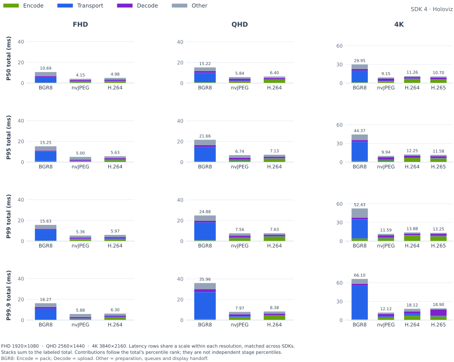

<details>
<summary>

### P50

</summary>

<table>
    <thead>
        <tr><th align="left">RES</th><th align="left">CC</th><th align="right">FPS</th><th align="right">FS</th><th align="right">Encode (ms)</th><th align="right">Transport (ms)</th><th align="right">Decode (ms)</th><th align="right">Total (ms)</th></tr>
    </thead>
    <tbody>
        <tr><td rowspan="3">FHD</td><td>BGR8</td><td align="right">16.87</td><td align="right">5.93 MiB</td><td align="right">0.41</td><td align="right">5.88</td><td align="right">0.93</td><td align="right">10.69</td></tr>
        <tr><td>nvJPEG</td><td align="right">16.95</td><td align="right">182.9 KiB</td><td align="right">1.08</td><td align="right">0.34</td><td align="right">1.14</td><td align="right">4.15</td></tr>
        <tr><td><strong>H.264</strong></td><td align="right"><strong>16.88</strong></td><td align="right"><strong>68.8 KiB</strong></td><td align="right"><strong>1.94</strong></td><td align="right"><strong>0.31</strong></td><td align="right"><strong>0.98</strong></td><td align="right"><strong>4.98</strong></td></tr>
        <tr><td rowspan="3">QHD</td><td>BGR8</td><td align="right">29.83</td><td align="right">10.55 MiB</td><td align="right">0.79</td><td align="right">8.77</td><td align="right">1.57</td><td align="right">15.22</td></tr>
        <tr><td>nvJPEG</td><td align="right">29.85</td><td align="right">342.0 KiB</td><td align="right">1.72</td><td align="right">0.69</td><td align="right">1.77</td><td align="right">5.84</td></tr>
        <tr><td><strong>H.264</strong></td><td align="right"><strong>29.85</strong></td><td align="right"><strong>132.3 KiB</strong></td><td align="right"><strong>3.35</strong></td><td align="right"><strong>0.26</strong></td><td align="right"><strong>1.39</strong></td><td align="right"><strong>6.40</strong></td></tr>
        <tr><td rowspan="4">4K</td><td>BGR8</td><td align="right">16.70</td><td align="right">23.73 MiB</td><td align="right">1.28</td><td align="right">18.89</td><td align="right">2.59</td><td align="right">29.95</td></tr>
        <tr><td>nvJPEG</td><td align="right">16.70</td><td align="right">676.7 KiB</td><td align="right">2.84</td><td align="right">1.22</td><td align="right">3.45</td><td align="right">9.15</td></tr>
        <tr><td><strong>H.264</strong></td><td align="right"><strong>29.95</strong></td><td align="right"><strong>268.9 KiB</strong></td><td align="right"><strong>6.77</strong></td><td align="right"><strong>0.54</strong></td><td align="right"><strong>2.41</strong></td><td align="right"><strong>11.26</strong></td></tr>
        <tr><td><strong>H.265</strong></td><td align="right"><strong>29.94</strong></td><td align="right"><strong>250.9 KiB</strong></td><td align="right"><strong>5.82</strong></td><td align="right"><strong>0.50</strong></td><td align="right"><strong>2.87</strong></td><td align="right"><strong>10.70</strong></td></tr>
    </tbody>
</table>

</details>

<details>
<summary>

### P95

</summary>

<table>
    <thead>
        <tr><th align="left">RES</th><th align="left">CC</th><th align="right">FPS</th><th align="right">FS</th><th align="right">Encode (ms)</th><th align="right">Transport (ms)</th><th align="right">Decode (ms)</th><th align="right">Total (ms)</th></tr>
    </thead>
    <tbody>
        <tr><td rowspan="3">FHD</td><td>BGR8</td><td align="right">16.87</td><td align="right">5.93 MiB</td><td align="right">0.48</td><td align="right">10.32</td><td align="right">1.44</td><td align="right">15.25</td></tr>
        <tr><td>nvJPEG</td><td align="right">16.95</td><td align="right">182.9 KiB</td><td align="right">1.15</td><td align="right">0.63</td><td align="right">1.30</td><td align="right">5.00</td></tr>
        <tr><td><strong>H.264</strong></td><td align="right"><strong>16.88</strong></td><td align="right"><strong>68.8 KiB</strong></td><td align="right"><strong>2.11</strong></td><td align="right"><strong>0.47</strong></td><td align="right"><strong>1.21</strong></td><td align="right"><strong>5.63</strong></td></tr>
        <tr><td rowspan="3">QHD</td><td>BGR8</td><td align="right">29.83</td><td align="right">10.55 MiB</td><td align="right">1.00</td><td align="right">13.99</td><td align="right">1.75</td><td align="right">21.66</td></tr>
        <tr><td>nvJPEG</td><td align="right">29.85</td><td align="right">342.0 KiB</td><td align="right">2.13</td><td align="right">0.87</td><td align="right">1.86</td><td align="right">6.74</td></tr>
        <tr><td><strong>H.264</strong></td><td align="right"><strong>29.85</strong></td><td align="right"><strong>132.3 KiB</strong></td><td align="right"><strong>3.48</strong></td><td align="right"><strong>0.42</strong></td><td align="right"><strong>1.54</strong></td><td align="right"><strong>7.13</strong></td></tr>
        <tr><td rowspan="4">4K</td><td>BGR8</td><td align="right">16.70</td><td align="right">23.73 MiB</td><td align="right">2.75</td><td align="right">31.82</td><td align="right">2.78</td><td align="right">44.37</td></tr>
        <tr><td>nvJPEG</td><td align="right">16.70</td><td align="right">676.7 KiB</td><td align="right">2.95</td><td align="right">1.36</td><td align="right">3.54</td><td align="right">9.94</td></tr>
        <tr><td><strong>H.264</strong></td><td align="right"><strong>29.95</strong></td><td align="right"><strong>268.9 KiB</strong></td><td align="right"><strong>7.03</strong></td><td align="right"><strong>0.75</strong></td><td align="right"><strong>2.65</strong></td><td align="right"><strong>12.25</strong></td></tr>
        <tr><td><strong>H.265</strong></td><td align="right"><strong>29.94</strong></td><td align="right"><strong>250.9 KiB</strong></td><td align="right"><strong>6.00</strong></td><td align="right"><strong>0.66</strong></td><td align="right"><strong>3.12</strong></td><td align="right"><strong>11.58</strong></td></tr>
    </tbody>
</table>

</details>

<details open>
<summary>

### P99

</summary>

<table>
    <thead>
        <tr><th align="left">RES</th><th align="left">CC</th><th align="right">FPS</th><th align="right">FS</th><th align="right">Encode (ms)</th><th align="right">Transport (ms)</th><th align="right">Decode (ms)</th><th align="right">Total (ms)</th></tr>
    </thead>
    <tbody>
        <tr><td rowspan="3">FHD</td><td>BGR8</td><td align="right">16.87</td><td align="right">5.93 MiB</td><td align="right">0.91</td><td align="right">10.67</td><td align="right">1.55</td><td align="right">15.63</td></tr>
        <tr><td>nvJPEG</td><td align="right">16.95</td><td align="right">182.9 KiB</td><td align="right">1.76</td><td align="right">0.78</td><td align="right">1.36</td><td align="right">5.36</td></tr>
        <tr><td><strong>H.264</strong></td><td align="right"><strong>16.88</strong></td><td align="right"><strong>68.8 KiB</strong></td><td align="right"><strong>2.68</strong></td><td align="right"><strong>0.59</strong></td><td align="right"><strong>1.31</strong></td><td align="right"><strong>5.97</strong></td></tr>
        <tr><td rowspan="3">QHD</td><td>BGR8</td><td align="right">29.83</td><td align="right">10.55 MiB</td><td align="right">2.00</td><td align="right">17.10</td><td align="right">1.90</td><td align="right">24.88</td></tr>
        <tr><td>nvJPEG</td><td align="right">29.85</td><td align="right">342.0 KiB</td><td align="right">2.99</td><td align="right">0.97</td><td align="right">1.93</td><td align="right">7.56</td></tr>
        <tr><td><strong>H.264</strong></td><td align="right"><strong>29.85</strong></td><td align="right"><strong>132.3 KiB</strong></td><td align="right"><strong>4.54</strong></td><td align="right"><strong>0.48</strong></td><td align="right"><strong>1.61</strong></td><td align="right"><strong>7.63</strong></td></tr>
        <tr><td rowspan="4">4K</td><td>BGR8</td><td align="right">16.70</td><td align="right">23.73 MiB</td><td align="right">3.14</td><td align="right">38.31</td><td align="right">3.43</td><td align="right">52.43</td></tr>
        <tr><td>nvJPEG</td><td align="right">16.70</td><td align="right">676.7 KiB</td><td align="right">4.75</td><td align="right">1.46</td><td align="right">3.63</td><td align="right">11.59</td></tr>
        <tr><td><strong>H.264</strong></td><td align="right"><strong>29.95</strong></td><td align="right"><strong>268.9 KiB</strong></td><td align="right"><strong>8.79</strong></td><td align="right"><strong>0.96</strong></td><td align="right"><strong>2.80</strong></td><td align="right"><strong>13.88</strong></td></tr>
        <tr><td><strong>H.265</strong></td><td align="right"><strong>29.94</strong></td><td align="right"><strong>250.9 KiB</strong></td><td align="right"><strong>7.82</strong></td><td align="right"><strong>0.85</strong></td><td align="right"><strong>3.27</strong></td><td align="right"><strong>13.25</strong></td></tr>
    </tbody>
</table>

</details>

<details open>
<summary>

### P99.9

</summary>

<table>
    <thead>
        <tr><th align="left">RES</th><th align="left">CC</th><th align="right">FPS</th><th align="right">FS</th><th align="right">Encode (ms)</th><th align="right">Transport (ms)</th><th align="right">Decode (ms)</th><th align="right">Total (ms)</th></tr>
    </thead>
    <tbody>
        <tr><td rowspan="3">FHD</td><td>BGR8</td><td align="right">16.87</td><td align="right">5.93 MiB</td><td align="right">1.05</td><td align="right">10.99</td><td align="right">1.73</td><td align="right">16.27</td></tr>
        <tr><td>nvJPEG</td><td align="right">16.95</td><td align="right">182.9 KiB</td><td align="right">1.84</td><td align="right">1.09</td><td align="right">1.49</td><td align="right">5.88</td></tr>
        <tr><td><strong>H.264</strong></td><td align="right"><strong>16.88</strong></td><td align="right"><strong>68.8 KiB</strong></td><td align="right"><strong>2.77</strong></td><td align="right"><strong>0.81</strong></td><td align="right"><strong>1.38</strong></td><td align="right"><strong>6.30</strong></td></tr>
        <tr><td rowspan="3">QHD</td><td>BGR8</td><td align="right">29.83</td><td align="right">10.55 MiB</td><td align="right">2.07</td><td align="right">26.23</td><td align="right">2.89</td><td align="right">35.96</td></tr>
        <tr><td>nvJPEG</td><td align="right">29.85</td><td align="right">342.0 KiB</td><td align="right">3.06</td><td align="right">1.21</td><td align="right">2.06</td><td align="right">7.97</td></tr>
        <tr><td><strong>H.264</strong></td><td align="right"><strong>29.85</strong></td><td align="right"><strong>132.3 KiB</strong></td><td align="right"><strong>4.70</strong></td><td align="right"><strong>0.60</strong></td><td align="right"><strong>1.73</strong></td><td align="right"><strong>8.38</strong></td></tr>
        <tr><td rowspan="4">4K</td><td>BGR8</td><td align="right">16.70</td><td align="right">23.73 MiB</td><td align="right">3.29</td><td align="right">53.89</td><td align="right">5.02</td><td align="right">66.10</td></tr>
        <tr><td>nvJPEG</td><td align="right">16.70</td><td align="right">676.7 KiB</td><td align="right">4.85</td><td align="right">1.66</td><td align="right">3.69</td><td align="right">12.12</td></tr>
        <tr><td><strong>H.264</strong></td><td align="right"><strong>29.95</strong></td><td align="right"><strong>268.9 KiB</strong></td><td align="right"><strong>8.99</strong></td><td align="right"><strong>3.60</strong></td><td align="right"><strong>4.18</strong></td><td align="right"><strong>18.12</strong></td></tr>
        <tr><td><strong>H.265</strong></td><td align="right"><strong>29.94</strong></td><td align="right"><strong>250.9 KiB</strong></td><td align="right"><strong>8.00</strong></td><td align="right"><strong>5.02</strong></td><td align="right"><strong>5.72</strong></td><td align="right"><strong>18.90</strong></td></tr>
    </tbody>
</table>

</details>

</details>

<details open>
<summary>

## Thor (Patient) → x86 (Surgeon): IMX274 Camera

</summary>

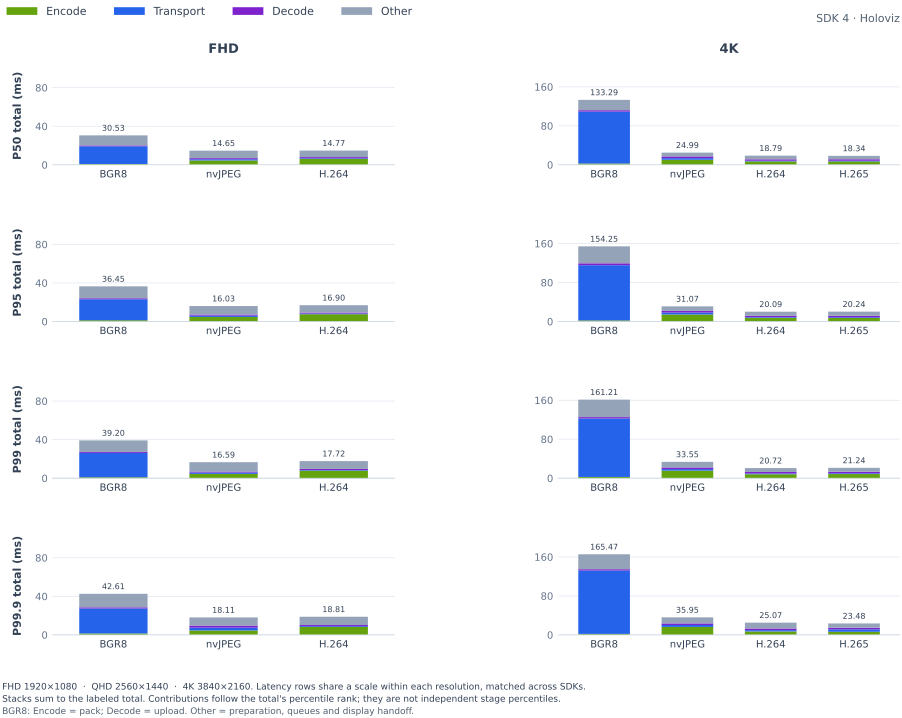

<details>
<summary>

### P50

</summary>

<table>
    <thead>
        <tr><th align="left">RES</th><th align="left">CC</th><th align="right">FPS</th><th align="right">FS</th><th align="right">Encode (ms)</th><th align="right">Transport (ms)</th><th align="right">Decode (ms)</th><th align="right">Total (ms)</th></tr>
    </thead>
    <tbody>
        <tr><td rowspan="3">FHD</td><td>BGR8</td><td align="right">59.64</td><td align="right">5.93 MiB</td><td align="right">0.94</td><td align="right">18.12</td><td align="right">0.91</td><td align="right">30.53</td></tr>
        <tr><td>nvJPEG</td><td align="right">59.68</td><td align="right">248.7 KiB</td><td align="right">4.46</td><td align="right">1.25</td><td align="right">1.10</td><td align="right">14.65</td></tr>
        <tr><td><strong>H.264</strong></td><td align="right"><strong>59.66</strong></td><td align="right"><strong>69.0 KiB</strong></td><td align="right"><strong>6.09</strong></td><td align="right"><strong>0.68</strong></td><td align="right"><strong>1.04</strong></td><td align="right"><strong>14.77</strong></td></tr>
        <tr><td rowspan="4">4K</td><td>BGR8</td><td align="right">15.23</td><td align="right">23.73 MiB</td><td align="right">2.32</td><td align="right">103.38</td><td align="right">2.75</td><td align="right">133.29</td></tr>
        <tr><td>nvJPEG</td><td align="right">59.84</td><td align="right">1.01 MiB</td><td align="right">9.25</td><td align="right">3.95</td><td align="right">3.40</td><td align="right">24.99</td></tr>
        <tr><td><strong>H.264</strong></td><td align="right"><strong>60.12</strong></td><td align="right"><strong>283.6 KiB</strong></td><td align="right"><strong>7.01</strong></td><td align="right"><strong>1.36</strong></td><td align="right"><strong>2.92</strong></td><td align="right"><strong>18.79</strong></td></tr>
        <tr><td><strong>H.265</strong></td><td align="right"><strong>60.11</strong></td><td align="right"><strong>281.4 KiB</strong></td><td align="right"><strong>6.43</strong></td><td align="right"><strong>1.35</strong></td><td align="right"><strong>3.11</strong></td><td align="right"><strong>18.34</strong></td></tr>
    </tbody>
</table>

</details>

<details>
<summary>

### P95

</summary>

<table>
    <thead>
        <tr><th align="left">RES</th><th align="left">CC</th><th align="right">FPS</th><th align="right">FS</th><th align="right">Encode (ms)</th><th align="right">Transport (ms)</th><th align="right">Decode (ms)</th><th align="right">Total (ms)</th></tr>
    </thead>
    <tbody>
        <tr><td rowspan="3">FHD</td><td>BGR8</td><td align="right">59.64</td><td align="right">5.93 MiB</td><td align="right">1.72</td><td align="right">22.80</td><td align="right">1.15</td><td align="right">36.45</td></tr>
        <tr><td>nvJPEG</td><td align="right">59.68</td><td align="right">248.7 KiB</td><td align="right">4.65</td><td align="right">1.44</td><td align="right">1.25</td><td align="right">16.03</td></tr>
        <tr><td><strong>H.264</strong></td><td align="right"><strong>59.66</strong></td><td align="right"><strong>69.0 KiB</strong></td><td align="right"><strong>7.45</strong></td><td align="right"><strong>0.87</strong></td><td align="right"><strong>1.35</strong></td><td align="right"><strong>16.90</strong></td></tr>
        <tr><td rowspan="4">4K</td><td>BGR8</td><td align="right">15.23</td><td align="right">23.73 MiB</td><td align="right">3.71</td><td align="right">117.29</td><td align="right">4.57</td><td align="right">154.25</td></tr>
        <tr><td>nvJPEG</td><td align="right">59.84</td><td align="right">1.01 MiB</td><td align="right">13.78</td><td align="right">4.51</td><td align="right">3.58</td><td align="right">31.07</td></tr>
        <tr><td><strong>H.264</strong></td><td align="right"><strong>60.12</strong></td><td align="right"><strong>283.6 KiB</strong></td><td align="right"><strong>7.78</strong></td><td align="right"><strong>1.69</strong></td><td align="right"><strong>3.05</strong></td><td align="right"><strong>20.09</strong></td></tr>
        <tr><td><strong>H.265</strong></td><td align="right"><strong>60.11</strong></td><td align="right"><strong>281.4 KiB</strong></td><td align="right"><strong>7.91</strong></td><td align="right"><strong>1.60</strong></td><td align="right"><strong>3.23</strong></td><td align="right"><strong>20.24</strong></td></tr>
    </tbody>
</table>

</details>

<details open>
<summary>

### P99

</summary>

<table>
    <thead>
        <tr><th align="left">RES</th><th align="left">CC</th><th align="right">FPS</th><th align="right">FS</th><th align="right">Encode (ms)</th><th align="right">Transport (ms)</th><th align="right">Decode (ms)</th><th align="right">Total (ms)</th></tr>
    </thead>
    <tbody>
        <tr><td rowspan="3">FHD</td><td>BGR8</td><td align="right">59.64</td><td align="right">5.93 MiB</td><td align="right">1.90</td><td align="right">25.31</td><td align="right">1.56</td><td align="right">39.20</td></tr>
        <tr><td>nvJPEG</td><td align="right">59.68</td><td align="right">248.7 KiB</td><td align="right">4.84</td><td align="right">1.58</td><td align="right">1.30</td><td align="right">16.59</td></tr>
        <tr><td><strong>H.264</strong></td><td align="right"><strong>59.66</strong></td><td align="right"><strong>69.0 KiB</strong></td><td align="right"><strong>8.07</strong></td><td align="right"><strong>1.00</strong></td><td align="right"><strong>1.48</strong></td><td align="right"><strong>17.72</strong></td></tr>
        <tr><td rowspan="4">4K</td><td>BGR8</td><td align="right">15.23</td><td align="right">23.73 MiB</td><td align="right">5.16</td><td align="right">122.28</td><td align="right">4.73</td><td align="right">161.21</td></tr>
        <tr><td>nvJPEG</td><td align="right">59.84</td><td align="right">1.01 MiB</td><td align="right">15.67</td><td align="right">4.81</td><td align="right">3.64</td><td align="right">33.55</td></tr>
        <tr><td><strong>H.264</strong></td><td align="right"><strong>60.12</strong></td><td align="right"><strong>283.6 KiB</strong></td><td align="right"><strong>8.27</strong></td><td align="right"><strong>1.91</strong></td><td align="right"><strong>3.25</strong></td><td align="right"><strong>20.72</strong></td></tr>
        <tr><td><strong>H.265</strong></td><td align="right"><strong>60.11</strong></td><td align="right"><strong>281.4 KiB</strong></td><td align="right"><strong>8.50</strong></td><td align="right"><strong>1.80</strong></td><td align="right"><strong>3.38</strong></td><td align="right"><strong>21.24</strong></td></tr>
    </tbody>
</table>

</details>

<details open>
<summary>

### P99.9

</summary>

<table>
    <thead>
        <tr><th align="left">RES</th><th align="left">CC</th><th align="right">FPS</th><th align="right">FS</th><th align="right">Encode (ms)</th><th align="right">Transport (ms)</th><th align="right">Decode (ms)</th><th align="right">Total (ms)</th></tr>
    </thead>
    <tbody>
        <tr><td rowspan="3">FHD</td><td>BGR8</td><td align="right">59.64</td><td align="right">5.93 MiB</td><td align="right">2.37</td><td align="right">27.89</td><td align="right">1.88</td><td align="right">42.61</td></tr>
        <tr><td>nvJPEG</td><td align="right">59.68</td><td align="right">248.7 KiB</td><td align="right">5.16</td><td align="right">2.95</td><td align="right">1.84</td><td align="right">18.11</td></tr>
        <tr><td><strong>H.264</strong></td><td align="right"><strong>59.66</strong></td><td align="right"><strong>69.0 KiB</strong></td><td align="right"><strong>8.64</strong></td><td align="right"><strong>1.19</strong></td><td align="right"><strong>1.63</strong></td><td align="right"><strong>18.81</strong></td></tr>
        <tr><td rowspan="4">4K</td><td>BGR8</td><td align="right">15.23</td><td align="right">23.73 MiB</td><td align="right">6.61</td><td align="right">131.53</td><td align="right">4.89</td><td align="right">165.47</td></tr>
        <tr><td>nvJPEG</td><td align="right">59.84</td><td align="right">1.01 MiB</td><td align="right">16.40</td><td align="right">7.08</td><td align="right">3.81</td><td align="right">35.95</td></tr>
        <tr><td><strong>H.264</strong></td><td align="right"><strong>60.12</strong></td><td align="right"><strong>283.6 KiB</strong></td><td align="right"><strong>8.88</strong></td><td align="right"><strong>5.44</strong></td><td align="right"><strong>3.57</strong></td><td align="right"><strong>25.07</strong></td></tr>
        <tr><td><strong>H.265</strong></td><td align="right"><strong>60.11</strong></td><td align="right"><strong>281.4 KiB</strong></td><td align="right"><strong>9.03</strong></td><td align="right"><strong>4.73</strong></td><td align="right"><strong>5.28</strong></td><td align="right"><strong>23.48</strong></td></tr>
    </tbody>
</table>

</details>

</details>

<details>
<summary>

## DGX Spark (Patient) → x86 (Surgeon): MIRA Procedure Camera

</summary>

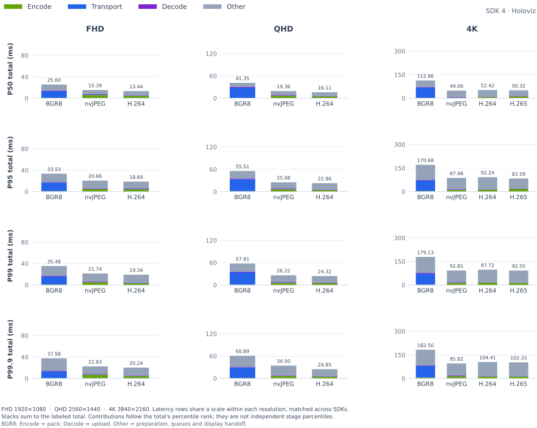

<details>
<summary>

### P50

</summary>

<table>
    <thead>
        <tr><th align="left">RES</th><th align="left">CC</th><th align="right">FPS</th><th align="right">FS</th><th align="right">Encode (ms)</th><th align="right">Transport (ms)</th><th align="right">Decode (ms)</th><th align="right">Total (ms)</th></tr>
    </thead>
    <tbody>
        <tr><td rowspan="3">FHD</td><td>BGR8</td><td align="right">15.65</td><td align="right">5.93 MiB</td><td align="right">0.38</td><td align="right">11.70</td><td align="right">0.98</td><td align="right">25.60</td></tr>
        <tr><td>nvJPEG</td><td align="right">15.38</td><td align="right">62.5 KiB</td><td align="right">4.36</td><td align="right">0.60</td><td align="right">1.12</td><td align="right">15.39</td></tr>
        <tr><td><strong>H.264</strong></td><td align="right"><strong>15.57</strong></td><td align="right"><strong>10.1 KiB</strong></td><td align="right"><strong>2.95</strong></td><td align="right"><strong>0.46</strong></td><td align="right"><strong>0.82</strong></td><td align="right"><strong>13.44</strong></td></tr>
        <tr><td rowspan="3">QHD</td><td>BGR8</td><td align="right">13.38</td><td align="right">10.55 MiB</td><td align="right">0.62</td><td align="right">24.48</td><td align="right">1.66</td><td align="right">41.35</td></tr>
        <tr><td>nvJPEG</td><td align="right">13.15</td><td align="right">101.9 KiB</td><td align="right">5.36</td><td align="right">0.66</td><td align="right">1.68</td><td align="right">19.36</td></tr>
        <tr><td><strong>H.264</strong></td><td align="right"><strong>13.37</strong></td><td align="right"><strong>14.0 KiB</strong></td><td align="right"><strong>4.27</strong></td><td align="right"><strong>0.49</strong></td><td align="right"><strong>1.07</strong></td><td align="right"><strong>16.11</strong></td></tr>
        <tr><td rowspan="4">4K</td><td>BGR8</td><td align="right">8.10</td><td align="right">23.73 MiB</td><td align="right">1.61</td><td align="right">54.91</td><td align="right">2.80</td><td align="right">112.86</td></tr>
        <tr><td>nvJPEG</td><td align="right">8.12</td><td align="right">209.2 KiB</td><td align="right">5.94</td><td align="right">1.09</td><td align="right">3.34</td><td align="right">49.06</td></tr>
        <tr><td><strong>H.264</strong></td><td align="right"><strong>8.22</strong></td><td align="right"><strong>23.2 KiB</strong></td><td align="right"><strong>8.12</strong></td><td align="right"><strong>0.69</strong></td><td align="right"><strong>1.85</strong></td><td align="right"><strong>52.42</strong></td></tr>
        <tr><td><strong>H.265</strong></td><td align="right"><strong>8.46</strong></td><td align="right"><strong>18.3 KiB</strong></td><td align="right"><strong>8.95</strong></td><td align="right"><strong>0.65</strong></td><td align="right"><strong>2.35</strong></td><td align="right"><strong>50.32</strong></td></tr>
    </tbody>
</table>

</details>

<details>
<summary>

### P95

</summary>

<table>
    <thead>
        <tr><th align="left">RES</th><th align="left">CC</th><th align="right">FPS</th><th align="right">FS</th><th align="right">Encode (ms)</th><th align="right">Transport (ms)</th><th align="right">Decode (ms)</th><th align="right">Total (ms)</th></tr>
    </thead>
    <tbody>
        <tr><td rowspan="3">FHD</td><td>BGR8</td><td align="right">15.65</td><td align="right">5.93 MiB</td><td align="right">2.12</td><td align="right">15.82</td><td align="right">1.58</td><td align="right">33.53</td></tr>
        <tr><td>nvJPEG</td><td align="right">15.38</td><td align="right">62.5 KiB</td><td align="right">7.27</td><td align="right">0.91</td><td align="right">1.29</td><td align="right">20.66</td></tr>
        <tr><td><strong>H.264</strong></td><td align="right"><strong>15.57</strong></td><td align="right"><strong>10.1 KiB</strong></td><td align="right"><strong>5.40</strong></td><td align="right"><strong>0.77</strong></td><td align="right"><strong>0.93</strong></td><td align="right"><strong>18.69</strong></td></tr>
        <tr><td rowspan="3">QHD</td><td>BGR8</td><td align="right">13.38</td><td align="right">10.55 MiB</td><td align="right">2.10</td><td align="right">32.09</td><td align="right">2.88</td><td align="right">55.51</td></tr>
        <tr><td>nvJPEG</td><td align="right">13.15</td><td align="right">101.9 KiB</td><td align="right">7.34</td><td align="right">0.95</td><td align="right">1.85</td><td align="right">25.08</td></tr>
        <tr><td><strong>H.264</strong></td><td align="right"><strong>13.37</strong></td><td align="right"><strong>14.0 KiB</strong></td><td align="right"><strong>5.90</strong></td><td align="right"><strong>0.79</strong></td><td align="right"><strong>1.18</strong></td><td align="right"><strong>22.86</strong></td></tr>
        <tr><td rowspan="4">4K</td><td>BGR8</td><td align="right">8.10</td><td align="right">23.73 MiB</td><td align="right">6.83</td><td align="right">69.33</td><td align="right">3.63</td><td align="right">170.68</td></tr>
        <tr><td>nvJPEG</td><td align="right">8.12</td><td align="right">209.2 KiB</td><td align="right">14.62</td><td align="right">1.69</td><td align="right">3.50</td><td align="right">87.48</td></tr>
        <tr><td><strong>H.264</strong></td><td align="right"><strong>8.22</strong></td><td align="right"><strong>23.2 KiB</strong></td><td align="right"><strong>16.35</strong></td><td align="right"><strong>1.16</strong></td><td align="right"><strong>2.01</strong></td><td align="right"><strong>92.24</strong></td></tr>
        <tr><td><strong>H.265</strong></td><td align="right"><strong>8.46</strong></td><td align="right"><strong>18.3 KiB</strong></td><td align="right"><strong>14.18</strong></td><td align="right"><strong>1.12</strong></td><td align="right"><strong>2.63</strong></td><td align="right"><strong>83.59</strong></td></tr>
    </tbody>
</table>

</details>

<details open>
<summary>

### P99

</summary>

<table>
    <thead>
        <tr><th align="left">RES</th><th align="left">CC</th><th align="right">FPS</th><th align="right">FS</th><th align="right">Encode (ms)</th><th align="right">Transport (ms)</th><th align="right">Decode (ms)</th><th align="right">Total (ms)</th></tr>
    </thead>
    <tbody>
        <tr><td rowspan="3">FHD</td><td>BGR8</td><td align="right">15.65</td><td align="right">5.93 MiB</td><td align="right">2.35</td><td align="right">16.69</td><td align="right">1.74</td><td align="right">35.48</td></tr>
        <tr><td>nvJPEG</td><td align="right">15.38</td><td align="right">62.5 KiB</td><td align="right">7.83</td><td align="right">1.06</td><td align="right">1.45</td><td align="right">21.74</td></tr>
        <tr><td><strong>H.264</strong></td><td align="right"><strong>15.57</strong></td><td align="right"><strong>10.1 KiB</strong></td><td align="right"><strong>6.10</strong></td><td align="right"><strong>0.94</strong></td><td align="right"><strong>1.05</strong></td><td align="right"><strong>19.34</strong></td></tr>
        <tr><td rowspan="3">QHD</td><td>BGR8</td><td align="right">13.38</td><td align="right">10.55 MiB</td><td align="right">3.10</td><td align="right">34.33</td><td align="right">3.42</td><td align="right">57.81</td></tr>
        <tr><td>nvJPEG</td><td align="right">13.15</td><td align="right">101.9 KiB</td><td align="right">7.91</td><td align="right">1.10</td><td align="right">1.94</td><td align="right">26.22</td></tr>
        <tr><td><strong>H.264</strong></td><td align="right"><strong>13.37</strong></td><td align="right"><strong>14.0 KiB</strong></td><td align="right"><strong>6.57</strong></td><td align="right"><strong>0.97</strong></td><td align="right"><strong>1.24</strong></td><td align="right"><strong>24.32</strong></td></tr>
        <tr><td rowspan="4">4K</td><td>BGR8</td><td align="right">8.10</td><td align="right">23.73 MiB</td><td align="right">9.39</td><td align="right">72.81</td><td align="right">4.68</td><td align="right">179.13</td></tr>
        <tr><td>nvJPEG</td><td align="right">8.12</td><td align="right">209.2 KiB</td><td align="right">16.27</td><td align="right">2.14</td><td align="right">3.57</td><td align="right">92.81</td></tr>
        <tr><td><strong>H.264</strong></td><td align="right"><strong>8.22</strong></td><td align="right"><strong>23.2 KiB</strong></td><td align="right"><strong>18.13</strong></td><td align="right"><strong>1.50</strong></td><td align="right"><strong>2.14</strong></td><td align="right"><strong>97.72</strong></td></tr>
        <tr><td><strong>H.265</strong></td><td align="right"><strong>8.46</strong></td><td align="right"><strong>18.3 KiB</strong></td><td align="right"><strong>17.23</strong></td><td align="right"><strong>1.48</strong></td><td align="right"><strong>2.73</strong></td><td align="right"><strong>92.55</strong></td></tr>
    </tbody>
</table>

</details>

<details open>
<summary>

### P99.9

</summary>

<table>
    <thead>
        <tr><th align="left">RES</th><th align="left">CC</th><th align="right">FPS</th><th align="right">FS</th><th align="right">Encode (ms)</th><th align="right">Transport (ms)</th><th align="right">Decode (ms)</th><th align="right">Total (ms)</th></tr>
    </thead>
    <tbody>
        <tr><td rowspan="3">FHD</td><td>BGR8</td><td align="right">15.65</td><td align="right">5.93 MiB</td><td align="right">2.49</td><td align="right">17.91</td><td align="right">2.11</td><td align="right">37.58</td></tr>
        <tr><td>nvJPEG</td><td align="right">15.38</td><td align="right">62.5 KiB</td><td align="right">8.24</td><td align="right">1.21</td><td align="right">1.74</td><td align="right">22.63</td></tr>
        <tr><td><strong>H.264</strong></td><td align="right"><strong>15.57</strong></td><td align="right"><strong>10.1 KiB</strong></td><td align="right"><strong>6.56</strong></td><td align="right"><strong>1.08</strong></td><td align="right"><strong>1.16</strong></td><td align="right"><strong>20.24</strong></td></tr>
        <tr><td rowspan="3">QHD</td><td>BGR8</td><td align="right">13.38</td><td align="right">10.55 MiB</td><td align="right">4.46</td><td align="right">36.57</td><td align="right">3.89</td><td align="right">60.89</td></tr>
        <tr><td>nvJPEG</td><td align="right">13.15</td><td align="right">101.9 KiB</td><td align="right">8.41</td><td align="right">1.38</td><td align="right">2.14</td><td align="right">34.50</td></tr>
        <tr><td><strong>H.264</strong></td><td align="right"><strong>13.37</strong></td><td align="right"><strong>14.0 KiB</strong></td><td align="right"><strong>7.43</strong></td><td align="right"><strong>1.20</strong></td><td align="right"><strong>1.38</strong></td><td align="right"><strong>24.85</strong></td></tr>
        <tr><td rowspan="4">4K</td><td>BGR8</td><td align="right">8.10</td><td align="right">23.73 MiB</td><td align="right">9.98</td><td align="right">78.54</td><td align="right">5.45</td><td align="right">182.50</td></tr>
        <tr><td>nvJPEG</td><td align="right">8.12</td><td align="right">209.2 KiB</td><td align="right">16.93</td><td align="right">2.59</td><td align="right">3.63</td><td align="right">95.82</td></tr>
        <tr><td><strong>H.264</strong></td><td align="right"><strong>8.22</strong></td><td align="right"><strong>23.2 KiB</strong></td><td align="right"><strong>19.10</strong></td><td align="right"><strong>3.90</strong></td><td align="right"><strong>2.53</strong></td><td align="right"><strong>104.41</strong></td></tr>
        <tr><td><strong>H.265</strong></td><td align="right"><strong>8.46</strong></td><td align="right"><strong>18.3 KiB</strong></td><td align="right"><strong>19.16</strong></td><td align="right"><strong>2.80</strong></td><td align="right"><strong>3.15</strong></td><td align="right"><strong>102.33</strong></td></tr>
    </tbody>
</table>

</details>

</details>

<details>
<summary>

## DGX Spark (Patient) → x86 (Surgeon): MIRA Room Camera

</summary>

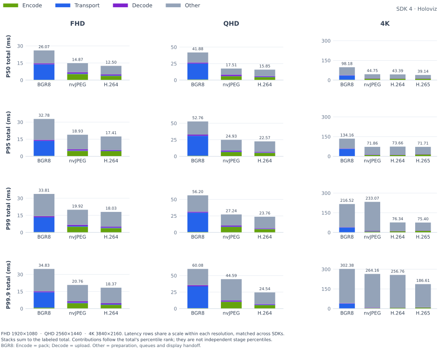

<details>
<summary>

### P50

</summary>

<table>
    <thead>
        <tr><th align="left">RES</th><th align="left">CC</th><th align="right">FPS</th><th align="right">FS</th><th align="right">Encode (ms)</th><th align="right">Transport (ms)</th><th align="right">Decode (ms)</th><th align="right">Total (ms)</th></tr>
    </thead>
    <tbody>
        <tr><td rowspan="3">FHD</td><td>BGR8</td><td align="right">15.50</td><td align="right">5.93 MiB</td><td align="right">0.31</td><td align="right">11.18</td><td align="right">0.89</td><td align="right">26.07</td></tr>
        <tr><td>nvJPEG</td><td align="right">15.38</td><td align="right">54.7 KiB</td><td align="right">4.70</td><td align="right">0.52</td><td align="right">1.06</td><td align="right">14.87</td></tr>
        <tr><td><strong>H.264</strong></td><td align="right"><strong>15.45</strong></td><td align="right"><strong>13.6 KiB</strong></td><td align="right"><strong>2.93</strong></td><td align="right"><strong>0.40</strong></td><td align="right"><strong>0.82</strong></td><td align="right"><strong>12.50</strong></td></tr>
        <tr><td rowspan="3">QHD</td><td>BGR8</td><td align="right">13.26</td><td align="right">10.55 MiB</td><td align="right">0.55</td><td align="right">22.57</td><td align="right">1.53</td><td align="right">41.88</td></tr>
        <tr><td>nvJPEG</td><td align="right">13.15</td><td align="right">88.8 KiB</td><td align="right">5.32</td><td align="right">0.57</td><td align="right">1.62</td><td align="right">17.51</td></tr>
        <tr><td><strong>H.264</strong></td><td align="right"><strong>13.25</strong></td><td align="right"><strong>19.1 KiB</strong></td><td align="right"><strong>4.41</strong></td><td align="right"><strong>0.46</strong></td><td align="right"><strong>1.04</strong></td><td align="right"><strong>15.85</strong></td></tr>
        <tr><td rowspan="4">4K</td><td>BGR8</td><td align="right">8.10</td><td align="right">23.73 MiB</td><td align="right">1.12</td><td align="right">45.59</td><td align="right">2.61</td><td align="right">98.18</td></tr>
        <tr><td>nvJPEG</td><td align="right">8.12</td><td align="right">181.3 KiB</td><td align="right">7.72</td><td align="right">0.92</td><td align="right">3.30</td><td align="right">44.75</td></tr>
        <tr><td><strong>H.264</strong></td><td align="right"><strong>8.22</strong></td><td align="right"><strong>31.7 KiB</strong></td><td align="right"><strong>7.96</strong></td><td align="right"><strong>0.57</strong></td><td align="right"><strong>1.80</strong></td><td align="right"><strong>43.39</strong></td></tr>
        <tr><td><strong>H.265</strong></td><td align="right"><strong>8.45</strong></td><td align="right"><strong>24.5 KiB</strong></td><td align="right"><strong>9.86</strong></td><td align="right"><strong>0.54</strong></td><td align="right"><strong>2.16</strong></td><td align="right"><strong>39.14</strong></td></tr>
    </tbody>
</table>

</details>

<details>
<summary>

### P95

</summary>

<table>
    <thead>
        <tr><th align="left">RES</th><th align="left">CC</th><th align="right">FPS</th><th align="right">FS</th><th align="right">Encode (ms)</th><th align="right">Transport (ms)</th><th align="right">Decode (ms)</th><th align="right">Total (ms)</th></tr>
    </thead>
    <tbody>
        <tr><td rowspan="3">FHD</td><td>BGR8</td><td align="right">15.50</td><td align="right">5.93 MiB</td><td align="right">0.99</td><td align="right">13.80</td><td align="right">1.05</td><td align="right">32.78</td></tr>
        <tr><td>nvJPEG</td><td align="right">15.38</td><td align="right">54.7 KiB</td><td align="right">6.40</td><td align="right">0.77</td><td align="right">1.22</td><td align="right">18.93</td></tr>
        <tr><td><strong>H.264</strong></td><td align="right"><strong>15.45</strong></td><td align="right"><strong>13.6 KiB</strong></td><td align="right"><strong>4.31</strong></td><td align="right"><strong>0.67</strong></td><td align="right"><strong>1.17</strong></td><td align="right"><strong>17.41</strong></td></tr>
        <tr><td rowspan="3">QHD</td><td>BGR8</td><td align="right">13.26</td><td align="right">10.55 MiB</td><td align="right">1.43</td><td align="right">28.22</td><td align="right">1.96</td><td align="right">52.76</td></tr>
        <tr><td>nvJPEG</td><td align="right">13.15</td><td align="right">88.8 KiB</td><td align="right">7.12</td><td align="right">0.92</td><td align="right">1.81</td><td align="right">24.93</td></tr>
        <tr><td><strong>H.264</strong></td><td align="right"><strong>13.25</strong></td><td align="right"><strong>19.1 KiB</strong></td><td align="right"><strong>5.38</strong></td><td align="right"><strong>0.73</strong></td><td align="right"><strong>1.27</strong></td><td align="right"><strong>22.57</strong></td></tr>
        <tr><td rowspan="4">4K</td><td>BGR8</td><td align="right">8.10</td><td align="right">23.73 MiB</td><td align="right">3.03</td><td align="right">57.37</td><td align="right">3.00</td><td align="right">134.16</td></tr>
        <tr><td>nvJPEG</td><td align="right">8.12</td><td align="right">181.3 KiB</td><td align="right">13.93</td><td align="right">1.51</td><td align="right">3.46</td><td align="right">71.86</td></tr>
        <tr><td><strong>H.264</strong></td><td align="right"><strong>8.22</strong></td><td align="right"><strong>31.7 KiB</strong></td><td align="right"><strong>11.26</strong></td><td align="right"><strong>1.03</strong></td><td align="right"><strong>2.02</strong></td><td align="right"><strong>73.66</strong></td></tr>
        <tr><td><strong>H.265</strong></td><td align="right"><strong>8.45</strong></td><td align="right"><strong>24.5 KiB</strong></td><td align="right"><strong>13.54</strong></td><td align="right"><strong>1.00</strong></td><td align="right"><strong>2.39</strong></td><td align="right"><strong>71.71</strong></td></tr>
    </tbody>
</table>

</details>

<details open>
<summary>

### P99

</summary>

<table>
    <thead>
        <tr><th align="left">RES</th><th align="left">CC</th><th align="right">FPS</th><th align="right">FS</th><th align="right">Encode (ms)</th><th align="right">Transport (ms)</th><th align="right">Decode (ms)</th><th align="right">Total (ms)</th></tr>
    </thead>
    <tbody>
        <tr><td rowspan="3">FHD</td><td>BGR8</td><td align="right">15.50</td><td align="right">5.93 MiB</td><td align="right">1.74</td><td align="right">14.66</td><td align="right">1.39</td><td align="right">33.81</td></tr>
        <tr><td>nvJPEG</td><td align="right">15.38</td><td align="right">54.7 KiB</td><td align="right">7.10</td><td align="right">0.90</td><td align="right">1.30</td><td align="right">19.92</td></tr>
        <tr><td><strong>H.264</strong></td><td align="right"><strong>15.45</strong></td><td align="right"><strong>13.6 KiB</strong></td><td align="right"><strong>5.01</strong></td><td align="right"><strong>0.90</strong></td><td align="right"><strong>1.33</strong></td><td align="right"><strong>18.03</strong></td></tr>
        <tr><td rowspan="3">QHD</td><td>BGR8</td><td align="right">13.26</td><td align="right">10.55 MiB</td><td align="right">1.64</td><td align="right">30.85</td><td align="right">2.55</td><td align="right">56.20</td></tr>
        <tr><td>nvJPEG</td><td align="right">13.15</td><td align="right">88.8 KiB</td><td align="right">8.37</td><td align="right">1.08</td><td align="right">2.73</td><td align="right">27.24</td></tr>
        <tr><td><strong>H.264</strong></td><td align="right"><strong>13.25</strong></td><td align="right"><strong>19.1 KiB</strong></td><td align="right"><strong>5.95</strong></td><td align="right"><strong>0.88</strong></td><td align="right"><strong>1.39</strong></td><td align="right"><strong>23.76</strong></td></tr>
        <tr><td rowspan="4">4K</td><td>BGR8</td><td align="right">8.10</td><td align="right">23.73 MiB</td><td align="right">3.84</td><td align="right">59.99</td><td align="right">4.10</td><td align="right">216.52</td></tr>
        <tr><td>nvJPEG</td><td align="right">8.12</td><td align="right">181.3 KiB</td><td align="right">15.21</td><td align="right">1.66</td><td align="right">3.58</td><td align="right">233.07</td></tr>
        <tr><td><strong>H.264</strong></td><td align="right"><strong>8.22</strong></td><td align="right"><strong>31.7 KiB</strong></td><td align="right"><strong>12.09</strong></td><td align="right"><strong>1.47</strong></td><td align="right"><strong>2.12</strong></td><td align="right"><strong>76.34</strong></td></tr>
        <tr><td><strong>H.265</strong></td><td align="right"><strong>8.45</strong></td><td align="right"><strong>24.5 KiB</strong></td><td align="right"><strong>14.33</strong></td><td align="right"><strong>1.37</strong></td><td align="right"><strong>2.54</strong></td><td align="right"><strong>75.40</strong></td></tr>
    </tbody>
</table>

</details>

<details open>
<summary>

### P99.9

</summary>

<table>
    <thead>
        <tr><th align="left">RES</th><th align="left">CC</th><th align="right">FPS</th><th align="right">FS</th><th align="right">Encode (ms)</th><th align="right">Transport (ms)</th><th align="right">Decode (ms)</th><th align="right">Total (ms)</th></tr>
    </thead>
    <tbody>
        <tr><td rowspan="3">FHD</td><td>BGR8</td><td align="right">15.50</td><td align="right">5.93 MiB</td><td align="right">2.41</td><td align="right">15.89</td><td align="right">1.73</td><td align="right">34.83</td></tr>
        <tr><td>nvJPEG</td><td align="right">15.38</td><td align="right">54.7 KiB</td><td align="right">7.42</td><td align="right">1.12</td><td align="right">1.50</td><td align="right">20.76</td></tr>
        <tr><td><strong>H.264</strong></td><td align="right"><strong>15.45</strong></td><td align="right"><strong>13.6 KiB</strong></td><td align="right"><strong>5.56</strong></td><td align="right"><strong>1.19</strong></td><td align="right"><strong>1.38</strong></td><td align="right"><strong>18.37</strong></td></tr>
        <tr><td rowspan="3">QHD</td><td>BGR8</td><td align="right">13.26</td><td align="right">10.55 MiB</td><td align="right">1.88</td><td align="right">35.08</td><td align="right">3.21</td><td align="right">60.08</td></tr>
        <tr><td>nvJPEG</td><td align="right">13.15</td><td align="right">88.8 KiB</td><td align="right">11.68</td><td align="right">1.34</td><td align="right">2.83</td><td align="right">44.59</td></tr>
        <tr><td><strong>H.264</strong></td><td align="right"><strong>13.25</strong></td><td align="right"><strong>19.1 KiB</strong></td><td align="right"><strong>6.56</strong></td><td align="right"><strong>1.05</strong></td><td align="right"><strong>1.90</strong></td><td align="right"><strong>24.54</strong></td></tr>
        <tr><td rowspan="4">4K</td><td>BGR8</td><td align="right">8.10</td><td align="right">23.73 MiB</td><td align="right">4.14</td><td align="right">65.73</td><td align="right">4.68</td><td align="right">302.38</td></tr>
        <tr><td>nvJPEG</td><td align="right">8.12</td><td align="right">181.3 KiB</td><td align="right">15.61</td><td align="right">2.07</td><td align="right">3.61</td><td align="right">264.16</td></tr>
        <tr><td><strong>H.264</strong></td><td align="right"><strong>8.22</strong></td><td align="right"><strong>31.7 KiB</strong></td><td align="right"><strong>12.93</strong></td><td align="right"><strong>3.33</strong></td><td align="right"><strong>3.37</strong></td><td align="right"><strong>256.76</strong></td></tr>
        <tr><td><strong>H.265</strong></td><td align="right"><strong>8.45</strong></td><td align="right"><strong>24.5 KiB</strong></td><td align="right"><strong>14.90</strong></td><td align="right"><strong>3.18</strong></td><td align="right"><strong>3.57</strong></td><td align="right"><strong>186.61</strong></td></tr>
    </tbody>
</table>

</details>

</details>

## Method and limits

- Source and receiver both use Holoscan `4.6.0`. Runs collect 60 seconds after a 30-second warmup; 6 earlier configurations retain their longer 10,000-sample runs. Actual durations, sample counts, incomplete timing coverage and frame-loss counters are in the CSV.
- H.264/H.265 use NVENC P1, ultra-low-latency, QP 24, independent frames, no B frames and no lookahead. nvJPEG quality is 85. Equal QP does not imply equal visual quality.
- BRIO captures YUYV at FHD and MJPEG at QHD/4K. MJPEG decoding inside camera capture precedes the measured buffer boundary. IMX274 uses native sensor modes. Simulation recreates each camera at the requested render resolution.
- Timing starts when a USB BGR buffer, processed HSB Bayer buffer or simulator RGB buffer is available. Sensor exposure, earlier producer work and physical scanout are excluded. The full path includes frame preparation, encoder queue, encode/pack, source relay/queue, send queue, transport, receive queue, decode/upload and viewer handoff.
- Percentiles use linear interpolation over at most 10,000 valid samples. Timing excludes the first two seconds after reset; native summaries refresh every five seconds. Browser totals use frames matched by RTP timestamp. Transport uses the receiver's recorded `steady_metrics.delivery_ms` percentiles.
- Same-host timing uses a monotonic clock. Remote timing uses fresh UTC bounds or four-timestamp relative estimates. Clock uncertainty is recorded in the CSV; unresolved timing remains unavailable.
- Frame size excludes TLS/TCP/IP overhead. FPS, frame spacing, sequence gaps and browser drops are separate from latency. Browser FPS subtracts dropped frames from the [total video frame counter](https://w3c.github.io/media-playback-quality/); sequence gaps use application stream numbers.
- Streams retain their requested resolution through decoding. Native windows are capped at 1280×720; Chromium uses a 1600×1000 dashboard viewport. These are stream-resolution tests with display scaling afterward. Browser hardware decoding was not confirmed.

Each configuration has one measured run. P99.9 can depend on only a few frames in a 60-second sample, especially for slower simulation sources. Background services remained running; power, clocks and physical camera scenes were not held constant. Remote tests also change source hardware, so their differences are not solely network overhead. Isaac Sim rendering and CPU readback/IPC can limit throughput independently of the codec.

## Repeat one configuration

Start patient and surgeon services with `--sdk 4`, discover the cameras, then collect a run:

```bash
.venv-sdk4/bin/python scripts/benchmark.py \
  --camera host:procedure --camera host:room \
  --width 3840 --height 2160 --fps 30 \
  --codec h265 --receiver holoviz \
  --seconds 60 --output workspace/benchmark.json
```

The collector starts/stops the selected streams and viewers and resets their metrics. It never moves robots. `--patient`, `--surgeon` and `--endpoint` select service addresses. For browser viewing, use `--codec h264 --receiver webrtc`; install Playwright/Chromium as described in [Contributing](../CONTRIBUTING.md).

<details>
<summary>

## Appendix: WebRTC

</summary>

H.264 viewing in a visible Chromium browser on the surgeon's x86 workstation. The same source titles and percentiles apply. Total includes browser delivery and scheduling; Transport covers patient-to-surgeon-service delivery only.

<details open>
<summary>

### x86 (Patient) → x86 (Surgeon): MIRA Procedure Camera

</summary>

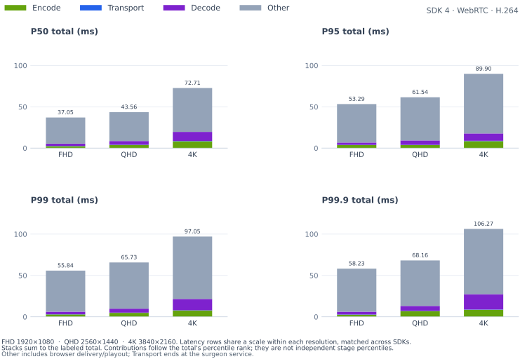

<details>
<summary>

#### P50

</summary>

<table>
    <thead>
        <tr><th align="left">RES</th><th align="left">CC</th><th align="right">FPS</th><th align="right">FS</th><th align="right">Encode (ms)</th><th align="right">Transport (ms)</th><th align="right">Decode (ms)</th><th align="right">Total (ms)</th></tr>
    </thead>
    <tbody>
        <tr><td>FHD</td><td><strong>H.264</strong></td><td align="right"><strong>26.29</strong></td><td align="right"><strong>10.1 KiB</strong></td><td align="right"><strong>2.68</strong></td><td align="right"><strong>0.30</strong></td><td align="right"><strong>2.60</strong></td><td align="right"><strong>37.05</strong></td></tr>
        <tr><td>QHD</td><td><strong>H.264</strong></td><td align="right"><strong>24.20</strong></td><td align="right"><strong>14.1 KiB</strong></td><td align="right"><strong>4.62</strong></td><td align="right"><strong>0.31</strong></td><td align="right"><strong>4.30</strong></td><td align="right"><strong>43.56</strong></td></tr>
        <tr><td>4K</td><td><strong>H.264</strong></td><td align="right"><strong>15.56</strong></td><td align="right"><strong>23.2 KiB</strong></td><td align="right"><strong>8.11</strong></td><td align="right"><strong>0.34</strong></td><td align="right"><strong>9.10</strong></td><td align="right"><strong>72.71</strong></td></tr>
    </tbody>
</table>

</details>

<details>
<summary>

#### P95

</summary>

<table>
    <thead>
        <tr><th align="left">RES</th><th align="left">CC</th><th align="right">FPS</th><th align="right">FS</th><th align="right">Encode (ms)</th><th align="right">Transport (ms)</th><th align="right">Decode (ms)</th><th align="right">Total (ms)</th></tr>
    </thead>
    <tbody>
        <tr><td>FHD</td><td><strong>H.264</strong></td><td align="right"><strong>26.29</strong></td><td align="right"><strong>10.1 KiB</strong></td><td align="right"><strong>3.85</strong></td><td align="right"><strong>0.41</strong></td><td align="right"><strong>3.30</strong></td><td align="right"><strong>53.29</strong></td></tr>
        <tr><td>QHD</td><td><strong>H.264</strong></td><td align="right"><strong>24.20</strong></td><td align="right"><strong>14.1 KiB</strong></td><td align="right"><strong>6.83</strong></td><td align="right"><strong>0.42</strong></td><td align="right"><strong>5.50</strong></td><td align="right"><strong>61.54</strong></td></tr>
        <tr><td>4K</td><td><strong>H.264</strong></td><td align="right"><strong>15.56</strong></td><td align="right"><strong>23.2 KiB</strong></td><td align="right"><strong>10.41</strong></td><td align="right"><strong>0.46</strong></td><td align="right"><strong>11.70</strong></td><td align="right"><strong>89.90</strong></td></tr>
    </tbody>
</table>

</details>

<details open>
<summary>

#### P99

</summary>

<table>
    <thead>
        <tr><th align="left">RES</th><th align="left">CC</th><th align="right">FPS</th><th align="right">FS</th><th align="right">Encode (ms)</th><th align="right">Transport (ms)</th><th align="right">Decode (ms)</th><th align="right">Total (ms)</th></tr>
    </thead>
    <tbody>
        <tr><td>FHD</td><td><strong>H.264</strong></td><td align="right"><strong>26.29</strong></td><td align="right"><strong>10.1 KiB</strong></td><td align="right"><strong>4.57</strong></td><td align="right"><strong>0.48</strong></td><td align="right"><strong>4.15</strong></td><td align="right"><strong>55.84</strong></td></tr>
        <tr><td>QHD</td><td><strong>H.264</strong></td><td align="right"><strong>24.20</strong></td><td align="right"><strong>14.1 KiB</strong></td><td align="right"><strong>7.54</strong></td><td align="right"><strong>0.48</strong></td><td align="right"><strong>6.20</strong></td><td align="right"><strong>65.73</strong></td></tr>
        <tr><td>4K</td><td><strong>H.264</strong></td><td align="right"><strong>15.56</strong></td><td align="right"><strong>23.2 KiB</strong></td><td align="right"><strong>11.03</strong></td><td align="right"><strong>0.71</strong></td><td align="right"><strong>12.20</strong></td><td align="right"><strong>97.05</strong></td></tr>
    </tbody>
</table>

</details>

<details open>
<summary>

#### P99.9

</summary>

<table>
    <thead>
        <tr><th align="left">RES</th><th align="left">CC</th><th align="right">FPS</th><th align="right">FS</th><th align="right">Encode (ms)</th><th align="right">Transport (ms)</th><th align="right">Decode (ms)</th><th align="right">Total (ms)</th></tr>
    </thead>
    <tbody>
        <tr><td>FHD</td><td><strong>H.264</strong></td><td align="right"><strong>26.29</strong></td><td align="right"><strong>10.1 KiB</strong></td><td align="right"><strong>5.45</strong></td><td align="right"><strong>0.74</strong></td><td align="right"><strong>17.71</strong></td><td align="right"><strong>58.23</strong></td></tr>
        <tr><td>QHD</td><td><strong>H.264</strong></td><td align="right"><strong>24.20</strong></td><td align="right"><strong>14.1 KiB</strong></td><td align="right"><strong>8.46</strong></td><td align="right"><strong>1.04</strong></td><td align="right"><strong>8.30</strong></td><td align="right"><strong>68.16</strong></td></tr>
        <tr><td>4K</td><td><strong>H.264</strong></td><td align="right"><strong>15.56</strong></td><td align="right"><strong>23.2 KiB</strong></td><td align="right"><strong>11.69</strong></td><td align="right"><strong>0.98</strong></td><td align="right"><strong>20.05</strong></td><td align="right"><strong>106.27</strong></td></tr>
    </tbody>
</table>

</details>

</details>

<details>
<summary>

### x86 (Patient) → x86 (Surgeon): MIRA Room Camera

</summary>

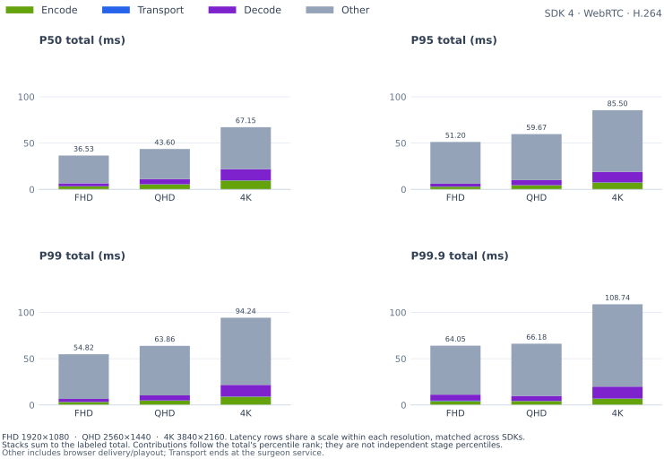

<details>
<summary>

#### P50

</summary>

<table>
    <thead>
        <tr><th align="left">RES</th><th align="left">CC</th><th align="right">FPS</th><th align="right">FS</th><th align="right">Encode (ms)</th><th align="right">Transport (ms)</th><th align="right">Decode (ms)</th><th align="right">Total (ms)</th></tr>
    </thead>
    <tbody>
        <tr><td>FHD</td><td><strong>H.264</strong></td><td align="right"><strong>26.27</strong></td><td align="right"><strong>13.7 KiB</strong></td><td align="right"><strong>2.82</strong></td><td align="right"><strong>0.18</strong></td><td align="right"><strong>2.90</strong></td><td align="right"><strong>36.53</strong></td></tr>
        <tr><td>QHD</td><td><strong>H.264</strong></td><td align="right"><strong>24.32</strong></td><td align="right"><strong>19.2 KiB</strong></td><td align="right"><strong>4.73</strong></td><td align="right"><strong>0.20</strong></td><td align="right"><strong>4.70</strong></td><td align="right"><strong>43.60</strong></td></tr>
        <tr><td>4K</td><td><strong>H.264</strong></td><td align="right"><strong>15.54</strong></td><td align="right"><strong>31.7 KiB</strong></td><td align="right"><strong>8.03</strong></td><td align="right"><strong>0.27</strong></td><td align="right"><strong>11.00</strong></td><td align="right"><strong>67.15</strong></td></tr>
    </tbody>
</table>

</details>

<details>
<summary>

#### P95

</summary>

<table>
    <thead>
        <tr><th align="left">RES</th><th align="left">CC</th><th align="right">FPS</th><th align="right">FS</th><th align="right">Encode (ms)</th><th align="right">Transport (ms)</th><th align="right">Decode (ms)</th><th align="right">Total (ms)</th></tr>
    </thead>
    <tbody>
        <tr><td>FHD</td><td><strong>H.264</strong></td><td align="right"><strong>26.27</strong></td><td align="right"><strong>13.7 KiB</strong></td><td align="right"><strong>4.24</strong></td><td align="right"><strong>0.48</strong></td><td align="right"><strong>3.50</strong></td><td align="right"><strong>51.20</strong></td></tr>
        <tr><td>QHD</td><td><strong>H.264</strong></td><td align="right"><strong>24.32</strong></td><td align="right"><strong>19.2 KiB</strong></td><td align="right"><strong>6.26</strong></td><td align="right"><strong>0.35</strong></td><td align="right"><strong>5.90</strong></td><td align="right"><strong>59.67</strong></td></tr>
        <tr><td>4K</td><td><strong>H.264</strong></td><td align="right"><strong>15.54</strong></td><td align="right"><strong>31.7 KiB</strong></td><td align="right"><strong>9.85</strong></td><td align="right"><strong>0.37</strong></td><td align="right"><strong>14.20</strong></td><td align="right"><strong>85.50</strong></td></tr>
    </tbody>
</table>

</details>

<details open>
<summary>

#### P99

</summary>

<table>
    <thead>
        <tr><th align="left">RES</th><th align="left">CC</th><th align="right">FPS</th><th align="right">FS</th><th align="right">Encode (ms)</th><th align="right">Transport (ms)</th><th align="right">Decode (ms)</th><th align="right">Total (ms)</th></tr>
    </thead>
    <tbody>
        <tr><td>FHD</td><td><strong>H.264</strong></td><td align="right"><strong>26.27</strong></td><td align="right"><strong>13.7 KiB</strong></td><td align="right"><strong>4.72</strong></td><td align="right"><strong>0.82</strong></td><td align="right"><strong>4.25</strong></td><td align="right"><strong>54.82</strong></td></tr>
        <tr><td>QHD</td><td><strong>H.264</strong></td><td align="right"><strong>24.32</strong></td><td align="right"><strong>19.2 KiB</strong></td><td align="right"><strong>6.89</strong></td><td align="right"><strong>0.57</strong></td><td align="right"><strong>6.86</strong></td><td align="right"><strong>63.86</strong></td></tr>
        <tr><td>4K</td><td><strong>H.264</strong></td><td align="right"><strong>15.54</strong></td><td align="right"><strong>31.7 KiB</strong></td><td align="right"><strong>10.58</strong></td><td align="right"><strong>0.51</strong></td><td align="right"><strong>15.12</strong></td><td align="right"><strong>94.24</strong></td></tr>
    </tbody>
</table>

</details>

<details open>
<summary>

#### P99.9

</summary>

<table>
    <thead>
        <tr><th align="left">RES</th><th align="left">CC</th><th align="right">FPS</th><th align="right">FS</th><th align="right">Encode (ms)</th><th align="right">Transport (ms)</th><th align="right">Decode (ms)</th><th align="right">Total (ms)</th></tr>
    </thead>
    <tbody>
        <tr><td>FHD</td><td><strong>H.264</strong></td><td align="right"><strong>26.27</strong></td><td align="right"><strong>13.7 KiB</strong></td><td align="right"><strong>5.10</strong></td><td align="right"><strong>1.27</strong></td><td align="right"><strong>19.37</strong></td><td align="right"><strong>64.05</strong></td></tr>
        <tr><td>QHD</td><td><strong>H.264</strong></td><td align="right"><strong>24.32</strong></td><td align="right"><strong>19.2 KiB</strong></td><td align="right"><strong>7.48</strong></td><td align="right"><strong>0.88</strong></td><td align="right"><strong>8.63</strong></td><td align="right"><strong>66.18</strong></td></tr>
        <tr><td>4K</td><td><strong>H.264</strong></td><td align="right"><strong>15.54</strong></td><td align="right"><strong>31.7 KiB</strong></td><td align="right"><strong>11.72</strong></td><td align="right"><strong>1.50</strong></td><td align="right"><strong>19.75</strong></td><td align="right"><strong>108.74</strong></td></tr>
    </tbody>
</table>

</details>

</details>

<details>
<summary>

### x86 (Patient) → x86 (Surgeon): Logitech BRIO Camera

</summary>

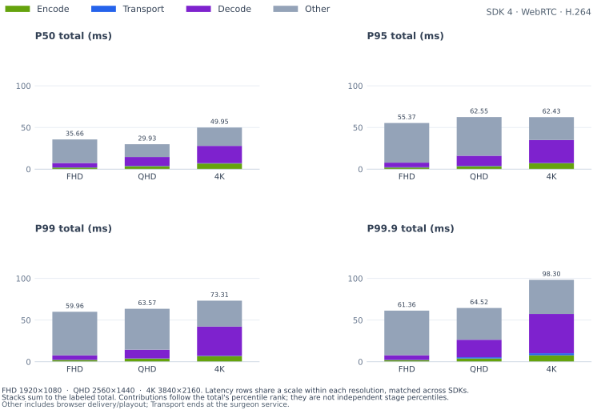

<details>
<summary>

#### P50

</summary>

<table>
    <thead>
        <tr><th align="left">RES</th><th align="left">CC</th><th align="right">FPS</th><th align="right">FS</th><th align="right">Encode (ms)</th><th align="right">Transport (ms)</th><th align="right">Decode (ms)</th><th align="right">Total (ms)</th></tr>
    </thead>
    <tbody>
        <tr><td>FHD</td><td><strong>H.264</strong></td><td align="right"><strong>24.47</strong></td><td align="right"><strong>67.5 KiB</strong></td><td align="right"><strong>2.00</strong></td><td align="right"><strong>0.33</strong></td><td align="right"><strong>5.40</strong></td><td align="right"><strong>35.66</strong></td></tr>
        <tr><td>QHD</td><td><strong>H.264</strong></td><td align="right"><strong>25.99</strong></td><td align="right"><strong>135.3 KiB</strong></td><td align="right"><strong>3.55</strong></td><td align="right"><strong>0.44</strong></td><td align="right"><strong>10.50</strong></td><td align="right"><strong>29.93</strong></td></tr>
        <tr><td>4K</td><td><strong>H.264</strong></td><td align="right"><strong>17.08</strong></td><td align="right"><strong>248.6 KiB</strong></td><td align="right"><strong>6.80</strong></td><td align="right"><strong>0.41</strong></td><td align="right"><strong>20.80</strong></td><td align="right"><strong>49.95</strong></td></tr>
    </tbody>
</table>

</details>

<details>
<summary>

#### P95

</summary>

<table>
    <thead>
        <tr><th align="left">RES</th><th align="left">CC</th><th align="right">FPS</th><th align="right">FS</th><th align="right">Encode (ms)</th><th align="right">Transport (ms)</th><th align="right">Decode (ms)</th><th align="right">Total (ms)</th></tr>
    </thead>
    <tbody>
        <tr><td>FHD</td><td><strong>H.264</strong></td><td align="right"><strong>24.47</strong></td><td align="right"><strong>67.5 KiB</strong></td><td align="right"><strong>2.55</strong></td><td align="right"><strong>0.54</strong></td><td align="right"><strong>5.60</strong></td><td align="right"><strong>55.37</strong></td></tr>
        <tr><td>QHD</td><td><strong>H.264</strong></td><td align="right"><strong>25.99</strong></td><td align="right"><strong>135.3 KiB</strong></td><td align="right"><strong>4.72</strong></td><td align="right"><strong>0.67</strong></td><td align="right"><strong>11.80</strong></td><td align="right"><strong>62.55</strong></td></tr>
        <tr><td>4K</td><td><strong>H.264</strong></td><td align="right"><strong>17.08</strong></td><td align="right"><strong>248.6 KiB</strong></td><td align="right"><strong>8.21</strong></td><td align="right"><strong>0.69</strong></td><td align="right"><strong>22.40</strong></td><td align="right"><strong>62.43</strong></td></tr>
    </tbody>
</table>

</details>

<details open>
<summary>

#### P99

</summary>

<table>
    <thead>
        <tr><th align="left">RES</th><th align="left">CC</th><th align="right">FPS</th><th align="right">FS</th><th align="right">Encode (ms)</th><th align="right">Transport (ms)</th><th align="right">Decode (ms)</th><th align="right">Total (ms)</th></tr>
    </thead>
    <tbody>
        <tr><td>FHD</td><td><strong>H.264</strong></td><td align="right"><strong>24.47</strong></td><td align="right"><strong>67.5 KiB</strong></td><td align="right"><strong>2.80</strong></td><td align="right"><strong>0.72</strong></td><td align="right"><strong>7.10</strong></td><td align="right"><strong>59.96</strong></td></tr>
        <tr><td>QHD</td><td><strong>H.264</strong></td><td align="right"><strong>25.99</strong></td><td align="right"><strong>135.3 KiB</strong></td><td align="right"><strong>5.06</strong></td><td align="right"><strong>0.83</strong></td><td align="right"><strong>16.79</strong></td><td align="right"><strong>63.57</strong></td></tr>
        <tr><td>4K</td><td><strong>H.264</strong></td><td align="right"><strong>17.08</strong></td><td align="right"><strong>248.6 KiB</strong></td><td align="right"><strong>9.04</strong></td><td align="right"><strong>0.86</strong></td><td align="right"><strong>34.07</strong></td><td align="right"><strong>73.31</strong></td></tr>
    </tbody>
</table>

</details>

<details open>
<summary>

#### P99.9

</summary>

<table>
    <thead>
        <tr><th align="left">RES</th><th align="left">CC</th><th align="right">FPS</th><th align="right">FS</th><th align="right">Encode (ms)</th><th align="right">Transport (ms)</th><th align="right">Decode (ms)</th><th align="right">Total (ms)</th></tr>
    </thead>
    <tbody>
        <tr><td>FHD</td><td><strong>H.264</strong></td><td align="right"><strong>24.47</strong></td><td align="right"><strong>67.5 KiB</strong></td><td align="right"><strong>3.08</strong></td><td align="right"><strong>0.98</strong></td><td align="right"><strong>11.63</strong></td><td align="right"><strong>61.36</strong></td></tr>
        <tr><td>QHD</td><td><strong>H.264</strong></td><td align="right"><strong>25.99</strong></td><td align="right"><strong>135.3 KiB</strong></td><td align="right"><strong>5.95</strong></td><td align="right"><strong>1.90</strong></td><td align="right"><strong>37.01</strong></td><td align="right"><strong>64.52</strong></td></tr>
        <tr><td>4K</td><td><strong>H.264</strong></td><td align="right"><strong>17.08</strong></td><td align="right"><strong>248.6 KiB</strong></td><td align="right"><strong>10.35</strong></td><td align="right"><strong>3.34</strong></td><td align="right"><strong>48.62</strong></td><td align="right"><strong>98.30</strong></td></tr>
    </tbody>
</table>

</details>

</details>

<details open>
<summary>

### Thor (Patient) → x86 (Surgeon): IMX274 Camera

</summary>

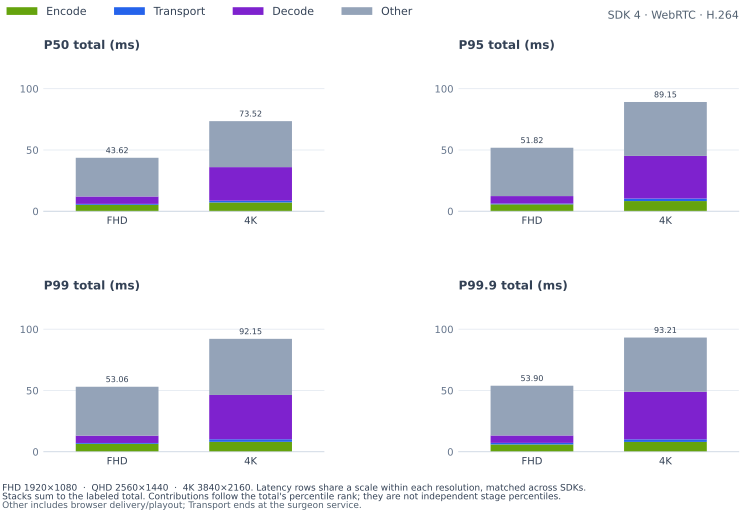

<details>
<summary>

#### P50

</summary>

<table>
    <thead>
        <tr><th align="left">RES</th><th align="left">CC</th><th align="right">FPS</th><th align="right">FS</th><th align="right">Encode (ms)</th><th align="right">Transport (ms)</th><th align="right">Decode (ms)</th><th align="right">Total (ms)</th></tr>
    </thead>
    <tbody>
        <tr><td>FHD</td><td><strong>H.264</strong></td><td align="right"><strong>60.00</strong></td><td align="right"><strong>69.7 KiB</strong></td><td align="right"><strong>6.25</strong></td><td align="right"><strong>0.71</strong></td><td align="right"><strong>6.00</strong></td><td align="right"><strong>43.62</strong></td></tr>
        <tr><td>4K</td><td><strong>H.264</strong></td><td align="right"><strong>29.77</strong></td><td align="right"><strong>393.8 KiB</strong></td><td align="right"><strong>7.68</strong></td><td align="right"><strong>1.73</strong></td><td align="right"><strong>27.80</strong></td><td align="right"><strong>73.52</strong></td></tr>
    </tbody>
</table>

</details>

<details>
<summary>

#### P95

</summary>

<table>
    <thead>
        <tr><th align="left">RES</th><th align="left">CC</th><th align="right">FPS</th><th align="right">FS</th><th align="right">Encode (ms)</th><th align="right">Transport (ms)</th><th align="right">Decode (ms)</th><th align="right">Total (ms)</th></tr>
    </thead>
    <tbody>
        <tr><td>FHD</td><td><strong>H.264</strong></td><td align="right"><strong>60.00</strong></td><td align="right"><strong>69.7 KiB</strong></td><td align="right"><strong>7.85</strong></td><td align="right"><strong>1.01</strong></td><td align="right"><strong>6.20</strong></td><td align="right"><strong>51.82</strong></td></tr>
        <tr><td>4K</td><td><strong>H.264</strong></td><td align="right"><strong>29.77</strong></td><td align="right"><strong>393.8 KiB</strong></td><td align="right"><strong>8.39</strong></td><td align="right"><strong>2.19</strong></td><td align="right"><strong>35.60</strong></td><td align="right"><strong>89.15</strong></td></tr>
    </tbody>
</table>

</details>

<details open>
<summary>

#### P99

</summary>

<table>
    <thead>
        <tr><th align="left">RES</th><th align="left">CC</th><th align="right">FPS</th><th align="right">FS</th><th align="right">Encode (ms)</th><th align="right">Transport (ms)</th><th align="right">Decode (ms)</th><th align="right">Total (ms)</th></tr>
    </thead>
    <tbody>
        <tr><td>FHD</td><td><strong>H.264</strong></td><td align="right"><strong>60.00</strong></td><td align="right"><strong>69.7 KiB</strong></td><td align="right"><strong>8.66</strong></td><td align="right"><strong>1.28</strong></td><td align="right"><strong>6.90</strong></td><td align="right"><strong>53.06</strong></td></tr>
        <tr><td>4K</td><td><strong>H.264</strong></td><td align="right"><strong>29.77</strong></td><td align="right"><strong>393.8 KiB</strong></td><td align="right"><strong>8.65</strong></td><td align="right"><strong>2.35</strong></td><td align="right"><strong>39.12</strong></td><td align="right"><strong>92.15</strong></td></tr>
    </tbody>
</table>

</details>

<details open>
<summary>

#### P99.9

</summary>

<table>
    <thead>
        <tr><th align="left">RES</th><th align="left">CC</th><th align="right">FPS</th><th align="right">FS</th><th align="right">Encode (ms)</th><th align="right">Transport (ms)</th><th align="right">Decode (ms)</th><th align="right">Total (ms)</th></tr>
    </thead>
    <tbody>
        <tr><td>FHD</td><td><strong>H.264</strong></td><td align="right"><strong>60.00</strong></td><td align="right"><strong>69.7 KiB</strong></td><td align="right"><strong>9.22</strong></td><td align="right"><strong>1.38</strong></td><td align="right"><strong>7.90</strong></td><td align="right"><strong>53.90</strong></td></tr>
        <tr><td>4K</td><td><strong>H.264</strong></td><td align="right"><strong>29.77</strong></td><td align="right"><strong>393.8 KiB</strong></td><td align="right"><strong>9.03</strong></td><td align="right"><strong>2.60</strong></td><td align="right"><strong>43.22</strong></td><td align="right"><strong>93.21</strong></td></tr>
    </tbody>
</table>

</details>

</details>

<details>
<summary>

### DGX Spark (Patient) → x86 (Surgeon): MIRA Procedure Camera

</summary>

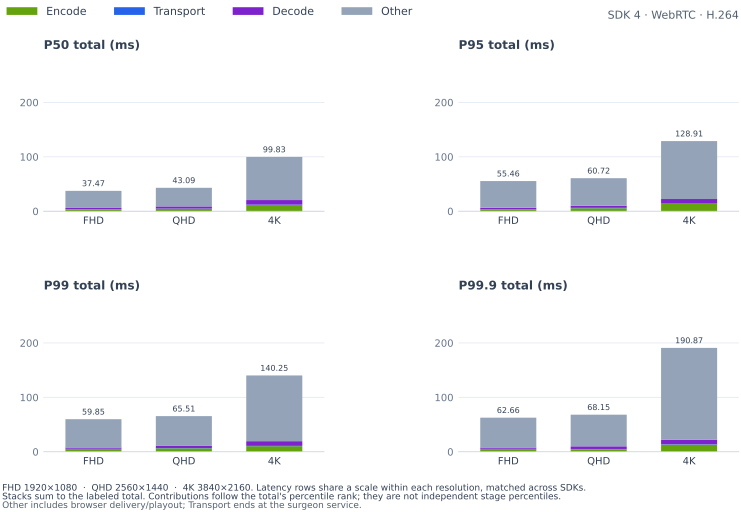

<details>
<summary>

#### P50

</summary>

<table>
    <thead>
        <tr><th align="left">RES</th><th align="left">CC</th><th align="right">FPS</th><th align="right">FS</th><th align="right">Encode (ms)</th><th align="right">Transport (ms)</th><th align="right">Decode (ms)</th><th align="right">Total (ms)</th></tr>
    </thead>
    <tbody>
        <tr><td>FHD</td><td><strong>H.264</strong></td><td align="right"><strong>15.56</strong></td><td align="right"><strong>10.1 KiB</strong></td><td align="right"><strong>2.91</strong></td><td align="right"><strong>0.58</strong></td><td align="right"><strong>2.30</strong></td><td align="right"><strong>37.47</strong></td></tr>
        <tr><td>QHD</td><td><strong>H.264</strong></td><td align="right"><strong>13.43</strong></td><td align="right"><strong>14.0 KiB</strong></td><td align="right"><strong>4.39</strong></td><td align="right"><strong>0.56</strong></td><td align="right"><strong>3.90</strong></td><td align="right"><strong>43.09</strong></td></tr>
        <tr><td>4K</td><td><strong>H.264</strong></td><td align="right"><strong>8.16</strong></td><td align="right"><strong>23.3 KiB</strong></td><td align="right"><strong>8.30</strong></td><td align="right"><strong>0.77</strong></td><td align="right"><strong>8.40</strong></td><td align="right"><strong>99.83</strong></td></tr>
    </tbody>
</table>

</details>

<details>
<summary>

#### P95

</summary>

<table>
    <thead>
        <tr><th align="left">RES</th><th align="left">CC</th><th align="right">FPS</th><th align="right">FS</th><th align="right">Encode (ms)</th><th align="right">Transport (ms)</th><th align="right">Decode (ms)</th><th align="right">Total (ms)</th></tr>
    </thead>
    <tbody>
        <tr><td>FHD</td><td><strong>H.264</strong></td><td align="right"><strong>15.56</strong></td><td align="right"><strong>10.1 KiB</strong></td><td align="right"><strong>5.73</strong></td><td align="right"><strong>1.06</strong></td><td align="right"><strong>2.40</strong></td><td align="right"><strong>55.46</strong></td></tr>
        <tr><td>QHD</td><td><strong>H.264</strong></td><td align="right"><strong>13.43</strong></td><td align="right"><strong>14.0 KiB</strong></td><td align="right"><strong>6.20</strong></td><td align="right"><strong>0.92</strong></td><td align="right"><strong>4.10</strong></td><td align="right"><strong>60.72</strong></td></tr>
        <tr><td>4K</td><td><strong>H.264</strong></td><td align="right"><strong>8.16</strong></td><td align="right"><strong>23.3 KiB</strong></td><td align="right"><strong>16.15</strong></td><td align="right"><strong>1.40</strong></td><td align="right"><strong>8.70</strong></td><td align="right"><strong>128.91</strong></td></tr>
    </tbody>
</table>

</details>

<details open>
<summary>

#### P99

</summary>

<table>
    <thead>
        <tr><th align="left">RES</th><th align="left">CC</th><th align="right">FPS</th><th align="right">FS</th><th align="right">Encode (ms)</th><th align="right">Transport (ms)</th><th align="right">Decode (ms)</th><th align="right">Total (ms)</th></tr>
    </thead>
    <tbody>
        <tr><td>FHD</td><td><strong>H.264</strong></td><td align="right"><strong>15.56</strong></td><td align="right"><strong>10.1 KiB</strong></td><td align="right"><strong>6.26</strong></td><td align="right"><strong>1.27</strong></td><td align="right"><strong>3.00</strong></td><td align="right"><strong>59.85</strong></td></tr>
        <tr><td>QHD</td><td><strong>H.264</strong></td><td align="right"><strong>13.43</strong></td><td align="right"><strong>14.0 KiB</strong></td><td align="right"><strong>7.90</strong></td><td align="right"><strong>1.13</strong></td><td align="right"><strong>5.20</strong></td><td align="right"><strong>65.51</strong></td></tr>
        <tr><td>4K</td><td><strong>H.264</strong></td><td align="right"><strong>8.16</strong></td><td align="right"><strong>23.3 KiB</strong></td><td align="right"><strong>18.21</strong></td><td align="right"><strong>1.70</strong></td><td align="right"><strong>9.20</strong></td><td align="right"><strong>140.25</strong></td></tr>
    </tbody>
</table>

</details>

<details open>
<summary>

#### P99.9

</summary>

<table>
    <thead>
        <tr><th align="left">RES</th><th align="left">CC</th><th align="right">FPS</th><th align="right">FS</th><th align="right">Encode (ms)</th><th align="right">Transport (ms)</th><th align="right">Decode (ms)</th><th align="right">Total (ms)</th></tr>
    </thead>
    <tbody>
        <tr><td>FHD</td><td><strong>H.264</strong></td><td align="right"><strong>15.56</strong></td><td align="right"><strong>10.1 KiB</strong></td><td align="right"><strong>6.95</strong></td><td align="right"><strong>1.49</strong></td><td align="right"><strong>3.14</strong></td><td align="right"><strong>62.66</strong></td></tr>
        <tr><td>QHD</td><td><strong>H.264</strong></td><td align="right"><strong>13.43</strong></td><td align="right"><strong>14.0 KiB</strong></td><td align="right"><strong>8.59</strong></td><td align="right"><strong>1.24</strong></td><td align="right"><strong>5.30</strong></td><td align="right"><strong>68.15</strong></td></tr>
        <tr><td>4K</td><td><strong>H.264</strong></td><td align="right"><strong>8.16</strong></td><td align="right"><strong>23.3 KiB</strong></td><td align="right"><strong>19.04</strong></td><td align="right"><strong>1.85</strong></td><td align="right"><strong>10.74</strong></td><td align="right"><strong>190.87</strong></td></tr>
    </tbody>
</table>

</details>

</details>

<details>
<summary>

### DGX Spark (Patient) → x86 (Surgeon): MIRA Room Camera

</summary>

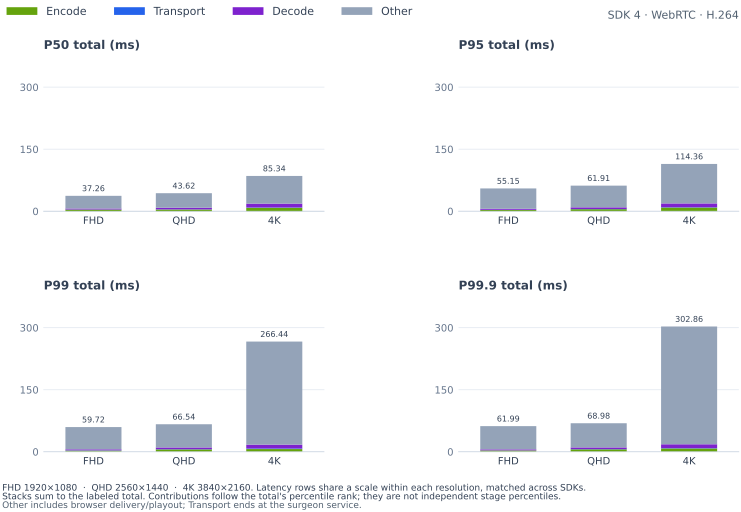

<details>
<summary>

#### P50

</summary>

<table>
    <thead>
        <tr><th align="left">RES</th><th align="left">CC</th><th align="right">FPS</th><th align="right">FS</th><th align="right">Encode (ms)</th><th align="right">Transport (ms)</th><th align="right">Decode (ms)</th><th align="right">Total (ms)</th></tr>
    </thead>
    <tbody>
        <tr><td>FHD</td><td><strong>H.264</strong></td><td align="right"><strong>15.56</strong></td><td align="right"><strong>13.6 KiB</strong></td><td align="right"><strong>2.86</strong></td><td align="right"><strong>0.45</strong></td><td align="right"><strong>2.50</strong></td><td align="right"><strong>37.26</strong></td></tr>
        <tr><td>QHD</td><td><strong>H.264</strong></td><td align="right"><strong>13.43</strong></td><td align="right"><strong>19.1 KiB</strong></td><td align="right"><strong>4.32</strong></td><td align="right"><strong>0.47</strong></td><td align="right"><strong>4.30</strong></td><td align="right"><strong>43.62</strong></td></tr>
        <tr><td>4K</td><td><strong>H.264</strong></td><td align="right"><strong>8.16</strong></td><td align="right"><strong>31.7 KiB</strong></td><td align="right"><strong>8.23</strong></td><td align="right"><strong>0.65</strong></td><td align="right"><strong>9.30</strong></td><td align="right"><strong>85.34</strong></td></tr>
    </tbody>
</table>

</details>

<details>
<summary>

#### P95

</summary>

<table>
    <thead>
        <tr><th align="left">RES</th><th align="left">CC</th><th align="right">FPS</th><th align="right">FS</th><th align="right">Encode (ms)</th><th align="right">Transport (ms)</th><th align="right">Decode (ms)</th><th align="right">Total (ms)</th></tr>
    </thead>
    <tbody>
        <tr><td>FHD</td><td><strong>H.264</strong></td><td align="right"><strong>15.56</strong></td><td align="right"><strong>13.6 KiB</strong></td><td align="right"><strong>4.38</strong></td><td align="right"><strong>1.07</strong></td><td align="right"><strong>2.60</strong></td><td align="right"><strong>55.15</strong></td></tr>
        <tr><td>QHD</td><td><strong>H.264</strong></td><td align="right"><strong>13.43</strong></td><td align="right"><strong>19.1 KiB</strong></td><td align="right"><strong>5.40</strong></td><td align="right"><strong>0.81</strong></td><td align="right"><strong>4.50</strong></td><td align="right"><strong>61.91</strong></td></tr>
        <tr><td>4K</td><td><strong>H.264</strong></td><td align="right"><strong>8.16</strong></td><td align="right"><strong>31.7 KiB</strong></td><td align="right"><strong>11.56</strong></td><td align="right"><strong>1.24</strong></td><td align="right"><strong>9.60</strong></td><td align="right"><strong>114.36</strong></td></tr>
    </tbody>
</table>

</details>

<details open>
<summary>

#### P99

</summary>

<table>
    <thead>
        <tr><th align="left">RES</th><th align="left">CC</th><th align="right">FPS</th><th align="right">FS</th><th align="right">Encode (ms)</th><th align="right">Transport (ms)</th><th align="right">Decode (ms)</th><th align="right">Total (ms)</th></tr>
    </thead>
    <tbody>
        <tr><td>FHD</td><td><strong>H.264</strong></td><td align="right"><strong>15.56</strong></td><td align="right"><strong>13.6 KiB</strong></td><td align="right"><strong>5.12</strong></td><td align="right"><strong>1.39</strong></td><td align="right"><strong>3.30</strong></td><td align="right"><strong>59.72</strong></td></tr>
        <tr><td>QHD</td><td><strong>H.264</strong></td><td align="right"><strong>13.43</strong></td><td align="right"><strong>19.1 KiB</strong></td><td align="right"><strong>6.17</strong></td><td align="right"><strong>1.00</strong></td><td align="right"><strong>5.44</strong></td><td align="right"><strong>66.54</strong></td></tr>
        <tr><td>4K</td><td><strong>H.264</strong></td><td align="right"><strong>8.16</strong></td><td align="right"><strong>31.7 KiB</strong></td><td align="right"><strong>12.35</strong></td><td align="right"><strong>1.65</strong></td><td align="right"><strong>9.90</strong></td><td align="right"><strong>266.44</strong></td></tr>
    </tbody>
</table>

</details>

<details open>
<summary>

#### P99.9

</summary>

<table>
    <thead>
        <tr><th align="left">RES</th><th align="left">CC</th><th align="right">FPS</th><th align="right">FS</th><th align="right">Encode (ms)</th><th align="right">Transport (ms)</th><th align="right">Decode (ms)</th><th align="right">Total (ms)</th></tr>
    </thead>
    <tbody>
        <tr><td>FHD</td><td><strong>H.264</strong></td><td align="right"><strong>15.56</strong></td><td align="right"><strong>13.6 KiB</strong></td><td align="right"><strong>5.87</strong></td><td align="right"><strong>1.68</strong></td><td align="right"><strong>3.42</strong></td><td align="right"><strong>61.99</strong></td></tr>
        <tr><td>QHD</td><td><strong>H.264</strong></td><td align="right"><strong>13.43</strong></td><td align="right"><strong>19.1 KiB</strong></td><td align="right"><strong>6.86</strong></td><td align="right"><strong>1.42</strong></td><td align="right"><strong>5.77</strong></td><td align="right"><strong>68.98</strong></td></tr>
        <tr><td>4K</td><td><strong>H.264</strong></td><td align="right"><strong>8.16</strong></td><td align="right"><strong>31.7 KiB</strong></td><td align="right"><strong>12.73</strong></td><td align="right"><strong>1.91</strong></td><td align="right"><strong>11.09</strong></td><td align="right"><strong>302.86</strong></td></tr>
    </tbody>
</table>

</details>

</details>

</details>
