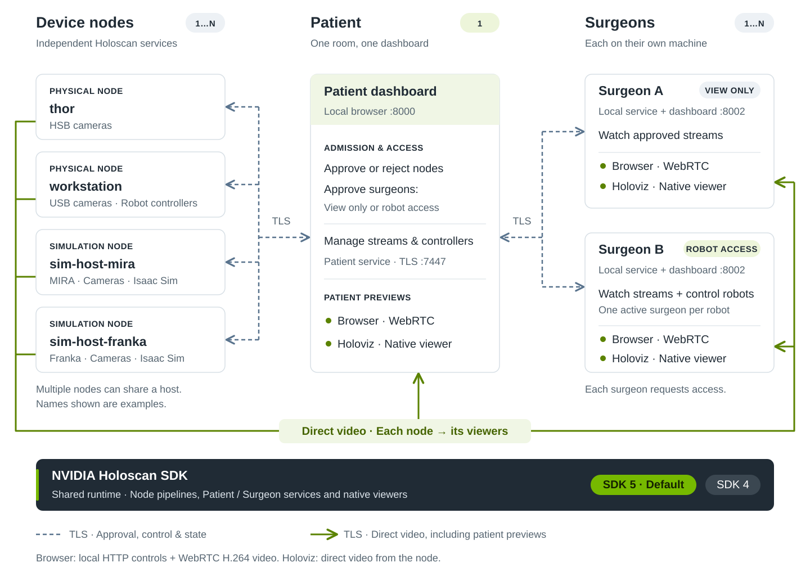
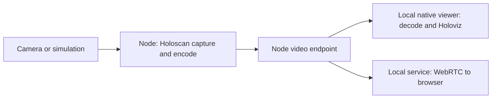

# Architecture

## System overview

Patient coordinates one room; independent nodes own devices and simulations. Each surgeon has a local dashboard with patient-approved view-only or robot access. Only one surgeon controls a given robot at a time.



Patient has **Overview**, **Nodes** and **Surgeons** pages. Each node's equipment table groups cameras, robots, settings, logs and metrics. The header can stop all streams or disconnect all robots. Surgeon keeps live views and robot controls together; changing a view does not stop its source stream.

## Project structure

| uv package            | Namespaces / responsibility                                       |
| --------------------- | ----------------------------------------------------------------- |
| `telesurgery-core`    | `adapters`, `control`, `transport`, `video`, `diagnostics`        |
| `telesurgery-robots`  | Shared `adapters`, vendor `franka` and `mira`, `simulation` state |
| `telesurgery-runtime` | Shared `application` graphs; `backends/sdk4` and `backends/sdk5`  |
| `telesurgery-app`     | CLI, `nodes` management, local `server` and browser UI            |
| `telesurgery-sim`     | Room `environments` and Isaac Sim `runtime`                       |

SDK-specific imports stay in the runtime backends. HSB capture uses the public sensor-bridge library through the SDK 4 backend; Franka's local servo controller lives in `packages/robots/native/`. Build helpers are grouped in `scripts/builders/`, and tests by subsystem under `tests/`.

## Nodes and environments

`patient` starts an empty room. Each independently started `node --patient HOST` requests approval before exposing its devices. Saved approvals permit reconnection; offline nodes remain listed. Removing a node revokes its approval and disconnects its streams and controllers.

Names default to the hostname, with `-mira` or `-franka` for simulation. Use `--name` for additional instances on the same host. Each node has its own credential, state directory and automatically allocated video port.

### Simulation environments

Restart a node with `--sim mira`, `--sim franka` or neither to choose its environment. Patient manages admission and equipment; the node owns its environment.

Each simulation node owns its robot and all its cameras. Startup progress and logs remain visible while Isaac Sim loads; `--sim-gui` also opens its native window. Robot feedback comes from simulated physics, separately from commanded targets.

| Environment | Robot and scene                               | Cameras            |
| ----------- | --------------------------------------------- | ------------------ |
| MIRA        | Two arms, suture pad and needle               | Procedure and room |
| Franka      | Panda, ultrasound probe and abdominal phantom | Wrist and room     |

## Video pipeline



Patient previews and Surgeon views use the same delivery paths. Each camera has a supervised process with a Holoscan graph and bounded local IPC. Remote video travels directly from its node to the surgeon. The patient coordinator receives frames only for its own previews. Old video frames are discarded; control messages have separate bounded queues.

H.264 browser viewing forwards encoded packets into WebRTC without re-encoding. Surgical Neural Tokenizer streams carry packed tokens to the viewing machine, where one GPU worker per camera decodes and converts them to H.264 for browser preview. A native viewer is a separate Holoscan process: NVDEC, nvJPEG or TensorRT decodes to GPU pixels, then Holoviz renders them directly. Its video path bypasses HTTP and WebRTC. Camera-scoped, single-use tickets authorize connections to node video endpoints; hiding the feed, disconnecting or revoking access closes them.

| Source / format | Processing |
| --- | --- |
| HSB IMX274 | GPU acquisition, optical-black correction, white balance, demosaic and sRGB transfer |
| USB | V4L2 capture; CPU pixels uploaded for GPU encoding. MJPEG capture also requires decoding |
| Isaac Sim | GPU rendering, then CPU RGB readback and local IPC before GPU encoding |
| H.264 / H.265 | NVENC encoding; NVDEC in the native viewer |
| nvJPEG | GPU JPEG encoding and decoding |
| BGR8 | No codec. Packing may download GPU pixels; the native viewer uploads and converts BGR to RGB |
| Surgical Neural Tokenizer (trial) | Public Cosmos-Tokenizer-Surg model, TensorRT encoding/decoding, packed uint16 tokens at 720p or 1080p |

Same-host video still uses IPC/TLS, not shared memory. Frame ownership is preserved until CUDA work completes. SDK 4 uses an EventBasedScheduler; SDK 5 uses graph partitions and latest-message queues.

Depth is optional for RealSense and simulation. Aligned float32 distances in metres travel with the color frame, compressed losslessly. Views offer depth, overlay and side-by-side modes with point readings in millimetres. Browser depth views present color and depth with matching RTP timestamps together, retaining the last pair briefly while the next depth frame arrives. Pending frames are bounded; pairs older than 500 ms expire instead of providing stale readings. Color-only viewing remains live. These readings measure distance along the camera axis, not tool clearance.

### Camera configuration

The patient selects capture format, resolution, FPS and codec; surgeon viewers follow those settings. Encoding can change through Stream settings while capture continues; a replacement encoder prepares in the background before taking over. Capture format, resolution and FPS changes require stopping the stream. Available modes come from the device. Simulation offers 640×480, 1280×720, 1920×1080, 2560×1440 and 3840×2160 with native render products. H.264 is the stream default. Surgical Neural Tokenizer also supports browser viewing; H.265, nvJPEG and raw BGR8 use Holoviz.

Each view has independent **− / zoom level / +** controls. Open the zoom level for a 1–4× slider, Reset and **Select area**. Draw an area in the browser to zoom with preserved proportions; drag the enlarged image to pan. Opening Holoviz closes the browser video path and carries over the same zoom and crop. Its dashboard card adjusts zoom and pan using metadata only; switch back to the browser to draw another area. Settings survive viewer switches and page refreshes for the life of the local service. Streams that require Holoviz have slider/pan controls but no browser area selection.

Browser zoom transforms the existing video layer without application frame readback or re-encoding; hardware acceleration depends on the browser. Native zoom slices a GPU tensor without allocating a crop image. SDK 4 passes its row stride to Holoviz; SDK 5 copies the selected rows in the existing provider-owned display handoff, without adding another GPU copy. Holoviz scales during rendering. Optional depth visualization retains its existing processing costs.

On the patient dashboard, camera details show **Camera zoom** only for writable V4L2 absolute-zoom controls. Changes use the device's reported bounds and steps, are read back, and apply without restarting capture. They affect the outgoing image for all viewers. Values are device units, not a claim of optical zoom or focal length; support depends on the camera and its driver. Intel RealSense D405/D455 do not expose this control. The audited BRIO and Spark USB camera do.

HSB discovery finds boards, not sensor models. It defaults to IMX274 sensor 0 and offers 1080p60 and 4K60. Configure another sensor in the node's `workspace/nodes/NAME/devices.yaml`:

```yaml
cameras:
  - id: hsb-192.168.0.2-0
    name: Endoscope
    kind: HSB
    source: imx274
    hololink: 192.168.0.2
    expander: 0
    width: 3840
    height: 2160
    fps: 60
```

Use a distinct ID and `expander: 1` for a second sensor. The board network must already be configured. HSB nodes automatically use an isolated SDK 4 runtime with LinuxReceiver (UDP). Other nodes, simulations and dashboards default to SDK 5. The launcher checks saved camera settings and listens for valid board announcements before loading a runtime. Connect the board before starting the node; if a board is attached later, restart the node to select its camera support. Saved FuSa selections fall back to LinuxReceiver while preserving the remaining stream settings.

## Robot control

Commands and feedback pass through surgeon, patient and device-node Holoscan graphs. Only the node contacts its robot controller. Each robot has an independent adapter and graph; physical servo loops remain local.

The patient approves robot access and manages controller connections. Input automatically takes an exclusive, renewable two-second lease. Tokens, increasing sequences and a 300 ms command-age limit reject stale input. Release, disconnect, revocation or expiry requests a hold before handover. Failed holds block further control until a successful retry.

Franka uses a native 1 kHz trajectory loop; simulation uses the same trajectory limits with measured physics feedback. Simulation acknowledges accepted targets without waiting for rendering or motion completion. Physical MIRA uses the supplied vendor API, with unverified stop/timestamp semantics documented in [robot controls](robot-controls.md).

## Latency metrics

Timing starts when the application receives a frame buffer. Sensor acquisition and simulator rendering before that boundary are excluded. Patient/node metrics end at transport handoff. Surgeon metrics end at estimated browser display or native Holoviz handoff; native rendering and physical scanout are not measured.

| Stage                     | Boundary                                                                     |
| ------------------------- | ---------------------------------------------------------------------------- |
| Frame preparation         | Buffer receipt through application copies, conversion and local handoff      |
| Processing queue / Encode | Codec scheduling, then input conversion and encoding                         |
| Source relay / queues     | Encoded frame through local IPC and node dispatch to transport handoff       |
| Transport                 | Serialization, TLS/network, assembly and receiver dispatch                   |
| Receive / WebRTC queues   | Surgeon dispatch and browser relay scheduling                                |
| Decode                    | GPU or browser decode and output preparation                                 |
| View processing           | Native depth composition and crop metadata selection after decode            |
| Display handoff           | Native Holoviz handoff, or browser delivery and estimated display scheduling |
| Pack / Upload             | Replaces Encode / Decode for uncompressed BGR8                               |

P50/P95/P99/P99.9 bars use matched frames ranked by total latency, so their stage contributions add to that total. Independent stage percentiles need not add up. Top cards show P99; frame spacing describes cadence. Payload size includes the application transport frame, not Ethernet/TCP/TLS overhead.

View processing excludes the renderer's zoom sampling. Browser compositor work is included in estimated WebRTC + display timing and cannot be isolated as GPU zoom time through the current browser APIs. Native render/scanout and camera-firmware zoom before buffer delivery remain outside the measured boundary. A near-zero crop-metadata time is not a claim of zero added display latency.

Metrics retain 10,000 recent samples after warmup and up to one hour of 5-second history buckets. Browser timing records while its metrics panel is open; server/native timing records while frames flow. Reset clears the selected device. Collection is bounded and percentile aggregation runs outside frame callbacks.

### Clock synchronization

`setup.sh` installs/enables chrony when needed; it persists across reboots and preserves an existing chrony/PTP service. No dashboard action changes the system clock. Same-host services compare monotonic clocks directly. Across hosts, fresh UTC reports are used when combined uncertainty is at most 1 ms; otherwise four-timestamp probes estimate relative clock offset with an RTT/asymmetry bound. Expired or invalid timing stays unavailable.

Browser display timing matches frames by RTP timestamp and uses a separate relative clock estimate between the browser and surgeon service. Its uncertainty is included in the displayed total. A browser clock bound above 1 ms is still usable when the remaining WebRTC/display delay exceeds that bound; missing timestamps or an unresolved delay leave the total unavailable with an explanation.

A shared LAN time server can improve accuracy. Across the internet, use trusted UTC sources at each site; hardware PTP is optional and requires compatible infrastructure. [Chrony error bounds](https://chrony-project.org/doc/latest/chronyc.html) · [Browser display timestamps](https://wicg.github.io/video-rvfc/)

## Connections and saved state

Dashboards bind to `127.0.0.1` by default; `--host` changes the bind address. `--ssl` enables HTTPS with a persistent self-signed certificate in the dashboard's state directory. Browsers require trusting it; use `--ssl-cert` and `--ssl-key` for a trusted certificate. Cross-origin requests and framing are blocked. Dashboards have no login: remote access belongs on a trusted network/VPN or behind an authenticated HTTPS proxy.

Service connections use TLS 1.3 with certificate pinning. The first patient connection trusts the presented certificate; later connections reject identity changes. Surgeon approvals identify the service credential, not the display name. Pending surgeons receive no devices or video.

Nodes start discovered camera streams once they are admitted and, for simulation, the scene is ready. Saved capture/encoding settings take precedence over device defaults. A failed automatic start is shown in the inventory and requires an explicit retry. Stop prevents automatic restart for the rest of that node session. Set `auto_start: false` on a manually configured camera to opt out. Robot connection attempts and configured vendor controllers start by default, with `auto_connect: false` as the corresponding robot option. Vendor startup can enable motor power on physical MIRA; acquisition and motion commands remain explicit. Controller startup failures require a manual retry, and already running controllers are reused.

| Port        | Purpose                                               |
| ----------- | ----------------------------------------------------- |
| 8000 / 8002 | Patient / surgeon dashboards                          |
| 7447        | Patient application endpoint                          |
| Automatic   | Direct node video; use node `--port` for a fixed port |

`./workspace` holds saved state, simulation dependencies, assets, caches and logs. Use `--workspace PATH` with setup and run commands to choose another directory. Dashboards use `ROLE-PORT` and nodes use `nodes/NAME` within it. Private YAML files store credentials, nodes, settings, certificate pins and approvals using atomic writes. Connections and robot locks are temporary. Coordinator loss stops streams and requests controller hold; after re-admission, streams interrupted by the link loss restart with their saved settings, while streams explicitly stopped by the operator remain stopped. Shutdown closes connections and joins the Holoscan graphs.

`run.sh status` and `run.sh stop` manage services within a workspace across native execution and Docker. Native services hold `service.lock` and publish a private, atomic `service.json` containing their PID, process start time, host, boot, and PID namespace. Shutdown verifies process identity and signals through a Linux PID descriptor to avoid PID reuse races. Older native services are discovered from the kernel's owners of the existing service locks and their application command lines. Docker services have workspace, user, role, instance, and log labels and stable names; management uses the verified container ID. Older launcher containers are identified by their entrypoint, user, and workspace mount. Stopping a node also stops its managed MIRA controller after closing device connections; a temporary patient disconnection leaves that controller running.

[Adding a robot](robot-controls.md#adding-a-robot) · [Dependency providers](../CONTRIBUTING.md#dependencies) · [TODO](TODO.md)
