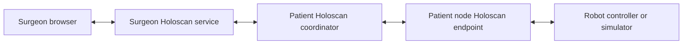

# Holoscan Telesurgery

One patient session can share cameras and robot controls with several surgeons. Its devices may be distributed across Thor, Spark and x86 nodes. The application demonstrates Holoscan and HSB acquisition through a browser interface, with the same workflow for physical cameras and simulation.

## Local dashboards, connected services

`run.sh patient` or `run.sh surgeon` chooses the role. Each user opens their own service at `http://localhost:PORT/`; surgeons never open the patient's HTTP server. A separate encrypted application endpoint connects the services. Browser ports and the patient endpoint port are configurable for testing on one machine.

There are no accounts or login screens. A surgeon requests access with a name and either video-only or video-and-robot permissions. Until the patient approves, the surgeon receives no inventory, video or robot state. Approvals are remembered against the surgeon service's private credential, never its display name. The patient can reject requests or revoke active and offline approvals. Robot locks are released on disconnect and never restored from disk.

## Workspaces

The patient operator has three navigation entries: **Overview**, **Nodes**, and **Surgeons**. Overview highlights requests and device issues. Each node opens one page with independent camera and robot columns. Previews expand beneath the cameras without moving the robot column; on narrow screens, robots appear before previews. Streaming actions are scoped to that node; previews open only when requested.

The surgeon works on one **Live views** page. **Add feeds** selects cameras, and layouts can be reordered without reconnecting video. The layout is saved locally. Authorized robot controls remain beside the feeds; view-only surgeons get the full viewing area. Each camera and robot has a **Metrics** link on both dashboards. It opens a panel for that device in the same page, with an optional pop out.

## Patient nodes and cameras

The host is the initial node. In physical mode, **Add node** accepts an existing SSH target. The application installs its workspace and selected runtime, starts a node service, and discovers cameras. Nodes send inventory over their management connections and serve video directly to approved viewers. SSH is used for deployment.

Alternatively, connect a manually started node using its address and pairing code. SSH deployments offer Physical/MIRA/Franka selection and subsequent environment changes in the dashboard. Manually started nodes follow their startup arguments; changing those arguments and restarting refreshes the patient inventory automatically. Configuration and approvals are saved in private YAML files.

USB/V4L2 cameras and HSB boards are discovered locally. HSB boards are offered as IMX274 sensor 0; discovery does not identify the attached sensor model. Additional camera settings can be configured on the node. Each camera can be named, started or stopped independently. Failures and unavailable nodes are visible in the patient dashboard.

Surgeons select, tile, hide and enlarge live feeds independently. Hiding a feed does not stop its patient stream. Holoscan runs the camera and video graphs; H.264 browser viewing forwards NVENC packets into WebRTC. **Open in Holoviz** launches a separate native Holoscan application that receives directly from the camera node endpoint and displays GPU frames without a WebRTC or HTTP video path. It supports H.264/H.265 with NVDEC, nvJPEG and uncompressed BGR8. Its camera-scoped access ends when the surgeon hides the feed, disconnects or loses patient approval.

## Robot control

Controllers run only on patient nodes. Controller addresses are not exposed to surgeon clients. Commands, acknowledgements and state pass through the surgeon and patient Holoscan graphs, including the graph at the device node.

Several surgeons may have robot permission. The first permitted input automatically acquires the exclusive lock; there is no second patient approval or lock-request button. Another surgeon's input is rejected while the lock is held. Release allows a new owner on their next input.

The patient checks permission, ownership token, sequence and command age before forwarding input. Commands expire rather than waiting for handover. Disconnect, revocation or lease expiry invalidates ownership and requests a controller hold. A failed hold leaves the robot unavailable until a successful retry. The patient can revoke control, and the surgeon can release it.

## Simulation rooms

`patient --sim mira` and `patient --sim franka` each start one Isaac Sim environment. MIRA has an endoscope viewing a suture pad and curved needle; Franka has a wrist-mounted camera and ultrasound probe facing an abdominal phantom on a patient table. Each also has an external room camera. All cameras and the controller belong to that single simulation node; physical node enrollment is disabled in simulation mode. Each preset owns its assets and scene configuration.

MIRA exposes four joint-delta controls per arm; Franka exposes seven arm joints. State reports drive targets, not measured physical motion. These adapters exercise the complete communication and ownership flow. Physical robot adapters require vendor-specific motion, state and stop handling and are not implemented.

## Deployment and verification

The application is a uv workspace with shared core, runtime, dashboard and simulation packages. SDK 5 is the default; SDK 4 is selectable per service or node. Dependency manifests control source or package installation, and setup owns its third-party checkouts. Native and Docker execution share the same application.

Verification covers both SDKs, real HSB and USB cameras, multiple nodes and surgeons, rendered simulator video, exclusive control and handover, revocation, disconnects, and stale input. [BENCHMARK.md](../BENCHMARK.md) records measured behavior and its limits.
